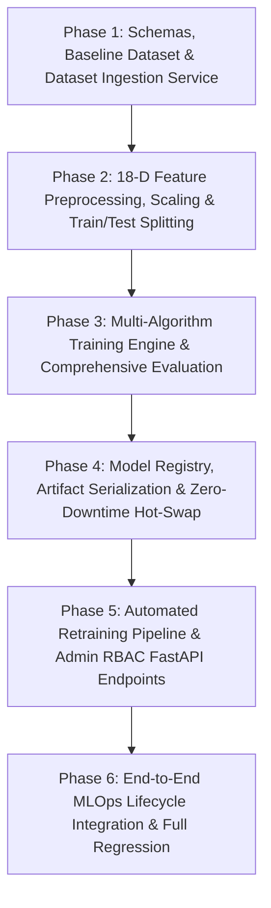

# Implementation Plan: AI Model Management & MLOps Engine (Module 16)

This plan outlines the atomic, step-by-step technical implementation of **Module 16: AI Model Management (`16. AI Model Management`)** for the backend MLOps lifecycle.

The plan strictly organizes work into technical dependencies, where each micro-task is fully testable in isolation and verified against unit/integration test suites before proceeding past explicit checkpoints.

---

## Technical Dependencies & Architecture Flow



---

## Phase 1: Schemas, Baseline Dataset & Ingestion Service

### Task 1.1: Define AI Model Management Pydantic Schemas
- **Target Files:**
  - `backend/app/schemas/ai_model.py`
  - `backend/tests/test_ai_model_schemas.py`
- **Micro-Task Description:**
  - Implement comprehensive Pydantic models for the entire MLOps lifecycle:
    - **Dataset Schemas:** `DatasetUploadRequest`, `DatasetSummaryResponse`, `DatasetColumnProfile`, `DatasetValidationReport`.
    - **Training & Preprocessing Schemas:** `ModelHyperparameters`, `ModelTrainingRequest`, `TrainingJobStatusResponse`.
    - **Evaluation Schemas:** `PerClassMetrics`, `ConfusionMatrixPayload`, `CrossValidationSummary`, `FeatureImportanceItem`, `ModelEvaluationResponse`.
    - **Registry & Deployment Schemas:** `ModelManifestItem`, `ModelRegistryListResponse`, `ModelDeploymentRequest`, `ModelDeploymentResponse`, `RollbackRequest`.
    - **Retraining Schemas:** `RetrainingTriggerRequest`, `RetrainingComparisonResponse`, `PerformanceDelta`.
- **Verification Command:**
  ```powershell
  python -m unittest tests/test_ai_model_schemas.py
  ```
- **Expected Result:** All request/response schemas correctly validate, serialize, deserialize, enforce boundary constraints, and handle optional hyperparameter overrides.

---

### Task 1.2: Generate Baseline Training Dataset (`baseline_archetypes.csv`)
- **Target Files:**
  - `backend/app/ml/datasets/baseline_archetypes.csv`
  - `backend/tests/test_ai_dataset_baseline.py`
- **Micro-Task Description:**
  - Create the curated baseline dataset in `backend/app/ml/datasets/baseline_archetypes.csv` encompassing 60+ diverse food commodity archetypes.
  - Include complete 18-dimensional feature attributes:
    - `moisture_content_pct`, `fat_content_pct`, `ph_level`, `water_activity`, `respiration_rate_5c`, `respiration_rate_20c`, `ethylene_sensitivity`, `chilling_threshold_c`, `storage_temperature_c`, `storage_duration_days`, `batch_weight_g`, `fragility_score`, `eco_priority`, `high_resp_high_temp_flag`, `acidic_high_moisture_flag`, `fat_chilling_sens_flag`, `extreme_shelf_life_flag`, `heavy_fragile_flag`.
    - `target_polymer_class`: Standardized across the 7 polymer classes (`BREATHABLE_BIO_EMAP`, `METALLIZED_BARRIER`, `HIGH_BARRIER_EVOH_VSP`, `CELLULOSE_KRAFT_LINED`, `RECYCLABLE_POLYOLEFIN`, `CRYOGENIC_DEEP_FREEZE`, `RETORT_ACID_BARRIER`).
- **Verification Command:**
  ```powershell
  python -m unittest tests/test_ai_dataset_baseline.py
  ```
- **Expected Result:** Dataset file loads cleanly, verifies no missing cells in baseline, contains all 7 target classes, and satisfies all 18 numerical/categorical bounds.

---

### Task 1.3: Implement Dataset Validation, Profiling & Ingestion Service (`DatasetService`)
- **Target Files:**
  - `backend/app/services/ai_dataset_service.py`
  - `backend/tests/test_ai_dataset_service.py`
- **Micro-Task Description:**
  - Implement `DatasetService` with methods:
    - `save_uploaded_dataset(file_bytes, filename)`: Saves file to `backend/app/ml/datasets/` with sanitize checking.
    - `validate_dataset(filepath)`: Validates required headers, data types, value ranges, and target class taxonomy.
    - `profile_dataset(filepath)`: Generates summary statistics (row count, missing counts, class distribution frequencies, numerical min/max/mean/std).
    - `list_available_datasets()`: Returns metadata on all stored dataset versions.
    - `get_dataset_dataframe(dataset_id)`: Loads and returns clean Pandas DataFrame.
- **Verification Command:**
  ```powershell
  python -m unittest tests/test_ai_dataset_service.py
  ```
- **Expected Result:** Invalid schemas, corrupted rows, and unknown target classes are caught with descriptive error reports; valid datasets produce complete profiling summaries.

---

### Checkpoint 1 (Schemas & Dataset Foundation)
- [ ] Run test suites: `test_ai_model_schemas.py`, `test_ai_dataset_baseline.py`, and `test_ai_dataset_service.py`.
- [ ] Verify 100% test pass rate.
- [ ] User approval to proceed to Phase 2.

---

## Phase 2: 18-D Feature Preprocessing, Scaling & Train/Test Splitting

### Task 2.1: Implement 18-Dimensional Feature Preprocessor & Imputer (`DataPreprocessingService`)
- **Target Files:**
  - `backend/app/services/ai_preprocessing_service.py`
  - `backend/tests/test_ai_preprocessing_service.py`
- **Micro-Task Description:**
  - Build `DataPreprocessingService` for transforming raw dataset rows into feature matrix $X$ and label vector $y$:
    - Impute missing biochemical traits using postharvest domain defaults (e.g. $a_w = 0.95$ for high moisture, respiration defaults by temperature).
    - Compute the 5 derived non-linear interaction features:
      - `high_resp_high_temp_flag = (respiration_rate_20c > 40) and (storage_temperature_c > 15)`
      - `acidic_high_moisture_flag = (ph_level < 4.5) and (moisture_content_pct > 80)`
      - `fat_chilling_sens_flag = (fat_content_pct > 15) and (chilling_threshold_c > 7)`
      - `extreme_shelf_life_flag = (storage_duration_days > 90)`
      - `heavy_fragile_flag = (batch_weight_g > 1000) and (fragility_score > 0.7)`
    - Validate alignment with `FeatureVectorizer` in `backend/app/services/ml_classifier.py`.
- **Verification Command:**
  ```powershell
  python -m unittest tests/test_ai_preprocessing_service.py
  ```
- **Expected Result:** Any raw dictionary or DataFrame is reliably transformed into an $N \times 18$ float NumPy array matching the canonical feature specification.

---

### Task 2.2: Implement Scaling, Label Encoding & Stratified Splitting
- **Target Files:**
  - `backend/app/services/ai_preprocessing_service.py`
  - `backend/tests/test_ai_pipeline_transforms.py`
- **Micro-Task Description:**
  - Extend `DataPreprocessingService` with fit/transform stateful methods:
    - `fit_transform(df, scaler_type="standard", test_size=0.2, random_state=42)`:
      - Encodes target polymer classes into discrete integer labels ($0 \dots 6$).
      - Fits `StandardScaler` or `MinMaxScaler` on training partition only to prevent data leakage.
      - Executes `StratifiedShuffleSplit` (80% train, 20% test) preserving class balance.
      - Returns `(X_train_scaled, X_test_scaled, y_train, y_test, scaler, label_encoder)`.
    - `transform_single(raw_features_dict, scaler)`: Transforms a single runtime inference request.
- **Verification Command:**
  ```powershell
  python -m unittest tests/test_ai_pipeline_transforms.py
  ```
- **Expected Result:** Zero data leakage between train/test partitions; accurate inverse transformation of labels; seamless single-sample scaling.

---

### Checkpoint 2 (Preprocessing & Feature Engineering Layer)
- [ ] Run test suites: `test_ai_preprocessing_service.py` and `test_ai_pipeline_transforms.py`.
- [ ] Verify 100% test pass rate.
- [ ] User approval to proceed to Phase 3.

---

## Phase 3: Multi-Algorithm Training Engine & Comprehensive Evaluation

### Task 3.1: Implement Multi-Algorithm Classifier Training Engine (`ModelTrainingEngine`)
- **Target Files:**
  - `backend/app/services/ai_training_engine.py`
  - `backend/tests/test_ai_training_engine.py`
- **Micro-Task Description:**
  - Implement `ModelTrainingEngine` supporting parameterized estimator initialization and fitting:
    - **Random Forest:** `RandomForestClassifier(n_estimators, max_depth, min_samples_split, class_weight="balanced")`.
    - **Gradient Boosting:** `GradientBoostingClassifier(n_estimators, learning_rate, max_depth, subsample)`.
    - **Multi-Layer Perceptron:** `MLPClassifier(hidden_layer_sizes, activation, max_iter, alpha)`.
    - **Support Vector Machine:** `SVC(C, kernel="rbf", probability=True)`.
    - Asynchronous training coordinator tracking `job_id`, status (`QUEUED`, `TRAINING`, `COMPLETED`, `FAILED`), elapsed training duration, and exception captures.
- **Verification Command:**
  ```powershell
  python -m unittest tests/test_ai_training_engine.py
  ```
- **Expected Result:** All 4 algorithm families train cleanly on the baseline dataset, converge without warnings, and return fitted estimator bundles.

---

### Task 3.2: Implement Comprehensive Model Evaluation & Metrics Intelligence Engine (`ModelEvaluationEngine`)
- **Target Files:**
  - `backend/app/services/ai_evaluation_engine.py`
  - `backend/tests/test_ai_evaluation_engine.py`
- **Micro-Task Description:**
  - Implement `ModelEvaluationEngine` with metrics calculations:
    - **Global Metrics:** Accuracy, Macro Precision, Macro Recall, Macro $F_1$, Weighted $F_1$.
    - **Per-Class Breakdown:** Precision, Recall, $F_1$-score, and support counts for each of the 7 polymer classes.
    - **$7 \times 7$ Confusion Matrix:** Normalized and raw count matrices with class name labels.
    - **5-Fold Stratified Cross-Validation:** Computes mean CV accuracy, standard deviation, and fold-by-fold scores.
    - **Feature Importance Rankings:** Gini importances for Tree models; permutation importances for MLP/SVC.
- **Verification Command:**
  ```powershell
  python -m unittest tests/test_ai_evaluation_engine.py
  ```
- **Expected Result:** Evaluator computes exact mathematical metrics, formats the $7 \times 7$ confusion matrix structure, performs 5-fold CV, and returns descending feature importance weights.

---

### Checkpoint 3 (Training & Evaluation Engines)
- [ ] Run test suites: `test_ai_training_engine.py` and `test_ai_evaluation_engine.py`.
- [ ] Verify 100% test pass rate.
- [ ] User approval to proceed to Phase 4.

---

## Phase 4: Model Registry, Serialization & Zero-Downtime Hot-Swapping

### Task 4.1: Implement Model Registry & Artifact Serialization (`ModelRegistryService`)
- **Target Files:**
  - `backend/app/services/ai_registry_service.py`
  - `backend/app/ml/registry.json`
  - `backend/tests/test_ai_registry_service.py`
- **Micro-Task Description:**
  - Implement `ModelRegistryService`:
    - Persists trained model bundle `.joblib` files to `backend/app/ml/models/{model_id}.joblib` (containing `{model, scaler, label_encoder, feature_names, metadata}`).
    - Maintains the JSON catalogue manifest `backend/app/ml/registry.json` tracking model versions, algorithm types, dataset IDs, hyperparameter snapshots, evaluation metrics, timestamps, and deployment states (`ACTIVE`, `CANDIDATE`, `ARCHIVED`).
    - Provides methods: `register_model(...)`, `get_model_manifest(model_id)`, `list_registered_models()`, `load_model_bundle(model_id)`, `archive_model(model_id)`.
- **Verification Command:**
  ```powershell
  python -m unittest tests/test_ai_registry_service.py
  ```
- **Expected Result:** Model bundles serialize and reload cleanly with bit-exact inference outputs; manifest catalog updates atomically.

---

### Task 4.2: Implement Zero-Downtime Hot-Swap Deployment (`ModelDeploymentService`)
- **Target Files:**
  - `backend/app/services/ai_deployment_service.py`
  - `backend/app/services/ml_classifier.py`
  - `backend/app/services/hybrid_recommender.py`
  - `backend/tests/test_ai_deployment_service.py`
- **Micro-Task Description:**
  - Implement `ModelDeploymentService`:
    - Manages live active model promotion: updates `registry.json` marking target model as `ACTIVE` and setting former active model to `ARCHIVED`.
    - Hot-swaps the in-memory estimator pointer in `MLPackagingClassifier` atomically without requiring a FastAPI server restart.
    - Implements instant rollback (`rollback_to_version(model_id)`).
    - Integrates with `HybridPackagingRecommender` to ensure live recommendation queries immediately reflect the newly deployed model's predictions.
- **Verification Command:**
  ```powershell
  python -m unittest tests/test_ai_deployment_service.py
  ```
- **Expected Result:** In-memory classifier updates instantly; subsequent recommendation queries utilize the newly deployed model with zero dropped requests.

---

### Task 4.3: Implement Automated & Triggered Retraining Pipeline (`RetrainingPipeline`)
- **Target Files:**
  - `backend/app/services/ai_retraining_pipeline.py`
  - `backend/tests/test_ai_retraining_pipeline.py`
- **Micro-Task Description:**
  - Implement `RetrainingPipeline`:
    - Orchestrates end-to-end retraining: Ingestion $\rightarrow$ Preprocessing $\rightarrow$ Training $\rightarrow$ Evaluation $\rightarrow$ Delta Comparison.
    - Computes metric deltas ($\Delta \text{Accuracy}$, $\Delta F_1$) against the currently active baseline model.
    - Enforces auto-promotion policy (e.g. promote if $\Delta \text{Accuracy} \ge +0.005$ and $F_1 \ge 0.90$, otherwise register as `CANDIDATE` for admin review).
- **Verification Command:**
  ```powershell
  python -m unittest tests/test_ai_retraining_pipeline.py
  ```
- **Expected Result:** Pipeline executes end-to-end retraining, generates accurate performance delta comparison, and enforces promotion threshold criteria.

---

### Checkpoint 4 (Registry, Deployment & Retraining Layer)
- [ ] Run test suites: `test_ai_registry_service.py`, `test_ai_deployment_service.py`, and `test_ai_retraining_pipeline.py`.
- [ ] Verify 100% test pass rate.
- [ ] User approval to proceed to Phase 5.

---

## Phase 5: FastAPI REST Endpoints & Admin RBAC Integration

### Task 5.1: Implement Dataset Management REST Endpoints
- **Target Files:**
  - `backend/app/api/v1/endpoints/ai_models.py`
  - `backend/tests/test_ai_models_dataset_api.py`
- **Micro-Task Description:**
  - Implement admin-gated dataset endpoints in `backend/app/api/v1/endpoints/ai_models.py`:
    - `POST /api/v1/admin/models/datasets/upload`: Multipart CSV/JSON upload with validation.
    - `GET /api/v1/admin/models/datasets`: List all available datasets with row counts and validation statuses.
    - `GET /api/v1/admin/models/datasets/{dataset_id}/profile`: Returns statistical distribution profile and class balance.
- **Verification Command:**
  ```powershell
  python -m unittest tests/test_ai_models_dataset_api.py
  ```
- **Expected Result:** Non-admins receive `403 Forbidden`; admins can upload datasets, view validation reports, and fetch column profiles.

---

### Task 5.2: Implement Training & Retraining REST Endpoints
- **Target Files:**
  - `backend/app/api/v1/endpoints/ai_models.py`
  - `backend/tests/test_ai_models_training_api.py`
- **Micro-Task Description:**
  - Implement training lifecycle endpoints:
    - `POST /api/v1/admin/models/train`: Submits training job for chosen algorithm and hyperparameters.
    - `GET /api/v1/admin/models/jobs/{job_id}`: Returns training progress, status, and elapsed duration.
    - `POST /api/v1/admin/models/retrain`: Triggers full retraining pipeline with comparison against active baseline.
- **Verification Command:**
  ```powershell
  python -m unittest tests/test_ai_models_training_api.py
  ```
- **Expected Result:** Training jobs can be initiated, tracked to completion, and return newly trained model IDs.

---

### Task 5.3: Implement Registry, Evaluation & Deployment REST Endpoints
- **Target Files:**
  - `backend/app/api/v1/endpoints/ai_models.py`
  - `backend/tests/test_ai_models_registry_api.py`
- **Micro-Task Description:**
  - Implement registry and deployment endpoints:
    - `GET /api/v1/admin/models/registry`: Lists all models with statuses, versions, and accuracy scores.
    - `GET /api/v1/admin/models/{model_id}/evaluation`: Returns full evaluation report (confusion matrix, 5-fold CV, feature importances).
    - `POST /api/v1/admin/models/{model_id}/deploy`: Hot-swaps the model to `ACTIVE`.
    - `POST /api/v1/admin/models/{model_id}/rollback`: Reverts active model to target version.
- **Verification Command:**
  ```powershell
  python -m unittest tests/test_ai_models_registry_api.py
  ```
- **Expected Result:** Complete registry viewing, evaluation drill-down, zero-downtime deployment, and rollback operate smoothly with RBAC protection.

---

### Task 5.4: Router Registration & OpenAPI Documentation Integration
- **Target Files:**
  - `backend/app/api/v1/router.py`
  - `backend/tests/test_ai_models_api_integration.py`
- **Micro-Task Description:**
  - Register `ai_models.router` under prefix `/admin/models` with tag `AI Model Management & MLOps` in `backend/app/api/v1/router.py`.
  - Validate OpenAPI schema generation and security scheme declarations.
- **Verification Command:**
  ```powershell
  python -m unittest tests/test_ai_models_api_integration.py
  ```
- **Expected Result:** All AI model management endpoints appear in FastAPI OpenAPI `/docs` under `AI Model Management & MLOps` with correct authentication requirements.

---

### Checkpoint 5 (FastAPI REST Endpoints & RBAC Integration)
- [x] Run test suites: `test_ai_models_dataset_api.py`, `test_ai_models_training_api.py`, `test_ai_models_registry_api.py`, and `test_ai_models_api_integration.py`.
- [x] Verify 100% test pass rate (18/18 pass).
- [x] User approval to proceed to Phase 6.

---

## Phase 6: End-to-End MLOps Lifecycle Integration & Full Regression

### Task 6.1: End-to-End MLOps Lifecycle Integration Test
- **Target Files:**
  - `backend/tests/test_ai_models_e2e_lifecycle.py`
- **Micro-Task Description:**
  - Create comprehensive integration test exercising the full lifecycle in sequence:
    1. Admin uploads a new experimental dataset CSV.
    2. Dataset is validated and profiled.
    3. Admin initiates a `RandomForestClassifier` training job with custom hyperparameters.
    4. Training completes, producing evaluation metrics (Accuracy, $F_1$, $7 \times 7$ Confusion Matrix, 5-Fold CV).
    5. Admin reviews evaluation report and issues a deploy hot-swap request.
    6. System deploys new model without restarting FastAPI.
    7. A live recommendation query (`POST /api/v1/packaging/recommend`) is issued and verifies that inference uses the new model.
    8. Admin issues a rollback request to previous model version and verifies live inference reverts cleanly.
- **Verification Command:**
  ```powershell
  python -m unittest tests/test_ai_models_e2e_lifecycle.py
  ```
- **Expected Result:** Full lifecycle completes with 100% assertions passed.

---

### Task 6.2: Full Repository Regression Testing
- **Target Files:**
  - Full backend test suite (`backend/tests/`)
  - Full frontend test suite (`frontend/test/`)
- **Micro-Task Description:**
  - Execute full backend test suite to ensure zero regressions across all 15 previous modules.
  - Execute full frontend test suite to ensure client stability.
- **Verification Commands:**
  ```powershell
  # Backend regression
  cd backend; python -m unittest discover -s tests -p "test_*.py"
  
  # Frontend regression
  cd ../frontend; flutter test
  ```
- **Expected Result:** 100% test pass rate across all backend and frontend tests (330 backend, 376 frontend).

---

### Final Checkpoint (Module 16 Complete)
- [x] Verify all 6 phases are complete and verified.
- [x] Update `PROJECT_HANDOVER.md` with Module 16 MLOps specifications and architecture details.
- [x] Present completed backend AI Model Management feature to the user.
