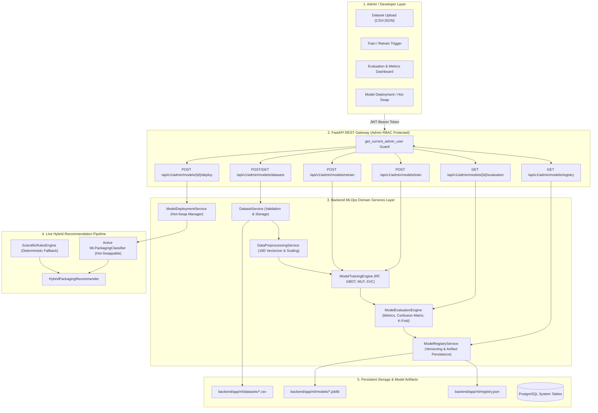
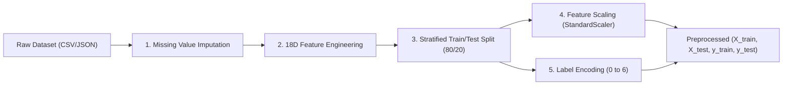
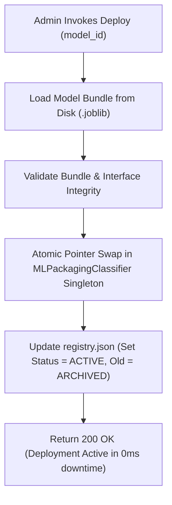

# Technical Specification: AI Model Management & MLOps Engine (Module 16)

## 1. Executive Summary & Engineering Motivation

### 1.1 Problem Statement & Objectives
In advanced packaging engineering and computational postharvest biology, packaging recommendation relies on a hybrid decision engine combining deterministic food preservation laws (chilling thresholds, respiration kinetics, gas permeability equations) with multivariate machine learning classifiers. As experimental datasets expand with novel bio-polymer packaging trials, shelf-life studies, and diverse food commodities, the machine learning models must not remain static or hardcoded.

**Module 16 (`16. AI Model Management`)** establishes the administrative/developer-side **MLOps & AI Model Lifecycle Management Engine** for the **SmartPack AI Packaging Recommender System**. It provides an end-to-end pipeline allowing administrators, ML engineers, and packaging researchers to:

1. **Dataset Ingestion & Quality Validation:**
   - Ingest CSV and JSON experimental datasets containing multi-dimensional food traits and validated packaging prescriptions.
   - Execute strict schema validation, missing value profiling, statistical range sanity checks, and class balance audits across 18 biochemical/logistical dimensions.
   - Maintain dataset metadata and versioned storage in the backend repository.

2. **Data Preprocessing & Feature Engineering:**
   - Transform raw commodity traits and logistics constraints into standardized 18-dimensional feature vectors.
   - Handle missing values with domain-specific postharvest defaults and imputation strategies.
   - Apply feature scaling (StandardScaler, MinMaxScaler, RobustScaler) and target label encoding across the 7 standardized polymer family classifications.
   - Generate stratified training and evaluation partitions (e.g. 80/20 train/test splits, K-fold cross-validation folds).

3. **Multi-Algorithm Model Training Engine:**
   - Support parameterized training of multiple classifier architectures:
     - **Random Forest Ensemble (`RandomForestClassifier`):** Bagging with out-of-bag scoring, Gini impurity splitting, and tree depth tuning.
     - **Gradient Boosting (`GradientBoostingClassifier`):** Sequential boosting optimizing log-loss for complex non-linear boundary separation.
     - **Multi-Layer Perceptron (`MLPClassifier`):** Feedforward neural network for continuous representation learning.
     - **Support Vector Classifier (`SVC`):** Radial basis function (RBF) margin maximization for high-confidence boundary fitting.
   - Configurable hyperparameter sets (estimators, learning rate, max depth, regularization).
   - Asynchronous job execution with real-time training progress and elapsed time tracking.

4. **Comprehensive Evaluation & Metrics Intelligence:**
   - Compute standard multi-class classification metrics: Overall Accuracy, Macro/Weighted Precision, Macro/Weighted Recall, and Macro/Weighted $F_1$-Score.
   - Generate a full $7 \times 7$ Confusion Matrix mapping true vs. predicted polymer family categories.
   - Provide per-class precision, recall, and $F_1$ breakdown with support sample counts.
   - Perform 5-Fold Stratified Cross-Validation reporting mean validation score and variance.
   - Extract and rank feature importance coefficients across all 18 dimensions.

5. **Model Versioning & Model Registry:**
   - Assign semantic version tags (e.g. `RandomForest-v2.4.0-18D`, `GradientBoost-v1.1.0-18D`, `vYYYYMMDD-HHMMSS`).
   - Serialize model binaries, scalers, and label encoders to persistent storage using `joblib`.
   - Maintain a model manifest catalog recording training dataset lineage, hyperparameter configurations, evaluation scores, and deployment states (`active`, `candidate`, `archived`).

6. **Zero-Downtime Hot-Swapping & Model Deployment:**
   - Promote any candidate model to `ACTIVE` with zero server restart or downtime.
   - Hot-swap the active inference engine within `HybridPackagingRecommender` and `MLPackagingClassifier`.
   - Provide 1-click rollback capability to any previously archived model version.
   - Maintain deterministic fallback resilience if ML mode is disabled or scikit-learn dependencies are unavailable.

7. **Automated & Triggered Retraining Workflows:**
   - Support manual retraining triggers via REST API.
   - Support automated retraining triggers upon new dataset upload.
   - Compute model comparison deltas ($\Delta \text{Accuracy}$, $\Delta F_1$) against the current active baseline to govern promotion policies.

8. **Admin RBAC Security:**
   - All dataset upload, model training, evaluation, registry, and deployment endpoints are strictly gated behind the `get_current_admin_user` dependency (`403 Forbidden` for non-admins, `401 Unauthorized` for unauthenticated requests).

---

### 1.2 System Architecture & MLOps Lifecycle



---

## 2. Standardized Feature Space & Target Taxonomy

### 2.1 18-Dimensional Feature Space Definition
Every food commodity analysis and training sample is represented by an 18-dimensional feature vector ($X \in \mathbb{R}^{18}$):

| Index | Feature Name | Data Type | Value Range | Scientific Description |
| :--- | :--- | :--- | :--- | :--- |
| `0` | `moisture_pct` | Float | $[0.0, 100.0]$ | Food moisture content percentage ($g/100g$) |
| `1` | `fat_pct` | Float | $[0.0, 100.0]$ | Total lipid/fat content percentage ($g/100g$) |
| `2` | `ph` | Float | $[0.0, 14.0]$ | Acidity pH level |
| `3` | `water_activity` | Float | $[0.0, 1.0]$ | Equilibrium relative humidity $a_w$ |
| `4` | `respiration_rate_5c` | Float | $[0.0, 500.0]$ | Respiration velocity at $5^\circ\text{C}$ ($\text{mg } CO_2/\text{kg/h}$) |
| `5` | `respiration_rate_20c` | Float | $[0.0, 1000.0]$ | Respiration velocity at $20^\circ\text{C}$ ($\text{mg } CO_2/\text{kg/h}$) |
| `6` | `ethylene_sensitivity_score` | Float | $[0.0, 1.0]$ | $C_2H_4$ sensitivity rating ($0.0 = \text{None}, 0.2 = \text{Low}, 0.5 = \text{Med}, 0.8 = \text{High}, 1.0 = \text{Critical}$) |
| `7` | `chilling_injury_threshold_c`| Float | $[-5.0, 25.0]$ | Physiological chilling breakdown temperature ($-1.0$ if non-chilling) |
| `8` | `storage_temp_c` | Float | $[-30.0, 45.0]$ | Target transport/storage temperature ($^\circ\text{C}$) |
| `9` | `storage_duration_days` | Float | $[1.0, 730.0]$ | Target commercial shelf life in days |
| `10` | `quantity_kg` | Float | $[0.01, 1000.0]$ | Packaging unit batch weight ($kg$) |
| `11` | `is_fragile` | Float | $\{0.0, 1.0\}$ | Binary indicator: $1.0$ if subject to bruising/crush injury, $0.0$ otherwise |
| `12` | `eco_friendly_priority` | Float | $\{0.0, 1.0\}$ | Binary indicator: $1.0$ if circular bio-based polymer is prioritized |
| `13` | `is_frozen` | Float | $\{0.0, 1.0\}$ | Engineered interaction: $1.0$ if $\text{temp} \le -10^\circ\text{C}$ or category Frozen |
| `14` | `is_high_lipid` | Float | $\{0.0, 1.0\}$ | Engineered interaction: $1.0$ if $\text{fat} \ge 18.0\%$ or lipid oxidation risk |
| `15` | `is_high_respiration` | Float | $\{0.0, 1.0\}$ | Engineered interaction: $1.0$ if $RR_{20} \ge 20.0\text{ mg }CO_2/\text{kg/h}$ |
| `16` | `is_acidic` | Float | $\{0.0, 1.0\}$ | Engineered interaction: $1.0$ if $\text{pH} \le 4.6$ |
| `17` | `is_perishable_animal_protein`| Float | $\{0.0, 1.0\}$ | Engineered interaction: $1.0$ if category is Meat, Poultry, Seafood, or Dairy |

---

### 2.2 Standardized Target Polymer Classes ($y \in \mathcal{C}$)
The classification target space comprises 7 standardized industrial packaging substrate families:

| Class Key | Label Index | Industrial Packaging Description | Target Food Commodities | Primary Barrier Function |
| :--- | :---: | :--- | :--- | :--- |
| `BREATHABLE_BIO_EMAP` | 0 | Micro-perforated bio-film (PLA/PBAT blend) | Fresh respiring produce (tomatoes, berries, leafy greens, mushrooms) | Tailored $O_2/CO_2$ permeability ratio ($\beta \approx 3.0-5.0$) preventing anaerobic fermentation |
| `METALLIZED_BARRIER` | 1 | Metallized Bio-PET / BOPP with $N_2$ gas flush | High-fat snacks, potato chips, roasted nuts, biscuits, fried wafers | Ultra-low $OTR$ ($< 1.0$) and $WVTR$ ($< 0.5$) preventing lipid rancidity and moisture uptake |
| `HIGH_BARRIER_EVOH_VSP`| 2 | Multi-layer EVOH / Polyamide vacuum skin packaging | Fresh meat, poultry, seafood, artisanal hard cheese, processed meats | Hermetic oxygen block ($OTR < 0.5$) preventing myoglobin browning and aerobic spoilage |
| `CELLULOSE_KRAFT_LINED`| 3 | Unbleached kraft paperboard with PLA water-repellent liner | Dry grains, basmati rice, wheat flour, lentils, pulses, dry bakery | Mechanical puncture resistance, structural stiffness, compostable circularity |
| `RECYCLABLE_POLYOLEFIN`| 4 | Mono-material recyclable LDPE / HDPE / PP flexible film | Ambient dry groceries, confectionery, pasta, general pantry goods | Low-cost moisture barrier with 100% mechanical recyclability |
| `CRYOGENIC_DEEP_FREEZE`| 5 | Puncture-resistant LLDPE / Cast PA multi-layer | Frozen vegetables, frozen prawns, ice cream, frozen ready-to-eat meals | Low-temperature flex-crack resistance down to $-30^\circ\text{C}$ preventing freezer burn |
| `RETORT_ACID_BARRIER` | 6 | High-temperature multi-layer acid-resistant retort pouch | Pickles, tomato purees, chutneys, acidic sauces, thermal sterilization goods | Acid-resistant inner sealing layer withstanding $121^\circ\text{C}$ autoclave processing |

---

## 3. Detailed Component Specifications

### 3.1 Dataset Management & Ingestion (`DatasetService`)

#### 3.1.1 Dataset Upload & Schema Validation
The `DatasetService` handles upload and persistence of dataset files (CSV/JSON):
1. **Schema Check:** Validates presence of all 18 required feature columns plus target `target_polymer_class` (or `label`).
2. **Type Coercion & Imputation:** Coerces numeric columns to float, handles missing values using domain rules.
3. **Class Validation:** Validates that target classes belong to the valid `POLYMER_CLASSES` enumeration.
4. **Data Profiling:**
   - Total row count ($N \ge 10$ minimum for valid training).
   - Class distribution histogram (e.g. `{"BREATHABLE_BIO_EMAP": 25, "METALLIZED_BARRIER": 18, ...}`).
   - Summary statistics (min, max, mean, std) per continuous feature.
   - Missing value percentage per feature.
5. **Storage:** Stored in `backend/app/ml/datasets/` with a unique ID (e.g. `ds_20260927_001.csv`).

#### 3.1.2 Default Archetype Dataset
If no custom dataset is uploaded, the system ships with a high-fidelity **Domain Calibration Baseline Dataset** (`baseline_archetypes.csv`) generated from verified food science packaging literature containing 70+ calibrated samples spanning all 7 target classes.

---

### 3.2 Data Preprocessing Pipeline (`DataPreprocessingService`)

#### 3.2.1 Pipeline Stages


1. **Imputation Rules:**
   - `moisture_pct`: Default 60.0% if missing.
   - `fat_pct`: Default 2.0% if missing.
   - `ph`: Default 6.0 if missing.
   - `water_activity`: If missing, computed as $0.95$ when $\text{moisture} > 60$ else $\text{moisture} / 100.0$.
   - `respiration_rate_5c` / `20c`: Computed from moisture and category heuristics.
   - `storage_temp_c`: Default $20.0^\circ\text{C}$ if missing.
   - `storage_duration_days`: Default $14.0$ days if missing.
2. **Feature Scalers:**
   - `StandardScaler`: $z = \frac{x - \mu}{\sigma}$ (default, preserving variance across diverse units).
   - `MinMaxScaler`: $x_{\text{scaled}} = \frac{x - x_{\min}}{x_{\max} - x_{\min}}$.
   - `None`: Raw features for tree-based models.
3. **Label Encoding:** Bidirectional mapping between string keys (`BREATHABLE_BIO_EMAP`) and integer class indices ($0 \dots 6$).

---

### 3.3 Multi-Algorithm Model Training Engine (`ModelTrainingEngine`)

#### 3.3.1 Supported Algorithms & Hyperparameters

| Algorithm Identifier | Scikit-Learn Estimator | Default Hyperparameters | Key Strengths in Packaging Domain |
| :--- | :--- | :--- | :--- |
| `RANDOM_FOREST` (Default) | `RandomForestClassifier` | `n_estimators=100`, `max_depth=12`, `min_samples_split=2`, `random_state=42` | Robust against overfitting on tabular biological data; provides native feature importance; handles non-linear interactions without scaling requirement. |
| `GRADIENT_BOOSTING` | `GradientBoostingClassifier` | `n_estimators=100`, `learning_rate=0.1`, `max_depth=5`, `random_state=42` | Highest accuracy for subtle boundary separations between high-moisture respiring vs. non-respiring food items. |
| `MULTI_LAYER_PERCEPTRON`| `MLPClassifier` | `hidden_layer_sizes=(64, 32)`, `activation='relu'`, `max_iter=500`, `alpha=0.0001` | Continuous latent representation learning for complex multivariate food matrices. |
| `SUPPORT_VECTOR_MACHINE` | `SVC` | `C=1.0`, `kernel='rbf'`, `probability=True`, `random_state=42` | Maximum margin separation for distinct packaging material boundaries. |

#### 3.3.2 Training Execution Flow
1. Receive training request with `dataset_id`, `algorithm_type`, `hyperparameters`, and `model_tag`.
2. Generate asynchronous training job with tracking ID (`job_id`).
3. Load and preprocess dataset via `DataPreprocessingService`.
4. Fit estimator on `(X_train, y_train)`.
5. Execute full evaluation suite on `(X_test, y_test)` plus 5-fold cross validation.
6. Serialize model bundle: `estimator`, `scaler`, `label_encoder`, `feature_names`, `classes`.
7. Register model in `ModelRegistryService` as `candidate`.
8. Mark training job as `COMPLETED` with execution time ($ms$) and evaluation summary.

---

### 3.4 Model Evaluation & Metrics Intelligence (`ModelEvaluationEngine`)

#### 3.4.1 Computed Evaluation Metrics
1. **Global Metrics:**
   $$\text{Accuracy} = \frac{\sum_{i=1}^K TP_i}{N}$$
   $$\text{Precision}_{\text{macro}} = \frac{1}{K}\sum_{i=1}^K \frac{TP_i}{TP_i + FP_i}, \quad \text{Precision}_{\text{weighted}} = \sum_{i=1}^K w_i \frac{TP_i}{TP_i + FP_i}$$
   $$\text{Recall}_{\text{macro}} = \frac{1}{K}\sum_{i=1}^K \frac{TP_i}{TP_i + FN_i}, \quad \text{Recall}_{\text{weighted}} = \sum_{i=1}^K w_i \frac{TP_i}{TP_i + FN_i}$$
   $$F_{1\text{, macro}} = 2 \cdot \frac{\text{Precision}_{\text{macro}} \cdot \text{Recall}_{\text{macro}}}{\text{Precision}_{\text{macro}} + \text{Recall}_{\text{macro}}}$$
2. **Confusion Matrix:** $7 \times 7$ 2D integer array where $C_{i,j}$ represents samples with true class $i$ predicted as class $j$.
3. **Per-Class Classification Report:** Detailed dictionary per class:
   ```json
   {
     "BREATHABLE_BIO_EMAP": {"precision": 0.96, "recall": 1.00, "f1_score": 0.98, "support": 15},
     "METALLIZED_BARRIER": {"precision": 1.00, "recall": 0.92, "f1_score": 0.96, "support": 12},
     ...
   }
   ```
4. **5-Fold Stratified Cross Validation:**
   - Computes cross-validation scores: $[s_1, s_2, s_3, s_4, s_5]$.
   - Mean CV accuracy: $\mu_{cv} = \frac{1}{5}\sum s_i$.
   - CV Standard Deviation: $\sigma_{cv}$.
5. **Feature Importance Ranking:** Impurity-based feature importance normalized to $100\%$:
   $$\sum_{j=1}^{18} I_j = 1.0$$

---

### 3.5 Model Versioning & Registry Service (`ModelRegistryService`)

#### 3.5.1 Artifact Storage Structure
```
backend/app/ml/
├── datasets/
│   ├── baseline_archetypes.csv
│   └── ds_20260927_001.csv
├── models/
│   ├── RandomForest-v2.3.0-18D.joblib
│   ├── RandomForest-v2.4.0-18D.joblib
│   └── GradientBoost-v1.0.0-18D.joblib
└── registry.json
```

#### 3.5.2 Registry Manifest Schema (`registry.json`)
```json
{
  "active_model_id": "RandomForest-v2.4.0-18D",
  "models": [
    {
      "model_id": "RandomForest-v2.4.0-18D",
      "algorithm": "RANDOM_FOREST",
      "version": "2.4.0",
      "dimensions": 18,
      "dataset_id": "ds_20260927_001",
      "created_at": "2026-09-27T14:30:00Z",
      "status": "active",
      "metrics": {
        "accuracy": 0.984,
        "precision_macro": 0.981,
        "recall_macro": 0.982,
        "f1_macro": 0.981,
        "cv_mean": 0.978,
        "cv_std": 0.012
      },
      "hyperparameters": {
        "n_estimators": 100,
        "max_depth": 12,
        "min_samples_split": 2
      },
      "feature_importances": {
        "moisture_pct": 0.165,
        "fat_pct": 0.142,
        "respiration_rate_20c": 0.138,
        "storage_temp_c": 0.115
      },
      "artifact_path": "backend/app/ml/models/RandomForest-v2.4.0-18D.joblib"
    }
  ]
}
```

---

### 3.6 Model Deployment & Zero-Downtime Hot-Swapping (`ModelDeploymentService`)

#### 3.6.1 Hot-Swap Lifecycle


1. **Atomic In-Memory Replacement:** The active `MLPackagingClassifier` maintains a thread-safe reference to the active loaded estimator. When a model is deployed, the estimator, scaler, and label encoders are loaded and atomically swapped.
2. **Zero Restart Requirement:** FastAPI server continues servicing recommendation requests without interruption.
3. **Rollback:** Any model in the registry can be redeployed at any time, restoring previous weights and performance characteristics instantly.

---

### 3.7 Automated & Triggered Retraining (`RetrainingPipeline`)

#### 3.7.1 Retraining Modes
1. **Manual Trigger (`POST /api/v1/admin/models/retrain`):**
   - Retrains using latest uploaded dataset or combined datasets.
   - Evaluates performance against active model baseline.
2. **Automated Trigger on Dataset Ingestion:**
   - Optional query parameter `auto_retrain=true` on dataset upload.
   - Pipeline runs automatically in background.
3. **Promotion Policy Engine:**
   - Computes:
     $$\Delta \text{Accuracy} = \text{Accuracy}_{\text{candidate}} - \text{Accuracy}_{\text{active}}$$
     $$\Delta F_1 = F_{1\text{, candidate}} - F_{1\text{, active}}$$
   - If $\Delta \text{Accuracy} \ge +0.005$ (+0.5%) and `auto_promote=true`, automatically deploys candidate model.
   - Otherwise, sets status to `candidate` and notifies admin in evaluation report for manual approval.

---

## 4. FastAPI REST Endpoints Specification

All endpoints are prefixed with `/api/v1/admin/models` and secured with `Depends(get_current_admin_user)`:

| Method | Endpoint Path | Description | Request Body | Success Response | Status Code |
| :--- | :--- | :--- | :--- | :--- | :---: |
| `POST` | `/api/v1/admin/models/datasets/upload` | Upload new CSV/JSON training dataset | `multipart/form-data` (`file`, `dataset_name`, `description`) | `DatasetUploadResponse` | `201 Created` |
| `GET` | `/api/v1/admin/models/datasets` | List all available training datasets | None | `List[DatasetMetadataResponse]` | `200 OK` |
| `GET` | `/api/v1/admin/models/datasets/{id}` | Get dataset details, profiling stats & sample rows | None | `DatasetDetailResponse` | `200 OK` |
| `DELETE` | `/api/v1/admin/models/datasets/{id}` | Delete a dataset file and metadata | None | `{"message": "Dataset deleted"}` | `200 OK` |
| `POST` | `/api/v1/admin/models/train` | Trigger model training run | `ModelTrainRequest` | `ModelTrainJobResponse` | `202 Accepted` |
| `GET` | `/api/v1/admin/models/jobs/{job_id}` | Check training job status | None | `ModelTrainJobResponse` | `200 OK` |
| `GET` | `/api/v1/admin/models/registry` | List all registered model versions | `?status=all\|active\|candidate` | `ModelRegistryListResponse` | `200 OK` |
| `GET` | `/api/v1/admin/models/{id}` | Get model metadata, metrics & feature importances | None | `ModelDetailResponse` | `200 OK` |
| `GET` | `/api/v1/admin/models/{id}/evaluation` | Get full evaluation metrics, confusion matrix & CV | None | `ModelEvaluationResponse` | `200 OK` |
| `POST` | `/api/v1/admin/models/{id}/deploy` | Hot-swap and promote model to ACTIVE | None | `ModelDeployResponse` | `200 OK` |
| `POST` | `/api/v1/admin/models/retrain` | Trigger retraining comparing vs active baseline | `RetrainRequest` | `RetrainComparisonResponse` | `200 OK` |
| `DELETE` | `/api/v1/admin/models/{id}` | Delete non-active candidate/archived model | None | `{"message": "Model deleted"}` | `200 OK` |

---

## 5. Pydantic Schemas Specification (`backend/app/schemas/ai_model.py`)

```python
from pydantic import BaseModel, Field
from typing import List, Dict, Any, Optional
from datetime import datetime
from enum import Enum


class AlgorithmTypeEnum(str, Enum):
    RANDOM_FOREST = "RANDOM_FOREST"
    GRADIENT_BOOSTING = "GRADIENT_BOOSTING"
    MULTI_LAYER_PERCEPTRON = "MULTI_LAYER_PERCEPTRON"
    SUPPORT_VECTOR_MACHINE = "SUPPORT_VECTOR_MACHINE"


class ModelStatusEnum(str, Enum):
    ACTIVE = "active"
    CANDIDATE = "candidate"
    ARCHIVED = "archived"


class JobStatusEnum(str, Enum):
    QUEUED = "queued"
    TRAINING = "training"
    COMPLETED = "completed"
    FAILED = "failed"


# --- Dataset Schemas ---

class DatasetMetadataResponse(BaseModel):
    dataset_id: str
    name: str
    description: Optional[str] = None
    file_format: str
    total_samples: int
    feature_count: int = 18
    class_distribution: Dict[str, int]
    created_at: datetime
    file_size_bytes: int


class DatasetDetailResponse(DatasetMetadataResponse):
    feature_summary: Dict[str, Dict[str, float]]
    preview_rows: List[Dict[str, Any]]


class DatasetUploadResponse(BaseModel):
    message: str
    dataset: DatasetMetadataResponse


# --- Model Training & Evaluation Schemas ---

class ModelHyperparameters(BaseModel):
    n_estimators: Optional[int] = 100
    max_depth: Optional[int] = 12
    learning_rate: Optional[float] = 0.1
    min_samples_split: Optional[int] = 2
    random_state: Optional[int] = 42
    test_size: Optional[float] = 0.2
    scaling_method: Optional[str] = "standard"


class ModelTrainRequest(BaseModel):
    dataset_id: Optional[str] = "baseline_archetypes"
    algorithm: AlgorithmTypeEnum = AlgorithmTypeEnum.RANDOM_FOREST
    model_tag: Optional[str] = None
    hyperparameters: Optional[ModelHyperparameters] = Field(default_factory=ModelHyperparameters)
    auto_promote_if_better: bool = False


class PerClassMetric(BaseModel):
    precision: float
    recall: float
    f1_score: float
    support: int


class ModelEvaluationMetrics(BaseModel):
    accuracy: float
    precision_macro: float
    recall_macro: float
    f1_macro: float
    precision_weighted: float
    recall_weighted: float
    f1_weighted: float
    cv_scores: List[float]
    cv_mean: float
    cv_std: float
    confusion_matrix: List[List[int]]
    classes: List[str]
    per_class_metrics: Dict[str, PerClassMetric]
    feature_importances: Dict[str, float]


class ModelDetailResponse(BaseModel):
    model_id: str
    algorithm: AlgorithmTypeEnum
    version: str
    dimensions: int = 18
    dataset_id: str
    status: ModelStatusEnum
    created_at: datetime
    metrics: ModelEvaluationMetrics
    hyperparameters: Dict[str, Any]
    artifact_path: str


class ModelRegistryListResponse(BaseModel):
    active_model_id: str
    total_models: int
    models: List[ModelDetailResponse]


class ModelTrainJobResponse(BaseModel):
    job_id: str
    status: JobStatusEnum
    algorithm: AlgorithmTypeEnum
    dataset_id: str
    elapsed_time_ms: Optional[float] = None
    error_message: Optional[str] = None
    model_result: Optional[ModelDetailResponse] = None


class ModelDeployResponse(BaseModel):
    message: str
    deployed_model_id: str
    previous_model_id: Optional[str] = None
    deployed_at: datetime
    active_model: ModelDetailResponse


class RetrainRequest(BaseModel):
    dataset_id: Optional[str] = None
    algorithm: Optional[AlgorithmTypeEnum] = None
    auto_promote: bool = False
    min_accuracy_delta: float = 0.005


class RetrainComparisonResponse(BaseModel):
    message: str
    candidate_model: ModelDetailResponse
    active_model: Optional[ModelDetailResponse] = None
    accuracy_delta: float
    f1_delta: float
    is_promoted: bool
```

---

## 6. Testing & Automated Verification Matrix

| Test Module | Scope | Key Assertions |
| :--- | :--- | :--- |
| `tests/test_ai_model_schemas.py` | Pydantic Schemas | Validates parsing, serialization, enums, validation errors for dataset and training schemas. |
| `tests/test_dataset_service.py` | Dataset Service | Ingests CSV/JSON, computes distributions, catches missing columns, profile metrics. |
| `tests/test_data_preprocessing_service.py`| Preprocessor | Imputes nulls, encodes 7 classes, normalizes 18D vectors, outputs stratified splits. |
| `tests/test_model_training_service.py` | Training Engine | Trains RF, GBDT, MLP; validates convergence, job status transitions. |
| `tests/test_model_evaluation_service.py` | Evaluation Engine | Verifies accuracy, confusion matrix shape ($7 \times 7$), CV variance, feature importance sum ($1.0$). |
| `tests/test_model_registry_service.py` | Registry & Persistence| Serializes/deserializes `.joblib`, updates `registry.json`, handles candidate/active states. |
| `tests/test_model_deployment_service.py` | Hot-Swapping | Promotes model to active, hot-swaps recommender live, tests instant rollback. |
| `tests/test_ai_model_api.py` | FastAPI Endpoints | End-to-end REST API verification for upload, train, list, eval, deploy, retrain, and RBAC security. |

---

## 7. Implementation Roadmap & Milestones

1. **Milestone 1: Schemas & Dataset Ingestion Layer**
   - Create `backend/app/schemas/ai_model.py`.
   - Implement `backend/app/services/ai_dataset_service.py` and default archetype dataset.
   - Unit tests: `test_ai_model_schemas.py` and `test_dataset_service.py`.

2. **Milestone 2: Preprocessing, Multi-Algorithm Training & Evaluation Engine**
   - Implement `backend/app/services/ai_preprocessing_service.py`.
   - Implement `backend/app/services/ai_training_service.py` (RF, GBDT, MLP, SVC).
   - Implement `backend/app/services/ai_evaluation_service.py` (Metrics, Confusion Matrix, K-Fold).
   - Unit tests: `test_data_preprocessing_service.py`, `test_model_training_service.py`, `test_model_evaluation_service.py`.

3. **Milestone 3: Model Versioning, Registry & Hot-Swap Deployment Engine**
   - Implement `backend/app/services/ai_registry_service.py`.
   - Implement `backend/app/services/ai_deployment_service.py`.
   - Integrate with `HybridPackagingRecommender` and `MLPackagingClassifier` for zero-downtime hot swapping.
   - Unit tests: `test_model_registry_service.py` and `test_model_deployment_service.py`.

4. **Milestone 4: FastAPI Admin REST Endpoints & RBAC Security**
   - Implement `backend/app/api/v1/endpoints/ai_models.py`.
   - Register route in `backend/app/api/v1/router.py`.
   - RBAC security checks with `get_current_admin_user`.
   - Full API integration tests: `test_ai_model_api.py`.

5. **Milestone 5: Full Regression & Zero-Downtime Validation**
   - Execute full backend test suite (`python -m unittest discover -s tests`).
   - Execute full frontend test suite (`flutter test`).
   - Verify 100% test pass rate across all 600+ repository tests.
