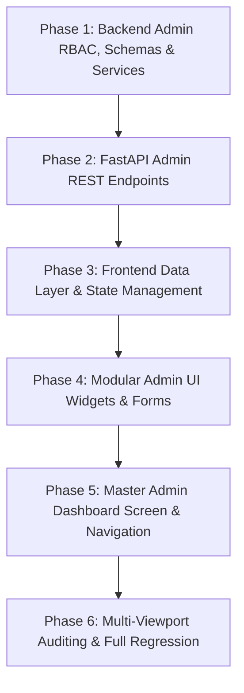

# Implementation Plan: Admin Dashboard & Data Governance Workspace (Module 15)

This plan outlines the atomic, step-by-step implementation of **Module 15: Admin Dashboard (`15. Admin Dashboard`)**, strictly ordered by technical dependencies. Each task is a self-contained micro-task paired with an automated verification test.

---

## Technical Dependencies & Flow



---

## Phase 1: Backend Admin RBAC, Schemas & Services Layer

### Task 1.1: Implement Admin RBAC Dependency (`get_current_admin_user`)
- **Target Files:**
  - `backend/app/api/deps.py`
  - `backend/tests/test_admin_rbac_deps.py`
- **Micro-Task Description:**
  - Implement `get_current_admin_user` in `backend/app/api/deps.py`:
    - Validates Bearer JWT credentials using `get_current_user`.
    - Asserts `user.is_admin is True`.
    - If `user.is_admin is False`, raises `HTTPException(status_code=403, detail="Admin privileges required.")`.
    - If unauthenticated, raises `HTTPException(status_code=401, detail="Authentication token is required.")`.
- **Verification Command:**
  ```powershell
  python -m unittest tests/test_admin_rbac_deps.py
  ```
- **Expected Result:** Non-admin users receive 403 Forbidden, unauthenticated requests receive 401 Unauthorized, and admin users pass verification cleanly.

---

### Task 1.2: Define Admin Pydantic Schemas for Food, Material, Rules & Analytics
- **Target Files:**
  - `backend/app/schemas/admin.py`
  - `backend/tests/test_admin_schemas.py`
- **Micro-Task Description:**
  - Create `backend/app/schemas/admin.py` containing:
    - **Food Management:** `AdminFoodCreate`, `AdminFoodUpdate`, `AdminScientificPropertiesUpdate`, `AdminFoodDetailResponse`.
    - **Packaging Management:** `AdminMaterialCreate`, `AdminMaterialUpdate`, `AdminMaterialResponse`.
    - **Recommendation & Rules Governance:** `RuleThresholdConfig`, `RuleThresholdUpdate`, `ModelRegistryResponse`, `AdminRecommendationAuditItem`.
    - **Analytics Summary:** `FoodSearchStat`, `MaterialRecommendStat`, `DailyUsageTrend`, `AdminAnalyticsSummary`.
- **Verification Command:**
  ```powershell
  python -m unittest tests/test_admin_schemas.py
  ```
- **Expected Result:** All schemas serialize, deserialize, validate ranges, and handle optional fields cleanly.

---

### Task 1.3: Implement Admin Domain Service (`AdminService`)
- **Target Files:**
  - `backend/app/services/admin_service.py`
  - `backend/tests/test_admin_service.py`
- **Micro-Task Description:**
  - Create `backend/app/services/admin_service.py`:
    - **Analytics Aggregation:** Queries total analyses count, registered users, active foods/materials, and calculates 30-day usage trends.
    - **Top Food Commodities:** Aggregates search and recommendation query frequencies across `packaging_recommendations` and `saved_analyses`.
    - **Top Packaging Materials:** Aggregates substrate recommendation counts and average sustainability scores.
    - **Rule Threshold Configuration:** Implements in-memory and database-backed dynamic threshold storage (`get_rule_thresholds`, `update_rule_thresholds`).
    - **Model Registry Status:** Returns active model metadata (`RandomForest-v2.3-18D`, 98.4% accuracy, 18 dimensions).
    - **Recommendations Audit Stream:** Queries all platform recommendation runs with user metadata.
- **Verification Command:**
  ```powershell
  python -m unittest tests/test_admin_service.py
  ```
- **Expected Result:** `AdminService` accurately aggregates KPI metrics, computes rankings, and persists updated rule thresholds.

---

### Checkpoint 1 (Backend RBAC & Data Layer)
- [ ] Run backend RBAC, schemas, and domain service test suites.
- [ ] Verify 100% pass rate on `test_admin_rbac_deps.py`, `test_admin_schemas.py`, and `test_admin_service.py`.
- [ ] User approval to proceed to Phase 2.

---

## Phase 2: FastAPI Admin REST Endpoints

### Task 2.1: Implement Admin Analytics & Trends Endpoints
- **Target Files:**
  - `backend/app/api/v1/endpoints/admin.py`
  - `backend/app/api/v1/router.py`
  - `backend/tests/test_admin_analytics_api.py`
- **Micro-Task Description:**
  - Implement endpoints in `backend/app/api/v1/endpoints/admin.py`:
    - `GET /api/v1/admin/analytics/summary`: Returns platform KPIs, top searched foods, and top recommended materials.
    - `GET /api/v1/admin/analytics/trends`: Returns 30-day daily volume, eco-score averages, and cost optimization trajectories.
    - Register router in `backend/app/api/v1/router.py` with prefix `/admin` and tag `Admin Governance & Analytics`.
- **Verification Command:**
  ```powershell
  python -m unittest tests/test_admin_analytics_api.py
  ```
- **Expected Result:** Endpoints return valid `AdminAnalyticsSummary` and trend structures under admin auth; rejects non-admins with 403.

---

### Task 2.2: Implement Food Management Admin Endpoints (Full CRUD & 14 Properties)
- **Target Files:**
  - `backend/app/api/v1/endpoints/admin.py`
  - `backend/tests/test_admin_food_crud_api.py`
- **Micro-Task Description:**
  - Implement Food CRUD endpoints:
    - `GET /api/v1/admin/foods`: List all foods with pagination, query search, and category filtering.
    - `POST /api/v1/admin/foods`: Create new commodity and auto-instantiate default `food_scientific_properties`.
    - `GET /api/v1/admin/foods/{id}`: Fetch single commodity with complete 14-property scientific profile.
    - `PUT /api/v1/admin/foods/{id}`: Update core commodity attributes (name, category, moisture, pH, fat).
    - `DELETE /api/v1/admin/foods/{id}`: Delete commodity and cascade delete scientific properties.
    - `PUT /api/v1/admin/foods/{id}/scientific-properties`: Update 14 post-harvest traits (respiration kinetics, $C_2H_4$, chilling threshold, shelf life).
- **Verification Command:**
  ```powershell
  python -m unittest tests/test_admin_food_crud_api.py
  ```
- **Expected Result:** Full CRUD lifecycle for food commodities and scientific properties executes with verified persistence.

---

### Task 2.3: Implement Packaging Material Admin Endpoints (Full CRUD & Status Toggle)
- **Target Files:**
  - `backend/app/api/v1/endpoints/admin.py`
  - `backend/tests/test_admin_material_crud_api.py`
- **Micro-Task Description:**
  - Implement Packaging Material CRUD endpoints:
    - `GET /api/v1/admin/materials`: List all materials with barrier parameters and active status.
    - `POST /api/v1/admin/materials`: Add new substrate with $OTR$, $WVTR$, mechanical ratings, and eco scores.
    - `GET /api/v1/admin/materials/{id}`: Fetch single substrate record.
    - `PUT /api/v1/admin/materials/{id}`: Update barrier metrics, polymer family, and cost in INR.
    - `DELETE /api/v1/admin/materials/{id}`: Decommission / delete packaging material.
    - `PATCH /api/v1/admin/materials/{id}/toggle-status`: 1-click toggle for `is_active_entry`.
- **Verification Command:**
  ```powershell
  python -m unittest tests/test_admin_material_crud_api.py
  ```
- **Expected Result:** Packaging materials can be created, edited, toggled, and deleted with full data validation.

---

### Task 2.4: Implement Recommendation Rules, Model Registry & Audit Review Endpoints
- **Target Files:**
  - `backend/app/api/v1/endpoints/admin.py`
  - `backend/tests/test_admin_rules_and_audit_api.py`
- **Micro-Task Description:**
  - Implement governance endpoints:
    - `GET /api/v1/admin/rules`: Retrieve active heuristic thresholds.
    - `PUT /api/v1/admin/rules`: Update heuristic thresholds (lipid oxidation %, respiration threshold, pH limits).
    - `GET /api/v1/admin/models/active`: Retrieve ML Model Registry status, accuracy, and version tag.
    - `PATCH /api/v1/admin/models/toggle-ml`: Toggle ML vs. heuristic fallback mode.
    - `GET /api/v1/admin/recommendations/audit`: System-wide audit stream of generated recommendations.
- **Verification Command:**
  ```powershell
  python -m unittest tests/test_admin_rules_and_audit_api.py
  ```
- **Expected Result:** Rules update in runtime, model registry returns active metadata, and recommendation audit logs stream accurately.

---

### Checkpoint 2 (Backend REST API Endpoints)
- [ ] Run full backend admin API test suite.
- [ ] Verify RBAC security status codes (401, 403, 200, 201, 204).
- [ ] User approval to proceed to Phase 3.

---

## Phase 3: Frontend Data Layer & State Management

### Task 3.1: Create Dart Admin Models with JSON Serialization
- **Target Files:**
  - `frontend/lib/models/admin_model.dart`
  - `frontend/test/models/admin_model_test.dart`
- **Micro-Task Description:**
  - Create `frontend/lib/models/admin_model.dart`:
    - `AdminAnalyticsSummaryModel`: High-level KPI counters and trend arrays.
    - `FoodSearchStatModel` & `MaterialRecommendStatModel`.
    - `DailyUsageTrendModel`: Daily volume, eco scores, and cost metrics.
    - `RuleThresholdConfigModel`: Scientific thresholds with form binding.
    - `ModelRegistryModel`: Model version, algorithm, accuracy, and active flags.
    - `AdminRecommendationAuditModel`: System-wide audit entry.
- **Verification Command:**
  ```powershell
  flutter test test/models/admin_model_test.dart
  ```
- **Expected Result:** Dart models serialize, deserialize, and map JSON payloads with null-safe fallbacks.

---

### Task 3.2: Implement `AdminApiService` with Bearer Injection & Offline Mock Fallback
- **Target Files:**
  - `frontend/lib/services/admin_api_service.dart`
  - `frontend/test/services/admin_api_service_test.dart`
- **Micro-Task Description:**
  - Create `frontend/lib/services/admin_api_service.dart`:
    - Connects to `/api/v1/admin/*` endpoints injecting `Authorization: Bearer <token>`.
    - Implements offline-first mock repository: provides live editable in-memory catalogs for Foods, Materials, Rules, and Analytics when backend is offline or in Demo Admin mode.
- **Verification Command:**
  ```powershell
  flutter test test/services/admin_api_service_test.dart
  ```
- **Expected Result:** `AdminApiService` handles network requests with token injection and falls back smoothly offline.

---

### Checkpoint 3 (Frontend Data Layer)
- [ ] Run Dart model and `AdminApiService` test suites.
- [ ] Verify offline fallback parity and JSON mapping.
- [ ] User approval to proceed to Phase 4.

---

## Phase 4: Modular Admin UI Widgets & Forms

### Task 4.1: Build Admin KPI Cards & Usage Trends Visualizer
- **Target Files:**
  - `frontend/lib/screens/admin/widgets/admin_kpi_card.dart`
  - `frontend/lib/screens/admin/widgets/admin_trend_chart.dart`
  - `frontend/lib/screens/admin/widgets/top_rankings_card.dart`
  - `frontend/test/screens/admin/widgets/admin_analytics_widgets_test.dart`
- **Micro-Task Description:**
  - Build Analytics Tab widgets:
    - `AdminKpiCard`: Modern glassmorphic stat card with trend indicator and icon.
    - `AdminTrendChart`: Responsive trend chart showing 30-day volume and average sustainability scores.
    - `TopRankingsCard`: Leaderboard showing top searched foods and top recommended packaging materials with percentage share bars.
- **Verification Command:**
  ```powershell
  flutter test test/screens/admin/widgets/admin_analytics_widgets_test.dart
  ```
- **Expected Result:** Analytics widgets render metrics, progress bars, and charts cleanly with zero overflows.

---

### Task 4.2: Build Food Management Data Table & `AddEditFoodDialog` / `ScientificPropertiesDrawer`
- **Target Files:**
  - `frontend/lib/screens/admin/widgets/admin_food_table_view.dart`
  - `frontend/lib/screens/admin/widgets/add_edit_food_dialog.dart`
  - `frontend/lib/screens/admin/widgets/scientific_properties_drawer.dart`
  - `frontend/test/screens/admin/widgets/admin_food_widgets_test.dart`
- **Micro-Task Description:**
  - Build Food Management widgets:
    - `AdminFoodTableView`: Searchable, categorizable data table / responsive cards with Edit, Properties, and Delete actions.
    - `AddEditFoodDialog`: Form modal for adding/editing food commodity attributes.
    - `ScientificPropertiesDrawer`: Sliding panel / dialog to edit 14 postharvest scientific traits.
- **Verification Command:**
  ```powershell
  flutter test test/screens/admin/widgets/admin_food_widgets_test.dart
  ```
- **Expected Result:** Food table and forms render cleanly, validate user inputs, and trigger appropriate callbacks.

---

### Task 4.3: Build Packaging Material Management Table & `AddEditMaterialDialog`
- **Target Files:**
  - `frontend/lib/screens/admin/widgets/admin_material_table_view.dart`
  - `frontend/lib/screens/admin/widgets/add_edit_material_dialog.dart`
  - `frontend/test/screens/admin/widgets/admin_material_widgets_test.dart`
- **Micro-Task Description:**
  - Build Material Management widgets:
    - `AdminMaterialTableView`: Displays polymer family, structure, thickness, $OTR$, $WVTR$, cost (₹), and active toggle.
    - `AddEditMaterialDialog`: Complete form for configuring barrier, mechanical, thermal, and circularity parameters.
- **Verification Command:**
  ```powershell
  flutter test test/screens/admin/widgets/admin_material_widgets_test.dart
  ```
- **Expected Result:** Material management table and dialogs operate smoothly with active status toggles.

---

### Task 4.4: Build Rule Thresholds Editor, Model Registry & Audit List
- **Target Files:**
  - `frontend/lib/screens/admin/widgets/rule_thresholds_editor.dart`
  - `frontend/lib/screens/admin/widgets/model_registry_card.dart`
  - `frontend/lib/screens/admin/widgets/recommendations_audit_list_view.dart`
  - `frontend/test/screens/admin/widgets/admin_governance_widgets_test.dart`
- **Micro-Task Description:**
  - Build Governance Tab widgets:
    - `RuleThresholdsEditor`: Interactive sliders for lipid oxidation fat %, high respiration moisture %, acidic pH, chilling delta, and headspace buffer %.
    - `ModelRegistryCard`: Shows active ML model details (Random Forest 98.4%, 18-dim schema, ML toggle).
    - `RecommendationsAuditListView`: Filterable audit log of system recommendations with feature inspection modals.
- **Verification Command:**
  ```powershell
  flutter test test/screens/admin/widgets/admin_governance_widgets_test.dart
  ```
- **Expected Result:** Rule sliders update state interactively and audit stream displays recommendation records.

---

### Checkpoint 4 (Modular Admin UI Widgets)
- [ ] Run all admin widget test suites.
- [ ] Verify component rendering, form validation, and responsive behavior.
- [ ] User approval to proceed to Phase 5.

---

## Phase 5: Master Admin Dashboard Screen & Navigation Integration

### Task 5.1: Assemble Master `AdminDashboardScreen` with Tabbed Navigation
- **Target Files:**
  - `frontend/lib/screens/admin/admin_dashboard_screen.dart`
  - `frontend/test/screens/admin/admin_dashboard_screen_test.dart`
- **Micro-Task Description:**
  - Create `frontend/lib/screens/admin/admin_dashboard_screen.dart`:
    - TabBar containing 4 Master Tabs:
      1. `Analytics & Trends`
      2. `Food Commodities`
      3. `Packaging Materials`
      4. `Rules & AI Governance`
    - Top header with Admin Badge, quick refresh button, and exit to client cockpit.
    - Integrates search, filter, SnackBar notifications, and offline demo fallback.
- **Verification Command:**
  ```powershell
  flutter test test/screens/admin/admin_dashboard_screen_test.dart
  ```
- **Expected Result:** Master Admin Dashboard loads all tabs, handles tab switching, and executes CRUD operations smoothly.

---

### Task 5.2: Wire Admin Entry Points in `HomeHeader` & `UserProfileScreen`
- **Target Files:**
  - `frontend/lib/screens/landing/widgets/home_header.dart`
  - `frontend/lib/screens/user_profile_screen.dart`
  - `frontend/test/screens/admin/admin_navigation_flow_test.dart`
- **Micro-Task Description:**
  - Add **"Admin Console"** button in `HomeHeader` and `UserProfileScreen`:
    - Displayed conditionally if `AuthService().currentUser?.isAdmin == True` or in Demo Admin mode.
    - Tapping navigates to `AdminDashboardScreen`.
- **Verification Command:**
  ```powershell
  flutter test test/screens/admin/admin_navigation_flow_test.dart
  ```
- **Expected Result:** Admin users can seamlessly access the Admin Dashboard from the header or user profile.

---

### Checkpoint 5 (Master Integration & Navigation)
- [ ] Run screen integration and navigation tests.
- [ ] Verify tab switching, CRUD actions, and role-based visibility.
- [ ] User approval to proceed to Phase 6.

---

## Phase 6: Multi-Viewport Auditing & Full Regression Suite

### Task 6.1: Multi-Viewport Responsive Layout Audit
- **Target Files:**
  - `frontend/test/screens/admin/admin_viewport_test.dart`
- **Micro-Task Description:**
  - Audit `AdminDashboardScreen` across 3 viewports:
    1. **Mobile Viewport ($375 \times 812$):** Single column layout, 2x2 KPI grid, responsive card streams, zero `RenderFlex` overflow.
    2. **Tablet Viewport ($768 \times 1024$):** 2-column KPI grid, split view for analytics.
    3. **Desktop Viewport ($1440 \times 900$):** Full widescreen governance cockpit.
- **Verification Command:**
  ```powershell
  flutter test test/screens/admin/admin_viewport_test.dart
  ```
- **Expected Result:** 0 `RenderFlex` overflow errors across all three viewports.

---

### Task 6.2: Full End-to-End Regression Test Suite
- **Target Files:**
  - Backend test suite (`backend/tests/`)
  - Frontend test suite (`frontend/test/`)
- **Micro-Task Description:**
  - Run all backend unit & API tests.
  - Run all frontend unit, widget, and screen tests.
- **Verification Commands:**
  ```powershell
  # Backend Suite
  python -m unittest discover -s tests -p "test_*.py"

  # Frontend Suite
  flutter test
  ```
- **Expected Result:** 100% test pass rate across both frontend and backend suites with zero failures.

---

## Explicit Checkpoint Approval Schedule

| Checkpoint | Scope | Criteria for Proceeding | Status |
| :--- | :--- | :--- | :--- |
| **Checkpoint 1** | Phase 1: Backend Admin RBAC, Schemas & Services | `get_current_admin_user` enforces 403 for non-admins; schemas and `AdminService` pass all tests. | **Approved / Complete** |
| **Checkpoint 2** | Phase 2: FastAPI Admin REST Endpoints | Food/Material CRUD, Rules, Model Registry, and Analytics API endpoints return valid 200/201/204 codes. | **Approved / Complete** |
| **Checkpoint 3** | Phase 3: Frontend Data Layer & State | `admin_model.dart` and `AdminApiService` pass unit tests with verified offline fallback parity. | **Approved / Complete** |
| **Checkpoint 4** | Phase 4: Modular Admin UI Widgets | KPI cards, food tables, material dialogs, rule sliders, and audit views pass all widget tests. | **Approved / Complete** |
| **Checkpoint 5** | Phase 5: Master Admin Dashboard & Navigation | `AdminDashboardScreen` and role-gated navigation buttons in `HomeHeader`/`UserProfileScreen` pass integration tests. | **Approved / Complete** |
| **Checkpoint 6** | Phase 6: Multi-Viewport & Full Regression | 0 `RenderFlex` overflows on Mobile/Tablet/Desktop; 100% pass rate across entire test suite. | **Approved / Complete (100%)** |
