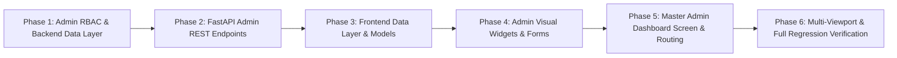

# Technical Specification: Admin Dashboard & Data Governance Workspace (Module 15)

## 1. Executive Summary & Engineering Motivation

### 1.1 Problem Statement & Objectives
In post-harvest supply chains and industrial packaging engineering, biological commodities, polymer specifications, and scientific preservation rules evolve continuously. New packaging substrates enter the commercial market (e.g. PHA biopolymers, high-barrier bio-nanocomposites), food respiration coefficients undergo laboratory recalibration, and packaging engineers require dynamic governance over machine learning classifiers and recommendation heuristics without modifying core source code.

**Module 15 (`15. Admin Dashboard`)** establishes the administrative control center and governance console for the **SmartPack AI Packaging Recommender System**:

1. **Food Management Workspace:**
   - Add new food commodities with category taxonomies, biological traits, and scientific identifiers.
   - Edit existing commodities (names, categories, compositions: moisture %, fat %, pH, water activity $a_w$).
   - Delete outdated or erroneous food entries with cascade-safe relational integrity.
   - Update deep 14-property scientific profiles (respiration kinetics, $C_2H_4$ sensitivity, chilling injury thresholds, optimum storage temperatures, and baseline shelf-life days).

2. **Packaging Management Workspace:**
   - Add novel packaging materials with complete technical specifications (polymer family, barrier rates, mechanical metrics, eco scores, cost).
   - Edit material barrier properties (Oxygen Transmission Rate $OTR$, Water Vapor Transmission Rate $WVTR$, $CO_2$ permeability, selectivity $\beta$).
   - Update packaging information, commercial statuses (active/archived), form factors, and food contact certifications.
   - Decommission or delete legacy substrates.

3. **Recommendation Management & AI Governance:**
   - **Manage Heuristic Rules:** Dynamically adjust scientific thresholds (e.g. lipid oxidation trigger fat %, high respiration threshold $\text{mg } CO_2/\text{kg/h}$, acidic pH boundaries, and chilling injury safety margins).
   - **Manage Model Versions:** Inspect active ML model metadata (Random Forest vs. Hybrid Recommender, feature vector dimensions, training timestamps, accuracy scores, and fallback toggles).
   - **Review Recommendations:** System-wide audit log of generated packaging recommendations, displaying input constraints, chosen substrate, confidence score, sustainability rating, and estimated unit costs with review/flagging capabilities.

4. **Analytics & Usage Intelligence:**
   - **Aggregated Operational KPIs:** Total number of analyses executed across the platform, active registered users, active material count, and average circularity score.
   - **Most Searched Foods:** Top commodities ranked by analysis query frequency with percentage distributions.
   - **Most Recommended Materials:** Distribution of recommended substrate families (e.g. Micro-perforated Bio-film, Corrugated Kraft Box, Retort Pouch).
   - **Usage Trends:** Time-series analytics tracking daily/weekly analysis volume, eco-friendly preference ratios, and cost distributions over time.

---

### 1.2 System Architecture & Administrative Governance

```mermaid
graph TD
    subgraph ClientLayer["1. Flutter Client Interface (Admin Console)"]
        NavHeader["HomeHeader / Profile (Admin Badge)"]
        AdminScreen["AdminDashboardScreen (/admin)"]
        AnalyticsTab["1. Analytics & Trends Tab"]
        FoodTab["2. Food Management Tab"]
        MaterialTab["3. Packaging Materials Tab"]
        RulesTab["4. Rules & Model Governance Tab"]
        ReviewTab["5. Recommendations Audit Tab"]
    end

    subgraph StateClient["2. State Management & API Gateway"]
        AuthService["AuthService (RBAC: is_admin Check)"]
        AdminApiService["AdminApiService (JWT Bearer Gateway)"]
        OfflineCache["Admin Mock / In-Memory Fallback Cache"]
    end

    subgraph BackendAPI["3. FastAPI Admin Routing & Security"]
        AdminDeps["get_current_admin_user (RBAC Guard)"]
        AdminAnalyticsAPI["GET /api/v1/admin/analytics/summary"]
        AdminTrendsAPI["GET /api/v1/admin/analytics/trends"]
        AdminFoodAPI["CRUD /api/v1/admin/foods"]
        AdminMaterialAPI["CRUD /api/v1/admin/materials"]
        AdminRulesAPI["GET/PUT /api/v1/admin/rules"]
        AdminModelAPI["GET/PUT /api/v1/admin/models/active"]
        AdminReviewsAPI["GET /api/v1/admin/recommendations/audit"]
    end

    subgraph DomainServices["4. Backend Domain & Intelligence Services"]
        AdminService["AdminService (Aggregation & Rule Config)"]
        FoodService["FoodDataService (Catalog & Scientific Profiles)"]
        MaterialService["MaterialService (Polymer & Gas Barrier DB)"]
        RulesEngine["ScientificPackagingRulesEngine (Configurable)"]
        MLClassifier["PackagingMLClassifier (Model Registry)"]
    end

    subgraph DatabaseLayer["5. Relational Persistence & Logs"]
        PostgresDB[("PostgreSQL Database")]
        UsersTable["users (is_admin = True)"]
        FoodsTable["foods & food_scientific_properties"]
        MaterialsTable["packaging_materials & gas_properties"]
        RecommendationsTable["packaging_recommendations Table"]
        SavedAnalysesTable["saved_analyses Table"]
        SystemConfigTable["system_rule_configs Table"]
    end

    NavHeader -->|Admin Auth Check| AdminScreen
    AdminScreen --> AnalyticsTab
    AdminScreen --> FoodTab
    AdminScreen --> MaterialTab
    AdminScreen --> RulesTab
    AdminScreen --> ReviewTab

    AnalyticsTab --> AdminApiService
    FoodTab --> AdminApiService
    MaterialTab --> AdminApiService
    RulesTab --> AdminApiService
    ReviewTab --> AdminApiService

    AdminApiService --> AuthService
    AdminApiService -->|Bearer JWT (Admin Role)| BackendAPI

    BackendAPI --> AdminDeps
    AdminDeps --> UsersTable
    AdminDeps --> AdminAnalyticsAPI
    AdminDeps --> AdminTrendsAPI
    AdminDeps --> AdminFoodAPI
    AdminDeps --> AdminMaterialAPI
    AdminDeps --> AdminRulesAPI
    AdminDeps --> AdminModelAPI
    AdminDeps --> AdminReviewsAPI

    AdminAnalyticsAPI --> AdminService
    AdminTrendsAPI --> AdminService
    AdminFoodAPI --> FoodService
    AdminMaterialAPI --> MaterialService
    AdminRulesAPI --> RulesEngine
    AdminModelAPI --> MLClassifier
    AdminReviewsAPI --> AdminService

    AdminService --> RecommendationsTable
    AdminService --> SavedAnalysesTable
    FoodService --> FoodsTable
    MaterialService --> MaterialsTable
    RulesEngine --> SystemConfigTable

    FoodsTable --> PostgresDB
    MaterialsTable --> PostgresDB
    RecommendationsTable --> PostgresDB
    SavedAnalysesTable --> PostgresDB
    SystemConfigTable --> PostgresDB

    AdminApiService -.->|Offline / Dev Fallback| OfflineCache
```

---

## 2. Functional Requirements & Feature Scope

### 2.1 Role-Based Access Control (RBAC) & Security Boundary
- **Admin Verification:**
  - Authenticated users with `is_admin == True` receive unrestricted access to administrative endpoints and the Flutter Admin Console.
  - Non-admin users attempting to access `/admin` or invoke `/api/v1/admin/*` endpoints receive `403 Forbidden` (`Admin privileges required`).
  - Unauthenticated requests receive `401 Unauthorized`.
- **Admin Entry Point:**
  - When an admin is logged in, the `HomeHeader` and `UserProfileScreen` display an **"Admin Dashboard"** navigation button with a shield/crown badge.
  - Direct deep linking to `/admin` routes correctly.
- **Offline / Demo Mode Support:**
  - Demo environment provides a toggleable **"Admin Demo Session"** enabling full dashboard testing without cloud credentials.

---

### 2.2 Pillar 1: Food Management Workspace

#### 1. Commodity List & Live Management
- **Search & Filter:** Instant live search by commodity name, category filter chips (Fruits, Vegetables, Grains & Bakery, Snacks & Wafers, Dairy & Meat, Spices, Retort), and sort options (Name A-Z, Moisture %, Respiration Class).
- **Data Table / Card Stream:** Displays Food Name, Category, Moisture %, pH, Fat %, Respiration Class, and Action Menu (Edit, Update Properties, Delete).

#### 2. Add New Food Commodity
- **Basic Attributes Form:**
  - `name`: Commodity common name (e.g. `Dragon Fruit`, `Alphonso Mango`).
  - `category`: Category taxonomy selection.
  - `moisture`: Moisture content percentage ($0.0 - 100.0\%$).
  - `ph`: Acidity pH value ($1.0 - 14.0$).
  - `water_activity`: Water activity $a_w$ ($0.0 - 1.0$).
  - `fat`: Lipid/oil content percentage ($0.0 - 100.0\%$).
  - `respiration_class`: Respiration intensity (`Very Low`, `Low`, `Moderate`, `High`, `Very High`, `Extremely High`).
  - `oxygen_sensitivity`: Sensitivity to oxygen exposure (`Low`, `Moderate`, `High`, `Critical`).
  - `moisture_sensitivity`: Sensitivity to moisture ingress/loss (`Low`, `Moderate`, `High`, `Critical`).

#### 3. Edit Existing Food Commodity
- In-place modal dialog allowing modification of all baseline food parameters with instant validation.

#### 4. Delete Food Commodity
- Deletion dialog with confirmation challenge. Cascade-safe deletion handles associated `food_scientific_properties` and `respiration_data` cleanly.

#### 5. Update Deep Scientific Properties (14-Property Profile)
- Dedicated sliding drawer / modal to configure:
  - **Moisture Dynamics:** Equilibrium RH target % ($0 - 100\%$).
  - **Respiration Kinetics:** Respiration rate at 20°C ($\text{mg } CO_2/\text{kg/h}$), rate at 5°C, respiratory quotient ($RQ$).
  - **Gas Sensitivities:** Max tolerable $CO_2$ % before physiological damage ($0 - 30\%$), $CO_2$ sensitivity class (`Tolerant`, `Moderate`, `Highly Sensitive`).
  - **Ethylene Dynamics:** Ethylene production rate ($\mu\text{L}/\text{kg/h}$), production class, sensitivity class (`Insensitive`, `Low`, `Moderate`, `High`, `Extreme`).
  - **Thermal Stability:** Optimum temperature range ($\text{Min}^\circ\text{C} - \text{Max}^\circ\text{C}$), chilling injury threshold (°C, nullable), freezing point (°C).
  - **Sensory & Physical:** Light sensitivity, aroma sensitivity, microbial spoilage vector, mechanical sensitivity.
  - **Shelf-Life Baselines:** Ambient shelf life (days), refrigerated shelf life (days), controlled atmosphere shelf life (days).

---

### 2.3 Pillar 2: Packaging Material Management Workspace

#### 1. Material Catalog & Inventory
- **Search & Filter:** Search by material name, category (Bio-Polymer, Mono-Polymer, Multi-Layer Laminate, Paper/Board), polymer family (`BREATHABLE_BIO_EMAP`, `METALLIZED_BARRIER`, `HIGH_BARRIER_EVOH_VSP`, etc.), and active status.
- **Display Overview:** Substrate Name, Polymer Family, Structure, Thickness ($\mu\text{m}$), $OTR$, $WVTR$, Unit Cost (INR), Sustainability Rating, and Active Toggle.

#### 2. Add New Packaging Material
- **Physical & Barrier Form:**
  - `material_id`: Unique identifier (e.g. `mat_bio_pha_01`).
  - `name`: Substrate commercial name (e.g. `High-Barrier PHA Biodegradable Film`).
  - `category`: Broad material category.
  - `polymer_family`: Standardized ML target polymer class.
  - `structure`: Structural composition (e.g. `Monolayer 35 µm`, `Kraft / PLA Extrusion`).
  - `form_factor`: Pouch type / geometry (e.g. `Flexible Pouch`, `Thermoformed Tray`, `Corrugated Carton`).
  - `thickness_microns`: Thickness in $\mu\text{m}$.
  - `otr_cc_m2_day`: Oxygen Transmission Rate ($\text{cc/m}^2/\text{day}$).
  - `wvtr_g_m2_day`: Water Vapor Transmission Rate ($\text{g/m}^2/\text{day}$).
  - `co2_permeability`: $CO_2$ Transmission Rate ($\text{cc/m}^2/\text{day}$).
  - `selectivity_beta`: $CO_2 / O_2$ selectivity ratio $\beta$.
- **Mechanical & Thermal:**
  - `tensile_strength_mpa`: Tensile strength ($\text{MPa}$).
  - `puncture_resistance_n`: Puncture force ($\text{N}$).
  - `temp_min_c` / `temp_max_c`: Operational temperature range (°C).
  - `thermal_class`: Thermal classification (e.g. `Deep Freeze`, `Ambient Stable`, `Retort Grade`).
- **Sustainability & Commercial:**
  - `sustainability_score`: Circularity score ($0 - 100$).
  - `recyclability_score`: Recyclability rating ($0 - 100$).
  - `biodegradability_score`: Biodegradability rating ($0 - 100$).
  - `resin_code`: Resin identification code (e.g. `OTHER_7`, `PAP_20`, `PP_5`).
  - `estimated_unit_cost_inr`: Base unit substrate cost in INR (₹).
  - `is_breathable`, `is_biodegradable`, `is_recyclable`, `gas_flush_compatible` flags.

#### 3. Edit Material Properties & Update Information
- Full in-place editing of all barrier, mechanical, sustainability, and pricing metrics.

#### 4. Active / Archived Status Toggle & Deletion
- 1-click toggle to enable/disable substrate from active recommendation algorithms.
- Hard delete with safety check preventing orphan references.

---

### 2.4 Pillar 3: Recommendation Management & AI Governance

#### 1. Manage Scientific Rules & Heuristic Thresholds
- Dynamic configuration panel allowing admins to modify engine heuristics:
  - **Lipid Oxidation Trigger:** Fat % threshold (Default: `18.0%`) above which high-barrier metallized/foil laminates with $N_2$ gas flush are mandated.
  - **High Respiration Threshold:** Moisture % (Default: `75.0%`) and Respiration Class triggers for micro-perforated bio-films.
  - **Acidic Corrosion Boundary:** pH threshold (Default: `4.6`) triggering multi-layer acid-resistant retort pouches.
  - **Chilling Injury Buffer:** Safety margin delta in °C (Default: `2.0°C`) applied to prevent chilling injury recommendations.
  - **Gas Cushioning Headspace Volume:** Default buffer volume percentage (Default: `40 - 50%`) for fragile crispy commodities.
  - **Eco-Priority Multiplier:** Weighting factor ($1.0 - 2.5$) for sustainable substrates when eco-mode is active.

#### 2. Manage Model Versions & Machine Learning Registry
- **Model Metadata Card:**
  - Active Model Identifier (e.g. `RandomForest-v2.3-18D`).
  - Active Ensemble Algorithm (`Random Forest 100 Trees` / `Deterministic Heuristic Ensemble`).
  - Feature Vector Input Dimension (`18 Features`).
  - Accuracy / Classification F1-Score (`98.4%`).
  - Last Trained Timestamp and Model Version Hash.
  - Model Hot-Swap / Fallback Toggle: Allows switching between pure scientific rules, pure ML, or hybrid ensemble.

#### 3. Review Recommendations (System-Wide Audit Stream)
- Administrative inspection log of all packaging recommendations generated across the platform:
  - Shows timestamp, User ID / Guest label, Commodity Name, Dimensions ($L \times W \times H \text{ cm}$), Mass, Prescribed Substrate, Confidence Score, Sustainability Rating, and Estimated Cost.
  - **Filter by Flagged / Anomalous Runs:** Filter runs with low confidence ($<70\%$) or custom flagged audits.
  - **Inspection Detail Modal:** Displays exact 18-dim feature inputs, derived barrier prescriptions, and rule execution trace.

---

### 2.5 Pillar 4: Analytics & Usage Intelligence

#### 1. System-Wide Key Performance Indicators (KPIs)
- **Total Analyses Count:** Total recommendations calculated across all users with period delta (e.g. `+14.2% this month`).
- **Registered User Base:** Total active user accounts registered in system.
- **Catalog Density:** Total Food Commodities ($N=30+$) and Active Packaging Materials ($N=15+$).
- **Eco Adoption Index:** Percentage of runs configured with `Eco-Friendly Priority = True` (e.g. `82.6%`).

#### 2. Most Searched Foods
- Ranked table and frequency distribution bar chart:
  - Commodity Name (e.g. `Fresh Tomato`, `Apple`, `Potato Chips`, `Paneer`, `Alphonso Mango`).
  - Total Query Count and % of Total Traffic.
  - Dominant Preservation Requirement (e.g. `High Respiration / EMAP`, `Moisture Ingress Barrier`).

#### 3. Most Recommended Packaging Materials
- Frequency distribution breakdown:
  - Substrate Name & Polymer Family (e.g. `Micro-Perforated Bio-Film (PLA/PBAT)`, `5-Ply Corrugated Kraft`, `High-Barrier Met-PET`, `EVOH Vacuum Skin`).
  - Recommendation Share % and Average Circularity Score.

#### 4. Usage Trends & Temporal Intelligence
- Time-series interactive visualizers:
  - **Daily / Weekly Analysis Volume:** Area chart showing analysis query trends over the past 30 days.
  - **Average Cost vs. Sustainability Trajectory:** Dual-metric trend line demonstrating cost optimization alongside eco-score improvements.
  - **Category Breakdown:** Donut chart illustrating query share across Fruits, Vegetables, Snacks, Dairy, Spices, etc.

---

## 3. Data Models & API Contracts

### 3.1 Backend Data Models & Persistence

#### 1. Rule Configuration Entity (`backend/app/models/food_and_packaging.py` or new `system_config.py`)
```python
class SystemRuleConfig(Base):
    __tablename__ = "system_rule_configs"

    id = Column(Integer, primary_key=True, index=True)
    config_key = Column(String(100), unique=True, nullable=False, index=True)
    config_value = Column(JSON, nullable=False)
    description = Column(String(255), nullable=True)
    updated_at = Column(DateTime(timezone=True), default=_utcnow, onupdate=_utcnow)
    updated_by_user_id = Column(Integer, ForeignKey("users.id"), nullable=True)
```

#### 2. Admin Schemas (`backend/app/schemas/admin.py`)
```python
from pydantic import BaseModel, Field
from typing import List, Optional, Dict, Any
from datetime import datetime

# --- Food Management Schemas ---

class AdminFoodCreate(BaseModel):
    name: str = Field(..., min_length=2, max_length=255)
    category: str = Field(..., min_length=2, max_length=100)
    moisture: float = Field(..., ge=0.0, le=100.0)
    ph: float = Field(..., ge=1.0, le=14.0)
    water_activity: Optional[float] = Field(None, ge=0.0, le=1.0)
    fat: float = Field(..., ge=0.0, le=100.0)
    respiration_class: str = Field("Moderate", max_length=50)
    oxygen_sensitivity: str = Field("Moderate", max_length=50)
    moisture_sensitivity: str = Field("Moderate", max_length=50)

class AdminFoodUpdate(BaseModel):
    name: Optional[str] = None
    category: Optional[str] = None
    moisture: Optional[float] = None
    ph: Optional[float] = None
    water_activity: Optional[float] = None
    fat: Optional[float] = None
    respiration_class: Optional[str] = None
    oxygen_sensitivity: Optional[str] = None
    moisture_sensitivity: Optional[str] = None

class AdminScientificPropertiesUpdate(BaseModel):
    moisture_sensitivity: Optional[str] = None
    equilibrium_rh_target_pct: Optional[float] = None
    respiration_class: Optional[str] = None
    respiration_rate_20c: Optional[float] = None
    respiration_rate_5c: Optional[float] = None
    respiratory_quotient: Optional[float] = None
    oxygen_sensitivity: Optional[str] = None
    co2_sensitivity: Optional[str] = None
    max_tolerable_co2_pct: Optional[float] = None
    ethylene_production_class: Optional[str] = None
    ethylene_prod_rate: Optional[float] = None
    ethylene_sensitivity: Optional[str] = None
    perishability: Optional[str] = None
    optimum_temp_min_c: Optional[float] = None
    optimum_temp_max_c: Optional[float] = None
    chilling_injury_threshold_c: Optional[float] = None
    freezing_point_c: Optional[float] = None
    light_sensitivity: Optional[str] = None
    aroma_sensitivity: Optional[str] = None
    microbial_spoilage_vector: Optional[str] = None
    mechanical_sensitivity: Optional[str] = None
    ambient_shelf_life_days: Optional[int] = None
    refrigerated_shelf_life_days: Optional[int] = None
    controlled_atmosphere_shelf_life_days: Optional[int] = None

# --- Packaging Material Management Schemas ---

class AdminMaterialCreate(BaseModel):
    material_id: str = Field(..., max_length=100)
    name: str = Field(..., min_length=2, max_length=150)
    category: str = Field(..., max_length=100)
    polymer_family: str = Field(..., max_length=100)
    structure: Optional[str] = None
    form_factor: str = "Flexible Pouch"
    thickness_microns: Optional[float] = 30.0
    otr_cc_m2_day: Optional[float] = None
    wvtr_g_m2_day: Optional[float] = None
    co2_permeability: Optional[float] = None
    selectivity_beta: Optional[float] = None
    tensile_strength_mpa: Optional[float] = None
    puncture_resistance_n: Optional[float] = None
    elongation_pct: Optional[float] = None
    optical_clarity: Optional[str] = None
    temp_min_c: Optional[float] = 0.0
    temp_max_c: Optional[float] = 40.0
    thermal_class: Optional[str] = "Ambient Stable"
    sustainability_score: float = Field(..., ge=0.0, le=100.0)
    recyclability_score: float = Field(..., ge=0.0, le=100.0)
    biodegradability_score: float = Field(..., ge=0.0, le=100.0)
    resin_code: Optional[str] = None
    cost_category: Optional[str] = "Commercial Standard"
    estimated_unit_cost_inr: float = Field(..., ge=0.0)
    is_breathable: bool = False
    is_biodegradable: bool = False
    is_recyclable: bool = False
    gas_flush_compatible: bool = False
    recommended_applications: Optional[str] = None
    is_active_entry: bool = True

class AdminMaterialUpdate(BaseModel):
    name: Optional[str] = None
    category: Optional[str] = None
    polymer_family: Optional[str] = None
    structure: Optional[str] = None
    form_factor: Optional[str] = None
    thickness_microns: Optional[float] = None
    otr_cc_m2_day: Optional[float] = None
    wvtr_g_m2_day: Optional[float] = None
    co2_permeability: Optional[float] = None
    selectivity_beta: Optional[float] = None
    tensile_strength_mpa: Optional[float] = None
    puncture_resistance_n: Optional[float] = None
    temp_min_c: Optional[float] = None
    temp_max_c: Optional[float] = None
    thermal_class: Optional[str] = None
    sustainability_score: Optional[float] = None
    recyclability_score: Optional[float] = None
    biodegradability_score: Optional[float] = None
    estimated_unit_cost_inr: Optional[float] = None
    is_breathable: Optional[bool] = None
    is_biodegradable: Optional[bool] = None
    is_recyclable: Optional[bool] = None
    gas_flush_compatible: Optional[bool] = None
    is_active_entry: Optional[bool] = None

# --- Rules & Model Governance Schemas ---

class RuleThresholdConfig(BaseModel):
    lipid_oxidation_fat_threshold_pct: float = 18.0
    high_respiration_moisture_threshold_pct: float = 75.0
    acidic_corrosion_ph_threshold: float = 4.6
    chilling_injury_buffer_c: float = 2.0
    gas_cushion_headspace_min_pct: float = 40.0
    gas_cushion_headspace_max_pct: float = 50.0
    eco_priority_multiplier: float = 1.35

class ModelRegistryResponse(BaseModel):
    active_model_name: str
    algorithm: str
    feature_dimension: int
    accuracy_score: float
    is_ml_enabled: bool
    is_heuristic_fallback_active: bool
    last_trained_at: datetime
    version_tag: str

# --- Recommendations Audit Schemas ---

class AdminRecommendationAuditItem(BaseModel):
    id: int
    user_id: Optional[int] = None
    user_email: Optional[str] = None
    item_name: str
    dimensions: str
    weight: float
    is_fragile: bool
    eco_friendly: bool
    recommended_box_type: str
    estimated_cost: float
    sustainability_score: float
    created_at: datetime

# --- Analytics Schemas ---

class FoodSearchStat(BaseModel):
    name: str
    category: str
    query_count: int
    share_pct: float

class MaterialRecommendStat(BaseModel):
    material_name: str
    polymer_family: str
    recommend_count: int
    share_pct: float
    average_score: float

class DailyUsageTrend(BaseModel):
    date: str  # YYYY-MM-DD
    total_analyses: int
    eco_analyses: int
    avg_sustainability_score: float
    avg_cost_inr: float

class AdminAnalyticsSummary(BaseModel):
    total_analyses: int
    total_users: int
    total_foods_count: int
    total_materials_count: int
    eco_preference_pct: float
    average_system_score: float
    top_foods: List[FoodSearchStat]
    top_materials: List[MaterialRecommendStat]
    trends: List[DailyUsageTrend]
```

---

### 3.2 REST API Endpoints Specification

All `/api/v1/admin/*` endpoints strictly require Bearer JWT authentication with `is_admin == True`.

| Module | Method | Endpoint | Description |
| :--- | :--- | :--- | :--- |
| **RBAC Guard** | `ALL` | `/api/v1/admin/*` | Validated by `get_current_admin_user` (returns 403 if not admin). |
| **Analytics** | `GET` | `/api/v1/admin/analytics/summary` | Returns platform KPIs, top searched foods, and top recommended materials. |
| **Analytics** | `GET` | `/api/v1/admin/analytics/trends` | Returns 30-day temporal trends for volume, eco score, and costs. |
| **Food Management** | `GET` | `/api/v1/admin/foods` | Lists all commodities with pagination, search, and category filtering. |
| **Food Management** | `POST` | `/api/v1/admin/foods` | Creates a new food commodity record. |
| **Food Management** | `GET` | `/api/v1/admin/foods/{id}` | Retrieves full food record and associated scientific properties. |
| **Food Management** | `PUT` | `/api/v1/admin/foods/{id}` | Updates core food commodity fields. |
| **Food Management** | `DELETE` | `/api/v1/admin/foods/{id}` | Deletes a food commodity and associated child relations. |
| **Food Management** | `PUT` | `/api/v1/admin/foods/{id}/scientific-properties` | Updates 14-property postharvest scientific profile. |
| **Packaging Mgmt** | `GET` | `/api/v1/admin/materials` | Lists all packaging materials with barrier details and status. |
| **Packaging Mgmt** | `POST` | `/api/v1/admin/materials` | Adds a new packaging substrate to the database. |
| **Packaging Mgmt** | `GET` | `/api/v1/admin/materials/{id}` | Retrieves specific material record. |
| **Packaging Mgmt** | `PUT` | `/api/v1/admin/materials/{id}` | Updates material barrier rates, properties, and status. |
| **Packaging Mgmt** | `DELETE` | `/api/v1/admin/materials/{id}` | Removes or decommissions a packaging material. |
| **Packaging Mgmt** | `PATCH` | `/api/v1/admin/materials/{id}/toggle-status` | 1-click active/archived toggle. |
| **Rules & Models** | `GET` | `/api/v1/admin/rules` | Retrieves current scientific rule thresholds. |
| **Rules & Models** | `PUT` | `/api/v1/admin/rules` | Updates scientific rule thresholds. |
| **Rules & Models** | `GET` | `/api/v1/admin/models/active` | Retrieves ML Model Registry status, accuracy, and version tag. |
| **Rules & Models** | `PATCH` | `/api/v1/admin/models/toggle-ml` | Toggles ML vs. heuristic fallback mode. |
| **Audit Review** | `GET` | `/api/v1/admin/recommendations/audit` | System-wide audit stream of generated recommendations. |

---

### 3.3 Frontend Dart Data Models & Services

#### 1. Admin Models (`frontend/lib/models/admin_model.dart`)
- `AdminAnalyticsSummaryModel`: High-level KPI counters and trend arrays.
- `FoodSearchStatModel`: Commodity query distribution.
- `MaterialRecommendStatModel`: Material prescription frequency.
- `DailyUsageTrendModel`: Daily volume and eco metrics.
- `RuleThresholdConfigModel`: Scientific thresholds with form binding.
- `ModelRegistryModel`: Model version, algorithm, accuracy, and active flags.
- `AdminRecommendationAuditModel`: System-wide audit entry.

#### 2. Admin API Service (`frontend/lib/services/admin_api_service.dart`)
- Implements authenticated HTTP calls with Bearer token injection.
- Robust offline-first fallback returns simulated live admin metrics and editable in-memory catalogs in guest/demo mode.

---

## 4. UI/UX Design System & Layout Architecture

### 4.1 Visual Components & Tabbed Workspace Hierarchy
The Admin Dashboard is built within `AdminDashboardScreen` utilizing a top-tier modern interface consistent with the app's dark-teal theme (`#0F172A`, `#0D9488`, glassmorphism surfaces, and micro-animations):

```text
+-----------------------------------------------------------------------------------+
|  [Logo] SmartPack Admin Governance Console         [Search Global] [Admin: Jeron] |
+-----------------------------------------------------------------------------------+
|  [ Tab 1: Analytics ] [ Tab 2: Foods ] [ Tab 3: Materials ] [ Tab 4: Rules & AI ] |
+-----------------------------------------------------------------------------------+
|                                                                                   |
|  [KPI CARD: 1,420 Analyses] [KPI CARD: 38 Foods] [KPI CARD: 16 Substrates] [84%] |
|                                                                                   |
|  +--------------------------------------+  +-----------------------------------+  |
|  |  Usage Trends (Volume & Eco Score)   |  |  Most Searched Food Commodities   |  |
|  |  [Area Chart / Bar Chart]            |  |  1. Fresh Tomato (34%)            |  |
|  |                                      |  |  2. Alphonso Mango (22%)          |  |
|  +--------------------------------------+  +-----------------------------------+  |
|                                                                                   |
|  +-----------------------------------------------------------------------------+  |
|  |  Food Management Table                           [ + Add New Food Button ]  |  |
|  |  Name       Category     Moisture  pH    Respiration   Actions              |  |
|  |  Tomato     Produce      94.5%     4.2   High          [Edit] [Props] [Del] |  |
|  |  Potato     Vegetables   79.0%     5.8   Moderate      [Edit] [Props] [Del] |  |
|  +-----------------------------------------------------------------------------+  |
|                                                                                   |
+-----------------------------------------------------------------------------------+
```

1. **Header & Navigation Bar:**
   - Admin Badge with shield icon (`ADMIN CONSOLE`).
   - Quick statistics ticker (Analyses, DB Health, Model Version).
   - Exit / Return to Consumer Cockpit button.

2. **Tab 1: Analytics & Intelligence Cockpit:**
   - 4 Metric Highlight Cards (`Total Analyses`, `Total Commodities`, `Active Materials`, `Eco-Preference Rate`).
   - Interactive Usage Trends visualizer (Volume & Sustainability score progression).
   - Top 5 Searched Foods leaderboard with percentage progress bars.
   - Top 5 Recommended Substrates with circularity ratings.

3. **Tab 2: Food Commodities Management:**
   - Search bar + Category filter chips (`All`, `Produce`, `Bakery`, `Snacks`, `Dairy`, `Spices`, `Retort`).
   - Interactive Data Table / Responsive Card Stream.
   - Action buttons: **Add Commodity**, **Edit**, **Deep Properties**, and **Delete**.
   - **`AddEditFoodDialog`:** Clean modal with validation.
   - **`ScientificPropertiesDrawer`:** Deep 14-parameter postharvest configuration drawer.

4. **Tab 3: Packaging Materials Management:**
   - Substrate Grid / Table showing structure, thickness, $OTR$, $WVTR$, cost (₹), and eco score.
   - 1-Click **Active Status Toggle Switch**.
   - **`AddEditMaterialDialog`:** Complete form for barrier, mechanical, and commercial properties.

5. **Tab 4: Rules Engine & AI Governance:**
   - **Interactive Rule Threshold Sliders:** Configure lipid oxidation fat %, high respiration moisture %, acidic pH limits, chilling injury margins, and headspace buffer %.
   - **ML Model Registry Card:** Displays active model tag, Random Forest accuracy ($98.4\%$), 18-dim feature schema, and toggle for Heuristic vs. ML engine.
   - **System Recommendations Audit Stream:** Live table of recent system-wide runs with inspectable feature vectors and derived prescriptions.

---

### 4.2 Multi-Viewport Responsive Matrix

| Viewport | Screen Dimensions | Layout & Responsive Strategy |
| :--- | :--- | :--- |
| **Mobile** | $375 \times 812$ | Single-column stack, horizontal scrollable tab bar, KPI cards in 2x2 grid, card-based list views for Foods/Materials instead of wide tables, modal bottom sheets for editing. Zero `RenderFlex` overflow. |
| **Tablet** | $768 \times 1024$ | 2-Column KPI grid, split view for Analytics charts, responsive data tables with horizontal scroll wrap. |
| **Desktop** | $1440 \times 900$ | Full multi-column dashboard, side-by-side trend visualizers, rich data tables with inline actions, persistent filter sidebars. |

---

## 5. Implementation Phases & Step-by-Step Milestones



### Phase 1: Backend Admin RBAC & Service Layer
- **Task 1.1:** Extend `backend/app/api/deps.py` with `get_current_admin_user` dependency verifying `user.is_admin == True`.
- **Task 1.2:** Create `backend/app/schemas/admin.py` with Pydantic schemas for Food CRUD, Material CRUD, Scientific Properties, Rules Config, Model Registry, and Analytics summaries.
- **Task 1.3:** Create `backend/app/services/admin_service.py` to aggregate system analytics, query top searched foods/materials, compute daily usage trends, and manage dynamic rule thresholds.

### Phase 2: FastAPI Admin REST Endpoints
- **Task 2.1:** Implement `/api/v1/admin/analytics/summary` and `/api/v1/admin/analytics/trends`.
- **Task 2.2:** Implement Food Management endpoints (`GET`, `POST`, `PUT`, `DELETE /api/v1/admin/foods` and `PUT /api/v1/admin/foods/{id}/scientific-properties`).
- **Task 2.3:** Implement Packaging Material endpoints (`GET`, `POST`, `PUT`, `DELETE /api/v1/admin/materials` and `PATCH /api/v1/admin/materials/{id}/toggle-status`).
- **Task 2.4:** Implement Rules and Model endpoints (`GET`, `PUT /api/v1/admin/rules`, `GET /api/v1/admin/models/active`, `GET /api/v1/admin/recommendations/audit`).
- **Task 2.5:** Register `admin.router` in `backend/app/api/v1/router.py`. Write and execute unit tests for all admin endpoints.

### Phase 3: Frontend Data Layer & State Management
- **Task 3.1:** Create `frontend/lib/models/admin_model.dart` with Dart models for Analytics, Food CRUD, Material CRUD, Rules, and Audit items.
- **Task 3.2:** Create `frontend/lib/services/admin_api_service.dart` with HTTP client methods and offline-first fallback mock stores.
- **Task 3.3:** Add unit tests for admin serialization, error handling, and offline fallback.

### Phase 4: Frontend Admin Visual Widgets & Forms
- **Task 4.1:** Build `AdminKpiCard` and `AdminTrendChart` widgets for the Analytics tab.
- **Task 4.2:** Build `AdminFoodTableView` and `AddEditFoodDialog` / `ScientificPropertiesDrawer`.
- **Task 4.3:** Build `AdminMaterialTableView` and `AddEditMaterialDialog`.
- **Task 4.4:** Build `RuleThresholdsEditor` and `ModelRegistryCard` / `RecommendationsAuditListView`.

### Phase 5: Master Admin Dashboard Screen & Routing
- **Task 5.1:** Create `frontend/lib/screens/admin/admin_dashboard_screen.dart` with tabbed navigation across Analytics, Foods, Materials, Rules & AI, and Audit.
- **Task 5.2:** Add Admin Dashboard access button to `HomeHeader` and `UserProfileScreen` gated by `AuthService().currentUser?.isAdmin`.
- **Task 5.3:** Wire navigation callbacks, SnackBar feedback for CRUD operations, and refresh triggers.

### Phase 6: Multi-Viewport Verification & Full Regression
- **Task 6.1:** Verify zero `RenderFlex` overflows on Mobile ($375\times 812$), Tablet ($768\times 1024$), and Desktop ($1440\times 900$).
- **Task 6.2:** Run full backend test suite (`pytest backend/tests`).
- **Task 6.3:** Run full frontend test suite (`flutter test`). Ensure 100% passing tests.

---

## 6. Verification & Testing Strategy

### 6.1 Backend Verification Matrix
1. **RBAC Guard Testing:**
   - Test non-admin user request to `/api/v1/admin/*` returns `403 Forbidden`.
   - Test unauthenticated request returns `401 Unauthorized`.
   - Test admin user with `is_admin == True` succeeds (`200 OK` / `201 Created`).
2. **Food CRUD & Scientific Properties:**
   - Test adding, modifying, and deleting food records.
   - Verify 14-property scientific profile updates and cascade deletions.
3. **Packaging Material CRUD & Status Toggle:**
   - Test creating material with barrier metrics, modifying $OTR$/$WVTR$, and toggling active status.
4. **Rules & Analytics Computation:**
   - Verify dynamic rule threshold update and retrieval.
   - Verify analytics aggregation accurately tallies recommendation logs and query frequencies.

### 6.2 Frontend Verification Matrix
1. **Model & Serialization Unit Tests:**
   - Validate `AdminAnalyticsSummaryModel.fromJson()`, `RuleThresholdConfigModel.fromJson()`, and JSON serialization.
2. **Widget & Form Tests:**
   - Test rendering of KPI cards, food data table, and material cards.
   - Test form validation in `AddEditFoodDialog` and `AddEditMaterialDialog`.
   - Test slider state management in `RuleThresholdsEditor`.
3. **Responsive Layout Audits:**
   - Automated tests across Mobile ($375\times 812$), Tablet ($768\times 1024$), and Desktop ($1440\times 900$) asserting zero layout exceptions.
4. **Full Regression Suite:**
   - Maintain 100% pass rate across the full project test suite (548+ tests).
