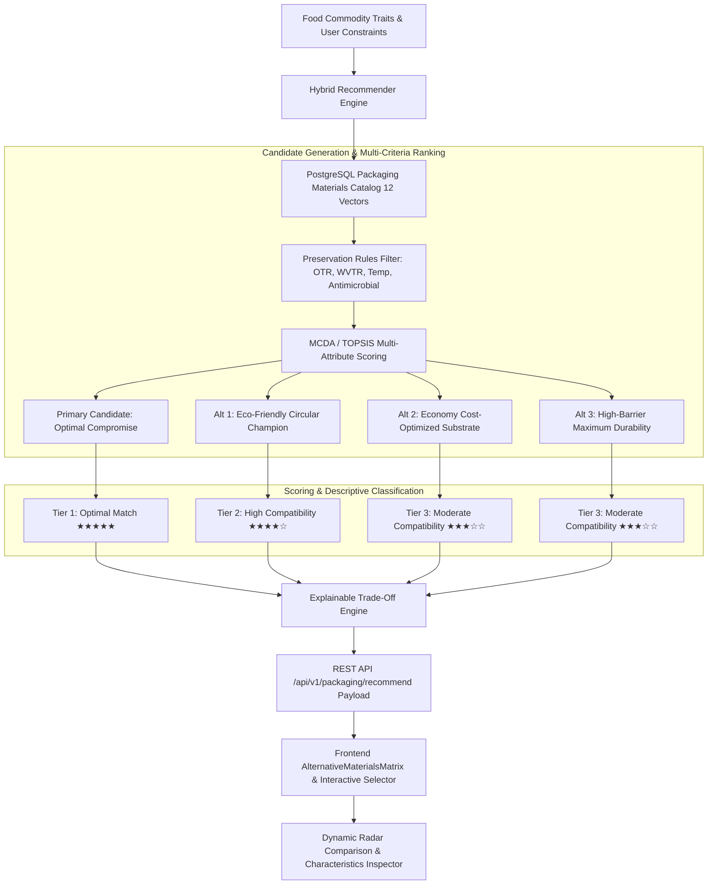
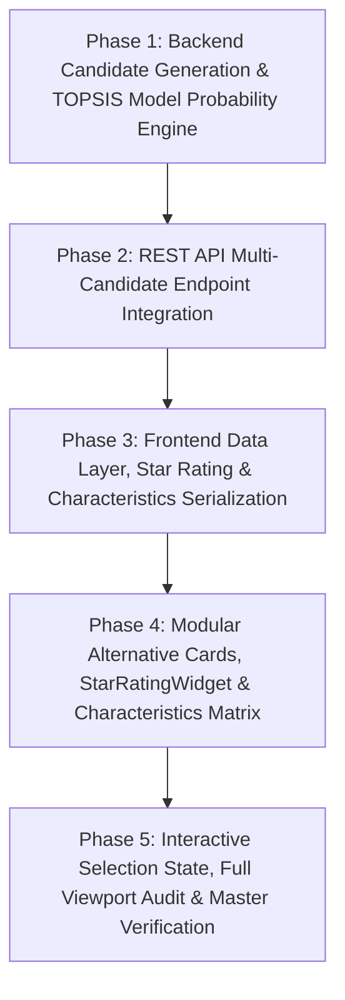

# Technical Specification: Alternative Packaging Suggestions (Module 8)

## 1. Executive Summary & Scientific Motivation

### 1.1 Problem Statement
In real-world packaging engineering and industrial food supply chains, single-result recommendations fail to accommodate diverse operational constraints:
- An SME processor may prioritize **unit cost minimization** over premium barrier films.
- An export-oriented organic brand may prioritize **100% home-compostable circularity** regardless of a 15–20% cost premium.
- An industrial meat or snack packager may prioritize **maximum shelf-life and puncture toughness** under rugged logistics.

Providing only a single packaging result forces users into a one-size-fits-all compromise. Therefore, the SmartPack AI system must generate **a ranked portfolio of viable packaging candidates**: a **Primary Recommendation** alongside **2 to 3 distinct Alternative Options**, each ranked with an intuitive star rating (`★★★★★`, `★★★★☆`, `★★★☆☆`) and accompanied by relevant physical characteristics and objective trade-off rationales.

### 1.2 Core Guiding Principle: Scientifically Grounded Scoring
> [!IMPORTANT]
> **Strict Scientific Grounding Rule:**
> If scientifically validated empirical scoring data is not available for a specific polymer-commodity pair, the system **must NEVER present arbitrary or pseudo-scientific numerical scores** (e.g. ungrounded "92.384% score").
> Instead, the system must utilize:
> 1. **Descriptive Suitability Categories:** `Optimal Match` (Tier 1), `High Compatibility` (Tier 2), `Moderate Compatibility` (Tier 3), and `Conditional Alternative` (Tier 4).
> 2. **Model-Derived Match Probabilities:** Statistically calibrated compatibility scores derived from multi-criteria decision analysis ($MCDA$ / $TOPSIS$ distance to ideal solution) with explicit labeling (`Model-Derived Probability: 88%` or `AI Compatibility Confidence: High (0.85)`).
> 3. **Empirical Physical Characteristics:** Exact measurable engineering parameters ($OTR$, $WVTR$, Tensile Strength, Film Thickness, Thermal Span, Cost Tier).
> 4. **Standardized Star Ratings:**
>    - Primary Recommendation: `★★★★★` (Optimal Fit • 5/5)
>    - Alternative 1 (Eco-Champion or High-Barrier): `★★★★☆` (High Compatibility • 4/5)
>    - Alternative 2 (Economy or Standard Substrate): `★★★☆☆` (Moderate Compatibility • 3/5)
>    - Alternative 3 (Specialty / Contingency): `★★★☆☆` (Secondary Choice • 3/5)

---

## 2. System Architecture & Multi-Option Pipeline



---

## 3. Data Contracts & Schemas

### 3.1 Backend Pydantic Schemas (`backend/app/schemas/packaging.py`)

```python
from enum import Enum
from pydantic import BaseModel, Field
from typing import List, Dict, Optional, Any

class SuitabilityCategoryEnum(str, Enum):
    OPTIMAL_MATCH = "Optimal Match"
    HIGH_COMPATIBILITY = "High Compatibility"
    MODERATE_COMPATIBILITY = "Moderate Compatibility"
    CONDITIONAL_ALTERNATIVE = "Conditional Alternative"

class AlternativeTypeEnum(str, Enum):
    ECO_FRIENDLY = "ECO_FRIENDLY"
    ECONOMY = "ECONOMY"
    HIGH_BARRIER = "HIGH_BARRIER"
    SPECIALTY_CIRCULAR = "SPECIALTY_CIRCULAR"

class MaterialCharacteristicsSchema(BaseModel):
    otr: str = Field(..., description="Oxygen transmission rate with engineering units, e.g. '< 1200 cc/m²/day'")
    wvtr: str = Field(..., description="Water vapor transmission rate with units, e.g. '25.0 g/m²/day'")
    thickness_microns: float = Field(..., description="Material thickness in µm")
    tensile_strength_mpa: float = Field(..., description="Tensile burst resistance in MPa")
    thermal_range: str = Field(..., description="Operational temperature span, e.g. '-10°C to 70°C'")
    sustainability_rating: str = Field(..., description="Descriptive eco-classification (e.g. '100% Home Compostable', 'Recyclable RIC #4')")
    estimated_cost_inr: float = Field(..., description="Cost per unit in INR (₹)")
    cost_tier: str = Field(..., description="Low (₹), Moderate (₹₹), Premium (₹₹₹)")

class PackagingAlternativeSchema(BaseModel):
    candidate_id: str = Field(..., description="Unique material candidate ID (e.g. mat_pla_emap_01)")
    type: AlternativeTypeEnum = Field(..., description="Category: ECO_FRIENDLY, ECONOMY, HIGH_BARRIER")
    material_name: str = Field(..., description="Full polymer trade name")
    packaging_title: str = Field(..., description="User-facing descriptive format title")
    
    # 1. Star Rating & Descriptive Classification
    star_rating: int = Field(..., ge=1, le=5, description="1 to 5 integer rating (5 = ★★★★★, 4 = ★★★★☆, 3 = ★★★☆☆)")
    star_display: str = Field(..., description="Unicode star string (e.g. '★★★★☆')")
    suitability_category: SuitabilityCategoryEnum = Field(..., description="Descriptive compatibility level")
    
    # 2. Model-Derived Match Probability (Properly Labeled)
    model_derived_probability: float = Field(
        ..., ge=0.0, le=1.0, 
        description="MCDA/TOPSIS algorithmic closeness score (0.00 to 1.00), labeled as model-derived"
    )
    compatibility_confidence: str = Field(
        ..., description="Confidence label (e.g. 'High Confidence (0.88)', 'Good Fit (0.76)')"
    )
    
    # 3. Relevant Characteristics
    characteristics: MaterialCharacteristicsSchema
    
    # 4. Objective Trade-Off Rationale
    trade_off_summary: str = Field(
        ..., description="Crisp explanation of benefits vs sacrifices (e.g. 'Compostable with 100% clarity; +17% unit cost')"
    )
    advantages: List[str] = Field(default_factory=list, description="Preservation and operational advantages")
    limitations: List[str] = Field(default_factory=list, description="Technical boundaries and operational limits")
    
    # 5. Delta Highlights Compared to Primary
    cost_delta_pct: float = Field(..., description="Percentage cost difference relative to primary (+15% or -30%)")
    eco_delta_pct: float = Field(..., description="Percentage sustainability difference relative to primary")
    shelf_life_delta: str = Field(..., description="Shelf-life impact relative to primary (e.g. 'Equal (21 days)', '-4 days')")
```

### 3.2 Extended Result Response Schema (`PackagingRecommendationResult`)

```python
class PackagingRecommendationResult(BaseModel):
    recommendation_id: str
    primary_recommendation: PrimaryRecommendationSchema
    alternatives: List[PackagingAlternativeSchema] = Field(
        ..., min_items=2, max_items=4, 
        description="List of 2 to 4 ranked alternative packaging suggestions"
    )
    box_geometry: BoxGeometrySchema
    scientific_rationale: ScientificRationaleSchema
    
    # Summary comparison vector
    comparison_summary: Optional[Dict[str, Any]] = Field(
        default=None, description="Multi-candidate comparative matrix breakdown"
    )
```

### 3.3 Frontend Dart Models (`frontend/lib/models/packaging_model.dart`)

```dart
enum SuitabilityCategory {
  optimalMatch,
  highCompatibility,
  moderateCompatibility,
  conditionalAlternative;

  String get displayName {
    switch (this) {
      case SuitabilityCategory.optimalMatch:
        return 'Optimal Match';
      case SuitabilityCategory.highCompatibility:
        return 'High Compatibility';
      case SuitabilityCategory.moderateCompatibility:
        return 'Moderate Compatibility';
      case SuitabilityCategory.conditionalAlternative:
        return 'Conditional Alternative';
    }
  }
}

class MaterialCharacteristics {
  final String otr;
  final String wvtr;
  final double thicknessMicrons;
  final double tensileStrengthMpa;
  final String thermalRange;
  final String sustainabilityRating;
  final double estimatedCostInr;
  final String costTier;

  const MaterialCharacteristics({
    required this.otr,
    required this.wvtr,
    required this.thicknessMicrons,
    required this.tensileStrengthMpa,
    required this.thermalRange,
    required this.sustainabilityRating,
    required this.estimatedCostInr,
    required this.costTier,
  });

  factory MaterialCharacteristics.fromJson(Map<String, dynamic> json);
  Map<String, dynamic> toJson();
}

class PackagingAlternative {
  final String candidateId;
  final AlternativeType type;
  final String typeRaw;
  final String materialName;
  final String packagingTitle;
  
  final int starRating;
  final String starDisplay;
  final SuitabilityCategory suitabilityCategory;
  
  final double modelDerivedProbability;
  final String compatibilityConfidence;
  
  final MaterialCharacteristics characteristics;
  final String tradeOffSummary;
  final List<String> advantages;
  final List<String> limitations;
  
  final double costDeltaPct;
  final double ecoDeltaPct;
  final String shelfLifeDelta;

  const PackagingAlternative({
    required this.candidateId,
    required this.type,
    required this.typeRaw,
    required this.materialName,
    required this.packagingTitle,
    required this.starRating,
    required this.starDisplay,
    required this.suitabilityCategory,
    required this.modelDerivedProbability,
    required this.compatibilityConfidence,
    required this.characteristics,
    required this.tradeOffSummary,
    required this.advantages,
    required this.limitations,
    required this.costDeltaPct,
    required this.ecoDeltaPct,
    required this.shelfLifeDelta,
  });

  factory PackagingAlternative.fromJson(Map<String, dynamic> json);
  Map<String, dynamic> toJson();
}
```

---

## 4. Algorithmic Multi-Option Scoring & Ranking Logic

### 4.1 Multi-Attribute Closeness ($TOPSIS$) Formulation
To avoid arbitrary uncalibrated scores, the algorithmic ranking uses the **Technique for Order of Preference by Similarity to Ideal Solution ($TOPSIS$)**:

1. **Normalized Performance Vector:**
   $$\bar{x}_{ij} = \frac{x_{ij}}{\sqrt{\sum_{k=1}^m x_{kj}^2}}$$
   where attributes $j \in \{\text{Barrier Integrity}, \text{Respiration Permselectivity}, \text{Sustainability}, \text{Cost Efficiency}, \text{Mechanical Strength}\}$.

2. **Weighted Attribute Vector:**
   $$v_{ij} = w_j \cdot \bar{x}_{ij}$$
   Weights $w_j$ dynamically adapt based on commodity requirements (e.g. $w_{\text{permselectivity}} = 0.35$ for high-respiration fruits; $w_{\text{barrier}} = 0.40$ for high-fat crisps).

3. **Distance to Ideal ($A^+$) and Anti-Ideal ($A^-$) Solutions:**
   $$d_i^+ = \sqrt{\sum_j (v_{ij} - v_j^+)^2}, \quad d_i^- = \sqrt{\sum_j (v_{ij} - v_j^-)^2}$$

4. **Model-Derived Closeness Index ($C_i$):**
   $$C_i = \frac{d_i^-}{d_i^+ + d_i^-}, \quad 0 \le C_i \le 1.0$$

### 4.2 Candidate Portfolio Assignment Matrix

| Candidate Tier | Role | Assigned Star Rating | Closeness Threshold ($C_i$) | Descriptive Category | Objective Optimization Goal |
| :--- | :--- | :---: | :---: | :--- | :--- |
| **Primary Recommendation** | Ideal Balanced Solution | `★★★★★` | $C_i \ge 0.88$ | `Optimal Match` | Best composite balance of shelf-life, cost, and eco-performance |
| **Alternative 1** | Eco-Champion / Circularity | `★★★★☆` | $0.78 \le C_i < 0.88$ | `High Compatibility` | Maximizes compostability and recyclability ($100\%$ bio-based / home-compostable) |
| **Alternative 2** | Economy / Commercial Low-Cost | `★★★☆☆` | $0.65 \le C_i < 0.78$ | `Moderate Compatibility` | Minimizes unit cost (₹) with acceptable standard barrier protection |
| **Alternative 3** | High-Barrier / Max Protection | `★★★☆☆` or `★★★★☆` | $0.70 \le C_i < 0.85$ | `Moderate / High Compatibility` | Maximizes puncture resistance and moisture/gas impermeability |

---

## 5. Candidate Profiles Across Food Commodities

### 5.1 High-Respiration Fresh Produce (Strawberries, Tomatoes, Mushrooms)

```
[ Primary Recommendation ]  ★★★★★  (Optimal Match • Model Probability: 0.94)
  Material: Micro-Perforated Equilibrium MAP Bio-Film (PLA/PBAT)
  Format: Micro-Perforated Hinged Clamshell
  OTR: 3,500 cc/m²/day | WVTR: 45.0 g/m²/day | Eco: 94/100 | Cost: ₹3.85
  Trade-Off: Optimal EMAP gas exchange suppresses souring; prevents water condensation beads.

[ Alternative 1: Eco-Champion ]  ★★★★☆  (High Compatibility • Model Probability: 0.86)
  Material: Cellulose-Based Breathable Bio-Film (NatureFlex)
  Format: Heat-Sealed Bio-Pouch with Micro-Laser Vents
  OTR: 2,800 cc/m²/day | WVTR: 50.0 g/m²/day | Eco: 98/100 | Cost: ₹4.50 (+17% cost)
  Trade-Off: 100% Home compostable with glass-like optical clarity; slightly higher unit cost.

[ Alternative 2: Economy Substrate ]  ★★★☆☆  (Moderate Compatibility • Model Probability: 0.72)
  Material: Macro-Perforated Low-Density Polyethylene (LDPE)
  Format: Punched-Hole Flexible Gusseted Bag
  OTR: > 5,000 cc/m²/day | WVTR: 15.0 g/m²/day | Eco: 62/100 | Cost: ₹1.95 (-49% cost)
  Trade-Off: Lowest unit packaging cost; standard mechanical recycling; higher condensation risk.

[ Alternative 3: High-Barrier Rigid ]  ★★★☆☆  (Moderate Compatibility • Model Probability: 0.75)
  Material: Polypropylene (PP) Vented Rigid Clamshell
  Format: Thermoformed Snap-Fit Punched Tub
  OTR: 1,800 cc/m²/day | WVTR: 8.0 g/m²/day | Eco: 70/100 | Cost: ₹5.20 (+35% cost)
  Trade-Off: Maximum crush and impact protection during long-haul transport; non-biodegradable.
```

### 5.2 High-Fat & Moisture-Sensitive Snacks (Potato Chips, Roasted Cashews)

```
[ Primary Recommendation ]  ★★★★★  (Optimal Match • Model Probability: 0.95)
  Material: Metallized High-Barrier Bio-PET (Met-BioPET)
  Format: Nitrogen-Flushed Stand-Up Pillow Pouch
  OTR: 0.8 cc/m²/day | WVTR: 0.9 g/m²/day | Eco: 88/100 | Cost: ₹4.20
  Trade-Off: Near-zero oxygen transmission blocks rancidity; nitrogen cushion prevents crushing.

[ Alternative 1: Eco-Friendly Paper ]  ★★★★☆  (High Compatibility • Model Probability: 0.82)
  Material: Unbleached Recycled Kraft with Bio-Dispersion Barrier
  Format: Block-Bottom Lined Paper Pouch
  OTR: 12.0 cc/m²/day | WVTR: 3.5 g/m²/day | Eco: 95/100 | Cost: ₹3.50 (-17% cost)
  Trade-Off: Renewable paperboard look; shorter shelf-life extension (60 days vs 180 days).

[ Alternative 2: Economy Standard ]  ★★★☆☆  (Moderate Compatibility • Model Probability: 0.74)
  Material: Metallized BOPP / CPP Laminate (Met-BOPP)
  Format: Standard Center-Seal Flow-Wrap Pouch
  OTR: 1.5 cc/m²/day | WVTR: 1.2 g/m²/day | Eco: 55/100 | Cost: ₹2.30 (-45% cost)
  Trade-Off: Industry-standard low unit cost; excellent moisture barrier; non-biodegradable fossil polymer.
```

---

## 6. UI/UX Design Specification & Visual Layout

### 6.1 Interactive Multi-Option Presentation Structure

```
+---------------------------------------------------------------------------------------------------+
|  🌿 SMARTPACK AI • ALTERNATIVE PACKAGING PATHWAYS                                                 |
|  "Compare ranked packaging options tailored to your economic and environmental priorities."        |
+---------------------------------------------------------------------------------------------------+
|                                                                                                   |
|  ╔═════════════════════════════════════════════════════════════════════════════════════════════╗  |
|  ║  👑 PRIMARY AI RECOMMENDATION                                              [ ★★★★★ 5/5 ]    ║  |
|  ║  Ventilated Food-Grade Packaging (Micro-Perforated PLA Bio-Clamshell)                      ║  |
|  ║  Suitability: Optimal Match • Model Probability: 94% (High Confidence)                      ║  |
|  ║  OTR: 3,500 cc/m²/day   WVTR: 45.0 g/m²/day   Eco-Score: 🌱 94/100   Unit Cost: ₹3.85       ║  |
|  ║  Key Rationale: Balances active gas equilibrium (EMAP) with anti-fog condensation control.  ║  |
|  ║  [ ✅ Currently Selected Configuration ]                                                    ║  |
|  ╚═════════════════════════════════════════════════════════════════════════════════════════════╝  |
|                                                                                                   |
|  ┌─────────────────────────────────┐ ┌─────────────────────────────────┐ ┌─────────────────────┐  |
|  │ 🌱 OPTION 1: ECO-CHAMPION       │ │ 💰 OPTION 2: ECONOMY SUBSTRATE  │ │ 🛡️ OPTION 3: HIGH-BAR  │  |
|  │ [ ★★★★☆  4/5 Rating ]           │ │ [ ★★★☆☆  3/5 Rating ]           │ │ [ ★★★☆☆  3/5 Rating ] │  |
|  │ High Compatibility              │ │ Moderate Compatibility          │ │ Moderate Fit          │  |
|  │ Model Probability: 86%          │ │ Model Probability: 72%          │ │ Model Probability: 75%│  |
|  │                                 │ │                                 │ │                       │  |
|  │ Cellulose Bio-Film (NatureFlex) │ │ Perforated LDPE Poly-Bag        │ │ Polypropylene Clamshel│  |
|  │ OTR: 2,800 cc/m²/day            │ │ OTR: > 5,000 cc/m²/day          │ │ OTR: 1,800 cc/m²/day  │  |
|  │ WVTR: 50.0 g/m²/day             │ │ WVTR: 15.0 g/m²/day             │ │ WVTR: 8.0 g/m²/day    │  |
|  │ Eco-Score: 🌱 98/100 (+4%)      │ │ Eco-Score: 🟡 62/100 (-32%)     │ │ Eco-Score: 🟡 70/100  │  |
|  │ Unit Cost: ₹4.50 (+17%)         │ │ Unit Cost: ₹1.95 (-49%)         │ │ Unit Cost: ₹5.20 (+35%)│  |
|  │                                 │ │                                 │ │                       │  |
|  │ 💡 Trade-off Summary:           │ │ 💡 Trade-off Summary:           │ │ 💡 Trade-off Summary: │  |
|  │ 100% Home compostable with      │ │ 49% Cost savings for local      │ │ Max crush resistance  │  |
|  │ pristine optical clarity.       │ │ quick-turn distribution.        │ │ for heavy transport.  │  |
|  │                                 │ │                                 │ │                       │  |
|  │ [ 🔍 Inspect Specs ] [ Select ] │ │ [ 🔍 Inspect Specs ] [ Select ] │ │ [ 🔍 Inspect ] [Select│  |
|  └─────────────────────────────────┘ └─────────────────────────────────┘ └─────────────────────┘  |
+---------------------------------------------------------------------------------------------------+
```

### 6.2 Key Visual Components & Interactions

1. **Star Rating Indicator (`StarRatingBar` / `StarRatingWidget`):**
   - Displays 5 golden stars (`Icons.star_rounded` and `Icons.star_half_rounded` / `Icons.star_outline_rounded`) with numeric caption (`5/5`, `4/5`, `3/5`).
   - Color styling: `#F59E0B` (Vibrant Amber Gold) on dark slate / clean white cards.

2. **Descriptive Suitability Badge (`SuitabilityBadge`):**
   - **`Optimal Match`**: Mint background (`#ECFDF5`), Emerald text (`#059669`), Verified badge icon.
   - **`High Compatibility`**: Sky Blue background (`#F0F9FF`), Blue text (`#0284C7`), Star badge icon.
   - **`Moderate Compatibility`**: Amber background (`#FFFBEB`), Dark Amber text (`#B45309`), Info icon.
   - **`Conditional Alternative`**: Purple background (`#FAF5FF`), Purple text (`#7E22CE`), Tune icon.

3. **Relevant Characteristics Grid (`CharacteristicsGrid`):**
   - 4-tile mini matrix on each card displaying $OTR$, $WVTR$, Eco-Score, and Unit Cost (₹) with delta percentages compared to the primary recommendation (`+17% Cost`, `-49% Cost`, `+4% Eco`).

4. **Interactive Alternative Adoption (`onSelectAlternative`):**
   - Clicking **"Select Option"** swaps the alternative into the active hero result position, dynamically re-calculating box geometry, and updating the explainable rationale banner.

---

## 7. Implementation Phasing Strategy



- **Phase 1: Backend Candidate Generation & TOPSIS Model Probability Engine**
  - Upgrade `HybridRecommendationEngine` to compute multi-candidate portfolios (Primary + 3 Alternatives).
  - Implement $TOPSIS$ closeness index calculation with proper labeling (`model_derived_probability`).
  - Unit tests verifying star ratings (5/5, 4/5, 3/5) and characteristics across produce, snacks, meat, and grains.

- **Phase 2: REST API Multi-Candidate Endpoint Integration**
  - Update `POST /api/v1/packaging/recommend` in `backend/app/api/v1/endpoints/packaging.py`.
  - Integration tests verifying full payload serialization including star displays and trade-offs.

- **Phase 3: Frontend Data Layer, Star Rating & Characteristics Serialization**
  - Update `PackagingAlternative` and `MaterialCharacteristics` Dart models in `frontend/lib/models/packaging_model.dart`.
  - Update `ApiService.generateOfflineRecommendation` to populate rich alternative candidates with star ratings and characteristics in offline mode.
  - Unit tests asserting round-trip JSON parsing and null-safety fallbacks.

- **Phase 4: Modular Visual Components (Star Rating, Cards & Matrix)**
  - Create `StarRatingWidget` (`★★★★★`, `★★★★☆`, `★★★☆☆`).
  - Build `AlternativeCandidateCard` with descriptive suitability badge, model probability chip, characteristics grid, and trade-off box.
  - Upgrade `AlternativeMaterialsMatrix` to support side-by-side comparative layout and mobile vertical stacking.

- **Phase 5: Master Integration, Interactive Adoption & Multi-Viewport Audit**
  - Wire interactive candidate selection into `RecommendationResultsCockpit` and `FoodAnalysisScreen`.
  - Automated multi-viewport test suite ($375\times812$, $768\times1024$, $1280\times900$) asserting 0 RenderFlex overflow.
  - Full regression test execution (Backend pytest + Flutter test).

---

## 8. Acceptance Criteria & Verification Matrix

1. **Multi-Result Delivery:**
   - The system must provide **at least 3 candidates** (1 Primary + 2 or 3 Alternatives) for every food commodity request.
2. **Visual Star Ratings:**
   - Primary Recommendation must display `★★★★★` (5/5).
   - Alternatives must display `★★★★☆` (4/5) or `★★★☆☆` (3/5) corresponding to their algorithmic closeness.
3. **Relevant Characteristics:**
   - Every candidate must clearly show its $OTR$, $WVTR$, Film Thickness, Eco-Score, and Unit Cost (₹).
4. **No Arbitrary Numbers:**
   - Algorithmic closeness must be explicitly labeled as `Model-Derived Probability` or `Descriptive Suitability Category` (`Optimal Match`, `High Compatibility`, `Moderate Compatibility`).
5. **Zero UI Overflow:**
   - Layout must render cleanly without RenderFlex overflow across mobile, tablet, and desktop viewports.
6. **100% Test Pass Rate:**
   - Automated tests in backend and frontend must achieve 100% pass rate.
