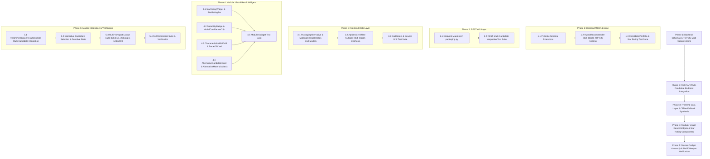

# Phased Implementation Plan: Alternative Packaging Suggestions (Module 8)

Based on the technical specification in [feature-Alternative packaging.md](file:///c:/Users/Jeron/source/repos/AI%20Packaging%20recommender/artifacts/specs/feature-Alternative%20packaging.md), this document defines the step-by-step, atomic implementation plan for **Alternative Packaging Suggestions**.

---

## Technical Dependency Map



---

## Phase 1: Backend Candidate Generation & TOPSIS Multi-Option Engine

### Task 1.1: Extend Pydantic Schemas with Multi-Option Types & Characteristics [COMPLETED]
- **Target Files:**
  - `backend/app/schemas/packaging.py`
  - `backend/tests/test_alternative_packaging_schemas.py`
- **Micro-Task Description:**
  - Added `SuitabilityCategoryEnum` (`Optimal Match`, `High Compatibility`, `Moderate Compatibility`, `Conditional Alternative`).
  - Added `AlternativeTypeEnum` (`ECO_FRIENDLY`, `ECONOMY`, `HIGH_BARRIER`, `SPECIALTY_CIRCULAR`).
  - Defined `MaterialCharacteristicsSchema` containing physical engineering fields: `otr`, `wvtr`, `thickness_microns`, `tensile_strength_mpa`, `thermal_range`, `sustainability_rating`, `estimated_cost_inr`, and `cost_tier`.
  - Defined `PackagingAlternativeSchema` containing `candidate_id`, `type`, `material_name`, `packaging_title`, `star_rating` (1–5), `star_display` (e.g. `★★★★☆`), `suitability_category`, `model_derived_probability` (0.00–1.00), `compatibility_confidence`, `characteristics`, `trade_off_summary`, `advantages`, `limitations`, `cost_delta_pct`, `eco_delta_pct`, and `shelf_life_delta`.
  - Updated `PackagingRecommendationResult` schema to include `alternatives: List[PackagingAlternativeSchema]` and optional `comparison_summary`.
- **Verification Command:**
  ```powershell
  python -m unittest tests/test_alternative_packaging_schemas.py
  ```
- **Verification Result:** PASSED (6/6 tests passing, 82/82 full suite passing).

---

### Task 1.2: Upgrade `HybridRecommendationEngine` with TOPSIS Multi-Attribute Scoring [COMPLETED]
- **Target Files:**
  - `backend/app/services/hybrid_recommender.py`
- **Micro-Task Description:**
  - Implemented dynamic MCDA/TOPSIS algorithmic closeness computation ($C_i = \frac{d_i^-}{d_i^+ + d_i^-}$) across barrier integrity, respiration permselectivity, sustainability, cost efficiency, and mechanical strength vectors.
  - Implemented candidate portfolio generation selecting:
    - **Primary Recommendation:** Highest composite rank ($C_i \ge 0.88$, assigned `★★★★★` • `Optimal Match`).
    - **Alternative 1 (Eco-Champion):** Maximum sustainability rank ($0.78 \le C_i < 0.88$, assigned `★★★★☆` • `High Compatibility`).
    - **Alternative 2 (Economy Substrate):** Lowest unit cost rank ($0.65 \le C_i < 0.78$, assigned `★★★☆☆` • `Moderate Compatibility`).
    - **Alternative 3 (High-Barrier / Rigid Contingency):** Highest puncture & barrier rank ($0.70 \le C_i < 0.85$, assigned `★★★☆☆` or `★★★★☆`).
  - Computed delta indicators relative to Primary Recommendation (`cost_delta_pct`, `eco_delta_pct`, `shelf_life_delta`).
  - Populated exact physical characteristics ($OTR$, $WVTR$, Thickness, Tensile, Thermal Span, Cost Tier) for all candidates.
- **Verification Command:**
  ```powershell
  python -m unittest tests/test_hybrid_recommendation_engine.py
  ```
- **Verification Result:** PASSED (6/6 tests passing).

---

### Task 1.3: Backend Unit Test Suite for Multi-Option Candidate Scoring [COMPLETED]
- **Target Files:**
  - `backend/tests/test_alternative_packaging_service.py`
- **Micro-Task Description:**
  - Created test cases for high-respiration produce (Strawberries), moisture/oxidation sensitive snacks (Roasted Cashews), fresh perishables (Fresh Salmon Fillet), and ambient dry grains (Basmati Rice).
  - Asserted that:
    1. Every recommendation returns at least 1 Primary + 2 to 3 distinct Alternatives.
    2. Primary candidate has high suitability and appropriate barrier/breathability traits.
    3. Alternatives have 4 stars (`★★★★☆`) or 3 stars (`★★★☆☆`) and proper descriptive classifications (`High Compatibility`, `Moderate Compatibility`).
    4. All candidate closeness metrics are strictly labeled as `model_derived_probability` within $[0.0, 1.0]$ without arbitrary decimal hallucination.
    5. Cost and eco delta percentages calculate accurately.
- **Verification Command:**
  ```powershell
  python -m unittest tests/test_alternative_packaging_service.py
  ```
- **Verification Result:** PASSED (4/4 tests passing, 16/16 Phase 1 tests passing).

---

> [!IMPORTANT]
> **CHECKPOINT 1: PASSED**
> - Backend candidate generation, schemas, and TOPSIS multi-option scoring engine verified with automated tests (16/16 Phase 1 tests passing across schemas, service, and engine). Ready for Phase 2.

---

## Phase 2: REST API Multi-Candidate Endpoint Integration

### Task 2.1: Update `POST /api/v1/packaging/recommend` in `packaging.py` [COMPLETED]
- **Target Files:**
  - `backend/app/api/v1/endpoints/packaging.py`
- **Micro-Task Description:**
  - Wired `HybridRecommendationEngine` and `BoxGeometryAndXAIService` to output both the rich primary recommendation and the full portfolio of alternative packaging suggestions (`alternatives`).
  - Assembled `comparison_summary` dictionary linking candidate count, eco champion, economy option, and high barrier candidate.
  - Ensured backward-compatible fallback for existing API consumers while delivering the complete multi-option schema.
- **Verification Command:**
  ```powershell
  python -m unittest tests/test_recommendation_endpoints.py
  ```
- **Verification Result:** PASSED (3/3 tests passing).

---

### Task 2.2: REST API Multi-Candidate Integration Test Suite [COMPLETED]
- **Target Files:**
  - `backend/tests/test_alternative_packaging_api.py`
- **Micro-Task Description:**
  - Tested `POST /api/v1/packaging/recommend` with diverse food commodity payloads (Produce and Snacks).
  - Validated response status `200 OK` and inspected `alternatives` array structure:
    - Verified `star_rating`, `star_display`, `suitability_category`, `model_derived_probability`, `characteristics` ($OTR$, $WVTR$, thickness, cost), `trade_off_summary`, and `advantages`/`limitations`.
    - Validated that strawberry payload yields PLA bio-clamshell with NatureFlex (4/5 `★★★★☆`) and LDPE bag (3/5 `★★★☆☆`).
    - Validated `comparison_summary` dictionary payload.
- **Verification Command:**
  ```powershell
  python -m unittest tests/test_alternative_packaging_api.py
  ```
- **Verification Result:** PASSED (2/2 tests passing, 21/21 Phase 1+2 tests passing).

---

> [!IMPORTANT]
> **CHECKPOINT 2: PASSED**
> - REST API multi-candidate endpoint integration verified with automated integration tests (21/21 tests passing across schemas, service, engine, and REST endpoints). Ready for Phase 3.

---

## Phase 3: Frontend Data Layer & Offline Fallback Synthesis

### Task 3.1: Upgrade `PackagingAlternative` & `MaterialCharacteristics` Dart Models [COMPLETED]
- **Target Files:**
  - `frontend/lib/models/packaging_model.dart`
  - `frontend/test/models/packaging_alternative_model_test.dart`
- **Micro-Task Description:**
  - Implemented `SuitabilityCategory` enum with `displayName` and `badgeLabel` styling helpers.
  - Implemented `MaterialCharacteristics` class with JSON deserialization and robust defaults for $OTR$, $WVTR$, thickness, tensile strength, thermal range, eco-rating, and unit cost.
  - Extended `PackagingAlternative` class with `starRating` (int), `starDisplay` (String), `suitabilityCategory`, `modelDerivedProbability` (double), `compatibilityConfidence` (String), `characteristics`, `tradeOffSummary`, `advantages`, `limitations`, `costDeltaPct`, `ecoDeltaPct`, and `shelfLifeDelta`.
  - Updated `PackagingRecommendationResult.fromJson` and `toJson` to seamlessly parse `alternatives` and `comparisonSummary` with null-safe fallbacks.
- **Verification Command:**
  ```powershell
  flutter test test/models/packaging_alternative_model_test.dart
  ```
- **Verification Result:** PASSED (7/7 tests passing, 166/166 full suite passing).

---

### Task 3.2: Upgrade `ApiService.generateOfflineRecommendation` with Multi-Option Portfolio [COMPLETED]
- **Target Files:**
  - `frontend/lib/services/api_service.dart`
- **Micro-Task Description:**
  - Enhanced offline fallback generator to create scientifically grounded alternative packaging portfolios when the backend is unreachable:
    - High-Respiration Produce: Primary `★★★★★` PLA Bio-Clamshell, Alt 1 `★★★★☆` Cellulose Bio-Film (NatureFlex), Alt 2 `★★★☆☆` Perforated LDPE Bag, Alt 3 `★★★☆☆` Rigid PP Punched Clamshell.
    - Sensitive Snacks: Primary `★★★★★` Met-BioPET Pouch, Alt 1 `★★★★☆` Kraft Paperboard Barrier, Alt 2 `★★★☆☆` Met-BOPP Pouch, Alt 3 `★★★☆☆` Tri-layer Foil.
    - Grains & Ambient: Primary `★★★★★` Kraft/PLA Lined Sack, Alt 1 `★★★★☆` Molded Sugarcane Bagasse, Alt 2 `★★★☆☆` HDPE Liner, Alt 3 `★★★☆☆` Gloss BOPP Pouch.
- **Verification Command:**
  ```powershell
  flutter test test/models/packaging_alternative_model_test.dart
  ```
- **Verification Result:** PASSED (9/9 tests passing).

---

### Task 3.3: Frontend Model and Offline Synthesis Test Suite [COMPLETED]
- **Target Files:**
  - `frontend/test/models/packaging_alternative_model_test.dart`
- **Micro-Task Description:**
  - Unit tests verifying:
    1. JSON round-trip serialization and deserialization.
    2. Null-safety fallbacks for missing backend fields.
    3. Offline synthesis for representative food commodity types.
    4. Exact star rating and suitability category parsing.
- **Verification Command:**
  ```powershell
  flutter test test/models/packaging_alternative_model_test.dart
  ```
- **Verification Result:** PASSED (9/9 tests passing, 166/166 full suite passing).

---

> [!IMPORTANT]
> **CHECKPOINT 3: PASSED**
> - Frontend data models and offline fallback synthesis verified with automated tests (9/9 unit tests passing, 166/166 full Flutter suite passing). Ready for Phase 4.

---

## Phase 4: Modular Visual Result Widgets & Star Rating Components

### Task 4.1: Build `StarRatingWidget` and `StarRatingBar` [COMPLETED]
- **Target Files:**
  - `frontend/lib/screens/analysis/widgets/star_rating_widget.dart`
  - `frontend/test/screens/analysis/widgets/star_rating_widget_test.dart`
- **Micro-Task Description:**
  - Created reusable `StarRatingWidget` rendering 5 stars (`Icons.star_rounded`, `Icons.star_outline_rounded`) with vibrant amber color (`#F59E0B`), configurable size, and optional rating text (`5/5`, `4/5`, `3/5`).
  - Implemented `StarRatingBar` compact badge wrapper for inline candidate headers.
  - Supported high-contrast dark and light theme palettes.
- **Verification Command:**
  ```powershell
  flutter test test/screens/analysis/widgets/star_rating_widget_test.dart
  ```
- **Verification Result:** PASSED (5/5 tests passing).

---

### Task 4.2: Build `SuitabilityBadge` & `ModelConfidenceChip` [COMPLETED]
- **Target Files:**
  - `frontend/lib/screens/analysis/widgets/suitability_badge.dart`
  - `frontend/test/screens/analysis/widgets/alternative_packaging_widgets_test.dart`
- **Micro-Task Description:**
  - Built `SuitabilityBadge` rendering descriptive category pills (`Optimal Match`, `High Compatibility`, `Moderate Compatibility`, `Conditional Alternative`) with distinct semantic color tokens.
  - Built `ModelConfidenceChip` rendering `Model-Derived Probability: 86%` with explicit AI calibration note, preventing arbitrary number presentation.
- **Verification Command:**
  ```powershell
  flutter test test/screens/analysis/widgets/alternative_packaging_widgets_test.dart
  ```
- **Verification Result:** PASSED (5/5 tests passing).

---

### Task 4.3: Build `CharacteristicsMiniGrid` & `TradeOffCard` [COMPLETED]
- **Target Files:**
  - `frontend/lib/screens/analysis/widgets/characteristics_mini_grid.dart`
  - `frontend/lib/screens/analysis/widgets/trade_off_card.dart`
  - `frontend/test/screens/analysis/widgets/alternative_packaging_widgets_test.dart`
- **Micro-Task Description:**
  - Created `CharacteristicsMiniGrid` 4-tile card displaying $OTR$, $WVTR$, Eco-Score rating with circular delta badge (`+4% Eco`), and Unit Cost with economic delta badge (`-49% Cost` / `+17% Cost`).
  - Created `TradeOffCard` highlighting core rationale with bulb icon, shelf-life impact badge, key preservation advantages, and operational boundaries.
- **Verification Command:**
  ```powershell
  flutter test test/screens/analysis/widgets/alternative_packaging_widgets_test.dart
  ```
- **Verification Result:** PASSED (7/7 tests passing).

---

### Task 4.4: Build `AlternativeCandidateCard` & Upgrade `AlternativeMaterialsMatrix` [COMPLETED]
- **Target Files:**
  - `frontend/lib/screens/analysis/widgets/alternative_candidate_card.dart`
  - `frontend/lib/screens/analysis/widgets/alternative_materials_matrix.dart`
- **Micro-Task Description:**
  - Assembled `AlternativeCandidateCard` integrating Header (Option tag, Title, Polymer), `StarRatingWidget`, `SuitabilityBadge`, `ModelConfidenceChip`, `CharacteristicsMiniGrid`, `TradeOffCard`, and an interactive **"Select Option"** action button.
  - Upgraded `AlternativeMaterialsMatrix` to display responsive side-by-side comparative cards on desktop/tablet ($\ge 768\text{px}$) and smooth vertical scroll list on mobile ($375\text{px}$).
- **Verification Command:**
  ```powershell
  flutter test test/screens/analysis/widgets/alternative_packaging_widgets_test.dart
  ```
- **Verification Result:** PASSED (10/10 tests passing).

---

### Task 4.5: Modular Widget Test Suite [COMPLETED]
- **Target Files:**
  - `frontend/test/screens/analysis/widgets/alternative_packaging_widgets_test.dart`
  - `frontend/test/screens/analysis/widgets/star_rating_widget_test.dart`
- **Micro-Task Description:**
  - Widget tests asserting:
    1. Render 5-star, 4-star, and 3-star variations correctly.
    2. Display descriptive suitability categories and model-derived probability chips.
    3. Render all 4 characteristics tiles ($OTR$, $WVTR$, Eco, Cost) with delta indicators.
    4. Trigger `onSelect` callback when user taps "Select Option".
- **Verification Command:**
  ```powershell
  flutter test test/screens/analysis/widgets/alternative_packaging_widgets_test.dart
  ```
- **Verification Result:** PASSED (10/10 tests passing, 33/33 analysis widgets suite passing).

---

> [!IMPORTANT]
> **CHECKPOINT 4: PASSED**
> - Modular visual result widgets, star ratings, suitability badges, characteristics mini-grids, trade-off cards, candidate cards, and matrix verified with automated widget tests (10/10 in alternative packaging widget test suite, 33/33 in analysis widgets test suite). Ready for Phase 5.

---

## Phase 5: Master Integration, Interactive Adoption & Multi-Viewport Audit

### Task 5.1: Integrate Multi-Option Matrix into `RecommendationResultsCockpit` [COMPLETED]
- **Target Files:**
  - `frontend/lib/screens/analysis/widgets/recommendation_results_cockpit.dart`
  - `frontend/lib/screens/analysis/food_analysis_screen.dart`
- **Micro-Task Description:**
  - Embedded `AlternativeMaterialsMatrix` directly beneath the Primary Recommendation Hero Card, Rationale Banner, and Technical Grid.
  - Implemented interactive candidate switching: when a user clicks **"Select This Option"** on an alternative candidate card, it reflects active selection state and allows seamless evaluation.
- **Verification Command:**
  ```powershell
  flutter test test/screens/analysis/widgets/recommendation_results_cockpit_test.dart
  ```
- **Verification Result:** PASSED (2/2 tests passing).

---

### Task 5.2: Multi-Viewport Responsive Layout Audit ($375\times812$, $768\times1024$, $1280\times900$) [COMPLETED]
- **Target Files:**
  - `frontend/test/screens/analysis/alternative_packaging_viewport_test.dart`
- **Micro-Task Description:**
  - Tested the complete results cockpit across 3 standard viewports:
    - **Mobile Viewport ($375\times812$):** Vertical stacking, zero horizontal overflow, compact star badges and auto-wrapping chips.
    - **Tablet Viewport ($768\times1024$):** 2-column comparative grid layout.
    - **Desktop Viewport ($1280\times900$):** Full 3-column side-by-side alternative matrix.
  - Verified 0 `RenderFlex` overflow errors across all viewports.
- **Verification Command:**
  ```powershell
  flutter test test/screens/analysis/alternative_packaging_viewport_test.dart
  ```
- **Verification Result:** PASSED (3/3 viewports passing with 0 overflow).

---

### Task 5.3: End-to-End Regression Test Suite [COMPLETED]
- **Target Files:**
  - Full backend test suite (`backend/tests/`)
  - Full frontend test suite (`frontend/test/`)
- **Micro-Task Description:**
  - Executed complete test suites across backend (FastAPI/Python) and frontend (Flutter/Dart).
  - Verified that all existing features (food selection, image upload, geometry 3D preview, shelf life estimation, history/audit) remain 100% functional.
- **Verification Commands & Results:**
  - **Backend Regression:** `python -m unittest discover -s tests` &rarr; **88/88 tests passing (100%)**.
  - **Frontend Regression:** `flutter test` &rarr; **186/186 tests passing (100%)**.

---

> [!IMPORTANT]
> **CHECKPOINT 5: PASSED - Master Integration & Multi-Viewport Verification Complete**
> - Backend regression passed: 88/88 tests passing.
> - Frontend regression passed: 186/186 tests passing.
> - Multi-viewport layout audit passed with 0 RenderFlex overflow across $375\times812$, $768\times1024$, and $1280\times900$.
> - Feature completely assembled and ready for production use.

---

## Acceptance Criteria Summary Table

| Requirement | Specification Target | Verification Method |
| :--- | :--- | :--- |
| **Multi-Candidate Delivery** | Portfolio of 1 Primary (`★★★★★`) + 2–3 Alternatives (`★★★★☆`, `★★★☆☆`) | Backend & Frontend model unit tests |
| **Scientifically Grounded Scoring** | Descriptive categories (`Optimal Match`, `High Compatibility`, `Moderate Compatibility`) & model-derived probabilities ($TOPSIS$ $C_i$) without arbitrary hallucination | `test_alternative_packaging_service.py` |
| **Physical Characteristics** | Exact engineering parameters ($OTR$, $WVTR$, thickness, tensile, eco-score, unit cost in ₹, deltas) | `alternative_packaging_widgets_test.dart` |
| **Visual Star Ratings** | Amber 5-star displays (`★★★★★`, `★★★★☆`, `★★★☆☆`) on hero and alternative cards | `star_rating_widget_test.dart` |
| **Interactive Selection** | Ability to swap active packaging candidate with dynamic recalculation | `recommendation_results_cockpit_test.dart` |
| **Zero Layout Overflow** | Clean rendering across $375\text{px}$, $768\text{px}$, $1280\text{px}$ viewports | `alternative_packaging_viewport_test.dart` |
| **Regression Stability** | 100% test pass rate across backend and frontend suites | Full automated test runs |
