# Phased Implementation Plan: Food Analysis Dashboard (Module 4)

Based on the technical specification in [feature-Analysis dashboard.md](file:///c:/Users/Jeron/source/repos/AI%20Packaging%20recommender/artifacts/specs/feature-Analysis%20dashboard.md), this document defines the step-by-step, atomic implementation plan for **Module 4: Food Analysis Dashboard**.

---

## Technical Dependency Map

```mermaid
graph TD
    P1[Phase 1: Normalization Engine & Math Services] --> P2[Phase 2: Critical Alerts Banner & Sensitivity Bar Matrix]
    P1 --> P3[Phase 3: 6-Axis Characteristics Radar Chart]
    P1 --> P4[Phase 4: Shelf-Life Matrix & Storage Safeguards]
    P2 & P3 & P4 --> P5[Phase 5: Master Dashboard Integration & Multi-Viewport Verification]

    subgraph Phase 1: Core Logic & Math
        T1_1[1.1 FoodAnalysisNormalizer Clamping & Mapping] --> T1_2[1.2 Critical Vulnerability Evaluator]
        T1_2 --> T1_3[1.3 Normalizer & Math Dart Unit Tests]
    end

    subgraph Phase 2: Bar Matrix & Critical Alerts
        T2_1[2.1 CriticalVulnerabilityBanner Widget] --> T2_2[2.2 SensitivityBarMatrix & Animated Row Widgets]
        T2_2 --> T2_3[2.3 Bar Matrix & Alert Widget Tests]
    end

    subgraph Phase 3: Characteristics Radar Chart
        T3_1[3.1 RadarChartPainter CustomPainter Canvas] --> T3_2[3.2 CharacteristicsRadarChart Interactive Widget]
        T3_2 --> T3_3[3.3 Radar Chart Widget & Geometry Tests]
    end

    subgraph Phase 4: Shelf-Life & Storage Safeguards
        T4_1[4.1 ShelfLifeMatrixCard & Q10 Extension Slider] --> T4_2[4.2 StorageRequirementsCard & Segregation Alerts]
        T4_2 --> T4_3[4.3 Shelf-Life & Storage Widget Tests]
    end

    subgraph Phase 5: Master Integration & Audits
        T5_1[5.1 FoodAnalysisDashboard Master Cockpit Widget] --> T5_2[5.2 FoodAnalysisScreen Lifecycle Integration]
        T5_2 --> T5_3[5.3 Multi-Viewport Responsive Layout Tests]
        T5_3 --> T5_4[5.4 Documentation & README Updates]
    end
```

---

## Phase 1: Normalization Engine & Math Services (Core Logic) [COMPLETED]

### Task 1.1: Implement `FoodAnalysisNormalizer` Service [COMPLETED]
- **Files:**
  - `frontend/lib/services/food_analysis_normalizer.dart`
- **Action:**
  - Create `FoodAnalysisNormalizer` class providing mathematical methods:
    - `normalizeMoisture(double moisturePct)`: Maps $0 - 100\%$ moisture to $[0.05, 1.0]$.
    - `normalizeRespiration(double rate20c)`: Maps $0 - 100\,mg\,CO_2/kg/h$ to $[0.05, 1.0]$.
    - `normalizeSensitivity(String sensitivity)`: Maps `LOW`, `MEDIUM`, `HIGH`, `CRITICAL` enums to discrete scale $[0.20, 0.55, 0.85, 1.0]$.
    - `computeRadarAxes(FoodScientificProfile profile)`: Computes normalized values for all 6 axes: *Moisture, Respiration, Gas ($O_2/CO_2$), Thermal/Chilling, Ethylene, Mechanical*.
    - `computeExtensionMultiplier(int ambientDays, int caDays)`: Calculates MAP preservation factor.
    - `estimateArrheniusShelfLife(int baseDays, double baseTemp, double targetTemp, {double q10 = 2.2})`: Calculates dynamic temperature-adjusted shelf-life.
- **Verification:** Unit test asserting correct mathematical clamping, division-by-zero protection, and vector completeness.

### Task 1.2: Implement `CriticalVulnerabilityEvaluator` [COMPLETED]
- **Files:**
  - `frontend/lib/services/food_analysis_normalizer.dart`
- **Action:**
  - Implement `evaluateCriticalVulnerabilities(FoodScientificProfile profile)` returning a list of `CriticalVulnerability` objects:
    - *Chilling Injury Risk* ($T_{ci} > 0^\circ\text{C}$).
    - *High Respiration / Metabolic Activity* ($\ge 40\,mg\,CO_2/kg/h$ or high class).
    - *Severe Moisture Loss / Hygroscopicity* (`CRITICAL` or $>85\%$ moisture).
    - *Oxygen Vulnerability / Oxidation Risk* (`HIGH` / `CRITICAL` $O_2$ sensitivity).
    - *Ethylene Sensitivity / Accelerated Senescence* (`HIGH` ethylene sensitivity).
    - *Mechanical Fragility / Bruising* (`HIGH` / `CRITICAL` mechanical sensitivity).
- **Verification:** Unit test asserting correct trigger flags for diverse commodities (Tomato, Spinach, Potato Chips, Milk Powder, Fresh Chicken).

### Task 1.3: Dart Unit Test Suite for Normalization & Math [COMPLETED]
- **Files:**
  - `frontend/test/services/food_analysis_normalizer_test.dart`
- **Action:**
  - Comprehensive unit test suite covering:
    - Boundary values (0%, 100%, negative values, extremes).
    - Radar 6-axis generation and completeness.
    - Critical vulnerability trigger logic.
    - Shelf life multiplier and Arrhenius $Q_{10}$ mathematical curve.
- **Verification:** Run `flutter test test/services/food_analysis_normalizer_test.dart` (9/9 tests passed).

> [!IMPORTANT]
> **CHECKPOINT 1: PASSED**
> Core normalization and mathematical rule engine verified with 9 automated unit tests. Ready for Phase 2.

---

## Phase 2: Critical Alerts Banner & Sensitivity Bar Matrix Widgets [COMPLETED]

### Task 2.1: Build `CriticalVulnerabilityBanner` Widget [COMPLETED]
- **Files:**
  - `frontend/lib/screens/analysis/widgets/critical_vulnerability_banner.dart`
- **Action:**
  - Create glassmorphic alert banner rendering dynamic `Wrap` of vulnerability chips:
    - Severity colors: Crimson (`#EF4444`) for Chilling / Critical, Amber (`#F59E0B`) for High risk, Emerald (`#10B981`) for Optimal.
    - Iconography and concise actionable preservation warning text.
- **Verification:** Widget test verifying chip rendering when specific vulnerabilities are present.

### Task 2.2: Build `SensitivityBarMatrix` and `SensitivityBarRow` Widgets [COMPLETED]
- **Files:**
  - `frontend/lib/screens/analysis/widgets/sensitivity_bar_matrix.dart`
- **Action:**
  - Create `SensitivityBarMatrix` rendering 8 standardized property bars:
    1. *Moisture Loss / Gain Risk*
    2. *Respiration Rate ($20^\circ\text{C}$)*
    3. *Oxygen ($O_2$) Sensitivity*
    4. *Overall Perishability Tier*
    5. *Temperature / Chilling Sensitivity*
    6. *Ethylene Vulnerability*
    7. *Mechanical Damage Fragility*
    8. *Light / Photo-Oxidation Sensitivity*
  - Implement `SensitivityBarRow` with smooth `TweenAnimationBuilder` (600ms easeOut), quantitative formatted value, indicator badge (`HIGH` / `MEDIUM` / `LOW` / `CRITICAL`), and packaging consequence tooltip.
- **Verification:** Widget test verifying all 8 bars render with animated progress values, correct level pills, and tooltips.

### Task 2.3: Widget Unit Test Suite for Bar Matrix & Critical Alerts [COMPLETED]
- **Files:**
  - `frontend/test/analysis/widgets/sensitivity_bar_matrix_test.dart`
- **Action:**
  - Unit tests verifying:
    - Critical banner visibility on chilling-sensitive items.
    - Bar row rendering and color transition logic.
    - Formatted string labels and level badge texts.
- **Verification:** Run `flutter test test/analysis/widgets/sensitivity_bar_matrix_test.dart` (3/3 tests passed).

> [!IMPORTANT]
> **CHECKPOINT 2: PASSED**
> Bar matrix and critical vulnerability banner widgets 100% verified with automated widget tests. Ready for Phase 3.

---

## Phase 3: 6-Axis Food Characteristics Radar Chart [COMPLETED]

### Task 3.1: Build `RadarChartPainter` Custom Canvas Painter [COMPLETED]
- **Files:**
  - `frontend/lib/screens/analysis/widgets/characteristics_radar_chart.dart`
- **Action:**
  - Implement `CustomPainter` with trigonometric coordinate mapping $(r_i, \theta_i)$ across 6 equidistant axes ($60^\circ$ separation):
    - 5 concentric polygon reference grid rings ($20\%, 40\%, 60\%, 80\%, 100\%$).
    - Translucent gradient-filled polygon with neon glow stroke.
    - Glowing vertex circles on each axis.
    - Axis labels and iconography arranged radially around outer bounds.
- **Verification:** Painter test asserting path generation without canvas errors.

### Task 3.2: Assemble `CharacteristicsRadarChart` Interactive Widget [COMPLETED]
- **Files:**
  - `frontend/lib/screens/analysis/widgets/characteristics_radar_chart.dart`
- **Action:**
  - Wrap `RadarChartPainter` in an interactive card with:
    - Smooth entry animation scaling from 0.0 to 1.0.
    - Live legend showing all 6 dimension scores.
    - Interactive tap gesture to highlight selected axis and show degradation details in an auxiliary HUD pill.
- **Verification:** Widget test verifying layout, touch gesture interaction, and legend readout.

### Task 3.3: Radar Chart Widget & Geometry Unit Tests [COMPLETED]
- **Files:**
  - `frontend/test/analysis/widgets/characteristics_radar_chart_test.dart`
- **Action:**
  - Test canvas painting, dimension score calculations, interaction callbacks, and zero-overflow rendering.
- **Verification:** Run `flutter test test/analysis/widgets/characteristics_radar_chart_test.dart` (2/2 tests passed).

> [!IMPORTANT]
> **CHECKPOINT 3: PASSED**
> Radar chart visualization and canvas trigonometry 100% verified with automated tests. Ready for Phase 4.

---

## Phase 4: Shelf-Life Horizon Matrix & Storage Safeguards [COMPLETED]

### Task 4.1: Build `ShelfLifeMatrixCard` Widget [COMPLETED]
- **Files:**
  - `frontend/lib/screens/analysis/widgets/shelf_life_matrix_card.dart`
- **Action:**
  - Build 4-regime comparative durability grid:
    - *Ambient ($25^\circ\text{C}$)*
    - *Refrigerated ($4^\circ\text{C}$)* with Chilling zone safeguard
    - *Frozen ($-18^\circ\text{C}$)*
    - *Modified Atmosphere Packaging (MAP + $4^\circ\text{C}$)* with neon **Extension Multiplier** badge (e.g. `4.5x Durability`, `+350% Gain`)
  - Add interactive temperature Arrhenius degradation curve preview slider ($0^\circ\text{C} - 35^\circ\text{C}$).
- **Verification:** Widget test verifying shelf-life card rendering, multiplier computation, and slider interactivity.

### Task 4.2: Build `StorageRequirementsCard` Widget [COMPLETED]
- **Files:**
  - `frontend/lib/screens/analysis/widgets/storage_requirements_card.dart`
- **Action:**
  - Build structured environmental safeguard card:
    - Safe Temperature Band (`optimum_temp_min_c` to `optimum_temp_max_c`) with Freezing Point ($T_f$) and Chilling Injury threshold ($T_{ci}$).
    - Relative Humidity target band (`optimum_humidity_min_pct` to `optimum_humidity_max_pct`).
    - Co-Storage & Ethylene Incompatibility warning banner.
    - Ventilation and air circulation directive.
- **Verification:** Widget test verifying temperature badge formatting, RH% display, and ethylene segregation alerts.

### Task 4.3: Widget Test Suite for Shelf-Life & Storage Safeguards [COMPLETED]
- **Files:**
  - `frontend/test/analysis/widgets/shelf_life_and_storage_test.dart`
- **Action:**
  - Comprehensive widget tests asserting shelf-life values, chilling warning triggers, and storage safeguard directives.
- **Verification:** Run `flutter test test/analysis/widgets/shelf_life_and_storage_test.dart` (2/2 tests passed).

> [!IMPORTANT]
> **CHECKPOINT 4: PASSED**
> Shelf-life horizon matrix and storage requirements safeguards 100% verified with automated tests. Ready for Phase 5.

---

## Phase 5: Master Dashboard Screen Integration & Multi-Viewport Verification [COMPLETED]

### Task 5.1: Assemble `FoodAnalysisDashboard` Master Widget [COMPLETED]
- **Files:**
  - `frontend/lib/screens/analysis/widgets/food_analysis_dashboard.dart`
- **Action:**
  - Integrate all Module 4 visual components into a cohesive, responsive cockpit card:
    1. Top: `CriticalVulnerabilityBanner`
    2. Middle: Responsive 2-Column Desktop Grid / Stacked Mobile Layout with `SensitivityBarMatrix` (Left) and `CharacteristicsRadarChart` (Right)
    3. Bottom: Responsive 2-Column Desktop Grid with `ShelfLifeMatrixCard` (Left) and `StorageRequirementsCard` (Right)
    4. Collapsible Drawer / Accordion: Embedding granular biochemical & physiological sub-dossiers.
- **Verification:** Master dashboard widget test verifying component assembly and state propagation.

### Task 5.2: Integrate Dashboard into `FoodAnalysisScreen` [COMPLETED]
- **Files:**
  - `frontend/lib/screens/analysis/food_analysis_screen.dart`
- **Action:**
  - Upgrade `FoodAnalysisScreen` to embed `FoodAnalysisDashboard` immediately upon food commodity selection.
  - Wire live storage condition selections into dynamic dashboard alerts.
- **Verification:** Screen integration test verifying automatic dashboard display upon commodity selection.

### Task 5.3: Multi-Viewport Responsive Layout Audit Suite [COMPLETED]
- **Files:**
  - `frontend/test/analysis/food_analysis_dashboard_viewport_test.dart`
- **Action:**
  - Automated layout audit across 3 standard viewports:
    - **Mobile Viewport ($375 \times 812\text{px}$):** Assert 0 RenderFlex overflows, readable text, and vertical scrollability.
    - **Tablet Viewport ($768 \times 1024\text{px}$):** Assert adaptive 2-column or stacked layout.
    - **Desktop Viewport ($1280 \times 900\text{px}$):** Assert full two-column visual cockpit layout.
- **Verification:** Run `flutter test test/analysis/food_analysis_dashboard_viewport_test.dart` (4/4 tests passed).

### Task 5.4: Documentation & Spec Updates [COMPLETED]
- **Files:**
  - `README.md`
  - `artifacts/specs/feature-Analysis dashboard-plan.md`
- **Action:**
  - Document Module 4 capabilities, visualizations, normalizer formulas, and widget architecture in project documentation.
- **Verification:** Markdown formatting and link integrity check.

> [!IMPORTANT]
> **CHECKPOINT 5: PASSED**
> All 5 phases of Module 4: Food Analysis Dashboard are 100% completed, tested, and verified with zero RenderFlex overflows across all viewports.
