# Technical Specification: Food Analysis Dashboard (Module 4)

## 1. Overview & Objectives

### 1.1 Purpose
The **Food Analysis Dashboard** is the central visual analytics and scientific diagnostic engine of SmartPack AI. It transforms complex biochemical, physiological, and postharvest data retrieved from empirical food catalogs (IFCT 2017, UC Davis Postharvest Produce Facts, USDA FoodData Central) into intuitive, high-impact visualizations. Packaging engineers, food technologists, and procurement specialists can instantly evaluate degradation vectors, shelf-life horizons, atmospheric dynamics, and storage vulnerabilities without interpreting raw scientific data tables.

### 1.2 Target User Goals
- **Instant Vulnerability Assessment:** Immediately spot the primary degradation mechanisms of any food commodity (e.g., severe moisture loss, chilling injury below $10^\circ\text{C}$, ethylene sensitivity, lipid oxidation) via prominent **Critical Properties Highlight** badges.
- **Normalized High / Medium / Low Bar Indicators:** Visually compare standardized vulnerability metrics (Moisture, Respiration, $O_2$ Sensitivity, Perishability, Temperature Sensitivity, Mechanical Vulnerability, Light Sensitivity) using color-coded progress bars (`HIGH` / `MEDIUM` / `LOW` / `CRITICAL`).
- **Holistic 6-Axis Radar Chart:** View the multidimensional characteristic footprint of the food on an interactive spider/radar chart displaying the interplay between moisture, respiration, gas sensitivity, thermal stability, ethylene kinetics, and structural fragility.
- **Multi-Tier Shelf-Life Horizon Matrix:** Compare expected product durability across 4 storage regimes (*Ambient $25^\circ\text{C}$*, *Refrigerated $4^\circ\text{C}$*, *Frozen $-18^\circ\text{C}$*, and *Optimal MAP $4^\circ\text{C} + \text{Atmosphere}$*) with dynamic shelf-life extension multipliers.
- **Actionable Storage Requirements:** Inspect optimum storage temperature ranges, relative humidity (RH %) bands, chilling injury thresholds ($T_{ci}$), and co-storage ethylene incompatibility warnings.
- **Responsive Cockpit Experience:** Seamlessly scale across Mobile ($375\text{px}$), Tablet ($768\text{px}$), and Desktop ($1280\text{px}+$) viewports with zero layout overflow and fluid animations.

---

## 2. System Architecture & UI Component Hierarchy

### 2.1 Component Flow Diagram

```mermaid
graph TD
    A[Food Commodity Selection / Retrieval] --> B[FoodScientificProfile Payload]
    B --> C[Food Analysis Dashboard Master View]
    
    C --> D[Critical Properties Highlight Banner]
    C --> E[Sensitivity Bar Chart Matrix]
    C --> F[Characteristics Radar Chart]
    C --> G[Shelf-Life & Preservation Horizon Matrix]
    C --> H[Storage Requirements & Environmental Safeguards Card]
    C --> I[Biochemical & Physiological Detail Accordion]

    D --> D1[Chilling Injury Alerts]
    D --> D2[Ethylene Clashing Warnings]
    D --> D3[Oxidation / Moisture Risk Tags]

    E --> E1[Moisture Risk Bar]
    E --> E2[Respiration Metabolic Bar]
    E --> E3[O2 Sensitivity Bar]
    E --> E4[Perishability Tier Bar]
    E --> E5[Temperature Vulnerability Bar]
    E --> E6[Mechanical Fragility Bar]

    F --> F1[Custom Radar Canvas Painter]
    F --> F2[Polar Trigonometry Engine]
    F --> F3[Interactive Axis Tooltips & Legend]

    G --> G1[Ambient Duration Pill]
    G --> G2[Refrigerated Duration Pill]
    G --> G3[Frozen Duration Pill]
    G --> G4[MAP Extended Duration & Multiplier]

    H --> H1[Optimum Safe Temp Range]
    H --> H2[Chilling Threshold T_ci Zone]
    H --> H3[Optimum Relative Humidity RH%]
    H --> H4[Incompatible Co-Storage Matrix]

    I --> I1[Physicochemical Traits]
    I --> I2[Atmosphere Dynamics]
    I --> I3[Microbial Spoilage Pathways]
```



### 2.2 Dashboard Layout Grid System

The Dashboard uses an adaptive responsive grid layout:

- **Desktop Viewport ($\ge 1200\text{px}$):**
  - **Top Row (Full Width):** Critical Properties Highlight Banner & Executive Diagnostic Summary.
  - **Middle Row (2-Column Grid):**
    - **Left Column ($55\%$):** Sensitivity Level Bar Chart Matrix with quantitative values and High/Medium/Low indicators.
    - **Right Column ($45\%$):** 6-Axis Food Characteristic Radar Chart with live axis legend and tooltip hover states.
  - **Bottom Row (2-Column Grid):**
    - **Left Column ($50\%$):** Multi-Tier Shelf-Life Horizon Matrix with MAP extension factor.
    - **Right Column ($50\%$):** Storage Requirements & Environmental Safeguards Card ($T_{safe}$, $T_{ci}$, RH%, Air flow).
  - **Footer Section:** Granular Biochemical & Physiological Dossier (Collapsible).

- **Tablet Viewport ($768\text{px} - 1199\text{px}$):**
  - Top Row: Critical Highlights Banner.
  - Stacked 2-Column: Radar Chart + Bar Chart side-by-side or stacked.
  - Shelf-life Matrix & Storage Requirements Cards stacked vertically.

- **Mobile Viewport ($375\text{px} - 767\text{px}$):**
  - Single-column linear layout.
  - Horizontally scrollable or segmented toggle for Radar vs Bar Chart visualizations.
  - Full-width shelf-life cards and compact storage badges.

---

## 3. Functional Requirements & Feature Specifications

### 3.1 Executive Summary & Critical Properties Highlight Banner

When a food profile is active, the dashboard automatically evaluates all 14 empirical attributes and generates urgent **Critical Vulnerability Chips**:

1. **Trigger Conditions & Badges:**
   - **Chilling Injury Risk:** Triggered if `chilling_injury_threshold_c > 0.0`. Displays: `CHILLING SENSITIVE (< 10°C) - Do not store in standard cold rooms`.
   - **High Respiration / Metabolic Rate:** Triggered if `respiration_rate_20c >= 40.0 mg CO2/kg/h` or `respiration_class` in `[HIGH, VERY_HIGH, EXTREMELY_HIGH]`. Displays: `HIGH METABOLIC ACTIVITY - Requires Macro/Micro-ventilation`.
   - **Extreme Moisture Loss / Hygroscopicity:** Triggered if `moisture_sensitivity == CRITICAL` or `(moisture_pct > 85.0 and moisture_sensitivity == HIGH)`. Displays: `SEVERE MOISTURE LOSS RISK - High WVTR Barrier Required`.
   - **High Oxygen Sensitivity (Lipid Rancidity / Discoloration):** Triggered if `o2_sensitivity in [HIGH, CRITICAL]`. Displays: `HIGH OXYGEN VULNERABILITY - Low OTR / Active O2 Scavenger Mandated`.
   - **Ethylene Sensitivity / Accelerated Ripening:** Triggered if `ethylene_sensitivity == HIGH`. Displays: `ETHYLENE SENSITIVE - Keep Isolated from Climacteric Fruits`.
   - **Mechanical Fragility / Bruising:** Triggered if `mechanical_damage_sensitivity in [HIGH, CRITICAL]`. Displays: `HIGH BRUISING FRAGILITY - Rigid Tray or Cushioning Required`.

2. **Banner UI Structure:**
   - Acrylic glassmorphic card (`AppColors.cardDark`) with neon accent borders.
   - Severity color coding:
     - `CRITICAL` / `CHILLING RISK`: Crimson / Ruby Red (`#EF4444`, `AppColors.error`).
     - `HIGH RISK`: Amber / Tangerine Orange (`#F59E0B`, `AppColors.warning`).
     - `OPTIMAL / STABLE`: Emerald Green (`#10B981`, `AppColors.success`).
   - Iconography: `Icons.warning_amber_rounded`, `Icons.ac_unit_rounded`, `Icons.air_rounded`, `Icons.opacity_rounded`.

---

### 3.2 High / Medium / Low Indicator Bar Charts

A structured matrix of standardized vulnerability bars providing immediate visual comprehension of food fragility:

```
┌────────────────────────────────────────────────────────────────────────┐
│ SENSITIVITY & DEGRADATION PROFILE                                      │
├────────────────────────────────────────────────────────────────────────┤
│ Moisture Loss / Gain     ████████████████████ 94.5%         HIGH       │
│ Respiration Rate (20°C)  ████████████████░░░░ 45.0 mg/kg/h  HIGH       │
│ Oxygen (O₂) Sensitivity  ████████████░░░░░░░░ Medium Risk   MEDIUM     │
│ Overall Perishability    ████████████████████ Tier 1        HIGH       │
│ Temperature Sensitivity  ████████████░░░░░░░░ Chilling Sns  HIGH       │
│ Ethylene Vulnerability   ████████████████████ High Risk     HIGH       │
│ Mechanical Fragility     ████████░░░░░░░░░░░░ Moderate      MEDIUM     │
│ Light / Photo-Oxidation  ████░░░░░░░░░░░░░░░░ Low Risk      LOW        │
└────────────────────────────────────────────────────────────────────────┘
```

#### Detailed Property Bar Specifications:

| Property Bar | Source Metric | Normalization Formula ($0.0 - 1.0$) | Level Thresholds | Color Coding |
| :--- | :--- | :--- | :--- | :--- |
| **Moisture Content & Risk** | `moisture_pct` & `moisture_sensitivity` | $V = \text{clamp}(\text{moisture\_pct} / 100.0, 0, 1)$ | $\ge 0.75$: **HIGH**<br>$0.25 - 0.74$: **MEDIUM**<br>$< 0.25$: **LOW** | Low: Green (`#10B981`)<br>Med: Amber (`#F59E0B`)<br>High: Red (`#EF4444`) |
| **Respiration Rate** | `respiration_rate_20c` ($mg\,CO_2/kg/h$) | $V = \text{clamp}(\text{respiration\_rate\_20c} / 100.0, 0, 1)$ | $\ge 40.0$: **HIGH**<br>$15.0 - 39.9$: **MEDIUM**<br>$< 15.0$: **LOW** | Low: Cyan (`#06B6D4`)<br>Med: Amber (`#F59E0B`)<br>High: Crimson (`#E11D48`) |
| **Oxygen ($O_2$) Sensitivity** | `o2_sensitivity` enum | `CRITICAL`: 1.0<br>`HIGH`: 0.8<br>`MEDIUM`: 0.5<br>`LOW`: 0.2 | `HIGH`/`CRITICAL`: **HIGH**<br>`MEDIUM`: **MEDIUM**<br>`LOW`: **LOW** | Low: Green<br>Med: Amber<br>High: Orange-Red |
| **Perishability Tier** | `perishability_tier` | `VERY_HIGH`: 1.0<br>`HIGH`: 0.85<br>`MODERATE`: 0.55<br>`LOW`: 0.3<br>`VERY_LOW`: 0.1 | `VERY_HIGH`/`HIGH`: **HIGH**<br>`MODERATE`: **MEDIUM**<br>`LOW`/`VERY_LOW`: **LOW** | Low: Green<br>Med: Amber<br>High: Red |
| **Thermal / Chilling Risk** | `temperature_sensitivity` & $T_{ci}$ | $T_{ci} > 0 \implies 0.95$<br>`HIGH`: 0.8<br>`MODERATE`: 0.5<br>`LOW`: 0.2 | Chilling / High: **HIGH**<br>Moderate: **MEDIUM**<br>Low: **LOW** | Chilling: Violet (`#8B5CF6`)<br>High: Amber<br>Low: Green |
| **Ethylene Sensitivity** | `ethylene_sensitivity` enum | `HIGH`: 0.9<br>`MEDIUM`: 0.55<br>`LOW`: 0.2 | `HIGH`: **HIGH**<br>`MEDIUM`: **MEDIUM**<br>`LOW`: **LOW** | Low: Blue<br>Med: Amber<br>High: Red |
| **Mechanical Fragility** | `mechanical_damage_sensitivity` | `CRITICAL`: 1.0<br>`HIGH`: 0.8<br>`MODERATE`: 0.5<br>`LOW`: 0.2 | `HIGH`/`CRITICAL`: **HIGH**<br>`MODERATE`: **MEDIUM**<br>`LOW`: **LOW** | Low: Green<br>Med: Amber<br>High: Orange |
| **Light Sensitivity** | `light_sensitivity` enum | `CRITICAL`: 1.0<br>`HIGH`: 0.8<br>`MODERATE`: 0.5<br>`LOW`: 0.2 | `HIGH`/`CRITICAL`: **HIGH**<br>`MODERATE`: **MEDIUM**<br>`LOW`: **LOW** | Low: Green<br>Med: Amber<br>High: Amber-Gold |

#### Bar Component Features:
- **Animated Fill Progression:** Custom `TweenAnimationBuilder` animating bars smoothly on food selection (600ms easeOutCubic).
- **Dual Display:** Shows both the formatted scientific quantitative value (e.g. `94.5%`, `45.0 mg CO₂/kg/h`) and the stylized indicator badge (`HIGH`, `MEDIUM`, `LOW`, `CRITICAL`).
- **Interactive Tooltip:** Hovering or tapping a bar displays an explanatory tooltip describing the exact physical packaging consequence (e.g., *"High respiration produces internal moisture condensation; anti-fog micro-perforated film required"*).

---

### 3.3 Multi-Axis Characteristics Radar Chart

An interactive 6-axis Spider/Radar chart rendered on a custom Flutter `CustomPainter` canvas:

```
                  [Moisture Vulnerability]
                             1.0
                              │
                              │
                              ●
                             ╱ ╲
    [Gas Sensitivity]       ╱   ╲       [Respiration / Kinetics]
             ●─────────────┼─────●─────────────●
              ╲           │       │           ╱
               ╲          │   ●   │          ╱
                ╲         │  ╱ ╲  │         ╱
                 ●────────┼─●───●─┼────────●
                ╱         │  ╲ ╱  │         ╲
               ╱          │   ●   │          ╲
              ╱           │       │           ╲
    [Mechanical] ●────────┼───────●───────────● [Thermal & Chilling]
                          │
                          ●
                          │
                 [Ethylene & Volatiles]
```

#### 6 Radar Dimensions:
1. **Axis 1 (Top - $90^\circ$):** *Moisture Dynamics* ($a_w$, moisture %, hygroscopicity).
2. **Axis 2 ($30^\circ$):** *Respiration Kinetics* (Metabolic $CO_2$ generation rate at $20^\circ\text{C}$).
3. **Axis 3 ($330^\circ$):** *Thermal & Chilling Risk* (Temperature sensitivity, $T_{ci}$ presence).
4. **Axis 4 ($270^\circ$):** *Ethylene & Volatiles* (Ethylene production rate & receptor sensitivity).
5. **Axis 5 ($210^\circ$):** *Mechanical Fragility* (Crush, bruising, skin puncture vulnerability).
6. **Axis 6 ($150^\circ$):** *Gas & Oxidation Sensitivity* ($O_2 / CO_2$ barrier requirements).

#### Radar Mathematical Geometry:
For $N=6$ equidistant axes:
$$\theta_i = \frac{2\pi}{N} \cdot i - \frac{\pi}{2}, \quad i \in \{0, 1, 2, 3, 4, 5\}$$
Coordinates of data point $i$ with radius $R_{max}$ and normalized value $v_i \in [0.1, 1.0]$:
$$x_i = x_{center} + R_{max} \cdot v_i \cdot \cos(\theta_i)$$
$$y_i = y_{center} + R_{max} \cdot v_i \cdot \sin(\theta_i)$$

#### Canvas Visual Features:
- Concentric polygon grid rings at $20\%$, $40\%$, $60\%$, $80\%$, $100\%$ with subtle dark strokes (`AppColors.cardBorder`).
- Gradient-filled data polygon with semi-transparent neon fill (`AppColors.primary` with $25\%$ opacity) and crisp glow stroke.
- Glowing vertex nodes on each axis with animated pulse effect.
- Clear axis labels with category-matched icon glyphs and percentage readouts.
- Tap gesture detection highlighting specific axis details in an auxiliary HUD card.

---

### 3.4 Multi-Tier Shelf-Life Horizon Matrix

A comparative preservation horizon dashboard displaying expected durability across 4 storage regimes:

```
┌────────────────────────────────────────────────────────────────────────┐
│ PRESERVATION & SHELF-LIFE HORIZON                                      │
├────────────────────────────────────────────────────────────────────────┤
│  [ Ambient 25°C ]    [ Refrigerated 4°C ]   [ Frozen -18°C ]  [ MAP + 4°C ]     │
│     5 - 7 Days           14 - 21 Days          180 Days         35 - 45 Days   │
│     Baseline             2.5x Extension        25x Horizon      5.5x Extended  │
│  ───────────────     ───────────────────   ────────────────   ───────────────  │
│  High spoilage risk  Safe storage zone     Long-term reserve  OPTIMAL CHOICE   │
└────────────────────────────────────────────────────────────────────────┘
```

#### Features:
1. **Regime Cards:**
   - **Ambient ($25^\circ\text{C}$):** `shelf_life_ambient_days` formatted as days/weeks with baseline marker.
   - **Refrigerated ($4^\circ\text{C}$):** `shelf_life_refrigerated_days` with temperature safety badge. (If $T_{ci} > 4^\circ\text{C}$, displays warning *"CHILLING INJURY ZONE - Recommended at 10-12°C"*).
   - **Frozen ($-18^\circ\text{C}$):** `shelf_life_frozen_days` (or *"Not Recommended"* for high-water produce prone to cell rupture).
   - **Modified Atmosphere (MAP + $4^\circ\text{C}$):** `shelf_life_ca_days` with highlighted **Shelf-Life Extension Multiplier** (e.g., `+250% Extension`, `4.5x Durability`).
2. **Visual Extension Bar:** A stacked horizontal bar visualizing the baseline ambient lifespan vs cold storage gain vs MAP equilibrium extension.
3. **Interactive Shelf-Life Simulator:** A small slider allowing the user to scrub between $0^\circ\text{C}$ and $35^\circ\text{C}$ to see the estimated Arrhenius $Q_{10}$ shelf-life degradation curve:
   $$\text{Shelf Life}(T) = \text{Shelf Life}(T_{ref}) \cdot Q_{10}^{\frac{T_{ref} - T}{10}}$$

---

### 3.5 Storage Requirements & Environmental Safeguards

A dedicated technical safeguard card presenting operational storage guidelines:

1. **Optimum Temperature Band ($T_{safe}$):**
   - Minimum Safe Temp (`optimum_temp_min_c`) to Maximum Safe Temp (`optimum_temp_max_c`).
   - Freezing Point marker ($T_f$) indicating frostbite boundary.
   - Chilling Injury threshold ($T_{ci}$) highlighted with safety lock icon.
2. **Optimum Relative Humidity (RH %):**
   - Target range: `optimum_humidity_min_pct` to `optimum_humidity_max_pct` (e.g., $90\% - 95\%$ for tomatoes, $50\% - 60\%$ for dry grains).
   - Condensation warning if target humidity approaches dew point in sealed non-breathable packages.
3. **Co-Storage & Ethylene Incompatibility Warnings:**
   - Detects if the commodity is **Ethylene Producer** ($\ge 1.0\,\mu L/kg/h$) or **Ethylene Sensitive** (`HIGH`).
   - Displays clear segregation directives (e.g., *"Do NOT store with Apples, Bananas, Melons, or Tomatoes in shared cargo hold"*).
4. **Air Circulation & Ventilation Directive:**
   - Recommends ventilation speed based on respiration class (e.g., *"Continuous air exchange (0.2 m/s) required to prevent anaerobic fermentation"*).

---

### 3.6 Granular Biochemical & Physiological Detail Accordion

An expandable technical dossier card for deep scientific exploration:

1. **Tab 1: Physicochemical Dynamics:**
   - Moisture %, Water Activity ($a_w$), Fat %, pH, and Acidity Class.
2. **Tab 2: Gas & Respiration Kinetics:**
   - Respiration Rate at $5^\circ\text{C}$ vs $20^\circ\text{C}$ ($mg\,CO_2/kg/h$).
   - Target EMAP Equilibrium Gas composition ($O_2\% = 3-5\%$, $CO_2\% = 3-5\%$).
   - Maximum tolerated $CO_2\%$ limit to avoid internal blackening / tissue browning.
3. **Tab 3: Spoilage Pathways & Vectors:**
   - Primary microbial risk (`microbial_spoilage_vector`, e.g. *Botrytis cinerea, Erwinia carotovora, Aspergillus*).
   - Lipid oxidation pathway (for high-fat nuts, chips, dairy).
   - Staling / retrogradation (for bakery).
4. **Tab 4: Scientific Packaging Prescriptions:**
   - Target OTR ($\text{cc}/m^2/\text{day}/\text{atm}$) and WVTR ($g/m^2/\text{day}$).
   - Active packaging inclusions (Ethylene absorber, $O_2$ scavenger, Anti-fog additive, UV barrier).

---

## 4. Data Transformation & Normalization Engine

### 4.1 Normalization Mathematical Rules

To drive the radar charts and bar indicators consistently across heterogeneous metrics, the dashboard implements `FoodAnalysisNormalizer`:

```dart
class FoodAnalysisNormalizer {
  /// Normalizes moisture value to 0.0 - 1.0 range
  static double normalizeMoisture(double moisturePct) {
    return (moisturePct / 100.0).clamp(0.05, 1.0);
  }

  /// Normalizes respiration rate at 20°C (mg CO2/kg/h)
  static double normalizeRespiration(double rate20c) {
    // 0 - 100 mg CO2/kg/h scale
    return (rate20c / 100.0).clamp(0.05, 1.0);
  }

  /// Normalizes discrete sensitivity enums (LOW, MEDIUM, HIGH, CRITICAL)
  static double normalizeSensitivity(String sensitivity) {
    switch (sensitivity.toUpperCase()) {
      case 'CRITICAL':
        return 1.0;
      case 'HIGH':
        return 0.85;
      case 'MEDIUM':
      case 'MODERATE':
        return 0.55;
      case 'LOW':
      case 'VERY_LOW':
      default:
        return 0.20;
    }
  }

  /// Calculates the 6 radar dimension values [0.0 - 1.0]
  static Map<String, double> computeRadarAxes(FoodScientificProfile profile) {
    return {
      'Moisture': normalizeMoisture(profile.moisturePct),
      'Respiration': normalizeRespiration(profile.respirationRate20c),
      'Gas (O₂/CO₂)': normalizeSensitivity(profile.o2Sensitivity),
      'Thermal/Chilling': profile.chillingInjuryThresholdC > 0.0 
          ? 0.95 
          : normalizeSensitivity(profile.temperatureSensitivity),
      'Ethylene': normalizeSensitivity(profile.ethyleneSensitivity),
      'Mechanical': normalizeSensitivity(profile.mechanicalDamageSensitivity),
    };
  }

  /// Calculates shelf life extension multiplier
  static double computeExtensionMultiplier(int ambientDays, int caDays) {
    if (ambientDays <= 0) return 1.0;
    return (caDays / ambientDays).clamp(1.0, 20.0);
  }
}
```

---

## 5. UI/UX Design System & Styling Tokens

### 5.1 Color Tokens & Semantics

| Semantic Purpose | Token | Hex Color | Visual Application |
| :--- | :--- | :--- | :--- |
| **High / Critical Risk** | `AppColors.error` / Crimson | `#EF4444` / `#E11D48` | High vulnerability bars, Chilling warning, Critical alert chips |
| **Medium / Moderate Risk** | `AppColors.warning` / Amber | `#F59E0B` / `#D97706` | Moderate vulnerability bars, Warning badges |
| **Low / Stable Risk** | `AppColors.success` / Emerald | `#10B981` / `#059669` | Low risk bars, Optimum storage tags, Safe temperature badges |
| **Radar Fill Accent** | `AppColors.primary` / Neon Cyan | `rgba(6, 182, 212, 0.25)` | Translucent radar polygon fill |
| **Radar Stroke Accent** | `AppColors.accent` / Electric Blue | `#06B6D4` / `#3B82F6` | Radar polygon boundary line & pulsing vertices |
| **MAP Preservation Glow** | `AppColors.neonGreen` | `#10B981` with shadow | MAP Shelf-life card highlight |
| **Thermal / Chilling** | `AppColors.purpleAccent` | `#8B5CF6` | Chilling injury gauge & temperature badges |

### 5.2 Responsive Layout Blueprint

```
+-----------------------------------------------------------------------------------+
|  [CRITICAL ALERTS BANNER]                                                        |
|  (!) Chilling Injury (< 10°C) | High Respiration (45 mg/kg/h) | Ethylene Sensitive|
+-----------------------------------------------------------------------------------+
| [DESKTOP 2-COLUMN VIEW]                                                           |
|                                         |                                         |
| [LEFT: SENSITIVITY BAR MATRIX]          | [RIGHT: CHARACTERISTICS RADAR CHART]    |
| - Moisture Content       [████████] HIGH|                    /\                   |
| - Respiration Rate (20C) [████████] HIGH|                   /  \                  |
| - Oxygen Sensitivity     [██████  ] MED |                 /      \                |
| - Perishability Tier     [████████] HIGH|                /________\               |
| - Temperature Risk       [██████  ] MED |                \        /               |
| - Ethylene Vulnerability [████████] HIGH|                 \      /                |
| - Mechanical Fragility   [████    ] MED |                  \    /                 |
| - Light Sensitivity      [██      ] LOW |                    \/                   |
|                                         |  [Interactive Tooltip & Axis Legend]    |
+-----------------------------------------------------------------------------------+
| [BOTTOM 2-COLUMN VIEW]                                                            |
| [LEFT: SHELF-LIFE MATRIX]               | [RIGHT: STORAGE REQUIREMENTS]           |
| - Ambient: 5-7 Days (1x Baseline)       | - Safe Temp: 12°C - 15°C                |
| - Refrigerated: 14-21 Days (3x)         | - Chilling Injury Limit: 10.0°C         |
| - Frozen: Not Recommended               | - Optimum Relative Humidity: 90% - 95%  |
| - MAP + Cold: 35-45 Days (5.5x Horizon) | - Co-Storage: Segregate from Ethylene   |
+-----------------------------------------------------------------------------------+
| [EXPANDABLE BIOCHEMICAL & PHYSIOLOGICAL DOSSIER ACCORDION]                       |
+-----------------------------------------------------------------------------------+
```

---

## 6. Implementation Modules & Phased Rollout

### Phase 1: Normalization Engine & Unit Test Suite
- Create `FoodAnalysisNormalizer` in `frontend/lib/services/food_analysis_normalizer.dart`.
- Implement unit tests covering:
  - Metric clamping and scaling.
  - Discrete enum mapping.
  - Radar axes vector computations.
  - Shelf-life multiplier calculation.
  - Arrhenius $Q_{10}$ temperature curve estimates.

### Phase 2: High/Medium/Low Sensitivity Bar Matrix Widget
- Create `SensitivityBarMatrix` widget in `frontend/lib/screens/analysis/widgets/sensitivity_bar_matrix.dart`.
- Implement individual animated bar row component (`SensitivityBarRow`) with quantitative label, progress fill, indicator pill (`HIGH`/`MED`/`LOW`), and tooltip.
- Verify with widget unit tests.

### Phase 3: Characteristics Radar Chart Widget
- Create `CharacteristicsRadarChart` widget in `frontend/lib/screens/analysis/widgets/characteristics_radar_chart.dart`.
- Build custom `RadarChartPainter` using `CustomPainter` with trigonometric coordinate mapping, concentric background rings, gradient fill, glowing vertices, and label rendering.
- Add interactive tap gestures to inspect individual axes.
- Verify with widget unit tests and rendering assertions.

### Phase 4: Shelf-Life Matrix & Storage Requirements Cards
- Create `ShelfLifeMatrixCard` in `frontend/lib/screens/analysis/widgets/shelf_life_matrix_card.dart` with 4-regime comparison and extension multipliers.
- Create `StorageRequirementsCard` in `frontend/lib/screens/analysis/widgets/storage_requirements_card.dart` displaying safe temperature bands, $T_{ci}$ alerts, RH% targets, and segregation rules.
- Verify with widget unit tests.

### Phase 5: Master Dashboard Screen Integration & Multi-Viewport Audit
- Create `FoodAnalysisDashboard` master widget in `frontend/lib/screens/analysis/widgets/food_analysis_dashboard.dart` embedding all components in a unified responsive layout.
- Embed `FoodAnalysisDashboard` into `FoodAnalysisScreen` upon food commodity selection.
- Execute multi-viewport tests across Mobile ($375\times812$), Tablet ($768\times1024$), and Desktop ($1280\times900$) ensuring $100\%$ zero RenderFlex overflow and flawless visual hierarchy.

---

## 7. Verification, Testing & Quality Assurance Plan

### 7.1 Unit & Widget Test Plan
1. **Normalization Tests (`test/services/food_analysis_normalizer_test.dart`):**
   - Test extreme values (Moisture 0%, 100%, negative values, NaN).
   - Test respiration rates for low (grains) vs high (spinach/asparagus) produce.
   - Test radar vector dimension completeness (always exactly 6 valid axes).
2. **Bar Matrix Widget Tests (`test/analysis/widgets/sensitivity_bar_matrix_test.dart`):**
   - Verify all 8 property bars render with correct labels, values, and indicator pills.
   - Verify color changes based on risk level (Red for High, Amber for Medium, Green for Low).
3. **Radar Chart Widget Tests (`test/analysis/widgets/characteristics_radar_chart_test.dart`):**
   - Verify `CustomPaint` renders without canvas errors.
   - Verify axis text labels are present and correctly positioned.
4. **Shelf Life & Storage Widget Tests (`test/analysis/widgets/shelf_life_and_storage_test.dart`):**
   - Verify ambient, refrigerated, frozen, and MAP duration rendering.
   - Verify chilling injury warning appears when $T_{ci} > 0^\circ\text{C}$.
5. **Multi-Viewport Layout Audit (`test/analysis/food_analysis_dashboard_viewport_test.dart`):**
   - Verify Mobile ($375\times812$), Tablet ($768\times1024$), and Desktop ($1280\times900$) layout with 0 RenderFlex overflow.

---

## 8. Summary of Deliverables

| Deliverable | Path | Description |
| :--- | :--- | :--- |
| **Technical Spec** | `artifacts/specs/feature-Analysis dashboard.md` | Comprehensive architectural and functional specification. |
| **Implementation Plan** | `artifacts/specs/feature-Analysis dashboard-plan.md` | Atomic step-by-step implementation plan with explicit checkpoints. |
| **Normalizer Engine** | `frontend/lib/services/food_analysis_normalizer.dart` | Mathematical normalization and radar axis computation. |
| **Bar Matrix Widget** | `frontend/lib/screens/analysis/widgets/sensitivity_bar_matrix.dart` | High/Med/Low indicator bar chart matrix with animations. |
| **Radar Chart Widget** | `frontend/lib/screens/analysis/widgets/characteristics_radar_chart.dart` | 6-axis CustomPainter spider/radar visualization. |
| **Shelf-Life Matrix** | `frontend/lib/screens/analysis/widgets/shelf_life_matrix_card.dart` | 4-tier storage durability comparison & MAP extension factor. |
| **Storage Requirements** | `frontend/lib/screens/analysis/widgets/storage_requirements_card.dart` | Safe temperature, $T_{ci}$, RH%, and segregation directives. |
| **Master Dashboard** | `frontend/lib/screens/analysis/widgets/food_analysis_dashboard.dart` | Unified responsive cockpit widget. |
| **Test Suites** | `frontend/test/analysis/widgets/*` | Complete unit, widget, and multi-viewport regression tests. |
