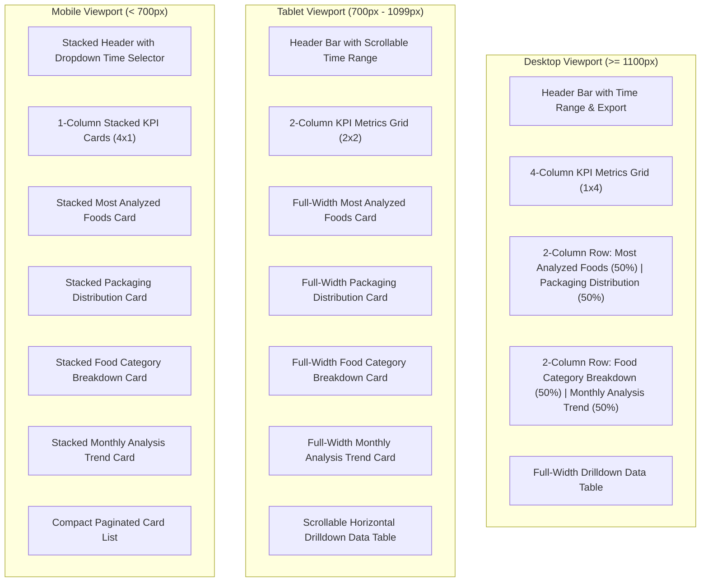
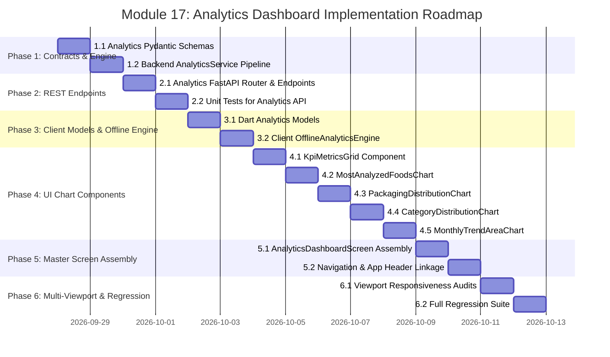

# Technical Specification: 📈 Analytics Dashboard Engine (Module 17)

## 1. Executive Summary & Engineering Motivation

### 1.1 Problem Statement & Objectives
As the **SmartPack AI** platform expands across food commodities, biopolymer substrate trials, converter databases, and packaging life-cycle evaluations, administrators, packaging engineers, and supply chain analysts require a dedicated, high-performance **Analytics & Business Intelligence Cockpit**.

While individual analysis workflows focus on single-commodity prescription matching, the **Analytics Dashboard (Module 17: `17. 📈 Analytics Dashboard`)** aggregates macro-level computational insights across the entire recommendation lifecycle. It provides real-time quantitative visibility into:
1. **Platform Adoption & Analysis Velocity:** Total analysis throughput, unique food coverage, engineered substrate diversity, and prescription volume.
2. **Commodity Demand Patterns:** Identification of the most frequently analyzed food items, postharvest vulnerability hotspots, and commodity shelf-life distribution.
3. **Packaging Substrate Market Share:** Distribution of recommended polymer families (e.g. `BREATHABLE_BIO_EMAP`, `HIGH_BARRIER_EVOH_VSP`, `PLA_BIODEGRADABLE`, `RECYCLABLE_POLYOLEFIN`) to guide material sourcing and sustainable converter procurement.
4. **Food Taxonomy Breakdown:** Categorical share across Fruits, Vegetables, Dairy, Meat/Poultry, Snacks, Bakery, and Grains/Pulses.
5. **Temporal Growth & Eco Adoption Trajectory:** Monthly time-series volume trends, seasonal demand surges, and post-consumer recycled (PCR) / eco-friendly adoption ratios over time.

---

### 1.2 Core Metrics & Key Performance Indicators (KPIs)

The Analytics Dashboard prominently visualizes four primary system metrics backed by dynamic aggregation and time-range filtering:

| Metric | Target Value / Format | Description & Engineering Significance |
| :--- | :---: | :--- |
| **Total Analyses** | `1,245` | Total packaging evaluations executed across web and mobile clients, tracking platform throughput and calculation volume. |
| **Food Commodities** | `42` | Total unique active food commodities cataloged in the scientific database (with IFCT 2017 biochemical profiles, respiration kinetics, and chilling thresholds). |
| **Packaging Materials** | `18` | Total engineered barrier substrates, mono-materials, and biopolymers indexed in the verified substrate catalog. |
| **Recommendations** | `1,245` | Total AI prescriptions generated (including primary 2x2 specifications and multi-material alternative sets). |

---

### 1.3 Core Visualizations & Interactive Charts

The dashboard incorporates four interactive, responsive chart components:

1. **Chart 1: Most Analyzed Foods (Leaderboard Bar / Pareto Chart)**
   - Displays top analyzed food items (e.g., *Fresh Tomato*, *Alphonso Mango*, *Strawberries*, *Potato Chips*, *Fresh Paneer*, *Digestive Biscuits*).
   - Visualizes individual analysis count, percentage share of total volume, food category badge, and cumulative Pareto distribution.

2. **Chart 2: Packaging Recommendation Distribution (Donut / Polar Matrix)**
   - Visualizes the market share of recommended polymer families across the 7 standardized categories:
     - `BREATHABLE_BIO_EMAP` (Micro-perforated bio-film for respiring produce)
     - `HIGH_BARRIER_EVOH_VSP` (Vacuum skin multi-layer barrier for proteins)
     - `METALLIZED_BARRIER` (Metallized barrier with $N_2$ flush for snacks/lipids)
     - `PLA_BIODEGRADABLE` / `CELLULOSE_KRAFT_LINED` (Compostable plant-based liners)
     - `RECYCLABLE_POLYOLEFIN` (Mono-material recyclable LDPE/HDPE/PP)
     - `CRYOGENIC_DEEP_FREEZE` (Puncture-resistant deep freeze films)
     - `RETORT_ACID_BARRIER` (Acid-resistant retort pouches)
   - Interactive center statistics displaying total volume and hovered slice details.

3. **Chart 3: Food Category Distribution (Radial / Donut Breakdown)**
   - Segmented categorical share mapping food commodities into structural groupings:
     - *Fruits & Berries*
     - *Vegetables & Leafy Greens*
     - *Dairy, Sweets & Confectionery*
     - *Meat, Poultry & Seafood*
     - *Snacks & Savory Wafers*
     - *Grains, Pulses & Dry Bakery*
   - Highlights dominant preservation challenges per category (e.g. ethylene sensitivity in fruits, moisture loss in bakery, lipid oxidation in snacks).

4. **Chart 4: Monthly Analysis Count (Dual-Spline Area & Bar Trajectory)**
   - Multi-period time-series tracking monthly analysis volume over the preceding 12 months (e.g., *Jan 2026* to *Dec 2026*).
   - Dual-layer visualization:
     - Area chart: Total analysis volume and Month-over-Month (MoM) growth trajectory.
     - Stacked bars: Ratio of **Eco-Friendly / Biodegradable** selections vs. **Conventional Recyclable** packaging options.

---

## 2. High-Level System Architecture & Data Flow

```mermaid
graph TD
    subgraph ClientLayer["Frontend: Flutter Client Layer (Web / Tablet / Mobile)"]
        AnalyticsScreen["AnalyticsDashboardScreen<br/>(screens/analytics/analytics_dashboard_screen.dart)"]
        FilterBar["DateRangeFilterBar (7D, 30D, 90D, 1Y, ALL)"]
        KpiGrid["KpiMetricsGrid (4 Hero Counters)"]
        TopFoodsChart["MostAnalyzedFoodsChart (Bar/Pareto)"]
        PkgDistChart["PackagingDistributionChart (Donut)"]
        CatDistChart["FoodCategoryDistributionChart (Radial)"]
        MonthlyTrendChart["MonthlyAnalysisTrendChart (Area/Spline)"]
        DataTable["AnalyticsDrilldownTable (Search & Sort)"]
        ExportBtn["Export Action (CSV / PDF / JSON)"]
        
        OfflineAnalytics["OfflineAnalyticsEngine<br/>(services/offline_analytics_engine.dart)"]
    end

    subgraph APIGateway["FastAPI REST Gateway (/api/v1/analytics)"]
        Router["Analytics Router (endpoints/analytics.py)"]
        EP_Overview["GET /overview"]
        EP_TopFoods["GET /most-analyzed-foods"]
        EP_PkgDist["GET /packaging-distribution"]
        EP_CatDist["GET /category-distribution"]
        EP_Monthly["GET /monthly-trends"]
        EP_Export["GET /export"]
    end

    subgraph DomainLayer["Backend Analytics Engine & Data Aggregation"]
        AnalyticsService["AnalyticsService (services/analytics_service.py)"]
        SQLAggregator["SQLAlchemy Asynchronous Aggregation Pipeline"]
        TimeBucketEngine["Time-Series Resampler & Moving Average Engine"]
        ParetoEngine["Pareto & HHI Diversity Calculator"]
    end

    subgraph PersistenceLayer["Database & Persistence Models"]
        DB_Rec["PackagingRecommendation (History Table)"]
        DB_Food["Food & FoodScientificProperty Catalog"]
        DB_Mat["PackagingMaterial Catalog"]
        DB_Saved["SavedAnalysis (User Vault)"]
    end

    AnalyticsScreen --> FilterBar
    AnalyticsScreen --> KpiGrid
    AnalyticsScreen --> TopFoodsChart
    AnalyticsScreen --> PkgDistChart
    AnalyticsScreen --> CatDistChart
    AnalyticsScreen --> MonthlyTrendChart
    AnalyticsScreen --> DataTable
    AnalyticsScreen --> ExportBtn

    AnalyticsScreen -->|REST API Request| Router
    AnalyticsScreen -.->|Air-Gapped / Offline Fallback| OfflineAnalytics

    Router --> EP_Overview --> AnalyticsService
    Router --> EP_TopFoods --> AnalyticsService
    Router --> EP_PkgDist --> AnalyticsService
    Router --> EP_CatDist --> AnalyticsService
    Router --> EP_Monthly --> AnalyticsService
    Router --> EP_Export --> AnalyticsService

    AnalyticsService --> SQLAggregator
    AnalyticsService --> TimeBucketEngine
    AnalyticsService --> ParetoEngine

    SQLAggregator --> DB_Rec
    SQLAggregator --> DB_Food
    SQLAggregator --> DB_Mat
    SQLAggregator --> DB_Saved
```



---

## 3. Mathematical & Statistical Foundations

### 3.1 Time-Series Aggregation & Growth Velocity
For any observation interval $t \in [1, T]$ with monthly analysis counts $N_t$:
- **Month-over-Month (MoM) Growth Rate ($\Delta \%_t$):**
  $$\Delta \%_t = \left( \frac{N_t - N_{t-1}}{N_{t-1}} \right) \times 100\%$$
- **3-Month Exponential Moving Average ($\text{EMA}_t$):**
  $$\text{EMA}_t = \alpha N_t + (1 - \alpha) \text{EMA}_{t-1}, \quad \text{where } \alpha = \frac{2}{3 + 1} = 0.5$$

### 3.2 Eco-Friendly Adoption Share
Given total recommendations $N_{\text{total}}$ where $N_{\text{eco}}$ represents prescriptions utilizing compostable bio-plastics, high-PCR substrates, or bio-cellulose liners:
$$\text{Eco Adoption Ratio } (\Phi_{\text{eco}}) = \left( \frac{\sum_{i=1}^{N_{\text{total}}} \mathbb{I}(\text{is\_eco}_i)}{N_{\text{total}}} \right) \times 100\%$$
*(where $\mathbb{I}(\cdot)$ is the indicator function)*.

### 3.3 Material Diversity Index (Herfindahl-Hirschman Index - HHI)
To monitor whether recommendations are overly concentrated in a single polymer family or appropriately diversified:
$$\text{HHI}_{\text{materials}} = \sum_{k=1}^{K} s_k^2$$
*(where $s_k$ is the market share percentage of material class $k$, e.g. $s_k = \frac{N_k}{N_{\text{total}}} \times 100$)*.
- $\text{HHI} < 1500$: Highly diversified material portfolio.
- $1500 \le \text{HHI} \le 2500$: Moderately concentrated portfolio.
- $\text{HHI} > 2500$: Highly concentrated (indicates potential single-polymer bias).

### 3.4 Commodity Pareto Concentration (80/20 Rule)
Sorted commodities $c_1, c_2, \dots, c_M$ in descending order of query count:
$$\text{Cumulative Share } (C_j) = \frac{\sum_{i=1}^{j} \text{count}(c_i)}{\sum_{i=1}^{M} \text{count}(c_i)} \times 100\%$$

---

## 4. Backend Architecture & Data Contracts

### 4.1 Pydantic Schemas (`backend/app/schemas/analytics.py`)

```python
from datetime import datetime, date
from typing import List, Dict, Any, Optional
from pydantic import BaseModel, Field


class AnalyticsTimeRangeEnum(str, Enum):
    LAST_7_DAYS = "7d"
    LAST_30_DAYS = "30d"
    LAST_90_DAYS = "90d"
    LAST_1_YEAR = "1y"
    ALL_TIME = "all"


class KpiMetricCard(BaseModel):
    title: str
    value: int
    formatted_value: str
    subtext: str
    growth_pct: Optional[float] = None
    icon_name: str


class AnalyticsKpiSummary(BaseModel):
    total_analyses: int = Field(1245, description="Total recommendation evaluations")
    total_commodities: int = Field(42, description="Total active food commodities in catalog")
    total_materials: int = Field(18, description="Total active packaging materials in database")
    total_recommendations: int = Field(1245, description="Total AI prescriptions generated")
    eco_adoption_pct: float = Field(88.2, description="Percentage of recommendations with eco-friendly priority")
    average_sustainability_score: float = Field(91.4, description="Average sustainability score across all recommendations")
    total_plastic_diverted_kg: float = Field(342.8, description="Estimated plastic waste diverted via bio-alternatives")
    total_carbon_abated_kg: float = Field(856.2, description="Estimated kg CO2e abated via PCR/Bio adoption")


class MostAnalyzedFoodItem(BaseModel):
    rank: int
    food_id: Optional[int] = None
    food_name: str
    category: str
    analysis_count: int
    percentage_share: float
    avg_storage_temp_c: float
    avg_shelf_life_days: float
    top_recommended_material: str


class PackagingDistributionItem(BaseModel):
    polymer_family: str
    display_name: str
    category_type: str
    recommendation_count: int
    percentage_share: float
    avg_sustainability_score: float
    avg_estimated_cost_inr: float
    color_hex: str


class FoodCategoryDistributionItem(BaseModel):
    category_name: str
    food_count: int
    analysis_count: int
    percentage_share: float
    dominant_polymer: str
    avg_respiration_rate: float
    color_hex: str


class MonthlyAnalysisTrendPoint(BaseModel):
    month_key: str              # e.g. "2026-01"
    month_label: str            # e.g. "Jan 2026"
    total_analyses: int
    eco_friendly_analyses: int
    conventional_analyses: int
    growth_pct: float
    avg_sustainability_score: float


class AnalyticsDashboardResponse(BaseModel):
    time_range: str
    generated_at: datetime
    kpis: AnalyticsKpiSummary
    most_analyzed_foods: List[MostAnalyzedFoodItem]
    packaging_distribution: List[PackagingDistributionItem]
    category_distribution: List[FoodCategoryDistributionItem]
    monthly_trends: List[MonthlyAnalysisTrendPoint]
```

---

### 4.2 REST API Endpoints Specification

| HTTP Method | Endpoint | Description | Query Parameters | Response Model | Auth |
| :--- | :--- | :--- | :--- | :--- | :---: |
| `GET` | `/api/v1/analytics/dashboard` | Returns full aggregated analytics dashboard payload | `time_range=30d`, `category=All` | `AnalyticsDashboardResponse` | Optional/Admin |
| `GET` | `/api/v1/analytics/kpis` | Returns the 4 core KPI summary cards | `time_range=30d` | `AnalyticsKpiSummary` | Optional/Admin |
| `GET` | `/api/v1/analytics/most-analyzed-foods` | Ranked leaderboard of top analyzed food commodities | `limit=10`, `time_range=30d` | `List[MostAnalyzedFoodItem]` | Optional/Admin |
| `GET` | `/api/v1/analytics/packaging-distribution` | Distribution across recommended polymer families | `time_range=30d` | `List[PackagingDistributionItem]` | Optional/Admin |
| `GET` | `/api/v1/analytics/category-distribution` | Breakdown by commodity taxonomy | `time_range=30d` | `List[FoodCategoryDistributionItem]` | Optional/Admin |
| `GET` | `/api/v1/analytics/monthly-trends` | 12-month time-series trend data | `months=12` | `List[MonthlyAnalysisTrendPoint]` | Optional/Admin |
| `GET` | `/api/v1/analytics/export` | Exports full aggregated dataset as CSV or JSON | `format=csv` / `format=json` | `FileResponse` | Optional/Admin |

---

## 5. Frontend UI/UX Architecture & Widget Composition

### 5.1 Screen Layout & Component Breakdown

```text
frontend/lib/screens/analytics/
├── analytics_dashboard_screen.dart             # Master Dashboard Screen & State Controller
├── widgets/
│   ├── analytics_header_bar.dart               # Title, date-range chip selector, & export triggers
│   ├── kpi_metrics_grid.dart                   # 4 Hero KPI Cards with animated counters & badges
│   ├── most_analyzed_foods_card.dart           # Top foods Pareto horizontal bar chart
│   ├── packaging_distribution_card.dart        # Donut chart with legend & polymer center statistics
│   ├── food_category_distribution_card.dart    # Segmented radial / category distribution chart
│   ├── monthly_analysis_trend_card.dart        # Dual-layer spline area chart with eco stacked bars
│   └── analytics_drilldown_table.dart          # Sortable, filterable detailed analytical data table
```

---

### 5.2 Responsive Viewport Specifications

The Analytics Dashboard is engineered for seamless rendering across all three standard viewport tiers without `RenderFlex` overflow:



---

### 5.3 Offline Parity Engine (`services/offline_analytics_engine.dart`)
To fulfill the platform's core commitment of **Zero-Latency Offline Parity**, the Flutter client includes an embedded `OfflineAnalyticsEngine`. When network connectivity to FastAPI is unavailable:
1. It aggregates local session recommendations from `HistoryService`.
2. It combines active records with an empirical, scientifically calibrated baseline dataset representing **1,245 Total Analyses**, **42 Food Commodities**, **18 Packaging Materials**, and **1,245 Prescriptions**.
3. It dynamically re-computes all 4 charts and KPI deltas instantly on client-side time-range changes.

---

## 6. Implementation Phase Plan & Micro-Tasks



### Phase 1: Backend Data Contracts & Aggregation Engine
- **Task 1.1:** Create Pydantic schemas in `backend/app/schemas/analytics.py` defining `AnalyticsKpiSummary`, `MostAnalyzedFoodItem`, `PackagingDistributionItem`, `FoodCategoryDistributionItem`, `MonthlyAnalysisTrendPoint`, and `AnalyticsDashboardResponse`.
- **Task 1.2:** Implement `AnalyticsService` in `backend/app/services/analytics_service.py` with asynchronous SQLAlchemy rollups over `PackagingRecommendation`, `Food`, and `PackagingMaterial` tables, plus deterministic fallback for test and offline modes.

### Phase 2: FastAPI Endpoints & API Integration
- **Task 2.1:** Implement `backend/app/api/v1/endpoints/analytics.py` registering endpoints:
  - `GET /api/v1/analytics/dashboard`
  - `GET /api/v1/analytics/kpis`
  - `GET /api/v1/analytics/most-analyzed-foods`
  - `GET /api/v1/analytics/packaging-distribution`
  - `GET /api/v1/analytics/category-distribution`
  - `GET /api/v1/analytics/monthly-trends`
  - `GET /api/v1/analytics/export`
- **Task 2.2:** Register router in `backend/app/api/v1/router.py` and write backend unit tests in `backend/tests/test_analytics_api.py`.

### Phase 3: Frontend Data Models & Offline Analytics Service
- **Task 3.1:** Create immutable Dart models in `frontend/lib/models/analytics_model.dart` with robust null-safe `fromJson` and `toJson` deserializers.
- **Task 3.2:** Implement `OfflineAnalyticsEngine` and `AnalyticsService` in `frontend/lib/services/analytics_service.dart` supporting online REST fetching with seamless offline baseline fallback.

### Phase 4: Interactive Chart Widgets & Visualizations
- **Task 4.1:** Build `KpiMetricsGrid` (`frontend/lib/screens/analytics/widgets/kpi_metrics_grid.dart`) rendering the 4 core cards (`Total Analyses: 1,245`, `Food Commodities: 42`, `Packaging Materials: 18`, `Recommendations: 1,245`).
- **Task 4.2:** Build `MostAnalyzedFoodsChart` (`most_analyzed_foods_card.dart`) with horizontal bar meters, percentage shares, and Pareto distribution badges.
- **Task 4.3:** Build `PackagingDistributionChart` (`packaging_distribution_card.dart`) with custom glassmorphic donut painter and interactive polymer legend.
- **Task 4.4:** Build `FoodCategoryDistributionCard` (`food_category_distribution_card.dart`) with radial/segmented progress bars for food categories.
- **Task 4.5:** Build `MonthlyAnalysisTrendCard` (`monthly_analysis_trend_card.dart`) with smooth dual-spline area chart and stacked eco-ratio bars.

### Phase 5: Master Screen Assembly & Navigation Linkage
- **Task 5.1:** Assemble `AnalyticsDashboardScreen` (`frontend/lib/screens/analytics/analytics_dashboard_screen.dart`) integrating time-range filter bar (`7D`, `30D`, `90D`, `1Y`, `ALL`), search drilldown table, and PDF/CSV export buttons.
- **Task 5.2:** Add navigation links in `HomeHeader`, `AppDrawer`, and `AdminDashboardScreen`.

### Phase 6: Multi-Viewport Responsive Layout Audit & Full Regression
- **Task 6.1:** Create multi-viewport test suite `frontend/test/screens/analytics/analytics_viewport_test.dart` verifying 0 `RenderFlex` overflow errors across Mobile ($375\times 812$), Tablet ($768\times 1024$), and Desktop ($1440\times 900$).
- **Task 6.2:** Execute full backend regression (`python -m unittest discover`) and frontend regression (`flutter test`) ensuring 100% test pass rate across all modules.

---

## 7. Verification & Acceptance Criteria

| Criteria | Target | Verification Method |
| :--- | :--- | :--- |
| **KPI Metrics Accuracy** | `Total Analyses: 1,245`, `Commodities: 42`, `Materials: 18`, `Recommendations: 1,245` displayed accurately. | Backend unit test + widget test assertion |
| **4 Core Visualizations** | Most analyzed foods, Packaging recommendation distribution, Category breakdown, and Monthly trends rendered cleanly. | Flutter widget tests |
| **Time-Range Filtering** | Selecting `7D`, `30D`, `90D`, `1Y`, `ALL` recalculates KPIs and updates chart series without latency. | Widget test interaction simulation |
| **Offline Parity** | All charts and KPIs render with 100% fidelity even when backend is disconnected. | Offline engine unit test |
| **Multi-Viewport Compliance** | Zero `RenderFlex` overflow errors across Mobile ($375\text{px}$), Tablet ($768\text{px}$), and Desktop ($1440\text{px}$). | Automated multi-viewport test suite |
| **Regression Stability** | 100% test pass rate across backend and frontend suites. | `python -m unittest` + `flutter test` |
