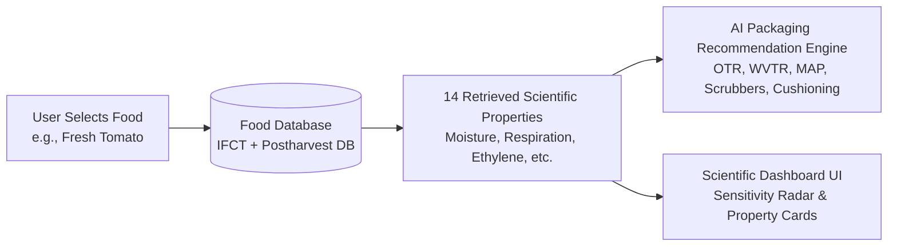
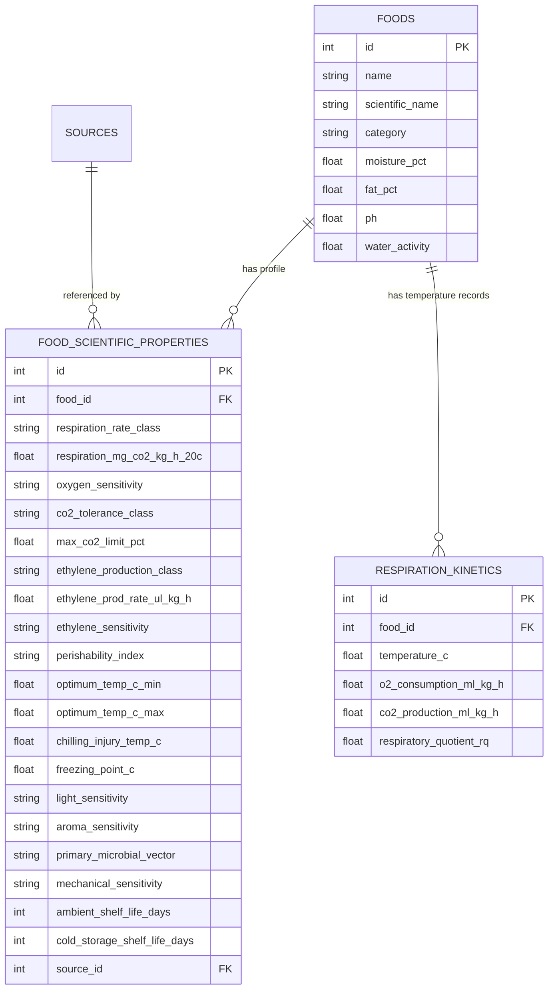
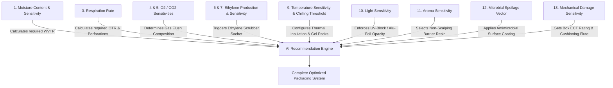

# Technical Specification: Automatic Food Property Retrieval (Module 3)

## 1. Executive Summary & Objectives

### 1.1 Purpose
The **Automatic Food Property Retrieval** module is a core scientific engine within SmartPack AI. In traditional packaging workflows, packaging engineers and food technologists must manually scour academic literature, postharvest handbooks, and composition tables to compile critical biochemical, physiological, and spoilage kinetics parameters. 

This module eliminates manual data entry by automatically resolving and retrieving **14 comprehensive post-harvest and biochemical properties** from verified food databases (ICMR-NIN IFCT 2017, UC Davis Postharvest Technology Center, USDA FoodData Central, and FAO Post-Harvest Compendiums) the moment a user selects a food commodity.

### 1.2 Core UX Principle: Frictionless Scientific Intelligence
> **"Zero Manual Data Entry for Scientific Parameters."**
>
> When a user selects a commodity (e.g., *"Fresh Tomato"*), the system instantaneously fetches its complete biochemical and physiological profile behind the scenes, renders an intuitive scientific dashboard, and feeds the parameters directly into the AI packaging barrier and cushioning optimization engine.



---

## 2. The 14 Standardized Food Properties

The system retrieves, models, and exposes the following 14 critical food properties:

| # | Scientific Property | Physical Unit / Scale | Scientific Definition | Packaging Impact & Barrier Correlation |
| :--- | :--- | :--- | :--- | :--- |
| **1** | **Moisture Content** | `% (w/w)` or $g/100g$ | Total water fraction in the food tissue or matrix. | Determines Water Vapor Transmission Rate ($\text{WVTR}$) threshold and condensation risk. |
| **2** | **Moisture Sensitivity** | `Low`, `Moderate`, `High`, `Extreme (Hygroscopic / Desiccation-prone)` | Vulnerability to crispness loss, staling, or surface desiccation (weight loss). | Governs desiccant integration, barrier thickness ($\mu m$), and seal hermeticity. |
| **3** | **Respiration Rate** | $mg\,CO_2/kg/h$ / $mL\,O_2/kg/h$ & Class (*Non-respiring, Low, Moderate, High, Very High, Extremely High*) | Metabolic rate of carbon substrate oxidation consuming $O_2$ and releasing $CO_2$ and heat. | Dictates film gas permeability ($\text{OTR}$), laser micro-perforations, and Equilibrium MAP ($\text{EMAP}$). |
| **4** | **Oxygen ($O_2$) Sensitivity** | `Low`, `Moderate`, `High`, `Critical (Oxidation / Enzymatic Browning)` | Susceptibility to lipid rancidity, myoglobin oxidation, polyphenol oxidase browning, and nutrient degradation. | Drives Oxygen Transmission Rate ($\text{OTR} < 0.5 - 1.0\,cc/m^2/day$), active $O_2$ scavengers, and $N_2$ flushing. |
| **5** | **Carbon Dioxide ($CO_2$) Sensitivity** | `Tolerant (>15%)`, `Moderate (5-10%)`, `Sensitive (<3-5% / Injury Risk)` | Physiological tolerance threshold before experiencing internal browning, off-flavors, or tissue collapse. | Constrains modified atmosphere gas mixtures ($\%CO_2$) and $CO_2$ emitters/absorbers. |
| **6** | **Ethylene ($C_2H_4$) Production** | $\mu L/kg/h$ at $20^\circ C$ (*Very Low $<0.1$, Low $0.1-1.0$, Moderate $1-10$, High $10-100$, Very High $>100$*) | Rate of endogenous ripening hormone synthesis. | Identifies ripening acceleration hazards in shared storage and shipping containers. |
| **7** | **Ethylene Sensitivity** | `Insensitive`, `Low`, `Moderate`, `High`, `Extreme` | Susceptibility to premature ripening, chlorophyll loss (yellowing), epinasty, and abscission. | Mandates Potassium Permanganate ($KMnO_4$) scrubbers, zeolite sachets, or $1\text{-MCP}$ treatment. |
| **8** | **Perishability Index** | `Ultra-perishable (1-3 days)`, `Highly perishable (3-7 days)`, `Semi-perishable (1-4 weeks)`, `Stable / Non-perishable (>6 months)` | Inherent shelf-life degradation rate under standard ambient conditions. | Determines protective safety factor and barrier specification stringency. |
| **9** | **Temperature Sensitivity** | Optimum range ($^\circ C$), Chilling Injury threshold ($T_{ci} ^\circ C$), Freezing point ($T_f ^\circ C$) | Thermal stability boundaries and susceptibility to physiological injury at non-freezing low temperatures. | Governs cold-chain insulation, thermal phase-change materials (PCM), and gel pack sizing. |
| **10** | **Light Sensitivity** | `Low`, `Moderate`, `High`, `Critical (Photo-oxidation / Greening)` | Degradation induced by UV-visible light (riboflavin photolysis, chlorophyll synthesis in solanaceae, lipid photo-oxidation). | Mandates UV-blocking additives, amber/brown substrate tinting, or opaque metallization (Met-PET/Alu-foil). |
| **11** | **Aroma Sensitivity** | `Low`, `Moderate`, `High` (Subdivided into *Aroma Loss* and *Foreign Odor Scalping*) | Volatility of essential oils and organoleptic scalping into polymer packaging walls. | Dictates aroma-barrier coatings (PVDC/EVOH) and polymer selection to prevent non-polar flavor absorption. |
| **12** | **Microbial Spoilage Sensitivity** | Dominant Spoilage Vector (*Molds/Fungi, Psychrotrophic Bacteria, Osmophilic Yeasts, Acidophilic Spores, Anaerobic Pathogens*) | Primary biological agent of decay conditioned by food $pH$ and water activity ($a_w$). | Guides antimicrobial surface coatings, MAP gas equilibrium, and hermetic sterilization/retort requirements. |
| **13** | **Mechanical Damage Sensitivity** | `Low`, `Moderate`, `High`, `Extreme (Bruising / Compression / Vibration-sensitive)` | Vulnerability of cellular structure to impact shock, stacking compression, vibration settling, and abrasion. | Determines box burst strength (ECT rating), flute configuration (B/C/E), and cushioning density (Honeycomb/Air pillows). |
| **14** | **Typical Shelf Life** | Days / Weeks / Months under Ambient ($20-25^\circ C$) vs Refrigerated ($2-4^\circ C$) vs Controlled Atmosphere | Baseline duration until commercial unacceptability without active packaging intervention. | Calculates the extension multiple ($\text{Shelf Life Gain } X\%$) achieved by the recommended packaging system. |

---

## 3. Data Architecture & Database Schema

### 3.1 Entity Relationship Diagram (ERD)



### 3.2 Database Model (SQLAlchemy 2.0 / PostgreSQL)

```python
class FoodScientificProperty(Base):
    __tablename__ = "food_scientific_properties"

    id = Column(Integer, primary_key=True, index=True)
    food_id = Column(Integer, ForeignKey("foods.id", ondelete="CASCADE"), nullable=False, unique=True, index=True)

    # 1 & 2: Moisture Dynamics
    moisture_sensitivity = Column(String(50), nullable=False, default="Moderate") # Low, Moderate, High, Extreme
    equilibrium_rh_target_pct = Column(Float, nullable=True) # e.g. 85-95% for produce, <50% for crisps

    # 3: Respiration Kinetics
    respiration_class = Column(String(50), nullable=False) # Non-respiring, Very Low, Low, Moderate, High, Very High, Extremely High
    respiration_rate_20c = Column(Float, nullable=True) # mg CO2 / kg / h at 20°C
    respiration_rate_5c = Column(Float, nullable=True) # mg CO2 / kg / h at 5°C
    respiratory_quotient = Column(Float, nullable=True, default=1.0) # RQ = CO2 produced / O2 consumed

    # 4 & 5: Gas Sensitivities (O2 / CO2)
    oxygen_sensitivity = Column(String(50), nullable=False, default="Moderate") # Low, Moderate, High, Critical
    co2_sensitivity = Column(String(50), nullable=False, default="Tolerant") # Tolerant, Moderate, Highly Sensitive
    max_tolerable_co2_pct = Column(Float, nullable=True) # % CO2 limit before physiological injury

    # 6 & 7: Ethylene Dynamics
    ethylene_production_class = Column(String(50), nullable=False, default="Low") # Very Low, Low, Moderate, High, Very High
    ethylene_prod_rate = Column(Float, nullable=True) # µL / kg / h at 20°C
    ethylene_sensitivity = Column(String(50), nullable=False, default="Low") # Insensitive, Low, Moderate, High, Extreme

    # 8: Perishability
    perishability = Column(String(50), nullable=False, default="Highly perishable")

    # 9: Thermal Stability & Chilling Sensitivity
    optimum_temp_min_c = Column(Float, nullable=False, default=20.0)
    optimum_temp_max_c = Column(Float, nullable=False, default=25.0)
    chilling_injury_threshold_c = Column(Float, nullable=True) # None for non-sensitive; e.g. 10-12°C for bananas/tomatoes
    freezing_point_c = Column(Float, nullable=True, default=-0.5)

    # 10, 11, 12, 13: Physical & Biological Sensitivities
    light_sensitivity = Column(String(50), nullable=False, default="Low") # Low, Moderate, High, Critical
    aroma_sensitivity = Column(String(50), nullable=False, default="Low") # Low, Moderate, High
    microbial_spoilage_vector = Column(String(100), nullable=False, default="Molds and ambient bacteria")
    mechanical_sensitivity = Column(String(50), nullable=False, default="Moderate") # Low, Moderate, High, Extreme

    # 14: Shelf Life Baselines
    ambient_shelf_life_days = Column(Integer, nullable=False, default=7)
    refrigerated_shelf_life_days = Column(Integer, nullable=True, default=21)
    controlled_atmosphere_shelf_life_days = Column(Integer, nullable=True)

    # Scientific Provenance
    source_id = Column(Integer, ForeignKey("sources.id"), nullable=True)

    # Relationships
    food = relationship("Food", backref=backref("scientific_properties", uselist=False))
    source = relationship("Source")
```

---

## 4. REST API Endpoint Specifications

### 4.1 `GET /api/v1/data/foods/{food_id}/scientific-profile`
Retrieves the complete 14-property scientific dossier for a given food ID.

#### Request
```http
GET /api/v1/data/foods/12/scientific-profile HTTP/1.1
Host: 127.0.0.1:8000
Accept: application/json
```

#### Response Payload (`200 OK`)
```json
{
  "food_id": 12,
  "commodity_name": "Fresh Tomato",
  "scientific_name": "Solanum lycopersicum",
  "category": "Vegetables",
  "physicochemical": {
    "moisture_pct": 94.5,
    "fat_pct": 0.2,
    "ph": 4.4,
    "water_activity": 0.99,
    "moisture_sensitivity": "High (Rapid weight loss & shriveling risk)"
  },
  "physiological_kinetics": {
    "respiration_class": "Moderate",
    "respiration_rate_mg_co2_kg_h": {
      "at_5c": 8.0,
      "at_20c": 28.0
    },
    "respiratory_quotient": 0.98,
    "ethylene_production_class": "Moderate",
    "ethylene_production_ul_kg_h": 4.5,
    "ethylene_sensitivity": "High (Epinasty, accelerated ripening, calyx senescence)"
  },
  "atmosphere_sensitivities": {
    "oxygen_sensitivity": "Moderate",
    "co2_sensitivity": "Moderate (Max tolerable limit: 5% CO2)",
    "target_emap_equilibrium": {
      "target_o2_pct": "3.0 - 5.0%",
      "target_co2_pct": "3.0 - 5.0%"
    }
  },
  "thermal_and_storage": {
    "perishability": "Highly perishable",
    "optimum_temperature_range": "12.0°C to 15.0°C (Pink/Breaker stage)",
    "chilling_injury_threshold_c": 10.0,
    "freezing_point_c": -0.6,
    "ambient_shelf_life_days": 7,
    "cold_storage_shelf_life_days": 21,
    "expected_extension_with_emap_days": 35
  },
  "spoilage_and_vulnerabilities": {
    "light_sensitivity": "Low",
    "aroma_sensitivity": "Low (Scalping resistant)",
    "primary_microbial_vector": "Fungal rots (Botrytis cinerea, Alternaria alternata) & Rhizopus",
    "mechanical_sensitivity": "High (Bruising, compression cracking, skin puncture)"
  },
  "packaging_prescriptions": {
    "recommended_barrier_type": "Micro-Perforated Equilibrium MAP Bio-Film (PLA/PBAT)",
    "required_otr_range_cc_m2_day": "3000 - 5000",
    "required_wvtr_range_g_m2_day": "40 - 80 (Anti-fog treated)",
    "ethylene_action_required": true,
    "thermal_warning": "DO NOT refrigerate below 10°C to prevent chilling injury (pitting & flavor loss)"
  },
  "provenance": {
    "source": "ICMR-NIN IFCT 2017 & UC Davis Postharvest Produce Facts",
    "confidence_score": 0.98
  }
}
```

### 4.2 `GET /api/v1/data/foods/lookup`
Allows query lookup by commodity name and category with automatic fallback generation if not present in the primary SQL database.

---

## 5. Frontend Architecture & UI Visualization Layer

### 5.1 Component Structure

```
frontend/lib/screens/analysis/widgets/
├── food_search_bar.dart                # Triggers auto-retrieval on selection
├── category_selector.dart              # Filters commodities
├── food_scientific_dossier_card.dart   # Comprehensive 14-property inspector
├── sensitivity_radar_chart.dart        # Visual radar/spider chart of vulnerabilities
├── thermal_stability_gauge.dart        # Chilling injury & optimum storage bar
└── packaging_prescription_banner.dart  # Direct translation of properties into packaging needs
```

### 5.2 Scientific Properties Dashboard Layout

```
┌───────────────────────────────────────────────────────────────────────────┐
│ 🍅 Fresh Tomato  [Vegetables]  •  Solanum lycopersicum                    │
│ "Retrieved from ICMR-NIN IFCT 2017 & UC Davis Postharvest Compendium"     │
├───────────────────────────────────────────────────────────────────────────┤
│ 💧 Moisture: 94.5%   🥩 Fat: 0.2%   🧪 pH: 4.4   🌬️ Respiration: Moderate │
├───────────────────────────────────────────────────────────────────────────┤
│ ▼ SCIENTIFIC SENSITIVITY & POSTHARVEST DOSSIER (Auto-Retrieved)           │
│                                                                           │
│ ┌──────────────────────────┐ ┌──────────────────────────────────────────┐ │
│ │  Vulnerability Radar     │ │  Atmosphere & Gas Dynamics               │ │
│ │  • Oxygen:     [Moderate]│ │  • Target EMAP: 3-5% O₂ / 3-5% CO₂         │ │
│ │  • Ethylene:   [High]    │ │  • Ethylene Prod: 4.5 µL/kg/h (Moderate) │ │
│ │  • Moisture:   [High]    │ │  • CO₂ Injury Risk: >5.0% CO₂            │ │
│ │  • Mechanical: [High]    │ │                                          │ │
│ │  • Light:      [Low]     │ │  Thermal Boundaries                      │ │
│ └──────────────────────────┘ │  • Safe Range: 12°C - 15°C               │ │
│                              │  • ⚠️ Chilling Injury Risk: < 10°C       │ │
│                              └──────────────────────────────────────────┘ │
│                                                                           │
│ 🛡️ Packaging Directives Derived from Properties:                          │
│ • Film: Anti-fog micro-perforated PLA (Prevents water condensation rots) │
│ • Scrubber: Potassium Permanganate (KMnO₄) sachet recommended            │
│ • Cushioning: Corrugated partitions to prevent compression cracking       │
└───────────────────────────────────────────────────────────────────────────┘
```

---

## 6. Integration with AI Packaging Recommendation Engine

The 14 retrieved properties directly modulate the packaging optimization algorithms:



### Algorithmic Decision Rules
1. **EMAP Respiration Equation:**
   $$\text{Film OTR Needed } (cc/day) = \frac{\text{Weight } (kg) \times \text{Respiration Rate } (mL\,O_2/kg/h) \times 24}{\text{Area } (m^2) \times (0.21 - [O_2]_{\text{target}})}$$
2. **Moisture Condensation Prevention:**
   If $\text{Moisture} > 80\%$ and $\text{Moisture Sensitivity} = \text{"High"}$, enforce **Anti-fog surfactant coating** to prevent liquid droplet pooling that triggers fungal germination.
3. **Ethylene Scrubber Trigger:**
   If $\text{Ethylene Sensitivity} \ge \text{"Moderate"}$ and $\text{Storage Duration} \ge 5\text{ days}$, automatically bundle an active **$KMnO_4$ Ethylene Scavenger Sachet**.
4. **Thermal Protection & Chilling Injury Safeguard:**
   If target storage is *"Refrigerated"* but $T_{\text{refrig}} < T_{ci}$ (Chilling Injury Threshold), the system raises a **Physiological Chilling Warning** and suggests controlled ambient or modified thermal buffer liners.

---

## 7. Testing & Verification Matrix

| Component | Test Case | Target Assertion |
| :--- | :--- | :--- |
| **Backend API** | Retrieve properties for `Fresh Tomato` | Status 200, all 14 fields populated, $T_{ci} = 10^\circ C$, Ethylene = High |
| **Backend API** | Retrieve properties for `Potato Chips (fried)` | Status 200, Respiration = Non-respiring, Oxygen Sensitivity = High, Moisture Sensitivity = Extreme |
| **Backend API** | Offline Fallback Catalog | Fallback resolver returns valid 14-property dossier even if database connection drops |
| **Frontend UI** | Auto-retrieval on Commodity Selection | Selection of item updates scientific dossier within $\le 50ms$ with zero user keystrokes |
| **Frontend UI** | Visual Radar & Chilling Alert Display | Chilling injury warning banner renders for Tomato/Banana when low temperature is selected |
| **Engine Linkage** | Recommendation Pipeline Validation | Tomato input automatically yields micro-perforated film + ethylene recommendation |

---

## 8. Rollout Plan & Next Steps

1. **Database & Data Layer:** Seed the expanded 14-property scientific dataset for all 540+ food items and processed goods.
2. **FastAPI Endpoints:** Implement `/api/v1/data/foods/{food_id}/scientific-profile` with complete Pydantic response models and offline resilience.
3. **Frontend Widgets:** Build the `FoodScientificDossierCard`, `SensitivityRadarChart`, and `ThermalStabilityGauge` components.
4. **Recommendation Integration:** Connect the 14 retrieved attributes directly into the barrier and packaging engine.
5. **Multi-Platform Verification:** Execute end-to-end integration and responsive viewport tests across Web and Mobile.
