# Phased Implementation Plan: Cost Estimation (Module 10)

Based on the technical specification in [feature-cost estimation.md](file:///c:/Users/Jeron/source/repos/AI%20Packaging%20recommender/artifacts/specs/feature-cost%20estimation.md), this document defines the step-by-step, atomic implementation plan for **Module 10: 💰 Cost Estimation**.

---

## Technical Dependency Map

```mermaid
graph TD
    P1[Phase 1: Backend Schemas & Geometric Surface Area Formulations] --> P2[Phase 2: Cost Calculation Engine & Volume Tier Pricing Service]
    P2 --> P3[Phase 3: REST API Endpoints & Route Registration]
    P3 --> P4[Phase 4: Frontend Data Models & Offline Parity Calculation Engine]
    P4 --> P5[Phase 5: Modular Visual UI Widgets, Steppers & Charts]
    P5 --> P6[Phase 6: Master Screen Assembly, Deep-Linking & Viewport Verification]

    subgraph Phase 1: Schemas & Geometry Formulation
        T1_1[1.1 Pydantic Schemas in cost_estimation.py] --> T1_2[1.2 Geometric Surface Area Calculator for 7 Form Factors]
        T1_2 --> T1_3[1.3 Schema Validation & Geometric Formula Unit Tests]
    end

    subgraph Phase 2: Cost Calculation Engine
        T2_1[2.1 Material Mass, Density & Scrap Allocation Engine] --> T2_2[2.2 Multi-Layer Cost Itemizer & Tooling Amortization]
        T2_2 --> T2_3[2.3 Volume Tier Discount Scaling & Sensitivity Generator]
        T2_3 --> T2_4[2.4 CostEstimationService Unit & Scenario Tests]
    end

    subgraph Phase 3: REST API Layer
        T3_1[3.1 POST /api/v1/packaging/cost-estimate Endpoint] --> T3_2[3.2 GET /api/v1/packaging/cost-parameters Endpoint]
        T3_2 --> T3_3[3.3 API Integration & Validation Error Test Suite]
    end

    subgraph Phase 4: Frontend Data Layer
        T4_1[4.1 Dart Cost Estimation Models & Serialization] --> T4_2[4.2 ApiService Integration & Offline Parity Calculation Engine]
        T4_2 --> T4_3[4.3 Frontend Model & Offline Engine Unit Tests]
    end

    subgraph Phase 5: Modular Cost Visual Widgets
        T5_1[5.1 PackagingTypeSelectorGrid & DimensionSteppers] --> T5_5[5.5 Modular Widget Test Suite]
        T5_2[5.2 AddOnFeatureChecklist & MaterialSelectorDropdown] --> T5_5
        T5_3[5.3 BatchVolumeSlider & CostSummaryHeroCard with ESTIMATED Badge] --> T5_5
        T5_4[5.4 CostBreakdownChart & VolumeSensitivityChart] --> T5_5
    end

    subgraph Phase 6: Master Screen & Integration
        T6_1[6.1 CostEstimationScreen State Management & Live Interactive Recalculation] --> T6_2[6.2 Navigation Integration from Cockpit, Catalog & Comparison Screens]
        T6_2 --> T6_3[6.3 Multi-Viewport Layout Verification 375x812, 768x1024, 1440x900]
        T6_3 --> T6_4[6.4 Full End-to-End Regression Suite Backend + Frontend]
    end
```



---

## Phase 1: Backend Schemas & Geometric Surface Area Formulations

### Task 1.1: Create Pydantic Data Contracts for Cost Estimation [COMPLETED]
- **Target Files:**
  - `backend/app/schemas/cost_estimation.py`
  - `backend/tests/test_cost_estimation_schemas.py`
- **Micro-Task Description:**
  - Define `PackagingFormFactorEnum` (`Pillow Pouch`, `Stand-up Doypack`, `3-Side Seal Pouch`, `4-Side Quad Seal`, `Thermoformed Tray / Clamshell`, `Vacuum / Retort Pouch`, `Folding Carton Box`).
  - Define `FunctionalAddOnEnum` (`Resealable Zipper`, `One-Way Degassing Valve`, `Laser Tear Notch`, `Anti-Fog Coating`, `Laser Micro-Perforations`, `MAP Gas Flush Seal`).
  - Define `PricingSourceEnum` (`Estimated Baseline Model`, `Live Supplier Direct RFQ`).
  - Define `PackageDimensionsInput`, `MaterialRequirementDetail`, `CostLayerItem`, `VolumeTierSensitivityPoint`, `CostEstimationRequest`, and `CostEstimationResponse` schemas with validation bounds ($L > 0$, $W > 0$, $N > 0$, scrap $0\le \alpha \le 30\%$).
- **Verification Command:**
  ```powershell
  python -m unittest tests/test_cost_estimation_schemas.py
  ```
- **Verification Result:** PASSED (7/7 tests passing with 0 warnings).

---

### Task 1.2: Implement Geometric Surface Area Calculation Module [COMPLETED]
- **Target Files:**
  - `backend/app/services/geometry_calculator.py`
  - `backend/tests/test_geometry_calculator.py`
- **Micro-Task Description:**
  - Implement surface area formulas for all 7 form factors:
    1. **Pillow Pouch:** $A = 2 \times (L + 2S) \times (W + S)$ with standard seam $S = 0.01\text{ m}$.
    2. **Stand-up Doypack:** $A = \left[ 2 \times (L + S) \times (W + S) \right] + \left[ (W + S) \times (G + S) \times 1.15 \right]$.
    3. **3-Side Seal:** $A = 2 \times (L + S) \times (W + 2S)$.
    4. **4-Side Quad Seal:** $A = 2 \times (L + 2S) \times (W + 2G + 2S)$.
    5. **Thermoformed Tray / Clamshell:** $A = [ (L \times W) + 2(L \times H) + 2(W \times H) ] \times 1.12$.
    6. **Vacuum / Retort Pouch:** $A = 2 \times (L + 2S) \times (W + 2S)$.
    7. **Folding Carton Box:** $A = 2 \times [ (L \times W) + (L \times H) + (W \times H) ] \times 1.22$.
  - Provide helper for unit conversion ($\text{cm} \to \text{m}$, $\text{mm} \to \text{m}$, $\text{m}^2 \to \text{cm}^2$).
- **Verification Command:**
  ```powershell
  python -m unittest tests/test_geometry_calculator.py
  ```
- **Verification Result:** PASSED (8/8 tests passing with exact analytical precision).

---

### Task 1.3: Phase 1 Checkpoint & Schema Test Suite Execution [COMPLETED]
- **Target Files:**
  - `backend/tests/test_cost_estimation_schemas.py`
  - `backend/tests/test_geometry_calculator.py`
- **Micro-Task Description:**
  - Run the combined Phase 1 test suite to verify schema constraints, default fallbacks, and boundary conditions.
- **Verification Command:**
  ```powershell
  python -m unittest tests/test_cost_estimation_schemas.py tests/test_geometry_calculator.py
  ```
- **Verification Result:** PASSED (15/15 tests passing with 0 failures, Phase 1 100% complete).

---

## Phase 2: Cost Calculation Engine & Volume Tier Pricing Service

### Task 2.1: Implement Substrate Mass, Density & Scrap Allowance Engine [COMPLETED]
- **Target Files:**
  - `backend/app/services/cost_estimation_service.py`
  - `backend/tests/test_cost_estimation_service.py`
- **Micro-Task Description:**
  - Implement polymer density lookups: LDPE ($920\,\text{kg/m}^3$), HDPE ($955$), BOPP ($905$), PET ($1380$), Bio-PLA ($1250$), NatureFlex ($1450$), Al-Foil ($2700$), Kraft Paper ($750$).
  - Calculate unit mass: $M_{\text{unit}} = A_{\text{unit}} \times t \times \rho$.
  - Calculate total gross batch material requirement ($A_{\text{gross}}$, $M_{\text{gross}}$) including configurable scrap rate $\alpha_{\text{scrap}}$ ($6\%$ default).
- **Verification Command:**
  ```powershell
  python -m unittest tests/test_cost_estimation_service.py
  ```
- **Verification Result:** PASSED (Exact mass conversions in grams/unit and batch kg with scrap margins).

---

### Task 2.2: Implement Multi-Layer Cost Itemizer & Tooling Setup Amortization [COMPLETED]
- **Target Files:**
  - `backend/app/services/cost_estimation_service.py`
- **Micro-Task Description:**
  - Compute itemized cost contributions:
    - **Raw Substrate:** $M_{\text{unit}} \times (1 + \alpha) \times \text{BasePricePerKg}$.
    - **Converting & Printing:** $(A_{\text{unit}} \times (P_{\text{print}} + P_{\text{lam}})) + P_{\text{pouchMaker}}$.
    - **Functional Add-ons:** Sum of selected add-on unit prices (Zipper: +₹0.40, Valve: +₹0.85, Anti-fog: +₹0.20, Notch: +₹0.08, MAP Flush: +₹0.15, Perforations: +₹0.18).
    - **Tooling Amortization:** Fixed setup ₹$12,000 / N$.
- **Verification Command:**
  ```powershell
  python -m unittest tests/test_cost_estimation_service.py
  ```
- **Verification Result:** PASSED (Cost layer subtotals sum up with exact percentage contributions).

---

### Task 2.3: Implement Volume Tier Scaling & Price Sensitivity Curve [COMPLETED]
- **Target Files:**
  - `backend/app/services/cost_estimation_service.py`
- **Micro-Task Description:**
  - Apply volume discount tiers:
    - Tier 1 ($100 \le N < 5,000$): $0\%$
    - Tier 2 ($5,000 \le N < 25,000$): $8\%$
    - Tier 3 ($25,000 \le N < 100,000$): $16\%$
    - Tier 4 ($N \ge 100,000$): $24\%$
  - Generate 5-point volume sensitivity curve (1,000, 5,000, 10,000, 25,000, 100,000 units).
  - Populate mandatory disclaimer notice: `"ESTIMATED BASELINE: Values are computed using standard industry conversion ratios, empirical polymer densities, and standard finishing margins..."`
- **Verification Command:**
  ```powershell
  python -m unittest tests/test_cost_estimation_service.py
  ```
- **Verification Result:** PASSED (Volume scaling curve points and mandatory estimated disclaimer generated).

---

### Task 2.4: Phase 2 Checkpoint & Cost Estimation Service Test Suite [COMPLETED]
- **Target Files:**
  - `backend/tests/test_cost_estimation_service.py`
- **Micro-Task Description:**
  - Execute full scenario tests comparing standard industry benchmarks (e.g. 500g Doypack Bio-PLA, 100g Pillow Pouch BOPP, 1kg Thermoformed Clamshell).
- **Verification Command:**
  ```powershell
  python -m unittest tests/test_cost_estimation_service.py
  ```
- **Verification Result:** PASSED (5/5 tests passing, 20/20 backend service tests passing).

---

## Phase 3: REST API Endpoints & FastAPI Route Integration

### Task 3.1: Implement `POST /api/v1/packaging/cost-estimate` Endpoint [COMPLETED]
- **Target Files:**
  - `backend/app/api/v1/endpoints/packaging.py`
  - `backend/tests/test_cost_estimation_endpoints.py`
- **Micro-Task Description:**
  - Add `POST /cost-estimate` route in FastAPI packaging router.
  - Ingest `CostEstimationRequest`, invoke `CostEstimationService.calculate_cost_estimate`, and return `CostEstimationResponse`.
- **Verification Command:**
  ```powershell
  python -m unittest tests/test_cost_estimation_endpoints.py
  ```
- **Verification Result:** PASSED (Endpoint returns 200 OK with fully populated JSON response matching schema contracts).

---

### Task 3.2: Implement `GET /api/v1/packaging/cost-parameters` Endpoint [COMPLETED]
- **Target Files:**
  - `backend/app/api/v1/endpoints/packaging.py`
- **Micro-Task Description:**
  - Add `GET /cost-parameters` route returning standard form factors, polymer densities, add-on unit prices, and volume discount tiers.
- **Verification Command:**
  ```powershell
  python -m unittest tests/test_cost_estimation_endpoints.py
  ```
- **Verification Result:** PASSED (Endpoint returns 200 OK with system default parameters for client bootstrapping).

---

### Task 3.3: Phase 3 Checkpoint & API Integration Test Suite [COMPLETED]
- **Target Files:**
  - `backend/tests/test_cost_estimation_endpoints.py`
- **Micro-Task Description:**
  - Run full backend integration tests including boundary validation ($L=0$, negative volume, invalid enum values).
- **Verification Command:**
  ```powershell
  python -m unittest tests/test_cost_estimation_endpoints.py
  ```
- **Verification Result:** PASSED (4/4 API integration tests passing, all backend phases 100% complete).

---

## Phase 4: Frontend Data Layer & Offline Parity Calculation Engine

### Task 4.1: Create Dart Cost Estimation Models & Serialization [COMPLETED]
- **Target Files:**
  - `frontend/lib/models/cost_estimation_model.dart`
  - `frontend/test/models/cost_estimation_model_test.dart`
- **Micro-Task Description:**
  - Implement `PackagingFormFactor`, `FunctionalAddOn`, `PackageDimensionsInput`, `MaterialRequirementDetail`, `CostLayerItem`, `VolumeTierSensitivityPoint`, `CostEstimationRequest`, and `CostEstimationResponse` classes with robust `fromJson()` / `toJson()` serialization.
- **Verification Command:**
  ```powershell
  flutter test test/models/cost_estimation_model_test.dart
  ```
- **Verification Result:** PASSED (5/5 tests passing with 100% round-trip fidelity).

---

### Task 4.2: Implement `ApiService` Cost Methods & Offline Parity Engine [COMPLETED]
- **Target Files:**
  - `frontend/lib/services/api_service.dart`
  - `frontend/lib/services/offline_cost_engine.dart`
  - `frontend/test/services/cost_estimation_api_test.dart`
- **Micro-Task Description:**
  - Implement `ApiService.calculateCostEstimate(CostEstimationRequest request)` with automatic HTTP POST to backend and seamless fallback to `OfflineCostEngine.calculateCostEstimate(request)` when offline or in standalone mode.
  - Implement `OfflineCostEngine` replicating backend geometric surface areas, density lookups, scrap allocation, add-on calculations, and volume discount curves.
- **Verification Command:**
  ```powershell
  flutter test test/services/cost_estimation_api_test.dart
  ```
- **Verification Result:** PASSED (4/4 tests passing with zero-latency local execution).

---

### Task 4.3: Phase 4 Checkpoint & Frontend Data Layer Test Suite [COMPLETED]
- **Target Files:**
  - `frontend/test/models/cost_estimation_model_test.dart`
  - `frontend/test/services/cost_estimation_api_test.dart`
- **Micro-Task Description:**
  - Execute combined Flutter unit tests for data contracts and offline calculation engine.
- **Verification Command:**
  ```powershell
  flutter test test/models/cost_estimation_model_test.dart test/services/cost_estimation_api_test.dart
  ```
- **Verification Result:** PASSED (9/9 Flutter tests passing, Phase 4 100% complete).

---

## Phase 5: Modular Cost Visual Widgets & Interactive Charts

### Task 5.1: Build `PackagingTypeSelectorGrid` & `PackageDimensionInputs` [COMPLETED]
- **Target Files:**
  - `frontend/lib/screens/cost_estimation/widgets/packaging_type_selector_grid.dart`
  - `frontend/lib/screens/cost_estimation/widgets/package_dimension_inputs.dart`
- **Micro-Task Description:**
  - `PackagingTypeSelectorGrid`: Grid of 7 packaging form factors with active highlight borders, geometry badges, and icon indicators.
  - `PackageDimensionInputs`: Responsive input fields for Length, Width, Height/Gusset ($\text{cm}$), and Gauge Thickness ($\mu\text{m}$) with real-time numeric steppers and capacity presets.

---

### Task 5.2: Build `MaterialSelectorDropdown` & `AddOnFeatureChecklist` [COMPLETED]
- **Target Files:**
  - `frontend/lib/screens/cost_estimation/widgets/material_selector_dropdown.dart`
  - `frontend/lib/screens/cost_estimation/widgets/addon_feature_checklist.dart`
- **Micro-Task Description:**
  - `MaterialSelectorDropdown`: Searchable polymer selector pulling from empirical catalog with density tag and base price per kg display.
  - `AddOnFeatureChecklist`: Filter chip / checkbox card list with explicit unit price tags (+₹0.40/unit Zipper, +₹0.85/unit Valve, etc.).

---

### Task 5.3: Build `CostSummaryHeroCard` with `ESTIMATED` Badge & `BatchVolumeSlider` [COMPLETED]
- **Target Files:**
  - `frontend/lib/screens/cost_estimation/widgets/cost_summary_hero_card.dart`
  - `frontend/lib/screens/cost_estimation/widgets/batch_volume_slider.dart`
- **Micro-Task Description:**
  - `CostSummaryHeroCard`: Large typography displaying **Total Estimated Cost (₹)**, **Cost Per Unit (₹/unit)**, and mandatory prominent amber `"ESTIMATED BASELINE"` badge with tooltip explanation.
  - `BatchVolumeSlider`: Logarithmic/stepped volume slider from $100$ to $100,000$ units with active Tier indicator chip (e.g. `Tier 2: 8% Bulk Discount`).

---

### Task 5.4: Build `CostBreakdownChart`, `MaterialFootprintCard` & `VolumeSensitivityChart` [COMPLETED]
- **Target Files:**
  - `frontend/lib/screens/cost_estimation/widgets/cost_breakdown_chart.dart`
  - `frontend/lib/screens/cost_estimation/widgets/material_footprint_card.dart`
  - `frontend/lib/screens/cost_estimation/widgets/volume_sensitivity_chart.dart`
  - `frontend/lib/screens/cost_estimation/widgets/supplier_quote_disclaimer_banner.dart`
- **Micro-Task Description:**
  - `CostBreakdownChart`: Multi-segment progress bar detailing Substrate vs Converting vs Add-ons vs Tooling Setup.
  - `MaterialFootprintCard`: 4-column metric card showing Unit Area ($\text{cm}^2/\text{m}^2$), Unit Mass ($\text{g}$), Gross Batch Area ($\text{m}^2$), Gross Batch Film ($\text{kg}$), and Scrap Margin ($\text{kg}$).
  - `VolumeSensitivityChart`: Interactive horizontal milestone comparison highlighting unit cost reduction at 1k, 5k, 10k, 25k, 100k units.
  - `SupplierQuoteDisclaimerBanner`: Persistent amber disclaimer banner with RFQ inquiry modal launcher.

---

### Task 5.5: Phase 5 Checkpoint & Modular Widget Test Suite [COMPLETED]
- **Target Files:**
  - `frontend/test/screens/cost_estimation/cost_widgets_test.dart`
- **Micro-Task Description:**
  - Write widget tests verifying rendering, user interactions, checkbox toggling, slider sliding, and zero `RenderFlex` overflow.
- **Verification Command:**
  ```powershell
  flutter test test/screens/cost_estimation/cost_widgets_test.dart
  ```
- **Verification Result:** PASSED (5/5 widget test cases passing with 0 errors).

---

## Phase 6: Master Screen Assembly, Deep-Linking & Verification [COMPLETED]

### Task 6.1: Assemble `CostEstimationScreen` with Real-Time Reactive State [COMPLETED]
- **Target Files:**
  - `frontend/lib/screens/cost_estimation/cost_estimation_screen.dart`
  - `frontend/lib/main.dart` (Route `/cost-estimation`)
- **Micro-Task Description:**
  - Combine input panels and output cockpit into a two-column responsive layout (single-column on mobile).
  - Manage reactive state so any dimension change, material switch, add-on toggle, or slider movement instantly recalculates metrics with zero stutter.
  - Add amber-hued `SupplierQuoteDisclaimerBanner` with Supplier RFQ inquiry modal launcher.
- **Verification Command:**
  ```powershell
  flutter test test/screens/cost_estimation/cost_estimation_screen_test.dart
  ```
- **Verification Result:** PASSED (2/2 test cases pass, full interaction & RFQ dialog modal flow verified).

---

### Task 6.2: Integrate Navigation Entry Points from Cockpit, Catalog & Comparison [COMPLETED]
- **Target Files:**
  - `frontend/lib/screens/analysis/widgets/recommendation_results_cockpit.dart`
  - `frontend/lib/screens/materials/packaging_catalog_screen.dart`
  - `frontend/lib/screens/landing/widgets/home_header.dart`
  - `frontend/lib/screens/landing/home_page.dart`
- **Micro-Task Description:**
  - Add `[ 💰 Estimate Cost ]` action button to material recommendation cards in Cockpit, passing pre-filled food quantity and material name.
  - Add Cost Estimator entry points in Home Header navigation and Home Page action routes.
- **Verification Command:**
  ```powershell
  flutter test test/analysis/recommendation_results_viewport_test.dart
  flutter test test/landing/responsive_layout_test.dart
  ```
- **Verification Result:** PASSED (Full responsive entry points pass across all viewports).

---

### Task 6.3: Multi-Viewport Layout Verification & Overflow Audit [COMPLETED]
- **Target Files:**
  - `frontend/test/screens/cost_estimation/cost_estimation_viewport_test.dart`
- **Micro-Task Description:**
  - Test `CostEstimationScreen` across 3 distinct viewport sizes:
    1. Mobile Portrait: $375 \times 812$ (iPhone SE / Standard Mobile)
    2. Tablet Portrait: $768 \times 1024$ (iPad)
    3. Desktop Widescreen: $1440 \times 900$ (Full Cockpit Desktop)
  - Verify 0 `RenderFlex` overflow warnings and proper responsive wrapping.
- **Verification Command:**
  ```powershell
  flutter test test/screens/cost_estimation/cost_estimation_viewport_test.dart
  ```
- **Verification Result:** PASSED (3/3 viewports tested with 0 RenderFlex overflow warnings).

---

### Task 6.4: Full End-to-End Regression Test Suite (Backend & Frontend) [COMPLETED]
- **Target Files:**
  - Full backend test suite (`backend/tests/`)
  - Full frontend test suite (`frontend/test/`)
- **Micro-Task Description:**
  - Run all backend unit and API tests.
  - Run all frontend unit, widget, and screen tests.
- **Verification Commands:**
  ```powershell
  # Backend
  python -m unittest discover -s tests -p "test_*.py"
  
  # Frontend
  flutter test
  ```
- **Verification Result:**
  - Backend: **125/125 tests passed (100% OK)**
  - Frontend: **225/225 tests passed (100% OK)**
  - Zero regression errors, zero layout overflows across all components.

---

## Explicit Checkpoint Approval Schedule

| Checkpoint | Scope | Criteria for Proceeding | Status |
| :--- | :--- | :--- | :--- |
| **Checkpoint 1** | Phase 1: Schemas & Geometry Formulation | Backend Pydantic validation tests & surface area formulas pass with exact precision. | **PASSED** ✅ |
| **Checkpoint 2** | Phase 2: Cost Calculation Engine | Substrate mass, converting fees, add-on additions, and volume tiers pass unit tests. | **PASSED** ✅ |
| **Checkpoint 3** | Phase 3: REST API Endpoints | `POST /cost-estimate` and `GET /cost-parameters` return valid responses with status 200. | **PASSED** ✅ |
| **Checkpoint 4** | Phase 4: Frontend Data Layer | Dart models and offline calculation engine pass with zero latency and numerical parity. | **PASSED** ✅ |
| **Checkpoint 5** | Phase 5: Modular Cost Visual Widgets | UI widgets render without overflow and user interaction tests pass. | **PASSED** ✅ |
| **Checkpoint 6** | Phase 6: Master Screen & End-to-End Verification | Full screen responsiveness, navigation deep-links, and full regression test suite pass 100%. | **PASSED** ✅ |
