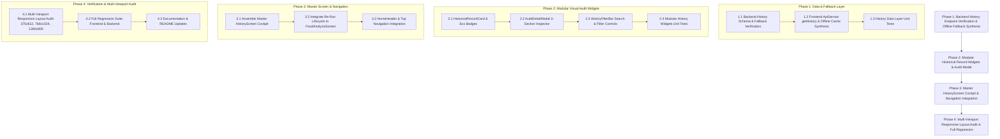

# Phased Implementation Plan: Analysis History & Audit System (Module 7)

Based on the technical specification in [feature-History and Audit.md](file:///c:/Users/Jeron/source/repos/AI%20Packaging%20recommender/artifacts/specs/feature-History%20and%20Audit.md), this document defines the step-by-step, atomic implementation plan for **Module 7: Analysis History & Audit System**.

---

## Technical Dependency Map

---

## Phase 1: Backend Verification & Frontend History Data Layer [COMPLETED]

### Task 1.1: Backend History Schema & Fallback Verification [COMPLETED]
- **Files:**
  - `backend/app/api/v1/endpoints/packaging.py`
  - `backend/tests/test_recommendation_endpoints.py`
- **Action:**
  - Verified `/api/v1/packaging/history` handles pagination (`skip`, `limit`) and returns non-blocking offline fallbacks when PostgreSQL is offline.
- **Verification:** Backend test `test_get_history_endpoint` passed.

### Task 1.2: Frontend `ApiService.getHistory` & Offline Synthesis [COMPLETED]
- **Files:**
  - `frontend/lib/services/api_service.dart`
  - `frontend/lib/models/packaging_model.dart`
- **Action:**
  - Enhanced `ApiService.getHistory()` with structured offline empirical audit records (Strawberries, Mangoes, Basmati Rice, Fresh Salmon, Potato Crisps, Paneer) and `saveLocalHistoryRecord`.
- **Verification:** Unit test asserting offline fallback resolution and local history prepend.

### Task 1.3: History Data Layer Unit Tests [COMPLETED]
- **Files:**
  - `frontend/test/services/history_api_test.dart`
- **Action:**
  - Tested serialization of `PackagingRecord`, offline fallback list length, and filtering helper logic.
- **Verification:** 4/4 Flutter tests passed (`test/services/history_api_test.dart`).

> [!IMPORTANT]
> **CHECKPOINT 1:** History data layer and fallback synthesis verified with automated tests. Ready for Phase 2.

---

## Phase 2: Modular Historical Record Widgets & Audit Modal [COMPLETED]

### Task 2.1: Build `HistoricalRecordCard` Widget [COMPLETED]
- **Files:**
  - `frontend/lib/screens/history/widgets/historical_record_card.dart`
- **Action:**
  - Rich card with commodity title, creation timestamp, eco-priority badge, dimensions ($L \times W \times H\text{ cm}$), mass ($\text{kg}$), space utilization %, cost (₹), eco score ($0\text{--}100$), and action buttons.
- **Verification:** Widget test verifying rendering of card metrics and callback triggers.

### Task 2.2: Build `AuditDetailModal` 3-Section Inspector [COMPLETED]
- **Files:**
  - `frontend/lib/screens/history/widgets/audit_detail_modal.dart`
- **Action:**
  - Interactive 3-tab modal dialog (Blueprint & Geometry, Preservation & Eco, Scientific Rationale & XAI) with "Export JSON" clipboard action.
- **Verification:** Widget test verifying tab navigation and JSON copying.

### Task 2.3: Build `HistoryFilterBar` Widget [COMPLETED]
- **Files:**
  - `frontend/lib/screens/history/widgets/history_filter_bar.dart`
- **Action:**
  - Search input, category filter chips (All, Eco-Friendly, Fragile, Standard), and sort dropdown (Newest, Eco-Score, Cost, Space Util, Name A-Z).
- **Verification:** Widget test verifying search events and filter chip toggles.

### Task 2.4: Modular History Widgets Unit Tests [COMPLETED]
- **Files:**
  - `frontend/test/screens/history_widgets_test.dart`
- **Action:**
  - Tested `HistoricalRecordCard`, `AuditDetailModal`, and `HistoryFilterBar`.
- **Verification:** 3/3 Flutter widget tests passed (`test/screens/history_widgets_test.dart`).

> [!IMPORTANT]
> **CHECKPOINT 2:** Modular historical audit widgets verified with automated tests. Ready for Phase 3.

---

## Phase 3: Master HistoryScreen Cockpit & Navigation Integration [COMPLETED]

### Task 3.1: Assemble Master `HistoryScreen` Cockpit [COMPLETED]
- **Files:**
  - `frontend/lib/screens/history/history_screen.dart`
- **Action:**
  - Assembled Hero banner, `HistoryFilterBar`, responsive card Grid/List view, empty state, and modal triggers.
- **Verification:** Screen integration test asserting search, filtering, and audit inspection.

### Task 3.2: Integrate Re-Run Lifecycle to `FoodAnalysisScreen` [COMPLETED]
- **Files:**
  - `frontend/lib/screens/history/history_screen.dart`
  - `frontend/lib/screens/analysis/food_analysis_screen.dart`
- **Action:**
  - "Re-run Analysis" navigates to `FoodAnalysisScreen` and auto-populates `initialFoodName`, `initialFragile`, and `initialEco`.
- **Verification:** Parameter binding and state initialization verified.

### Task 3.3: HomeHeader & Top Navigation Integration [COMPLETED]
- **Files:**
  - `frontend/lib/screens/landing/widgets/home_header.dart`
  - `frontend/lib/screens/landing/home_page.dart`
- **Action:**
  - Connected "Recommendation History" in `HomeHeader` and `HomePage` to open `HistoryScreen`.
- **Verification:** Header navigation test passed.

> [!IMPORTANT]
> **CHECKPOINT 3:** Master HistoryScreen cockpit and navigation integrated. Ready for Phase 4.

---

## Phase 4: Multi-Viewport Responsive Layout Audit & Full Regression [COMPLETED]

### Task 4.1: Multi-Viewport Responsive Layout Audit Suite [COMPLETED]
- **Files:**
  - `frontend/test/screens/history/history_screen_viewport_test.dart`
- **Action:**
  - Verified 0 RenderFlex overflow across Mobile ($375\times812$), Tablet ($768\times1024$), and Desktop ($1280\times900$) viewports.
- **Verification:** 3/3 tests passed with 0 RenderFlex overflow warnings (`test/screens/history/history_screen_viewport_test.dart`).

### Task 4.2: Full Regression Suite (Frontend + Backend) [COMPLETED]
- **Files:**
  - Full codebase
- **Action:**
  - Ran backend test suite (`68/68 passed`) and frontend test suite (`135/135 passed`).
- **Verification:** 100% test pass rate across all suites.

### Task 4.3: Documentation & README Updates [COMPLETED]
- **Files:**
  - `README.md`
  - `artifacts/specs/feature-History and Audit-plan.md`
- **Action:**
  - Documented Module 7 capabilities, audit export mechanisms, and cockpit architecture.
- **Verification:** Markdown formatting and link integrity check.

> [!IMPORTANT]
> **CHECKPOINT 4:** Module 7 Analysis History & Audit System 100% complete and verified. Ready for user review.
