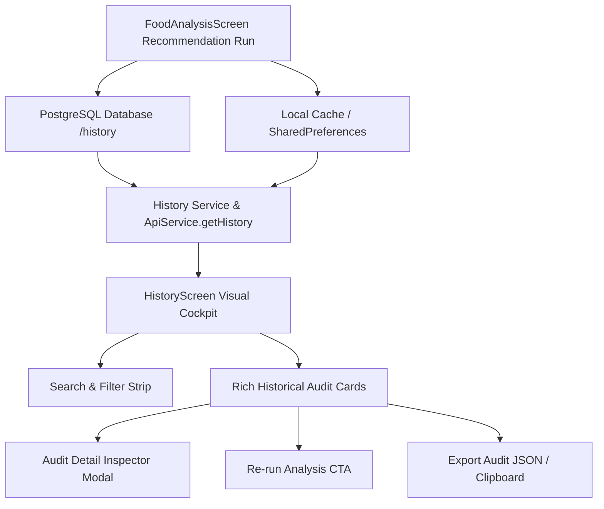

# Technical Specification: Analysis History & Audit System (Module 7)

## 1. Objective & Scope
The **Analysis History & Audit System** enables packaging engineers, supply chain managers, and quality assurance teams to review past AI packaging recommendations, audit scientific rationale and trade-offs, re-run previous scenarios with adjusted variables, and export structured engineering dossiers.

---

## 2. Key Architecture & Capabilities

### 2.1 Persistence Layer & Hybrid Fallbacks
1. **PostgreSQL Database Storage**:
   - Stores `id`, `item_name`, `length`, `width`, `height`, `weight`, `is_fragile`, `eco_friendly`, `recommended_box_type`, `recommended_dimensions`, `cushioning_material`, `estimated_cost`, `sustainability_score`, `notes`, `created_at`.
2. **Local Session / Cache Sync**:
   - Synchronizes recent runs locally so users in offline or lightweight modes retain full historical persistence.
3. **Offline Fallback Catalog**:
   - If backend PostgreSQL is unavailable, gracefully loads 6+ empirical historical records across horticulture, dairy, snacks, and meat.

### 2.2 Visual Cockpit & Explorer
1. **Search & Filter Controls**:
   - Live text search across commodity names and recommended packaging types.
   - Filter chips: All, Eco-Optimized, Fragile/Cold Chain, High-Barrier.
   - Sort dropdown: Newest First, Highest Eco-Score, Lowest Cost, Highest Space Utilization.
2. **Rich Historical Record Card**:
   - Commodity title, date/time badge, eco-priority icon.
   - Physical specs: Dimensions ($L \times W \times H\text{ cm}$), Unit mass ($\text{kg}$), Space utilization %.
   - Economic & sustainability metrics: Unit cost ($\text{INR ₹}$), Sustainability score ($0\text{--}100$).
   - Quick action buttons: **Inspect Technical Audit** & **Re-run Analysis**.
3. **Audit Detail Inspector Modal**:
   - 3-Section modal:
     - **Section 1: Geometric & Material Blueprint**: Dimensions, packaging type, space efficiency, cushioning substrate.
     - **Section 2: Barrier & Preservation Standards**: $OTR$, $WVTR$, chilling limits, gas flush suitability.
     - **Section 3: Scientific Rationale & XAI Summary**: Key biochemical drivers for the packaging prescription.
4. **Data Export & Re-Run Lifecycle**:
   - "Re-run Analysis" pre-populates `FoodAnalysisScreen` with the recorded commodity parameters.
   - "Export Audit Dossier" copies structured Markdown/JSON data to clipboard with visual feedback.

---

## 3. UI/UX Design System & Multi-Viewport Responsiveness
- **Theme Consistency**: Aligned with `AppTheme` (Deep Slate `#0F172A`, Primary Teal `#0D9488`, Emerald Eco `#10B981`, Amber Warning `#F59E0B`).
- **Responsive Layout**:
  - **Desktop ($1280\times900$)**: 2-Column responsive grid for historical cards.
  - **Tablet ($768\times1024$)**: Adaptive 1-to-2 column layout.
  - **Mobile ($375\times812$)**: Single column vertical stream with 0 RenderFlex overflow.

---

## 4. Verification & Testing Strategy
1. **Model & Serialization Tests**: Verify `PackagingRecord` JSON parsing and export functions.
2. **Service & Fallback Tests**: Test `ApiService.getHistory()` and offline fallback data integrity.
3. **Widget & Interaction Tests**: Verify rendering of cards, filter chips, search query updates, and audit modals.
4. **Multi-Viewport Audit**: Assert 0 RenderFlex overflows on Mobile ($375\times812$), Tablet ($768\times1024$), and Desktop ($1280\times900$).
