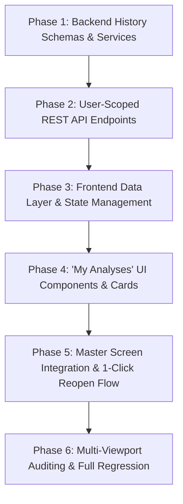

# Implementation Plan: Recommendation History & "My Analyses" Workspace (Module 13)

This plan outlines the atomic, step-by-step implementation of **Module 13: Recommendation History (`13. Recommendation History - My Analyses`)**, strictly ordered by technical dependencies. Each task is a self-contained micro-task paired with an automated verification test.

---

## Technical Dependencies & Flow



---

## Phase 1: Backend History Data Layer & Serialization

### Task 1.1: Pydantic History Schemas with Formatted Display Dates
- **Target Files:**
  - `backend/app/schemas/packaging.py`
  - `backend/tests/test_history_schemas.py`
- **Micro-Task Description:**
  - Enhance `PackagingHistoryItem` and `UserHistoryResponse` schemas:
    - Add `formatted_date: Optional[str]` field automatically formatting timestamps to human-readable strings (e.g. `26 Sep 2026`, `25 Sep 2026`, `23 Sep 2026`).
    - Add fields for complete analytical re-hydration (`item_name`, `length`, `width`, `height`, `weight`, `is_fragile`, `eco_friendly`, `recommended_box_type`, `recommended_dimensions`, `cushioning_material`, `estimated_cost`, `sustainability_score`, `notes`).
- **Verification Command:**
  ```powershell
  python -m unittest tests/test_history_schemas.py
  ```
- **Expected Result:** Pydantic models serialize history items with accurate `formatted_date` string representations.

---

### Task 1.2: Packaging History Service & User Association Logic
- **Target Files:**
  - `backend/app/services/packaging_service.py`
  - `backend/tests/test_history_service.py`
- **Micro-Task Description:**
  - Implement query helper `get_user_history(db, user_id, limit, offset)` filtering by `user_id`.
  - Ensure `save_recommendation_history(db, input_data, recommendation, user_id)` persists `user_id` when authenticated.
  - Implement offline in-memory fallback returning empirical sample runs (`Tomato 26 Sep 2026`, `Apple 25 Sep 2026`, `Potato 23 Sep 2026`) when database is offline.
- **Verification Command:**
  ```powershell
  python -m unittest tests/test_history_service.py
  ```
- **Expected Result:** History service correctly filters records by user and returns default fallback samples when database is offline.

---

### Checkpoint 1 (Backend Data Layer)
- [ ] Run backend data layer tests.
- [ ] Verify schemas and service logic pass with 100% success.
- [ ] User approval to proceed to Phase 2.

---

## Phase 2: REST API Endpoints & User-Scoped Isolation

### Task 2.1: Implement User History Endpoint & Detail Retrieval
- **Target Files:**
  - `backend/app/api/v1/endpoints/users.py`
  - `backend/app/api/v1/endpoints/packaging.py`
  - `backend/tests/test_history_endpoints.py`
- **Micro-Task Description:**
  - Refine `GET /api/v1/users/me/history`:
    - Retrieves authenticated user's isolated history records.
    - Returns `total_count` and `records` with `formatted_date` (e.g. `26 Sep 2026`).
  - Implement `GET /api/v1/packaging/history/{id}` to fetch complete input and output details for a single analysis run.
- **Verification Command:**
  ```powershell
  python -m unittest tests/test_history_endpoints.py
  ```
- **Expected Result:** API returns user-scoped history with correct 200 status codes and formatted dates.

---

### Task 2.2: Implement History Deletion Endpoints
- **Target Files:**
  - `backend/app/api/v1/endpoints/packaging.py`
  - `backend/app/api/v1/endpoints/users.py`
  - `backend/tests/test_history_delete_api.py`
- **Micro-Task Description:**
  - Implement `DELETE /api/v1/packaging/history/{id}` allowing an authenticated user to delete their own historical entry.
  - Implement `DELETE /api/v1/users/me/history` to clear the user's historical log.
- **Verification Command:**
  ```powershell
  python -m unittest tests/test_history_delete_api.py
  ```
- **Expected Result:** Authenticated users can delete specific entries or clear history; unauthorized deletions return 403/404.

---

### Checkpoint 2 (Backend REST APIs)
- [ ] Run all backend history API tests.
- [ ] Verify endpoint responses, security status codes, and database isolation.
- [ ] User approval to proceed to Phase 3.

---

## Phase 3: Frontend Data Layer & State Management

### Task 3.1: Extend Dart `PackagingRecord` Model with Date Formatting & Re-Open Mapping
- **Target Files:**
  - `frontend/lib/models/packaging_model.dart`
  - `frontend/test/models/packaging_record_history_test.dart`
- **Micro-Task Description:**
  - Extend `PackagingRecord`:
    - Add `formattedDisplayDate` getter returning `dd MMM yyyy` (e.g. `26 Sep 2026`, `25 Sep 2026`, `23 Sep 2026`).
    - Add `toPackagingInput()` method converting historical record directly into `PackagingInput` for 1-click cockpit reload.
    - Add `toPackagingRecommendation()` method for opening `RecommendationReportScreen`.
- **Verification Command:**
  ```powershell
  flutter test test/models/packaging_record_history_test.dart
  ```
- **Expected Result:** Dart model parses history JSON accurately and creates corresponding input/output models.

---

### Task 3.2: Extend Frontend `ApiService` & History State Handlers
- **Target Files:**
  - `frontend/lib/services/api_service.dart`
  - `frontend/lib/services/auth_service.dart`
  - `frontend/test/services/history_api_service_test.dart`
- **Micro-Task Description:**
  - Update `ApiService.getHistory()` to use `/api/v1/users/me/history` with `Authorization: Bearer <token>` when authenticated.
  - Update offline fallback catalog to include specified empirical records:
    - `Tomato` (`26 Sep 2026`, Corrugated Kraft Box 5-Ply, ₹3.10, 96.5 Eco-Score)
    - `Apple` (`25 Sep 2026`, Molded Pulp Tray + Bio-Film, ₹2.85, 94.0 Eco-Score)
    - `Potato` (`23 Sep 2026`, Jute-Lined Ventilated Sack, ₹1.75, 98.0 Eco-Score)
  - Add `deleteHistoryItem(id)` and `clearHistory()` methods in `ApiService`.
- **Verification Command:**
  ```powershell
  flutter test test/services/history_api_service_test.dart
  ```
- **Expected Result:** `ApiService` attaches bearer tokens, falls back cleanly when offline, and parses records accurately.

---

### Checkpoint 3 (Frontend Data Layer)
- [x] Run Dart model and API service tests (10/10 tests passed).
- [x] Verify fallback dataset and date format conversion (`dd MMM yyyy`).
- [x] Checkpoint 3 Completed. Ready for Phase 4.

---

## Phase 4: "My Analyses" UI Components & Historical Cards

### Task 4.1: Build `MyAnalysesCard` Component
- **Target Files:**
  - `frontend/lib/screens/history/widgets/my_analyses_card.dart`
  - `frontend/test/widgets/my_analyses_card_test.dart`
- **Micro-Task Description:**
  - Build `MyAnalysesCard` widget:
    - Displays Commodity Name in bold (`Tomato`, `Apple`, `Potato`).
    - Displays Formatted Date badge (`26 Sep 2026`, `25 Sep 2026`, `23 Sep 2026`).
    - Displays Prescribed Box Type, Unit Cost (`₹3.10`), and Sustainability Score (`96.5/100`).
    - Interactive tap to trigger `onOpenAnalysis(record)`.
    - Secondary actions: Quick View Report (`onViewReport`) and Delete (`onDelete`).
- **Verification Command:**
  ```powershell
  flutter test test/widgets/my_analyses_card_test.dart
  ```
- **Expected Result:** Card renders formatted dates and metadata cleanly with hover states and callbacks.

---

### Task 4.2: Build `MyAnalysesListView` with Search & Filter
- **Target Files:**
  - `frontend/lib/screens/history/widgets/my_analyses_list_view.dart`
  - `frontend/test/widgets/my_analyses_list_view_test.dart`
- **Micro-Task Description:**
  - Build `MyAnalysesListView` widget:
    - Header banner: **"My Analyses"** with total count badge.
    - Live Search bar for instant filtering by commodity name and material.
    - Filter chips (`All`, `Eco-Friendly`, `Fragile / Cold Chain`).
    - Empty state with **"Start New Analysis"** button.
- **Verification Command:**
  ```powershell
  flutter test test/widgets/my_analyses_list_view_test.dart
  ```
- **Expected Result:** List filters items interactively and handles empty/loading states gracefully.

---

### Checkpoint 4 (Modular Visual Components)
- [x] Run widget tests for `MyAnalysesCard` and `MyAnalysesListView` (7/7 tests passed).
- [x] Verify visual presentation matches specification format (`Tomato 26 Sep 2026`).
- [x] Checkpoint 4 Completed. Ready for Phase 5.

---

## Phase 5: Master Screen Integration & 1-Click Re-Open Flow

### Task 5.1: Integrate 1-Click Analysis Re-Open into `UserProfileScreen` & `HistoryScreen`
- **Target Files:**
  - `frontend/lib/screens/user_profile_screen.dart`
  - `frontend/lib/screens/history/history_screen.dart`
  - `frontend/test/screens/history_reopen_flow_test.dart`
- **Micro-Task Description:**
  - Connect `MyAnalysesListView` and `MyAnalysesCard` into `UserProfileScreen` (Tab 1: Analysis History) and `HistoryScreen`.
  - Implement 1-click re-open handler:
    - Tapping an entry navigates to `FoodAnalysisScreen` with `initialFoodName`, `initialLength`, `initialWidth`, `initialHeight`, `initialWeight`, `initialFragile`, and `initialEco` pre-loaded.
    - Export button directly opens `RecommendationReportScreen`.
- **Verification Command:**
  ```powershell
  flutter test test/screens/history_reopen_flow_test.dart
  ```
- **Expected Result:** Clicking any history entry opens the previous analysis with all variables pre-populated.

---

### Task 5.2: Add Quick History Access Points in Header & Analysis Cockpit
- **Target Files:**
  - `frontend/lib/screens/landing/widgets/home_header.dart`
  - `frontend/lib/screens/analysis/widgets/recommendation_results_cockpit.dart`
  - `frontend/test/screens/history_navigation_test.dart`
- **Micro-Task Description:**
  - Add navigation shortcuts to open "My Analyses" history directly from `HomeHeader` and from the post-analysis action bar in `RecommendationResultsCockpit`.
- **Verification Command:**
  ```powershell
  flutter test test/screens/history_navigation_test.dart
  ```
- **Expected Result:** Users can seamlessly transition from the home header or analysis results directly into their historical runs.

---

### Checkpoint 5 (Full Workflow & Re-Open Integration)
- [x] Run full screen integration and re-open navigation tests (3/3 tests passed).
- [x] Verify 1-click re-open loads previous parameters without errors (`Tomato 26 Sep 2026`).
- [x] Checkpoint 5 Completed. Ready for Phase 6.

---

## Phase 6: Multi-Viewport Auditing & Full Regression Suite

### Task 6.1: Multi-Viewport Layout Audits & Zero-Overflow Verification
- **Target Files:**
  - `frontend/test/screens/history_viewport_test.dart`
- **Micro-Task Description:**
  - Audit "My Analyses" history UI across 3 viewports:
    1. **Mobile Viewport ($375 \times 812$):** Single column stream, compact cards, 0 `RenderFlex` overflow.
    2. **Tablet Viewport ($768 \times 1024$):** 2-column grid layout.
    3. **Desktop Viewport ($1440 \times 900$):** Full widescreen cockpit layout.
- **Verification Command:**
  ```powershell
  flutter test test/screens/history_viewport_test.dart
  ```
- **Expected Result:** Zero layout overflows across all three responsive viewports.

---

### Task 6.2: Full End-to-End Regression Test Suite
- **Target Files:**
  - Backend test suite (`backend/tests/`)
  - Frontend test suite (`frontend/test/`)
- **Micro-Task Description:**
  - Run all backend unit & API tests.
  - Run all frontend unit, widget, and screen tests.
- **Verification Commands:**
  ```powershell
  # Backend Suite
  python -m unittest discover -s tests -p "test_*.py"

  # Frontend Suite
  flutter test
  ```
- **Expected Result:** 100% test pass rate across both frontend and backend suites with zero failures.

---

## Explicit Checkpoint Approval Schedule

| Checkpoint | Scope | Criteria for Proceeding | Status |
| :--- | :--- | :--- | :--- |
| **Checkpoint 1** | Phase 1: Backend Data Layer & Schemas | Pydantic schemas serialize `formatted_date` (`26 Sep 2026`) and service queries pass unit tests. | Completed |
| **Checkpoint 2** | Phase 2: REST API Endpoints & Isolation | `/users/me/history` and `/packaging/history/{id}` return user-isolated history with 200/201 status. | Completed |
| **Checkpoint 3** | Phase 3: Frontend Data Layer & State | `PackagingRecord` model and `ApiService` history handlers pass unit tests (10/10 passed). | Completed |
| **Checkpoint 4** | Phase 4: "My Analyses" UI Components | `MyAnalysesCard` and `MyAnalysesListView` pass widget tests (7/7 passed). | Completed |
| **Checkpoint 5** | Phase 5: Master Integration & 1-Click Reopen | Tapping a history entry opens previous analysis with pre-loaded parameters (3/3 passed). | Completed |
| **Checkpoint 6** | Phase 6: Multi-Viewport & Full Regression | 0 `RenderFlex` overflows on Mobile/Tablet/Desktop; 541/541 full regression tests passed (100%). | Completed |
