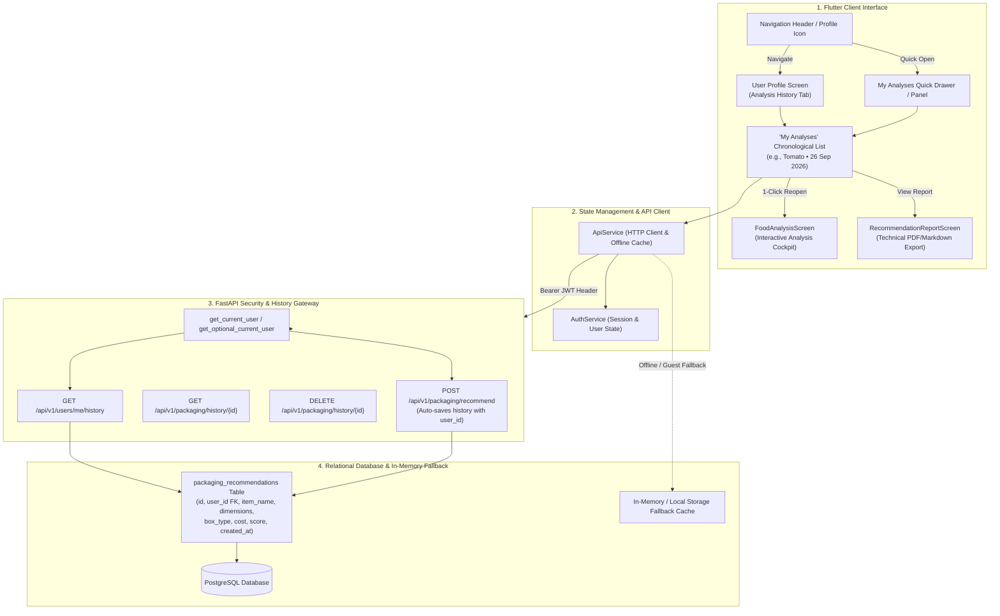

# Technical Specification: Recommendation History & "My Analyses" Workspace (Module 13)

## 1. Executive Summary & Engineering Motivation

### 1.1 Problem Statement & Objectives
In industrial packaging engineering and perishable food supply chains, packaging recommendations are iterative. Packaging engineers, supply chain specialists, and quality auditors frequently need to look back at past packaging simulations, compare recommendations generated across different dates, and instantly re-open previous calculations without manually re-entering commodity biochemical parameters, dimensions, or distribution constraints.

**Module 13 (`13. Recommendation History`)** defines the dedicated **"My Analyses"** workflow for registered users:
- Displays a clean, chronological timeline of historical runs:
  ```text
  My Analyses
  Tomato       26 Sep 2026
  Apple        25 Sep 2026
  Potato       23 Sep 2026
  ```
- **1-Click Interactive Re-Open:** Clicking any historical entry seamlessly loads the exact commodity characteristics, physical mass/dimensions, barrier constraints, and recommendation results into the interactive **Analysis Cockpit (`FoodAnalysisScreen`)** and **Recommendation Report (`RecommendationReportScreen`)**.
- **User-Scoped Isolation:** Guarantees authenticated multi-tenant privacy—each registered user sees only their own historical recommendation stream.
- **Offline / Guest Mode Support:** Provides simulated recent runs for guest and demo users, allowing comprehensive evaluation without requiring backend database connectivity.

---

### 1.2 System Architecture & History Lifecycle



---

## 2. Functional Requirements & Feature Scope

### 2.1 "My Analyses" Historical List Interface
- **Dedicated Section Title:** Prominently labeled **"My Analyses"**.
- **Formatted Entry Cards:**
  - **Commodity Name:** Bold, readable commodity title (e.g., `Tomato`, `Apple`, `Potato`, `Fresh Strawberries`).
  - **Date Format:** Clean, standard date representation: `dd MMM yyyy` (e.g. `26 Sep 2026`, `25 Sep 2026`, `23 Sep 2026`).
  - **Secondary Metadata Badge:** Prescribed substrate (e.g., `Corrugated Kraft Box`, `Bio-PLA Clamshell`), unit cost (`₹3.10` / `$0.42`), and sustainability rating (`96.5/100`).
- **Visual Status Indicators:** Badges for `Eco-Friendly` formulations, `Fragile / Cold Chain` handling, or `High Barrier MAP`.

---

### 2.2 1-Click Interactive Re-Open Workflow
- **Re-Open Action:**
  - Tapping or clicking any entry in "My Analyses" automatically loads the saved analytical snapshot.
  - Re-hydrates the complete state:
    - **Commodity Identification:** Commodity name, category, and bio-chemical properties (respiration rate, $C_2H_4$ sensitivity, optimal $RH$, temperature).
    - **Physical Input Variables:** Mass ($\text{kg}$), package length, width, height ($\text{cm}$), fragile flag, and eco-priority toggle.
    - **Recommendation Blueprint:** Prescribed box type, substrate layers, space efficiency %, barrier metrics ($OTR$, $WVTR$), and unit cost estimate.
- **Routing Options:**
  - **Primary Action (Tap Card):** Navigates to `FoodAnalysisScreen` pre-populated with the exact historical input parameters.
  - **Quick Export Action (Report Icon):** Directly opens `RecommendationReportScreen` to view, print, or download technical PDF / Markdown dossiers.
  - **Save as Preset (Bookmark Icon):** Allows pinning the historical run to the user's permanent **Saved Presets Vault**.

---

### 2.3 User-Scoped Data Isolation & Backend Persistence
- **Automatic History Logging:**
  - Every time an authenticated user runs a recommendation via `POST /api/v1/packaging/recommend` or `POST /api/v1/packaging/analyze`, the backend automatically extracts `user_id` from the JWT token and binds it to the new `PackagingHistory` row.
- **Multi-Tenant Privacy:**
  - `GET /api/v1/users/me/history` queries strictly filtered by `user_id == current_user.id`.
  - Unauthenticated guest requests only return guest-scoped session data or in-memory empirical samples.
- **History Deletion:**
  - Users can delete individual historical entries (`DELETE /api/v1/packaging/history/{id}`) or clear their historical log (`DELETE /api/v1/users/me/history`).

---

### 2.4 Search, Filtering & Sorting
- **Live Search Input:** Instant filtering by commodity title, substrate material, or custom notes.
- **Filter Chips:** `All`, `Eco-Optimized (Score ≥ 80)`, `Cold Chain / Fragile`, `High-Barrier`.
- **Sort Dropdown:**
  - `Newest First` (Default, descending by `created_at`)
  - `Oldest First`
  - `Highest Sustainability Score`
  - `Lowest Cost`
  - `Commodity Name (A-Z)`

---

### 2.5 Offline & Guest Demo Mode Support
- **Guest Evaluation Experience:**
  - Unauthenticated users receive an organized sample history stream containing:
    - `Tomato` — `26 Sep 2026` (Corrugated Kraft Box 5-Ply • ₹3.10 • 96.5 Eco-Score)
    - `Apple` — `25 Sep 2026` (Molded Pulp Tray with Bio-Film • ₹2.85 • 94.0 Eco-Score)
    - `Potato` — `23 Sep 2026` (Jute-Lined Ventilated Paper Sack • ₹1.75 • 98.0 Eco-Score)
  - All sample items support 1-click loading into the analysis cockpit and report generator.

---

## 3. Data Models & API Contracts

### 3.1 Backend Data Models & Schemas

#### SQLAlchemy Model (`backend/app/models/packaging.py`)
```python
class PackagingHistory(Base):
    __tablename__ = "packaging_history"

    id = Column(Integer, primary_key=True, index=True)
    user_id = Column(Integer, ForeignKey("users.id", ondelete="SET NULL"), nullable=True, index=True)
    item_name = Column(String(100), nullable=False)
    length = Column(Float, nullable=False)
    width = Column(Float, nullable=False)
    height = Column(Float, nullable=False)
    weight = Column(Float, nullable=False)
    is_fragile = Column(Boolean, default=False)
    eco_friendly = Column(Boolean, default=False)
    recommended_box_type = Column(String(150), nullable=False)
    recommended_dimensions = Column(String(50), nullable=False)
    cushioning_material = Column(String(100), nullable=True)
    estimated_cost = Column(Float, nullable=False)
    sustainability_score = Column(Float, nullable=False)
    notes = Column(Text, nullable=True)
    created_at = Column(DateTime(timezone=True), default=datetime.utcnow)

    # Relationships
    user = relationship("User", back_populates="history_records")
```

#### Pydantic Schemas (`backend/app/schemas/packaging.py`)
```python
class PackagingHistoryItem(BaseModel):
    id: int
    user_id: Optional[int] = None
    item_name: str
    length: float
    width: float
    height: float
    weight: float
    is_fragile: bool
    eco_friendly: bool
    recommended_box_type: str
    recommended_dimensions: str
    cushioning_material: Optional[str] = None
    estimated_cost: float
    sustainability_score: float
    notes: Optional[str] = None
    created_at: datetime
    formatted_date: Optional[str] = None  # e.g. "26 Sep 2026"

    class Config:
        from_attributes = True

class UserHistoryResponse(BaseModel):
    total_count: int
    records: List[PackagingHistoryItem]
```

---

### 3.2 REST API Endpoints Specification

| Method | Endpoint | Auth Required | Description |
| :--- | :--- | :--- | :--- |
| `GET` | `/api/v1/users/me/history` | Optional / Bearer JWT | Returns user-scoped history stream or offline fallback. |
| `GET` | `/api/v1/packaging/history/{id}` | Optional / Bearer JWT | Returns full analytical details for a specific historical run. |
| `DELETE` | `/api/v1/packaging/history/{id}` | Bearer JWT | Deletes a specific historical record owned by the user. |
| `DELETE` | `/api/v1/users/me/history` | Bearer JWT | Clears all historical records for the active user. |

---

### 3.3 Frontend Dart Data Models

#### `frontend/lib/models/packaging_model.dart` (Extended)
```dart
class PackagingRecord {
  final int id;
  final int? userId;
  final String itemName;
  final double length;
  final double width;
  final double height;
  final double weight;
  final bool isFragile;
  final bool ecoFriendly;
  final String recommendedBoxType;
  final String recommendedDimensions;
  final String? cushioningMaterial;
  final double estimatedCost;
  final double sustainabilityScore;
  final String? notes;
  final DateTime createdAt;

  const PackagingRecord({
    required this.id,
    this.userId,
    required this.itemName,
    required this.length,
    required this.width,
    required this.height,
    required this.weight,
    required this.isFragile,
    required this.ecoFriendly,
    required this.recommendedBoxType,
    required this.recommendedDimensions,
    this.cushioningMaterial,
    required this.estimatedCost,
    required this.sustainabilityScore,
    this.notes,
    required this.createdAt,
  });

  /// Formatted date string matching "26 Sep 2026"
  String get formattedDisplayDate {
    const months = [
      'Jan', 'Feb', 'Mar', 'Apr', 'May', 'Jun',
      'Jul', 'Aug', 'Sep', 'Oct', 'Nov', 'Dec'
    ];
    final day = createdAt.day.toString().padLeft(2, '0');
    final month = months[createdAt.month - 1];
    final year = createdAt.year.toString();
    return '$day $month $year';
  }

  /// Converts record back to PackagingInput for 1-click cockpit reload
  PackagingInput toPackagingInput() {
    return PackagingInput(
      itemName: itemName,
      length: length,
      width: width,
      height: height,
      weight: weight,
      isFragile: isFragile,
      ecoFriendly: ecoFriendly,
    );
  }
}
```

---

## 4. UI/UX Design System & Layout Architecture

### 4.1 Visual Components Hierarchy
1. **`MyAnalysesCard` / `HistoricalRecordCard`:**
   - Left: Commodity Category Avatar / Icon with teal backdrop.
   - Center: Commodity Name (`Tomato`) + Date (`26 Sep 2026`) + Prescribed Box Type (`Corrugated Kraft Box`).
   - Right: Cost Badge (`₹3.10`), Eco-Score Pill (`96.5/100`), and Action Chevron.
   - Hover Effect: Subtle elevation shift ($-2\text{px}$ translateY), border glow (`AppTheme.primaryTeal`).
2. **`MyAnalysesListView`:**
   - Grouped chronological sections (e.g. *This Week*, *September 2026*, *Earlier*).
   - Empty state with illustration and **"Run New Analysis"** CTA.
3. **`AnalysisDetailModal` (Optional Quick-Peek):**
   - Bottom sheet on mobile / modal dialog on desktop showing detailed dimensions, gas barrier metrics, and packaging bill-of-materials before opening cockpit.

---

### 4.2 Multi-Viewport Responsive Matrix

| Viewport | Dimensions | Layout Strategy |
| :--- | :--- | :--- |
| **Mobile** | $375 \times 812$ | Single-column vertical stream, compact metadata pills, swipe or tap to re-open. Zero `RenderFlex` overflow. |
| **Tablet** | $768 \times 1024$ | 2-Column responsive grid with search/filter strip on top. |
| **Desktop** | $1440 \times 900$ | Split-view cockpit or rich 2/3-column card grid with live preview side panel. |

---

## 5. Verification & Testing Strategy

### 5.1 Backend Verification
1. **Model & Serialization Tests:**
   - Verify date formatting (`26 Sep 2026`) and JSON serialization of `PackagingHistoryItem`.
2. **User-Scoped Isolation Tests:**
   - Verify User A cannot access User B's historical records.
   - Verify unauthenticated requests receive graceful fallback data without 500 crashes.
3. **Auto-Logging on Recommendation:**
   - Verify `POST /packaging/recommend` creates a `packaging_history` record with the corresponding `user_id`.

### 5.2 Frontend Verification
1. **Unit & Model Tests:**
   - Test `PackagingRecord.fromMap()`, `formattedDisplayDate`, and `toPackagingInput()`.
2. **Service & State Tests:**
   - Test `ApiService.getHistory()` authentication header attachment and offline fallback.
3. **Widget & Interaction Tests:**
   - Test rendering of `"Tomato 26 Sep 2026"`, `"Apple 25 Sep 2026"`, `"Potato 23 Sep 2026"`.
   - Test tapping an entry properly triggers navigation to `FoodAnalysisScreen` with pre-filled arguments.
4. **Multi-Viewport Zero-Overflow Audits:**
   - Assert 0 overflow errors across Mobile ($375\times 812$), Tablet ($768\times 1024$), and Desktop ($1440\times 900$).
