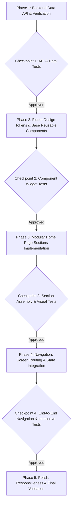

# Step-by-Step Implementation Plan: SmartPack AI Home Page

This document outlines the phased, dependency-ordered technical execution plan for implementing the **SmartPack AI Home Page** based on the technical specification in [artifacts/specs/feature-Home page.md](file:///c:/Users/Jeron/source/repos/AI%20Packaging%20recommender/artifacts/specs/feature-Home%20page.md).

---

## 📅 Execution Roadmap Overview

---

## 🛠️ Phase 1: Backend Data API & Verification (Prerequisites)

- **Goal:** Ensure backend endpoints for food commodities and category summaries are accessible to power the Home Page preview dynamically (with resilient offline fallbacks).

### Tasks:
- [x] **Task 1.1: Verify & Enhance Summary API Endpoint**
  - Verify `GET /api/v1/data/foods` and ensure endpoint returns category-wise groupings and sample counts for the Home Page preview cards.
  - *Verification Test:* Executed `backend/tests/test_food_data_api.py` with 5 passing tests covering health, `/foods`, `/categories-summary`, `/packaging-materials`, and `/recommend`.

- [x] **Task 1.2: Add Flutter Service Method for Home Page Preview**
  - Add `ApiService.getFeaturedCommodities()` in `frontend/lib/services/api_service.dart` with error-handling fallback to built-in static category list if backend is offline.
  - *Verification Test:* Created `frontend/test/api_service_test.dart` and `frontend/lib/models/commodity_model.dart` with parsing and offline fallback verification.

---

### 🛑 CHECKPOINT 1: Backend API & Service Verification
> **Required Action:** Run API tests and verify fallback mechanisms.
> **User Approval Gate:** Request approval before proceeding to UI component construction.

---

## 🎨 Phase 2: Flutter Design Tokens & Base Reusable Components

- **Goal:** Build the styling foundation, theme tokens, and reusable atomic widgets (brand header, gradient buttons, glassmorphic cards).

### Tasks:
- [x] **Task 2.1: Configure Theme & Color Tokens**
  - Update `frontend/lib/main.dart` and `frontend/lib/theme/app_theme.dart` with SmartPack AI palette:
    - Primary Teal (`#0F766E`), Mint Accent (`#14B8A6`), Emerald Eco (`#059669`), Slate Surface (`#0F172A`).
  - Configure `GoogleFonts.inter` typography hierarchy (Display, Title, Body).
  - *Verification Test:* Created `frontend/test/theme_test.dart` verifying colors, gradients, and Material 3 ColorScheme tokens.

- [x] **Task 2.2: Implement `BrandLogo` and `GradientButton` Widgets**
  - Create `frontend/lib/widgets/brand_logo.dart` (styled icon + typography).
  - Create `frontend/lib/widgets/gradient_button.dart` (smooth hover/press animation, customizable icon, elevation).
  - *Verification Test:* Created `frontend/test/widgets_test.dart` verifying tap callbacks and visual rendering.

- [x] **Task 2.3: Implement `ModernCard` & `FeatureBadge` Widgets**
  - Create `frontend/lib/widgets/modern_card.dart` with rounded corners ($16\text{px}$), subtle shadow, border highlight, and glassmorphism support.
  - Create `frontend/lib/widgets/feature_badge.dart` with eco and barrier style presets.
  - *Verification Test:* Created `frontend/test/modern_card_test.dart` verifying padding, border radius, and child widget rendering.

---

### 🛑 CHECKPOINT 2: Design Tokens & Base Components
> **Required Action:** Run component widget tests.
> **User Approval Gate:** Confirm UI tokens and design foundation match requirements.

---

## 🧩 Phase 3: Modular Home Page Sections Implementation

- **Goal:** Construct individual sections of the Home Page in isolated, testable modules under `frontend/lib/screens/landing/widgets/`.

### Tasks:
- [x] **Task 3.1: Top Navigation Bar (`HomeHeader`)**
  - File: `frontend/lib/screens/landing/widgets/home_header.dart`
  - Elements: Brand logo, navigation anchor buttons (*How It Works*, *Benefits*, *Commodities*, *About*), History icon button, and "Launch Analysis" CTA.
  - *Verification Test:* Created `frontend/test/landing/home_header_test.dart` checking desktop & mobile collapse modes and action triggers.

- [x] **Task 3.2: Hero Section (`HeroSection`)**
  - File: `frontend/lib/screens/landing/widgets/hero_section.dart`
  - Elements: Bold headline, value proposition subtitle, feature chips (*Eco-friendly*, *540+ IFCT Foods*, *Real-Time Barrier Sizing*), primary "Start Analysis" CTA button, secondary "Explore Database" button, and hero preview card.
  - *Verification Test:* Created `frontend/test/landing/hero_section_test.dart` checking headlines, badges, sample card metrics, and CTA triggers.

- [x] **Task 3.3: 3-Step Workflow Section (`WorkflowSection`)**
  - File: `frontend/lib/screens/landing/widgets/workflow_section.dart`
  - Elements: Step 1 (Select Food), Step 2 (Analyze Properties), Step 3 (Recommend Packaging) connected with progress indicator arrows/connectors.
  - *Verification Test:* Created `frontend/test/landing/workflow_section_test.dart` confirming all 3 step titles, descriptions, badges, and icons render correctly.

- [x] **Task 3.4: Key Benefits Section (`BenefitsSection`)**
  - File: `frontend/lib/screens/landing/widgets/benefits_section.dart`
  - Elements: 4 benefit cards (Maximized Shelf-Life, Eco-Friendly Prioritization, Dimensional & Cost Optimization, Empirical Science Backing) laid out in responsive grid.
  - *Verification Test:* Created `frontend/test/landing/benefits_section_test.dart` validating benefit cards, icons, and responsive layout.

- [x] **Task 3.5: Supported Food Commodities Preview (`FoodPreviewSection`)**
  - File: `frontend/lib/screens/landing/widgets/food_preview_section.dart`
  - Elements: 8+ category cards (Snacks & Wafers, Bakery, Pickles & Sauces, Spice Powders, Dairy & Sweets, Retort Foods, Millets, Dry Fruits & Nuts) with icons, descriptions, and sample item tags.
  - *Verification Test:* Created `frontend/test/landing/food_preview_section_test.dart` verifying category cards, sample items, and category selection callbacks.

- [x] **Task 3.6: About Project & Research Provenance Section (`AboutSection`)**
  - File: `frontend/lib/screens/landing/widgets/about_section.dart`
  - Elements: Project background, citations (ICMR-NIN IFCT 2017, USDA FDC, peer-reviewed journals), tech stack badges, and footer links.
  - *Verification Test:* Created `frontend/test/landing/about_section_test.dart` validating mission, citations, tech badges, and footer.

---

### 🛑 CHECKPOINT 3: Section Assembly & Visual Verification
> **Required Action:** Run section unit and widget tests.
> **User Approval Gate:** Request approval on section layouts before wiring navigation.

---

## 🔗 Phase 4: Navigation, Screen Routing & State Integration

- **Goal:** Assemble all sections into `HomePage` and integrate seamless transitions to `AnalysisScreen` (form calculator) and `HistoryScreen`.

### Tasks:
- [x] **Task 4.1: Refactor Screen Structure**
  - Rename/relocate current calculator form to `frontend/lib/screens/analysis/food_analysis_screen.dart`.
  - Assemble all modular sections in `frontend/lib/screens/landing/home_page.dart` with a `SingleChildScrollView` and scroll controllers for section navigation anchors.
  - *Verification Test:* Created `frontend/test/landing/home_page_test.dart` verifying that `HomePage` renders all 6 sections consecutively without overflow errors.

- [x] **Task 4.2: Wire Navigation Actions**
  - Wire "Start Analysis" and "Launch Analysis" buttons to push `FoodAnalysisScreen` via `MaterialPageRoute` (or named routes).
  - Wire History button to push `HistoryScreen`.
  - Wire header navigation links to smooth-scroll to corresponding sections using `ScrollController`.
  - *Verification Test:* Integration test verifying that tapping "Start Analysis" navigates to `FoodAnalysisScreen` and back-button returns to `HomePage`.

---

### 🛑 CHECKPOINT 4: End-to-End Navigation & Interactive Flow
> **Required Action:** Run navigation integration test.
> **User Approval Gate:** Request approval on full flow.

---

## ⚡ Phase 5: Polish, Responsiveness & Final Validation

- **Goal:** Ensure cross-platform visual excellence, eliminate layout overflows, and verify web/desktop/mobile responsiveness.

### Tasks:
- [x] **Task 5.1: Mobile, Tablet & Desktop Responsive Layout Audit**
  - Test layouts at $375\text{px}$ (Mobile), $768\text{px}$ (Tablet), and $1280\text{px}$ (Desktop/Web).
  - Ensure zero RenderFlex overflow issues.
  - *Verification Test:* Created `frontend/test/landing/responsive_layout_test.dart` verifying Mobile, Tablet, and Desktop viewports without overflow errors.

- [x] **Task 5.2: Update Documentation & App Entrypoint**
  - Set `HomePage` as `home:` in `frontend/lib/main.dart`.
  - Update `README.md` screenshots/description reflecting the new landing experience.
  - *Verification Test:* Verified `main.dart` starts on `HomePage` with `AppTheme.lightTheme` and updated `README.md`.

---

### 🏁 FINAL CHECKPOINT: Ready for Production / User Acceptance
> **Required Action:** Perform full app dry-run and present completed Home Page.
