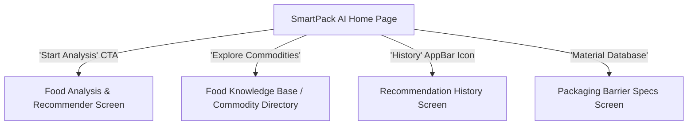
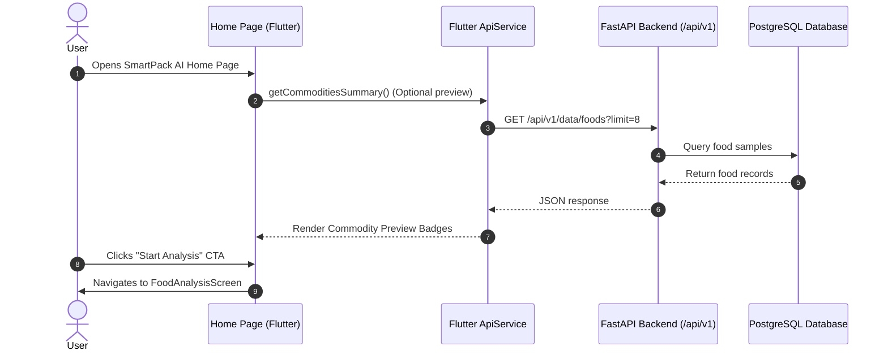

# Technical Specification: SmartPack AI Home Page

## 1. Overview & Objectives

### 1.1 Purpose
The **SmartPack AI Home Page** serves as the primary landing and introductory interface for the AI-Powered Sustainable Packaging Recommender system. It establishes brand identity, educates new users on food-package compatibility science, showcases the system's underlying research datasets, and provides clear call-to-action (CTA) paths to start commodity analysis and view historical recommendations.

### 1.2 Target Audience & Use Cases
- **Food Product Developers & SMEs:** Seeking optimal barrier packaging (OTR, WVTR) for shelf-life extension.
- **Packaging Engineers:** Exploring bio-based/recyclable polymer alternatives without compromising food preservation.
- **Researchers & Students:** Inspecting food properties (moisture, fat, pH, respiration rates) and correlating them with polymer barrier specs.

---

## 2. Architecture & Design System Integration

### 2.1 Technology Stack & Alignment
- **Framework:** Flutter (Dart 3.x, Material 3)
- **State Management:** Provider / Flutter State hooks
- **Typography:** Google Fonts (`Inter` / `Outfit`)
- **Theme Palette:**
  - **Primary Brand:** Deep Teal `#0F766E` / Mint Accent `#14B8A6`
  - **Secondary Brand:** Emerald Green `#059669` (Eco indicator)
  - **Dark Surface:** Slate Charcoal `#0F172A`
  - **Light Surface:** Crisp White `#FFFFFF` / Soft Off-white `#F8FAFC`
  - **Card Accents:** Soft Teal `#F0FDFA` / Border `#CCFBF1`

### 2.2 Navigation Architecture


---

## 3. UI/UX Component Specifications

The Home Page is structured as a vertically scrollable, responsive landing page adapting fluidly between Mobile, Tablet, and Desktop viewports ($max\text{-}width: 1200\text{px}$).

### 3.1 Top Navigation Bar (Header)
- **Branding:** SmartPack AI Logo Icon (`Icons.inventory_2_rounded` + Leaf badge `Icons.eco_rounded`) with stylized text.
- **Navigation Links (Desktop/Tablet):**
  - *How It Works* (Scroll to Section)
  - *Benefits* (Scroll to Section)
  - *Food Commodities* (Scroll to Section)
  - *About Project* (Scroll to Section)
- **Action Buttons:**
  - `History` button with badge count
  - `Launch Analysis` elevated button

### 3.2 Hero Section (Above the Fold)
- **Headline:** *"Precision AI Packaging Recommendations for Food Quality & Sustainability"*
- **Sub-headline:** *"Correlate commodity biochemical properties (Moisture, Fat, pH, Respiration) with optimal polymer barriers and eco-friendly packaging structures."*
- **Visual Badges / Chips:**
  - 🌿 *Eco-friendly Polymer Matching*
  - 📊 *540+ IFCT 2017 Food Database*
  - ⚡ *Real-Time Barrier Sizing (OTR / WVTR)*
- **Primary CTAs:**
  - **Primary:** `Start Analysis` Button (Prominent gradient button with `Icons.arrow_forward_rounded`)
  - **Secondary:** `Explore Database` Button (Outlined button with `Icons.travel_explore_rounded`)
- **Hero Graphic/Card:**
  - Glassmorphic card preview displaying a real-time sample card: *“Eco Ceramic Mug / Fried Potato Chips → Metallized PET / Honeycomb Kraft Cushioning — Sustainability Score: 94/100”*.

### 3.3 3-Step Workflow Section ("How SmartPack AI Works")
Interactive step-by-step progress cards explaining the underlying decision pipeline:
1. **Step 1: Select Food Commodity**
   - *Icon:* `Icons.restaurant_rounded`
   - *Description:* Choose from 540+ Indian Food Composition (IFCT 2017) profiles or input custom moisture %, fat %, pH, and dimensions.
2. **Step 2: Analyze Chemical & Barrier Needs**
   - *Icon:* `Icons.science_rounded`
   - *Description:* System calculates oxygen sensitivity, hygroscopic moisture pickup vulnerability, and respiration constraints ($O_2$ consumption / $CO_2$ generation).
3. **Step 3: Generate Optimized Packaging**
   - *Icon:* `Icons.check_circle_rounded`
   - *Description:* Delivers optimal polymer barrier selection (LDPE, HDPE, PET, PLA, Metallized films), box dimensions, cushioning materials, and cost/sustainability metrics.

### 3.4 Key Benefits Section
Grid/Carousel of benefit cards highlighting technical capabilities:
| Benefit Card | Icon | Description |
| :--- | :--- | :--- |
| **Maximized Shelf-Life** | `Icons.timer_outlined` | Precision matching of Oxygen ($OTR$) and Water Vapor ($WVTR$) barriers prevents oxidation and sogginess. |
| **Eco-Friendly Prioritization** | `Icons.compost_rounded` | Evaluates biodegradable polymers (PLA, breathable films) and recyclable corrugated kraft structures. |
| **Dimensional & Cost Optimization** | `Icons.aspect_ratio_rounded` | Auto-calculates volumetric utilization percentage and estimated unit packaging cost. |
| **Empirical Science Backing** | `Icons.menu_book_rounded` | Grounded in peer-reviewed packaging research and ICMR-NIN IFCT 2017 nutritional datasets. |

### 3.5 Supported Food Commodities Preview
A dynamic interactive category browser showcasing supported categories:
- **Category Chips / Cards:**
  - 🥨 *Snacks & Wafers* (Potato chips, banana chips, namkeen, extruded snacks)
  - 🍪 *Biscuits & Bakery* (Digestive cookies, breads, rusk, pastries)
  - 🥫 *Pickles & Sauces* (Oil-based pickles, acidic ketchups, fruit jams)
  - 🌶️ *Spice Powders* (Red chili, turmeric, garam masala, cumin)
  - 🥛 *Dairy & Sweets* (Paneer, cheese, butter, barfi, laddu)
  - 🍲 *Retort & Ready-to-Eat* (Biryani, dal makhani, curries)
  - 🌾 *Millets & Flours* (Ragi, jowar, bajra, legume flours)
  - 🥜 *Dry Fruits & Nuts* (Almonds, cashews, walnuts, raisins)
- **Live Search / Preview Bar:** Quick search to see if a food item is available in the IFCT database.

### 3.6 About Project & Research Team Section
- **Background:** Developed as an AI-driven decision-support tool bridging food technology and sustainable packaging engineering.
- **Data Provenance:**
  - National Institute of Nutrition (NIN) – Indian Food Composition Tables (IFCT 2017)
  - USDA Food Data Central & FAO Food Composition Standards
  - Published Food Packaging Research (Journal of Food Science, Polymer Testing, CRFS)
- **Tech Stack Highlights:** Flutter Frontend, FastAPI Async Backend, PostgreSQL 16 DB.

### 3.7 Footer
- Quick navigation links, API documentation link (`/docs`), GitHub repository badge, and license info.

---

## 4. Frontend Implementation Architecture

### 4.1 Folder Structure
```
frontend/lib/
├── main.dart
├── screens/
│   ├── landing/
│   │   ├── home_page.dart             <-- New Main Home Page
│   │   └── widgets/
│   │       ├── hero_section.dart      <-- Hero branding & CTA
│   │       ├── workflow_section.dart  <-- 3-step workflow diagram
│   │       ├── benefits_section.dart  <-- Key advantages cards
│   │       ├── food_preview_section.dart <-- Commodity categories preview
│   │       └── about_section.dart     <-- Research background & footer
│   ├── analysis/
│   │   └── food_analysis_screen.dart  <-- Interactive analysis tool
│   └── history/
│       └── history_screen.dart        <-- Past recommendations
├── widgets/
│   ├── brand_logo.dart
│   ├── modern_card.dart
│   └── gradient_button.dart
└── services/
    └── api_service.dart
```

### 4.2 Data Flow & API Connections


---

## 5. Non-Functional Requirements & Performance

1. **Responsiveness:** Fluid breakpoints:
   - Mobile: $< 640\text{px}$ (single-column cards, vertical CTA stack)
   - Tablet: $640\text{px} - 1024\text{px}$ (2-column benefit grid)
   - Desktop: $> 1024\text{px}$ (3-column benefit grid, side-by-side hero)
2. **Performance:** Lazy loading of commodity preview lists; SVG & vector icons (`Lucide` / `MaterialIcons`) for sub-second rendering.
3. **Accessibility:** WCAG AA compliant contrast ratios with Google Fonts typography (`Inter`).

---

## 6. Acceptance Criteria

- [ ] Header contains brand logo, navigation links, and "Launch Analysis" button.
- [ ] Hero section displays SmartPack AI title, value proposition, and functional "Start Analysis" CTA button.
- [ ] 3-step workflow visually illustrates *Select Food → Analyze Properties → Recommend Packaging*.
- [ ] Benefits section details shelf-life protection, sustainability scoring, and dimensional optimization.
- [ ] Supported food categories preview displays representative food tags across all 8+ categories.
- [ ] About section documents scientific sources (IFCT 2017, USDA, peer-reviewed literature).
- [ ] Clicking "Start Analysis" seamlessly routes to the recommendation/calculator interface.
