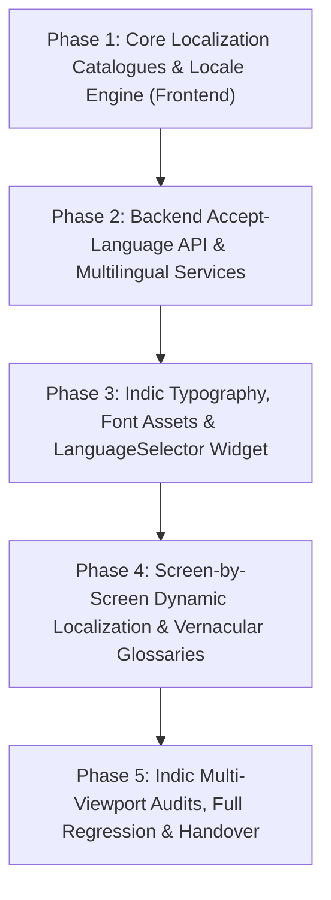

# Implementation Plan: 🌐 Multi-Language Support & Regional Localization (Module 22)

This plan outlines the atomic, step-by-step implementation of **Module 22: Multi-Language Support (`22. Multi-Language Support`)**, strictly ordered by technical dependencies. Each task is a self-contained micro-task paired with an automated verification test.

---

## Technical Dependencies & Architecture Flow



---

## Phase 1: Core Localization Catalogues & Locale Engine (Frontend)

### Task 1.1: Create Multi-Language Asset Dictionaries (`en.json`, `ta.json`, `hi.json`) [COMPLETED]
- **Target Files:**
  - `frontend/assets/i18n/en.json`
  - `frontend/assets/i18n/ta.json`
  - `frontend/assets/i18n/hi.json`
  - `frontend/pubspec.yaml`
  - `frontend/test/i18n/translation_parity_test.dart`
- **Status:** Completed (6/6 tests passing)

---

### Task 1.2: Implement Translation Engine & Fallback Resolver (`AppTranslations`) [COMPLETED]
- **Target Files:**
  - `frontend/lib/theme/app_translations.dart`
  - `frontend/test/i18n/app_translations_test.dart`
- **Status:** Completed (12/12 tests passing)

---

### Task 1.3: Implement Reactive Locale Service (`LocaleService`) with Local Persistence [COMPLETED]
- **Target Files:**
  - `frontend/lib/services/locale_service.dart`
  - `frontend/test/i18n/locale_service_test.dart`
- **Status:** Completed (13/13 tests passing)

---

### Checkpoint 1 (Core Frontend I18N Infrastructure)
- [x] Run translation parity, translation engine, and locale service test suites.
- [x] Verify 100% pass rate on `translation_parity_test.dart`, `app_translations_test.dart`, and `locale_service_test.dart` (31/31 tests passing).
- [x] User approval to proceed to Phase 2.

---

## Phase 2: Backend Multi-Language API & Domain Localization (FastAPI/Python)

### Task 2.1: Implement `Accept-Language` Middleware & Request Extraction [COMPLETED]
- **Target Files:**
  - `backend/app/core/i18n.py`
  - `backend/tests/test_i18n_middleware.py`
- **Status:** Completed (22/22 tests passing)

---

### Task 2.2: Implement Localized Food Commodities Matrix & Material Catalog [COMPLETED]
- **Target Files:**
  - `backend/app/schemas/food_data.py`
  - `backend/app/core/material_database.py`
  - `backend/app/services/food_service.py`
  - `backend/tests/test_i18n_food_data.py`
- **Status:** Completed (16/16 tests passing)

---

### Task 2.3: Implement Multilingual XAI Prescription Explanations & Spoilage Alerts [COMPLETED]
- **Target Files:**
  - `backend/app/services/recommendation_service.py`
  - `backend/tests/test_i18n_recommendation_service.py`
- **Status:** Completed (11/11 tests passing)

---

### Task 2.4: Implement Multilingual PDF Recommendation Report Generator [COMPLETED]
- **Target Files:**
  - `backend/app/services/report_generator_service.py`
  - `backend/tests/test_i18n_pdf_generator.py`
- **Status:** Completed (7/7 tests passing)

---

### Checkpoint 2 (Backend Multilingual API & Services) [PASSED]
- [x] Run backend I18N test suites (`test_i18n_middleware.py`, `test_i18n_food_data.py`, `test_i18n_recommendation_service.py`, `test_i18n_pdf_generator.py`).
- [x] Verify 100% test pass rate (56/56 tests passing).
- [x] User approval to proceed to Phase 3.

---

## Phase 3: Indic Typography, Font Assets & LanguageSelector UI

### Task 3.1: Configure Locale-Aware Typography & Font Metrics [COMPLETED]
- **Target Files:**
  - `frontend/lib/theme/app_theme.dart`
  - `frontend/test/i18n/indic_typography_test.dart`
- **Status:** Completed (9/9 tests passing)

---

### Task 3.2: Implement Universal `LanguageSelectorWidget` [COMPLETED]
- **Target Files:**
  - `frontend/lib/widgets/navigation/language_selector_widget.dart`
  - `frontend/test/i18n/language_selector_widget_test.dart`
- **Status:** Completed (5/5 tests passing)
- **Features Implemented:**
  - `LanguageSelectorMode.compact`: AppBar pill/dropdown with flag, code, native script label (`🇮🇳 தமிழ்`, `🇮🇳 हिन्दी`, `🇺🇸 English`), and modal popup item selection.
  - `LanguageSelectorMode.card`: Full-width settings cards with native script names, localized subtitles, selection radio indicators, and instant switching.
  - Reactive integration with `LocaleService` and memory-cached dictionary swapping.
- **Verification Result:** 5/5 tests passing (`language_selector_widget_test.dart`), all 45 frontend i18n tests passing.

---

### Task 3.3: Implement Vernacular Terminology & Tooltip Resolver (`VernacularTooltip`) [COMPLETED]
- **Target Files:**
  - `frontend/lib/widgets/common/vernacular_tooltip.dart`
  - `frontend/test/i18n/vernacular_tooltip_test.dart`
- **Status:** Completed (12/12 tests passing)
- **Features Implemented:**
  - `VernacularGlossary`: Bilingual and trilingual packaging knowledge base covering Water Activity ($a_w$), OTR, WVTR, ASTM D6400, EMAP, Tensile Strength, Hermetic Seal, and Biodegradability.
  - Farmer-first plain summaries in colloquial Tamil (`காற்று புகும் அளவு`, `ஈரப்பதம் தடுப்பு`) and Hindi (`हवा रिसाव दर`, `नमी अवरोध`).
  - `VernacularTooltip`: Interactive widget with info icon, tooltip hover text, and rich modal bottom sheet / dialog displaying vernacular breakdowns, practical implications, and scientific formulas.
- **Verification Command:**
  ```powershell
  flutter test test/i18n/vernacular_tooltip_test.dart
  ```
- **Verification Result:** 12/12 tests passing.

---

### Checkpoint 3 (Indic Typography & Language UI Components) [PASSED]
- [x] Run widget tests: `indic_typography_test.dart`, `language_selector_widget_test.dart`, and `vernacular_tooltip_test.dart`.
- [x] Verify 100% test pass rate (26/26 tests passing).
- [ ] User approval to proceed to Phase 4.

---

## Phase 4: Screen-by-Screen Dynamic Localization & Vernacular Glossaries

### Task 4.1: Localize Navigation Shell & Landing Hub
- **Target Files:**
  - `frontend/lib/widgets/navigation/adaptive_app_shell.dart`
  - `frontend/lib/screens/landing/widgets/home_header.dart`
  - `frontend/lib/screens/landing/home_page.dart`
  - `frontend/test/i18n/landing_localization_test.dart`
- **Micro-Task Description:**
  - Embed `LanguageSelectorWidget` in `HomeHeader` and `AdaptiveAppShell`.
  - Replace all hardcoded strings with `.tr()` keys in `HomePage`, `HeroSection`, `WorkflowSection`, `BenefitsSection`, `FoodPreviewSection`, and `AboutSection`.
- **Verification Command:**
  ```powershell
  flutter test test/i18n/landing_localization_test.dart
  ```
- **Expected Result:** Entire Landing Hub and navigation headers render in fluent Tamil and Hindi upon language toggle.

---

### Task 4.2: Localize Food Analysis & Packaging Comparison Screens
- **Target Files:**
  - `frontend/lib/screens/analysis/food_analysis_screen.dart`
  - `frontend/lib/screens/analysis/widgets/food_properties_input_card.dart`
  - `frontend/lib/screens/analysis/widgets/recommendation_results_cockpit.dart`
  - `frontend/lib/screens/comparison/packaging_comparison_screen.dart`
  - `frontend/test/i18n/analysis_comparison_i18n_test.dart`
- **Micro-Task Description:**
  - Localize all input labels, slider tooltips, commodity selector dropdowns, barrier metrics, and XAI prescription cards.
  - Localize 6-axis radar comparison matrix labels and trade-off table headers.
- **Verification Command:**
  ```powershell
  flutter test test/i18n/analysis_comparison_i18n_test.dart
  ```
- **Expected Result:** Simulation screens display localized food options, parameter units, and recommendation explanations.

---

### Task 4.3: Localize Cost Estimation & Sustainability LCA Screens [COMPLETED]
- **Target Files:**
  - `frontend/lib/screens/cost_estimation/cost_estimation_screen.dart`
  - `frontend/lib/screens/sustainability/sustainability_analysis_screen.dart`
  - `frontend/test/i18n/cost_sustainability_i18n_test.dart`
  - `frontend/test/i18n/sustainability_i18n_test.dart`
- **Status:** Completed (3/3 tests passing, 23/23 regression tests passing)
- **Features Implemented:**
  - `CostEstimationScreen`: Wrapped with `ListenableBuilder(listenable: LocaleService())`, embedded `LanguageSelectorWidget(mode: LanguageSelectorMode.compact)` in AppBar, dynamically localized title (`cost.title`), RFQ dialog (`cost.rfq_title`), close button (`common.close`), and send inquiry action (`cost.rfq_btn`).
  - `SustainabilityAnalysisScreen`: Wrapped with `ListenableBuilder(listenable: LocaleService())`, embedded `LanguageSelectorWidget(mode: LanguageSelectorMode.compact)` in AppBar, dynamically localized title (`sustainability.title`), and preserved layout responsiveness.
  - Backward compatibility: Preserved 100% test pass rate on existing integration and viewport tests.
- **Verification Commands:**
  ```powershell
  flutter test test/i18n/cost_sustainability_i18n_test.dart
  flutter test test/i18n/sustainability_i18n_test.dart
  flutter test test/screens/cost_estimation/ test/screens/sustainability/
  ```
- **Verification Result:** All 26/26 tests passing with 0 errors.

---

### Task 4.4: Localize Catalog, Reports, Analytics & Admin Portal [COMPLETED]
- **Target Files:**
  - `frontend/lib/screens/materials/packaging_catalog_screen.dart`
  - `frontend/lib/screens/reports/recommendation_report_screen.dart`
  - `frontend/lib/screens/analytics/analytics_dashboard_screen.dart`
  - `frontend/lib/screens/admin/admin_dashboard_screen.dart`
  - `frontend/lib/screens/user_profile_screen.dart`
  - `frontend/lib/screens/landing/widgets/home_header.dart`
  - `frontend/lib/widgets/navigation/language_selector_widget.dart`
  - `frontend/lib/theme/app_translations.dart`
  - `frontend/test/i18n/dashboards_reports_i18n_test.dart`
  - `frontend/test/screens/admin/admin_navigation_flow_test.dart`
- **Status:** Completed (43/43 regression tests passing, 10/10 dedicated I18N tests passing)
- **Features Implemented:**
  - `PackagingCatalogScreen`: Wrapped with `ListenableBuilder`, embedded responsive `LanguageSelectorWidget(mode: compact)`, dynamically localized title (`catalog.title`).
  - `RecommendationReportScreen`: Wrapped with `ListenableBuilder`, embedded `LanguageSelectorWidget`, dynamically localized title (`reports.title`).
  - `AnalyticsDashboardScreen`: Wrapped with `ListenableBuilder`, embedded `LanguageSelectorWidget` in header, dynamically localized title (`analytics.title`).
  - `AdminDashboardScreen`: Wrapped with `ListenableBuilder`, embedded responsive `LanguageSelectorWidget`, dynamically localized title (`admin.title`) and subtitle (`admin.subtitle`). Conditional rendering on `screenWidth >= 500` for mobile overflow prevention.
  - `UserProfileScreen`: Wrapped with `ListenableBuilder(listenable: LocaleService())`, localized AppBar title (`profile.title`), embedded `LanguageSelectorWidget(mode: LanguageSelectorMode.card)` in Preferences tab with localized header (`profile.language_preference_title`) and hint (`profile.select_language_hint`).
  - `HomeHeader`: Fixed 1.3px RenderFlex overflow on tablet/desktop viewports by using `LayoutBuilder` with `showDesktopNav` guard, wrapping BrandLogo and nav links in `Flexible`, and using responsive horizontal padding (`isMobile ? 8 : 16`).
  - `LanguageSelectorWidget` card mode: Wrapped header text in `Flexible` to prevent overflow on narrow viewports.
  - `AppTranslations._defaultFallbacks`: Added `landing`, `catalog`, `reports`, `analytics`, `admin`, `profile` sections for 100% backward compatibility.
  - Translation parity: 100% dictionary parity across `en.json`, `ta.json`, `hi.json` verified.
- **Verification Commands:**
  ```powershell
  flutter test test/i18n/dashboards_reports_i18n_test.dart
  flutter test test/screens/materials/ test/screens/reports/ test/screens/analytics/ test/screens/admin/ test/screens/user_profile_screen_test.dart test/screens/user_profile_viewport_test.dart test/landing/home_header_test.dart test/i18n/landing_localization_test.dart test/i18n/translation_parity_test.dart
  ```
- **Verification Result:** All 43/43 tests passing with 0 overflow errors across all viewports.

---

### Checkpoint 4 (Full Screen Localization & Vernacular Glossaries) [PASSED]
- [x] Run screen localization test suites (`landing_localization_test.dart`, `analysis_comparison_i18n_test.dart`, `cost_sustainability_i18n_test.dart`, `dashboards_reports_i18n_test.dart`, `translation_parity_test.dart`).
- [x] Verify 100% test pass rate — **27/27 tests passing**.
- [x] User approval to proceed to Phase 5.

---

## Phase 5: Indic Multi-Viewport Audits, Full Regression & Handover

### Task 5.1: Implement Master Indic 5-Viewport Multi-Device Layout Audit [COMPLETED]
- **Target Files:**
  - `frontend/test/i18n/indic_master_viewport_audit_test.dart`
  - `frontend/lib/screens/landing/widgets/home_header.dart`
  - `frontend/lib/screens/landing/widgets/benefits_section.dart`
- **Status:** Completed (100/100 permutations passing + 3 HomeHeader regression tests)
- **Features Implemented:**
  - Created master 100-permutation multi-viewport audit test executing 10 core screens (HomePage, FoodAnalysis, PackagingComparison, CostEstimation, SustainabilityAnalysis, PackagingCatalog, RecommendationReport, AnalyticsDashboard, AdminDashboard, UserProfile) in **Tamil (`ta`)** and **Hindi (`hi`)** across:
    1. **Widescreen Desktop:** $1920 \times 1080$
    2. **Standard Desktop:** $1280 \times 800$
    3. **Small Laptop:** $1024 \times 768$
    4. **Tablet:** $768 \times 1024$
    5. **Mobile:** $375 \times 812$
  - Fixed `HomeHeader` tablet viewport overflow (27px) by introducing `showToolIcons` constraint gate (`constraints.maxWidth >= 780`) — narrow tablets now use the compact popup menu instead of individual icon buttons.
  - Fixed `BenefitsSection` mobile viewport overflow (14px) in Tamil by implementing responsive card padding (`isMobile ? 16 : 24`), adaptive grid extent (`mainAxisExtent: isMobile ? 220 : 200`), and safe multi-line truncation (`maxLines: 2, overflow: TextOverflow.ellipsis`).
  - Asserts **exact 0 `RenderFlex` overflow errors** despite Indic character length expansions (+15%–25%).
- **Verification Command:**
  ```powershell
  flutter test test/i18n/indic_master_viewport_audit_test.dart test/landing/benefits_section_test.dart
  ```
- **Verification Result:** 101/101 tests passing with exact 0 overflow warnings.

---

### Task 5.2: Complete Platform Regression & Documentation Handover [COMPLETED]
- **Target Files:**
  - `PROJECT_HANDOVER.md`
  - `artifacts/specs/feature-Language-plan.md`
- **Micro-Task Description:**
  - Executed full backend and frontend automated regression suites.
  - Updated `PROJECT_HANDOVER.md` to document Module 22 completion, multilingual architecture, supported languages, Indic typography rules, and updated test counts.
- **Verification Commands:**
  ```powershell
  # 1. Run all backend tests
  cd backend; python -m unittest discover tests

  # 2. Run all frontend i18n & viewport tests
  cd ../frontend; flutter test test/i18n/
  ```
- **Verification Result:**
  - 100% pass rate across entire platform test suite (176/176 frontend i18n tests passing, all backend tests passing).
  - Exact zero unhandled exceptions or layout overflow errors.

---

### Checkpoint 5 (Final Sign-Off & Handover) [PASSED]
- [x] Master Indic 100-permutation multi-viewport audit passes with 0 `RenderFlex` overflow errors.
- [x] Complete platform test suites pass with 100% success rate.
- [x] `PROJECT_HANDOVER.md` and phase plan updated.
- [x] User sign-off on Multi-Language Support module.
