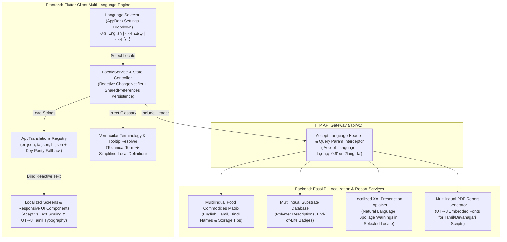
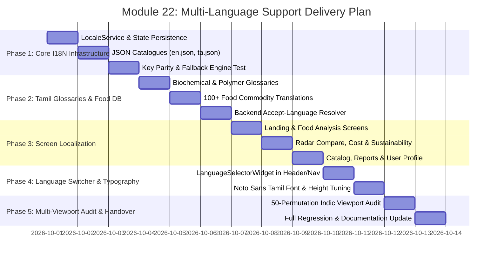

# Technical Specification: 🌐 Multi-Language Support & Regional Localization (Module 22)

---

## 1. Executive Summary & Vision

### 1.1 Objective & Context
The **AI Packaging Recommender** is engineered to bridge cutting-edge food preservation science (shelf-life kinetics, equilibrium modified atmosphere packaging $\text{EMAP}$, and barrier polymer matching) with practical agricultural and commercial operations. 

While enterprise packaging engineers and corporate R&D teams frequently operate in English, a substantial segment of food producers—specifically **smallholder farmers, rural agricultural cooperatives, artisanal food processors, and micro-to-medium enterprise (MSME) converters**—primarily operate in regional vernacular languages such as **Tamil (`ta`)**, **Hindi (`hi`)**, **Telugu (`te`)**, and **Kannada (`kn`)**.

```
   ┌────────────────────────────────────────────────────────────────────────┐
   │                        ACCESSIBILITY GAP                               │
   │                                                                        │
   │   High-Tech Food Science                   Grassroots Food Producers   │
   │   (OTR, WVTR, ASTM D6400, EMAP)     ──✕──  (Farmers, MSME Millers)     │
   │   English-only interfaces                  Vernacular Tamil / Hindi    │
   │                                                                        │
   │                        SMARTPACK AI SOLUTION                           │
   │                                                                        │
   │   High-Tech Food Science                   Grassroots Food Producers   │
   │   (OTR, WVTR, ASTM D6400, EMAP)     ──✔──  (Farmers, MSME Millers)     │
   │   Bilingual Glossaries + Voice             Vernacular Tamil / Hindi    │
   └────────────────────────────────────────────────────────────────────────┘
```

Module 22 introduces a **unified, zero-latency, cross-platform Multi-Language Localization Engine** covering both the **Flutter frontend client** and the **FastAPI computational backend**. This allows any food commodity (e.g., *Alphonso Mango / அல்போன்சா மாம்பழம்*, *Tomato / தக்காளி*, *Moringa Powder / முருங்கை இலை பொடி*) to be analyzed with localized scientific terminology, intuitive visual icons, simplified vernacular explanations, and downloadable multi-language recommendation dossiers.

---

### 1.2 Target Beneficiaries & User Personas

| User Persona | Primary Language | Operational Context | Key Value Delivered |
|---|---|---|---|
| **Farmer / Post-Harvest Grower** | **Tamil (`ta`) / Hindi (`hi`)** | Agricultural farm gate, post-harvest sorting, mandis, cold-storage aggregation | Instant, understandable guidance on how to prevent crop spoilage using affordable bio-pouches without needing to understand complex English acronyms. |
| **MSME Food Processor** | **Tamil (`ta`) / English (`en`)** | Spices, dehydrated foods, sweets, pickles, bakery units | Clear material choices (e.g., PLA vs. Metallized BOPP), shelf-life gains in local terminology, and converter cost calculations. |
| **Packaging Converter / Supplier** | **English (`en`) / Hindi (`hi`)** | Polymer processing plants, flexographic printing, pouch making | Multilingual RFQ specifications and international ASTM/ISO compliance reports. |
| **Research Scientist & Academic Jury** | **English (`en`)** | College presentations, journal publications, R&D validation | Full technical precision with instantaneous language switching for demonstration. |

---

## 2. Multi-Language System Architecture & Data Flow



---

## 3. Supported Languages & Locale Matrix

### 3.1 Initial Rollout & Roadmap Phases

| Language | ISO Code | Script & Font Family | Directionality | Support Tier | Scope |
|---|:---:|---|:---:|:---:|---|
| **English** | `en` | Latin (`Inter`, `Outfit`) | LTR | **Tier 1 (Default)** | Full UI, ML inference, API endpoints, PDF dossiers, admin portal |
| **Tamil** | `ta` | Tamil (`Noto Sans Tamil`, `Mukta Malar`) | LTR | **Tier 1 (Priority)** | Full UI, 100+ Food commodities, XAI explanations, vernacular tooltips, PDF export |
| **Hindi** | `hi` | Devanagari (`Noto Sans Devanagari`) | LTR | **Tier 2 (Phase 2)** | Core UI, top 50 commodities, essential cost & sustainability labels |
| **Telugu** | `te` | Telugu (`Noto Sans Telugu`) | LTR | **Tier 3 (Future)** | Core UI & commodity presets |
| **Kannada** | `kn` | Kannada (`Noto Sans Kannada`) | LTR | **Tier 3 (Future)** | Core UI & commodity presets |
| **Spanish** | `es` | Latin (`Inter`) | LTR | **Tier 3 (Future)** | International trade & export packaging |

---

## 4. Bilingual Domain Glossaries & Technical Vernacular Mapping

A primary challenge in agricultural engineering is translating dense biochemical and polymer science terms into everyday actionable language without losing technical rigor.

### 4.1 Packaging Polymer & Barrier Science Terminology

| Technical English Term | Standard Tamil Translation | Simplified Vernacular Explanation (Tamil) | Hindi Translation |
|---|---|---|---|
| **Moisture Vapor Transmission Rate (WVTR)** | நீராவி ஊடுருவல் வீதம் | உணவு காய்ந்து போகாமல் அல்லது ஈரப்பதம் அடையாமல் தடுக்கும் திறன் | जल वाष्प संचरण दर |
| **Oxygen Transmission Rate (OTR)** | ஆக்சிஜன் ஊடுருவல் வீதம் | காற்று புகாமல் உணவின் சுவை மற்றும் நிறம் மாறாமல் பாதுகாக்கும் திறன் | ऑक्सीजन संचरण दर |
| **Water Activity ($a_w$)** | நீர் செயல்பாடு அளவு | உணவில் உள்ள நுண்ணுயிர்கள் வளரக்கூடிய ஈரப்பதத்தின் அளவு | जल गतिविधि स्तर |
| **Shelf-Life Extension** | அடுக்கு ஆயுள் நீட்டிப்பு | உணவு கெட்டுப்போகாமல் சந்தையில் விற்கக்கூடிய நாட்களின் கூடுதல் அளவு | शेल्फ-लाइफ विस्तार |
| **Equilibrium MAP (EMAP)** | சமநிலை வாயு கட்டுப்பாடு | பாக்கெட்டுக்குள் காற்று மற்றும் வாயு அளவை சமநிலையில் வைத்தல் | संतुलित वातावरण पैकेजिंग |
| **Biodegradable / Compostable** | மக்கும் தன்மை கொண்டது | மண்ணில் இயற்கையாக மக்கி உரமாக மாறும் சூழல் நட்பு உறை | जैव निम्नीकरण योग्य (बायोडीग्रेडेबल) |
| **Food Contact Safe (FDA/FSSAI)** | உணவுப் பாதுகாப்பு அங்கீகரிக்கப்பட்டது | உணவோடு நேரடியாகத் தொடர்பு கொள்ள பாதுகாப்பானது என சான்றளிக்கப்பட்டது | खाद्य संपर्क सुरक्षित |
| **Pouch Geometry Yield** | பை உற்பத்தி திறன் | ஒரு கிலோ மூலப்பொருளில் உருவாக்கக்கூடிய பாக்கெட்டுகளின் எண்ணிக்கை | पाउच उत्पादन दर |

---

### 4.2 Food Commodity Names & Presets (Sample Matrix)

| English Name | Category | Tamil Name (தமிழ்) | Hindi Name (हिन्दी) | Typical Spoilage Risk (Tamil Vernacular) |
|---|---|---|---|---|
| **Alphonso Mango** | Fresh Fruits | அல்போன்சா மாம்பழம் | हापुस आम | விரைவான பழுத்தல் & கருப்பு புள்ளி உருவாக்கம் |
| **Tomato** | Fresh Vegetables | தக்காளி | टमाटर | ஈரப்பதம் இழப்பு, தோல் சுருக்கம் & மென்மை அடைதல் |
| **Moringa Powder** | Processed / Spices | முருங்கை இலை பொடி | सहजन पाउडर | காற்றில் உள்ள ஈரப்பதம் உறிஞ்சி கட்டி ஆகுதல் |
| **Fresh Paneer / Tofu** | Dairy / Protein | புதிய பனீர் / டோஃபு | ताजा पनीर | பாக்டீரியா தொற்று மற்றும் புளிப்பு வாடை ஏற்படுதல் |
| **Banana (Cavendish)** | Fresh Fruits | வாழைப்பழம் (பச்சை/மஞ்சள்) | केला | எத்திலீன் வாயுவினால் அதிக பழுத்தல் |
| **Roasted Groundnuts** | Dry Snacks | வறுத்த வேர்க்கடலை | भुनी हुई मूंगफली | காற்றில் உள்ள ஆக்சிஜனால் எண்ணெய் கசப்பு வாடை ஏற்படுதல் |
| **Curry Leaves (Fresh)** | Fresh Herbs | புதிய கறிவேப்பிலை | ताज़ा करी पत्ता | இலைகள் வாடுதல், நிறம் மாறுதல் மற்றும் மணம் குறைதல் |
| **Whole Wheat Flour** | Grains & Flours | கோதுமை மாவு | गेहूं का आटा | வண்டுகள் தோன்றுதல் & பூஞ்சை தொற்று |

---

## 5. Frontend Multi-Language Architecture (Flutter/Dart)

### 5.1 Dynamic Locale Controller (`LocaleService`)
The frontend leverages a centralized, reactive `LocaleService` implemented as a `ChangeNotifier` with local persistence.

```dart
/// frontend/lib/services/locale_service.dart
class LocaleService extends ChangeNotifier {
  static final LocaleService _instance = LocaleService._internal();
  factory LocaleService() => _instance;
  LocaleService._internal();

  static const String _prefKey = 'user_selected_language';
  Locale _currentLocale = const Locale('en');

  Locale get currentLocale => _currentLocale;
  String get languageCode => _currentLocale.languageCode;
  bool get isTamil => languageCode == 'ta';
  bool get isHindi => languageCode == 'hi';
  bool get isEnglish => languageCode == 'en';

  Future<void> init() async {
    final prefs = await SharedPreferences.getInstance();
    final savedCode = prefs.getString(_prefKey) ?? 'en';
    _currentLocale = Locale(savedCode);
    await AppTranslations.load(_currentLocale.languageCode);
    notifyListeners();
  }

  Future<void> changeLocale(String languageCode) async {
    if (_currentLocale.languageCode == languageCode) return;
    _currentLocale = Locale(languageCode);
    await AppTranslations.load(languageCode);
    
    final prefs = await SharedPreferences.getInstance();
    await prefs.setString(_prefKey, languageCode);
    
    notifyListeners();
  }
}
```

---

### 5.2 Translation Catalog & Fallback Resolver (`AppTranslations`)
To guarantee that missing translation keys in regional languages never crash the application or render blank labels, `AppTranslations` incorporates a **hierarchical fallback resolver**:

```dart
/// frontend/lib/theme/app_translations.dart
class AppTranslations {
  static Map<String, dynamic> _localizedStrings = {};
  static Map<String, dynamic> _fallbackStrings = {};

  static Future<void> load(String languageCode) async {
    // Load default English fallback catalog
    final fallbackJson = await rootBundle.loadString('assets/i18n/en.json');
    _fallbackStrings = json.decode(fallbackJson) as Map<String, dynamic>;

    if (languageCode == 'en') {
      _localizedStrings = _fallbackStrings;
    } else {
      try {
        final currentJson = await rootBundle.loadString('assets/i18n/$languageCode.json');
        _localizedStrings = json.decode(currentJson) as Map<String, dynamic>;
      } catch (e) {
        _localizedStrings = _fallbackStrings;
      }
    }
  }

  static String tr(String key, {Map<String, String>? params}) {
    String value = _resolveNestedKey(_localizedStrings, key) ?? 
                   _resolveNestedKey(_fallbackStrings, key) ?? 
                   key;

    if (params != null) {
      params.forEach((paramKey, paramValue) {
        value = value.replaceAll('{$paramKey}', paramValue);
      });
    }
    return value;
  }

  static String? _resolveNestedKey(Map<String, dynamic> map, String key) {
    final keys = key.split('.');
    dynamic current = map;
    for (final k in keys) {
      if (current is Map<String, dynamic> && current.containsKey(k)) {
        current = current[k];
      } else {
        return null;
      }
    }
    return current is String ? current : null;
  }
}

// Convenient Extension for Flutter Widgets
extension StringTranslationExtension on String {
  String tr({Map<String, String>? params}) => AppTranslations.tr(this, params: params);
}
```

---

### 5.3 Typography & Font Rendering for Indic Scripts
Tamil and Devanagari scripts require proper Unicode UTF-8 handling, adequate line heights (to prevent cutting off diacritics / sub-glyphs like `ு`, `ூ`, `ி`, `ீ`), and harmonious font pairings:

```dart
/// frontend/lib/theme/app_theme.dart (Locale-Aware Typography Extension)
TextStyle getLocalizedTextStyle(BuildContext context, {
  double fontSize = 14,
  FontWeight fontWeight = FontWeight.normal,
  Color? color,
  double? height,
}) {
  final isTamil = LocaleService().isTamil;
  final isHindi = LocaleService().isHindi;

  String? fontFamily;
  double adjustedHeight = height ?? 1.35;

  if (isTamil) {
    fontFamily = 'NotoSansTamil';
    adjustedHeight = height ?? 1.55; // Additional line-height for Tamil glyph descenders
  } else if (isHindi) {
    fontFamily = 'NotoSansDevanagari';
    adjustedHeight = height ?? 1.50;
  }

  return TextStyle(
    fontFamily: fontFamily,
    fontSize: isTamil ? fontSize * 1.02 : fontSize,
    fontWeight: fontWeight,
    color: color ?? AppTheme.slateDark,
    height: adjustedHeight,
  );
}
```

---

### 5.4 Universal Language Selector Widget (`LanguageSelectorWidget`)
A streamlined widget accessible in both Desktop top navigation, Mobile popup drawers, and User Profile settings:

```dart
/// frontend/lib/widgets/navigation/language_selector_widget.dart
class LanguageSelectorWidget extends StatelessWidget {
  final bool compact;
  const LanguageSelectorWidget({super.key, this.compact = false});

  @override
  Widget build(BuildContext context) {
    final localeService = LocaleService();

    return AnimatedBuilder(
      animation: localeService,
      builder: (context, _) {
        return PopupMenuButton<String>(
          tooltip: 'Select Language / மொழியை தேர்ந்தெடுக்கவும்',
          initialValue: localeService.languageCode,
          onSelected: (code) => localeService.changeLocale(code),
          shape: RoundedRectangleBorder(borderRadius: BorderRadius.circular(12)),
          child: Container(
            padding: EdgeInsets.symmetric(horizontal: compact ? 8 : 12, vertical: 6),
            decoration: BoxDecoration(
              color: AppTheme.surfaceWhite,
              borderRadius: BorderRadius.circular(20),
              border: Border.all(color: AppTheme.borderSubtle),
            ),
            child: Row(
              mainAxisSize: MainAxisSize.min,
              children: [
                const Icon(Icons.language_rounded, size: 16, color: AppTheme.primaryTeal),
                const SizedBox(width: 6),
                Text(
                  _getLanguageLabel(localeService.languageCode),
                  style: const TextStyle(fontSize: 12, fontWeight: FontWeight.bold),
                ),
                const SizedBox(width: 4),
                const Icon(Icons.keyboard_arrow_down_rounded, size: 16, color: AppTheme.slateMuted),
              ],
            ),
          ),
          itemBuilder: (context) => [
            const PopupMenuItem(
              value: 'en',
              child: Row(
                children: [
                  Text('🇺🇸 ', style: TextStyle(fontSize: 16)),
                  Text('English', style: TextStyle(fontWeight: FontWeight.w600)),
                ],
              ),
            ),
            const PopupMenuItem(
              value: 'ta',
              child: Row(
                children: [
                  Text('🇮🇳 ', style: TextStyle(fontSize: 16)),
                  Text('தமிழ் (Tamil)', style: TextStyle(fontFamily: 'NotoSansTamil', fontWeight: FontWeight.w600)),
                ],
              ),
            ),
            const PopupMenuItem(
              value: 'hi',
              child: Row(
                children: [
                  Text('🇮🇳 ', style: TextStyle(fontSize: 16)),
                  Text('हिन्दी (Hindi)', style: TextStyle(fontFamily: 'NotoSansDevanagari', fontWeight: FontWeight.w600)),
                ],
              ),
            ),
          ],
        );
      },
    );
  }

  String _getLanguageLabel(String code) {
    switch (code) {
      case 'ta': return 'தமிழ்';
      case 'hi': return 'हिन्दी';
      default: return 'EN';
    }
  }
}
```

---

## 6. Backend API Multilingual Architecture (FastAPI/Python)

### 6.1 `Accept-Language` Middleware & Request Extraction
The FastAPI backend automatically extracts the target language from the standard HTTP `Accept-Language` header or an optional `?lang=ta` query override:

```python
# backend/app/core/i18n.py
from fastapi import Request, Header
from typing import Optional

SUPPORTED_LOCALES = ["en", "ta", "hi"]
DEFAULT_LOCALE = "en"

def get_requested_locale(
    request: Request,
    accept_language: Optional[str] = Header(None),
    lang: Optional[str] = None,
) -> str:
    # 1. Query param takes immediate precedence
    if lang and lang.lower() in SUPPORTED_LOCALES:
        return lang.lower()
    
    # 2. Parse Accept-Language header (e.g. "ta-IN,ta;q=0.9,en-US;q=0.8,en;q=0.7")
    if accept_language:
        for part in accept_language.split(","):
            code = part.split(";")[0].strip().lower().split("-")[0]
            if code in SUPPORTED_LOCALES:
                return code
                
    return DEFAULT_LOCALE
```

---

### 6.2 Multilingual Pydantic Schemas & Model Serializers

```python
# backend/app/schemas/food_data.py
from pydantic import BaseModel, Field
from typing import Optional, Dict

class FoodCommodityLocalized(BaseModel):
    id: str
    name: str  # Localized display name
    name_en: str
    name_ta: Optional[str] = None
    name_hi: Optional[str] = None
    category: str
    moisture_content_percent: float
    water_activity: float
    respiration_rate_mg_co2_kg_h: Optional[float] = None
    spoilage_vector: str  # Localized degradation explanation
    storage_recommendation: str  # Localized storage guidance in vernacular
```

---

### 6.3 Localized AI Recommendation & Spoilage Explainers
When a user submits food parameters (e.g., Moisture 82%, $a_w = 0.94$, ambient temperature $32^\circ\text{C}$ in Tamil Nadu conditions), the AI recommendation engine generates natural language explanations in the user's selected language:

```python
# backend/app/services/recommendation_service.py (Localized Explanation Synthesis)

def generate_spoilage_explanation(food_id: str, gas_barrier_needed: bool, lang: str = "en") -> str:
    if lang == "ta":
        return (
            "இந்த உணவு அதிக ஈரப்பதம் (Water Activity) கொண்டுள்ளதால், நுண்ணுயிர்கள் மற்றும் பூஞ்சை "
            "விரைவில் வளர வாய்ப்புள்ளது. அதிக ஆக்சிஜன் மற்றும் நீராவி தடுப்புத்திறன் (High Barrier) "
            "கொண்ட மறுசுழற்சி செய்யக்கூடிய பைகளை பயன்படுத்த பரிந்துரைக்கிறோம்."
        )
    elif lang == "hi":
        return (
            "इस खाद्य पदार्थ में उच्च नमी स्तर होने के कारण इसमें फफूंद और बैक्टीरिया जल्दी पनप सकते हैं। "
            "हम उच्च ऑक्सीजन और नमी अवरोधक (High Barrier) पैकेजिंग का उपयोग करने की सलाह देते हैं।"
        )
    else:
        return (
            "Due to high water activity and moisture sensitivity, this commodity is prone to rapid "
            "microbial proliferation. A high-barrier, multi-layer compostable substrate is recommended."
        )
```

---

### 6.4 Multilingual PDF Recommendation Report Dossier
When generating client dossiers via `ReportGeneratorService`:
- Uses open-source Unicode fonts (`NotoSansTamil-Regular.ttf`, `NotoSans-Regular.ttf`) embedded into the ReportLab / PDF canvas.
- Renders dual-column technical metrics: English scientific parameters alongside clear Tamil / Hindi summaries for local converters and farming collectives.

---

## 7. Voice & Agricultural Accessibility Enhancements

To empower rural users who may have limited technical literacy:
1. **Simplified Visual Badges:** Eco-leaf icons for compostable substrates, water drops for moisture barrier, shield for oxygen protection.
2. **Audio Tooltips (Text-to-Speech Ready):** Clean string structures that integrate seamlessly with native browser/mobile Text-to-Speech (TTS) APIs.
3. **Dialect & Regional Measurement Conversions:**
   - Support for standard metric units ($\text{kg}$, $\text{grams}$, $\text{Celsius}$) alongside regional agricultural terms (e.g., *குவிண்டால் / Quintal*, *பெட்டி / Crate*).

---

## 8. Multi-Viewport & Layout Adaptation for Indic Scripts

Indic scripts (especially Tamil and Devanagari) have unique visual characteristics that impact layout density:
1. **Horizontal Text Expansion:** Tamil text is typically $15\% - 25\%$ longer in horizontal character width compared to English equivalents (e.g., `Start Analysis` $\to$ `ஆய்வைத் தொடங்கு`).
2. **Flex & Wrap Safety:** All responsive buttons, app bar titles, table headers, and KPI cards must utilize `Flexible`, `FittedBox`, or `ResponsiveWrapGrid` primitives created in Module 20 to prevent `RenderFlex` layout overflow.
3. **Vertical Glyphs:** Sub-script and super-script signs require `line-height >= 1.4` to avoid vertical clipping.

---

## 9. Verification, Test Strategy & Translation Quality Audits

### 9.1 Automated Test Suite Coverage

```
   ┌────────────────────────────────────────────────────────────────────────┐
   │                    MULTI-LANGUAGE VERIFICATION SUITE                   │
   │                                                                        │
   │   1. Key Parity Test          ──✔  Asserts 100% key parity (en=ta=hi)  │
   │   2. Locale Switching Test    ──✔  Verifies instant reactive UI update │
   │   3. Tamil Glyph Audit        ──✔  Zero clipping across all viewports  │
   │   4. Backend Header Test      ──✔  200 OK with localized payload       │
   │   5. PDF Font Embedding Test  ──✔  Renders Tamil UTF-8 PDF output      │
   └────────────────────────────────────────────────────────────────────────┘
```

1. **Translation Key Parity Tests (`test/i18n/translation_parity_test.dart`):**
   - Automated test iterating through every JSON key in `en.json` and asserting that `ta.json` and `hi.json` contain the exact corresponding key paths with non-empty string values.
2. **Dynamic UI Locale Switch Widget Tests (`test/i18n/locale_switch_test.dart`):**
   - Renders `HomePage`, `FoodAnalysisScreen`, `CostEstimationScreen`, and `SustainabilityAnalysisScreen`.
   - Triggers `changeLocale('ta')` and verifies that headers, buttons, and badges dynamically update to Tamil without app restart.
3. **Indic Multi-Viewport Overflow Tests (`test/i18n/indic_viewport_overflow_test.dart`):**
   - Audits all 10 core screens in Tamil and Hindi across Mobile ($375\times812$), Tablet ($768\times1024$), and Desktop ($1440\times900$) ensuring **0 `RenderFlex` overflows**.
4. **Backend Localized Endpoint Tests (`backend/tests/test_i18n_endpoints.py`):**
   - Sends requests with `Accept-Language: ta` and asserts localized commodity names, degradation vectors, and storage guidance.

---

## 10. Implementation Plan & Phased Delivery Strategy



---

## 11. Success Criteria & Sign-Off Checklist

- [ ] **Comprehensive Translation Coverage:** 100% of UI labels, buttons, navigation items, tooltips, and dialogs localized in English and Tamil.
- [ ] **Agricultural Commodity Localization:** 100+ fresh produce and processed food presets have verified Tamil vernacular names and spoilage warnings.
- [ ] **Zero Layout Regressions:** All screens maintain 0 `RenderFlex` overflow errors across Mobile, Tablet, and Desktop when switching between English and Tamil.
- [ ] **Zero-Latency Offline Parity:** Switching languages works instantaneously offline via bundled JSON assets and client-side translation catalogs.
- [ ] **Backend Multilingual API:** `Accept-Language: ta` returns localized food models, recommendation rationales, and PDF exports.
- [ ] **Automated Test Suite:** 100% pass rate on all translation parity and Indic widget test suites.
