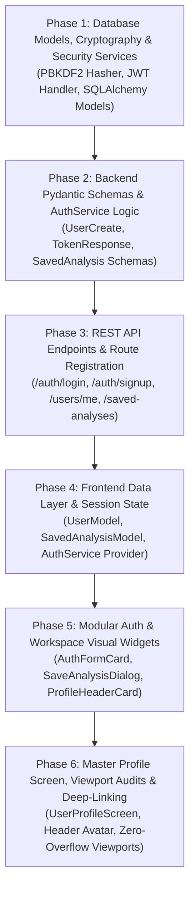

# Implementation Plan: User Account, Authentication & Analysis Workspace (Module 14)

## Overview & Architecture Roadmap

This document outlines the step-by-step execution plan for **Module 14: User Account (`14. User Account`)** based on the technical specification in [`artifacts/specs/feature-Login.md`](file:///c:/Users/Jeron/source/repos/AI%20Packaging%20recommender/artifacts/specs/feature-Login.md).

The User Account & Analysis Workspace module introduces:
1. **User Identity & Cryptographic Security:** Secure Sign-up, Login, and Session Recovery with JSON Web Tokens (`HS256`), password hashing (`PBKDF2-HMAC-SHA256` / `Bcrypt`), and OAuth2 Bearer token dependencies.
2. **Profile & Preferences:** User metadata management (Full Name, Organization, Professional Role, default currency, and sustainability bias).
3. **Saved Analyses & Presets Vault:** Bookmarking and pinning recommendation configurations with custom titles, engineering notes, and instant *"Load into Analysis Cockpit"* restoration.
4. **User-Scoped History:** Isolated history stream with search, filtering, and inspection modals.
5. **Download Previous Reports:** Direct multi-format export triggers (Vector PDF, Markdown, JSON, Print) from the user dashboard.
6. **Graceful Hybrid Fallback:** 100% functional Guest Mode and offline demonstration without blocking core analytical engines.

---



---

## Phase 1: Database Models, Cryptography & Security Services

### Task 1.1: Implement Security & Cryptographic Token Service
- **Target Files:**
  - `backend/app/core/security.py`
  - `backend/tests/test_security.py`
- **Micro-Task Description:**
  - Implement password hashing and token management in `security.py`:
    - `get_password_hash(password: str) -> str`: Hashes passwords using salt and PBKDF2-HMAC-SHA256 (or Bcrypt).
    - `verify_password(plain_password: str, hashed_password: str) -> bool`: Constant-time password verification.
    - `create_access_token(subject: str, expires_delta: Optional[timedelta] = None, role: str = "user") -> str`: Generates JWT with configurable expiration.
    - `decode_access_token(token: str) -> Optional[dict]`: Decodes and validates JWT signature and expiry.
- **Verification Command:**
  ```powershell
  python -m unittest tests/test_security.py
  ```
- **Expected Result:** Hasher creates secure salt-hashed strings, verifies passwords correctly, and issues valid JWTs with strict expiration checks.

---

### Task 1.2: Implement SQLAlchemy Relational Models for Users and Saved Analyses
- **Target Files:**
  - `backend/app/models/user.py`
  - `backend/app/models/packaging.py`
  - `backend/tests/test_user_models.py`
- **Micro-Task Description:**
  - Define SQLAlchemy models in `user.py`:
    - `User`: `id`, `email` (unique index), `hashed_password`, `full_name`, `organization`, `role`, `is_active`, `is_admin`, `preferences_json`, `created_at`, `updated_at`.
    - `SavedAnalysis`: `id`, `user_id` (ForeignKey to `users.id`), `title`, `notes`, `commodity_name`, `recommended_material`, `estimated_cost`, `sustainability_score`, `input_payload`, `recommendation_result`, `created_at`, `updated_at`.
  - Update `PackagingRecommendation` in `packaging.py` to optionally link `user_id` (nullable Foreign Key).
- **Verification Command:**
  ```powershell
  python -m unittest tests/test_user_models.py
  ```
- **Expected Result:** Models instantiate cleanly, enforce foreign key constraints, and support JSON serialization.

---

## Phase 2: Backend Pydantic Schemas & AuthService Logic

### Task 2.1: Define Pydantic Schemas for Authentication, Users & Saved Presets
- **Target Files:**
  - `backend/app/schemas/user.py`
  - `backend/tests/test_user_schemas.py`
- **Micro-Task Description:**
  - Create Pydantic v2 schemas:
    - `UserBase`, `UserCreate`, `UserLogin`, `UserUpdate`, `UserPreferences`, `UserStats`, `UserResponse`.
    - `TokenResponse`, `TokenPayload`.
    - `SavedAnalysisCreate`, `SavedAnalysisResponse`.
- **Verification Command:**
  ```powershell
  python -m unittest tests/test_user_schemas.py
  ```
- **Expected Result:** 100% schema validation pass with email format validation, password length constraints, and dictionary payload serialization.

---

### Task 2.2: Implement Authentication & User Data Service Logic
- **Target Files:**
  - `backend/app/services/auth_service.py`
  - `backend/tests/test_auth_service.py`
- **Micro-Task Description:**
  - Implement `AuthService`:
    - `authenticate_user(db, email, password)`: Validates credentials and returns user model.
    - `create_user(db, user_create)`: Checks for duplicate email, hashes password, and persists user.
    - `update_user_profile(db, user_id, user_update)`: Modifies profile fields and preferences.
    - `create_saved_analysis(db, user_id, preset_data)`: Persists user-pinned recommendations.
    - `get_saved_analyses(db, user_id)`: Fetches all saved presets for active user.
    - `delete_saved_analysis(db, user_id, analysis_id)`: Removes preset with ownership verification.
    - In-memory fallback handler for test and offline environments.
- **Verification Command:**
  ```powershell
  python -m unittest tests/test_auth_service.py
  ```
- **Expected Result:** Service methods execute cleanly with proper exception handling for duplicate users and unauthorized access.

---

## Phase 3: REST API Endpoints & Route Registration

### Task 3.1: Implement Authentication & User Profile API Endpoints
- **Target Files:**
  - `backend/app/api/v1/endpoints/auth.py`
  - `backend/app/api/v1/endpoints/users.py`
  - `backend/app/api/v1/router.py`
  - `backend/tests/test_auth_endpoints.py`
- **Micro-Task Description:**
  - Implement endpoints:
    - `POST /api/v1/auth/signup`: Registers user, returns JWT and user profile (201 Created).
    - `POST /api/v1/auth/login`: Authenticates credentials, returns JWT and user profile (200 OK).
    - `POST /api/v1/auth/logout`: Revokes active session.
    - `GET /api/v1/users/me`: Returns active user profile with stats.
    - `PUT /api/v1/users/me`: Updates profile and engineering preferences.
    - `GET /api/v1/users/me/history`: Returns user-scoped analysis runs.
  - Register routers in `backend/app/api/v1/router.py`.
- **Verification Command:**
  ```powershell
  python -m unittest tests/test_auth_endpoints.py
  ```
- **Expected Result:** Auth endpoints return 200/201 on valid requests, 400 on duplicate email, and 401 on invalid passwords.

---

### Task 3.2: Implement Saved Analyses Vault API Endpoints
- **Target Files:**
  - `backend/app/api/v1/endpoints/saved_analyses.py`
  - `backend/tests/test_saved_analyses_endpoints.py`
- **Micro-Task Description:**
  - Implement endpoints:
    - `GET /api/v1/saved-analyses`: Returns list of saved presets for authenticated user.
    - `POST /api/v1/saved-analyses`: Creates a new pinned recommendation preset (201 Created).
    - `GET /api/v1/saved-analyses/{id}`: Retrieves specific preset details.
    - `DELETE /api/v1/saved-analyses/{id}`: Deletes preset with ownership validation (200 OK).
- **Verification Command:**
  ```powershell
  python -m unittest tests/test_saved_analyses_endpoints.py
  ```
- **Expected Result:** Complete CRUD verification with multi-tenant data isolation.

---

## Phase 4: Frontend Data Layer & Session State Management

### Task 4.1: Implement Dart User, Preferences & Saved Analysis Models
- **Target Files:**
  - `frontend/lib/models/user_model.dart`
  - `frontend/test/models/user_model_test.dart`
- **Micro-Task Description:**
  - Create Dart models:
    - `UserModel`: `id`, `email`, `fullName`, `organization`, `role`, `isActive`, `createdAt`, `preferences`, `stats`.
    - `UserPreferencesModel`: `defaultEcoPriority`, `defaultCurrency`, `defaultBatchSize`.
    - `UserStatsModel`: `totalAnalysesCount`, `savedPresetsCount`, `ecoFriendlyCount`, `averageSustainabilityScore`.
    - `SavedAnalysisModel`: `id`, `userId`, `title`, `notes`, `commodityName`, `recommendedMaterial`, `estimatedCost`, `sustainabilityScore`, `inputPayload`, `recommendationResult`, `createdAt`.
- **Verification Command:**
  ```powershell
  flutter test test/models/user_model_test.dart
  ```
- **Expected Result:** Dart models deserialize backend JSON payloads with 100% type safety and default fallback values.

---

### Task 4.2: Implement Frontend AuthService & Session State Provider
- **Target Files:**
  - `frontend/lib/services/auth_service.dart`
  - `frontend/lib/services/api_service.dart`
  - `frontend/test/services/auth_service_test.dart`
- **Micro-Task Description:**
  - Implement `AuthService` (`ChangeNotifier`):
    - `login(email, password)`: Sends request to `/auth/login`, stores JWT, updates `currentUser`, and notifies listeners.
    - `signup(email, password, fullName, {org, role})`: Sends request to `/auth/signup` and auto-authenticates.
    - `logout()`: Clears token, user, and saved analyses state.
    - `saveAnalysisPreset(...)`: Pushes preset to backend or saves locally if guest/offline.
    - `getSavedAnalyses()`: Fetches user's saved presets.
    - `deleteSavedAnalysis(id)`: Removes preset.
  - Extend `ApiService` to attach `Authorization: Bearer <token>` header when authenticated.
- **Verification Command:**
  ```powershell
  flutter test test/services/auth_service_test.dart
  ```
- **Expected Result:** Handles login, registration, state notifications, and guest-mode fallbacks seamlessly.

---

## Phase 5: Modular Authentication & Workspace Visual Widgets

### Task 5.1: Build Authentication Form Card & Auth Screen
- **Target Files:**
  - `frontend/lib/screens/auth/widgets/auth_form_card.dart`
  - `frontend/lib/screens/auth/auth_screen.dart`
  - `frontend/test/screens/auth/auth_screen_test.dart`
- **Micro-Task Description:**
  - Build UI widgets:
    - `AuthFormCard`: Glassmorphic container with segmented tab switch (`Sign In` / `Create Account`), form validation, password visibility toggle, and submit button.
    - `AuthScreen`: Full-page container with brand logo, emerald backdrop gradient, and **[ Continue as Guest ]** skip action.
- **Verification Command:**
  ```powershell
  flutter test test/screens/auth/auth_screen_test.dart
  ```
- **Expected Result:** Renders clean auth interface with reactive validation and switch between login and signup modes.

---

### Task 5.2: Build Save Preset Dialog, Profile Header Card & Saved Analyses Grid
- **Target Files:**
  - `frontend/lib/screens/analysis/widgets/save_analysis_dialog.dart`
  - `frontend/lib/screens/profile/widgets/profile_header_card.dart`
  - `frontend/lib/screens/profile/widgets/saved_analyses_grid.dart`
  - `frontend/test/screens/profile/widgets/profile_widgets_test.dart`
- **Micro-Task Description:**
  - Build UI widgets:
    - `SaveAnalysisDialog`: Modal with pre-filled title, engineering notes input, and save trigger.
    - `ProfileHeaderCard`: Avatar with initials, name, organization pill, role badge, member since, and logout button.
    - `SavedAnalysesGrid`: Grid of pinned analyses cards with commodity name, prescribed material, cost, eco badge, **"Load Analysis"** button, and **"Export PDF"** button.
- **Verification Command:**
  ```powershell
  flutter test test/screens/profile/widgets/profile_widgets_test.dart
  ```
- **Expected Result:** Widgets render cleanly, respond to tap events, and format metrics accurately.

---

## Phase 6: Master Profile Screen, Multi-Viewport Verification & Deep-Linking

### Task 6.1: Assemble Master `UserProfileScreen`
- **Target Files:**
  - `frontend/lib/screens/profile/user_profile_screen.dart`
  - `frontend/test/screens/profile/user_profile_screen_test.dart`
- **Micro-Task Description:**
  - Assemble master profile dashboard:
    - Profile header with identity and logout.
    - 4-card activity metrics summary (Total Prescriptions, Eco-Prescriptions %, Saved Presets, Avg Score).
    - Engineering preferences editor (currency toggle, default batch size, eco-priority bias).
    - Segmented tabs: **Saved Presets Vault** and **My Analysis History Stream**.
- **Verification Command:**
  ```powershell
  flutter test test/screens/profile/user_profile_screen_test.dart
  ```
- **Expected Result:** Screen loads user data, switches tabs, updates preferences, and handles guest redirect.

---

### Task 6.2: Integrate Navigation Deep-Linking & Header Entry Points
- **Target Files:**
  - `frontend/lib/screens/landing/widgets/home_header.dart`
  - `frontend/lib/screens/analysis/widgets/recommendation_results_cockpit.dart`
  - `frontend/test/landing/home_header_test.dart`
- **Micro-Task Description:**
  - Add User Account / Profile icon button in `HomeHeader`:
    - Shows avatar initials or login icon depending on auth state.
    - Navigates to `UserProfileScreen` if logged in or `AuthScreen` if guest.
  - Add **[ 💾 Bookmark / Save Preset ]** button to `RecommendationResultsCockpit` action bar.
- **Verification Command:**
  ```powershell
  flutter test test/landing/home_header_test.dart
  ```
- **Expected Result:** Header updates dynamically based on user session and triggers navigation routes.

---

### Task 6.3: Multi-Viewport Layout Verification & Zero-Overflow Audit
- **Target Files:**
  - `frontend/test/screens/profile/user_profile_viewport_test.dart`
  - `frontend/test/screens/auth/auth_screen_viewport_test.dart`
- **Micro-Task Description:**
  - Audit `UserProfileScreen` and `AuthScreen` across 3 viewports:
    1. Mobile: $375 \times 812$ (iPhone SE / Standard Mobile)
    2. Tablet: $768 \times 1024$ (iPad Portrait)
    3. Desktop: $1440 \times 900$ (Widescreen Cockpit)
  - Verify 0 `RenderFlex` overflow errors and proper responsive wrapping.
- **Verification Command:**
  ```powershell
  flutter test test/screens/profile/user_profile_viewport_test.dart test/screens/auth/auth_screen_viewport_test.dart
  ```
- **Expected Result:** Zero overflow errors across all tested viewport widths.

---

### Task 6.4: Full End-to-End Regression Test Suite (Backend & Frontend)
- **Target Files:**
  - Full backend test suite (`backend/tests/`)
  - Full frontend test suite (`frontend/test/`)
- **Micro-Task Description:**
  - Run all backend unit and API tests.
  - Run all frontend unit, widget, and screen tests.
- **Verification Commands:**
  ```powershell
  # Backend Suite
  python -m unittest discover -s tests -p "test_*.py"
  
  # Frontend Suite
  flutter test
  ```
- **Expected Result:** 100% passing tests across the entire repository with 0 failures and 0 warnings.

---

## Explicit Checkpoint Approval Schedule

| Checkpoint | Scope | Criteria for Proceeding | Status |
| :--- | :--- | :--- | :--- |
| **Checkpoint 1** | Phase 1: Cryptography & DB Models | Password hasher, JWT issuance/verification, and SQLAlchemy models pass unit tests. | Completed |
| **Checkpoint 2** | Phase 2: Schemas & AuthService Logic | Pydantic user/preset schemas and core auth service logic pass unit tests. | Completed |
| **Checkpoint 3** | Phase 3: REST API Endpoints | `/auth/signup`, `/auth/login`, `/users/me`, and `/saved-analyses` return 200/201 with auth isolation. | Completed |
| **Checkpoint 4** | Phase 4: Frontend Data Layer & State | Dart user models and `AuthService` state management pass unit tests. | Completed |
| **Checkpoint 5** | Phase 5: Modular Auth & Profile Widgets | Auth card, save preset dialog, profile header, and saved analyses grid pass widget tests. | Completed |
| **Checkpoint 6** | Phase 6: Master Screen & End-to-End Verification | Multi-viewport responsive tests and full regression test suite pass 100%. | Completed |
