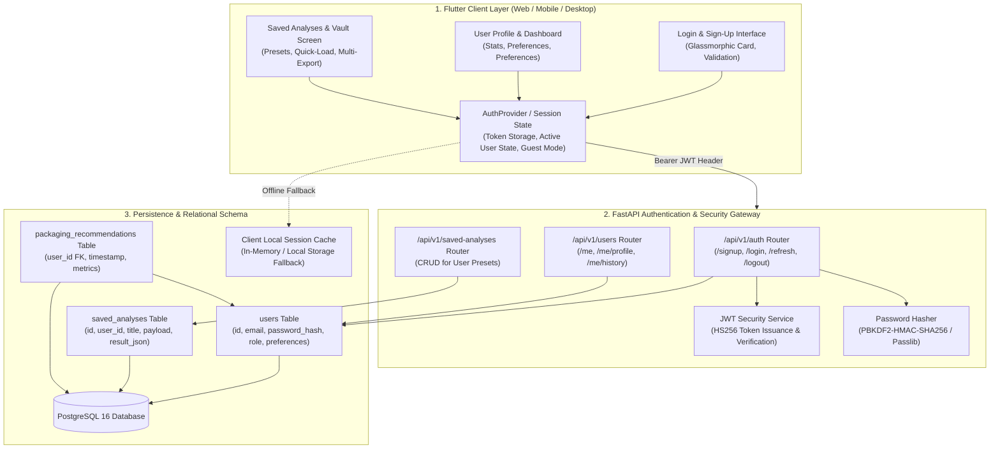

# Technical Specification: User Account, Authentication & Analysis Workspace (Module 14)

## 1. Executive Summary & Engineering Motivation

### 1.1 Problem Statement & Objectives
In professional packaging engineering and food manufacturing workflows, users frequently need to track recurrent formulations, compare multiple packaging simulations across commodity iterations, save customized presets, and retrieve previous technical audit reports. While earlier modules in the **AI Packaging Recommender** support guest-level exploratory analysis and local session caching, enterprise-grade usability requires **user identity, profile management, persistent cloud-synced analyses, and dedicated historical report vaults**.

For an academic MVP, authentication must balance **robust architectural foundations** (cryptographic password hashing, JSON Web Tokens, relational database foreign keys) with **zero-friction usability** (optional guest mode, offline fallback operation, and seamless local-to-cloud migration).

Key capabilities governed by **Module 14 (`14. User Account`)**:
1. **User Identity & Onboarding:** Secure Sign-up, Login, and Session Recovery with JWT Bearer tokens and PBKDF2/Bcrypt password hashing.
2. **Profile & Enterprise Preferences:** User metadata management (Full Name, Organization, Role, default packaging priorities, currency baseline).
3. **Saved Analyses & Presets:** Dedicated bookmarking and pinning system for high-value packaging recommendations with custom labels and engineering notes.
4. **User-Scoped Analysis History:** Multi-tenant history tracking where recommendations are linked to user accounts with privacy isolation.
5. **Vault for Previous Reports:** One-click re-generation, viewing, and multi-format download (Vector PDF, Technical Markdown, Structured JSON) of past recommendation reports.
6. **Graceful Hybrid Fallback:** Full support for guest mode and offline demonstration without blocking core recommender functionality.

---

### 1.2 System Architecture & Authentication Workflow



---

## 2. Functional Requirements & Feature Scope

### 2.1 Authentication & Onboarding
- **User Sign-Up:**
  - Mandatory fields: `email` (unique, lowercase normalized, RFC 5322 regex validation), `password` (minimum 8 characters with entropy checks), `full_name`.
  - Optional enterprise fields: `organization` (e.g. "Apex Foods Ltd"), `role` (e.g. "Packaging Engineer", "Procurement Manager", "Food Technologist", "Academic Researcher").
- **User Login:**
  - Form/JSON authentication supporting Email & Password.
  - Returns JWT `access_token`, `token_type` ("bearer"), `expires_in` (seconds), and serialized `user` profile.
- **Guest / Skip Mode:**
  - Users can bypass authentication to use all analytical engines (Modules 1-12) anonymously.
  - An inline banner or button prompts users to "Create account or log in to save this analysis to your cloud vault".
- **Session Persistence & Logout:**
  - Token persisted in secure client memory/storage.
  - Logout clears active session and resets client state to guest mode.

### 2.2 User Profile & Configuration Management
- **Profile Overview:**
  - Avatar badge with initials, email verification status, member-since date, and role badge.
  - User activity metrics: Total Analyses Generated, Eco-Friendly Prescriptions Ratio, Saved Preset Count, Average Shelf-Life Optimization.
- **Engineering & System Preferences:**
  - `default_currency`: INR (`₹`), USD (`$`), EUR (`€`), GBP (`£`).
  - `default_eco_priority`: Boolean toggle to always bias recommendations toward biodegradable/monomaterial solutions.
  - `default_batch_size`: Default unit quantity for converter economics calculations (e.g. 10,000 units).
  - `organization_title`: Customizable company header for exported PDF reports.

### 2.3 Saved Analyses & Presets Vault
- **Save Current Recommendation:**
  - Option on the Recommendation Cockpit (`RecommendationResultsCockpit`) and Report Screen (`RecommendationReportScreen`) to **[ 💾 Bookmark / Save Preset ]**.
  - Modal prompt allows assigning a custom `title` (e.g. "Q4 Fresh Berry Export Specs") and `notes` (e.g. "Tested against 90% RH cold-chain transit").
- **Inspect & Load Presets:**
  - Dedicated "Saved Analyses" tab in Profile or standalone dashboard.
  - One-click **"Load into Analysis Cockpit"** restoring the exact commodity biochemical specs and packaging parameters.
- **Preset Management:**
  - Edit title/notes, search saved presets by commodity or material, and delete obsolete entries.

### 2.4 User-Scoped History & Audit Trail
- **Isolated User History:**
  - Analysis runs performed while authenticated are automatically tagged with `user_id`.
  - History view defaults to current user's runs, with option for enterprise admins to view team logs.
- **Download Previous Reports:**
  - Direct actions on each historical card:
    1. **Download Vector PDF**: Instant client generation via `PdfReportBuilder`.
    2. **View Technical Report**: Navigate to `RecommendationReportScreen`.
    3. **Copy JSON / Markdown**: Clipboard export for converter interchange.

---

## 3. Detailed Data Schemas

### 3.1 Backend Pydantic Schemas (`backend/app/schemas/user.py`)

```python
from datetime import datetime
from typing import Optional, Dict, Any, List
from pydantic import BaseModel, EmailStr, Field

# --- User Base Schemas ---

class UserBase(BaseModel):
    email: EmailStr = Field(..., description="Unique email address for authentication")
    full_name: str = Field(..., min_length=2, max_length=100, description="User's full display name")
    organization: Optional[str] = Field(None, max_length=150, description="Company, university, or institute")
    role: Optional[str] = Field("Packaging Engineer", max_length=100, description="Professional or academic role")

class UserCreate(UserBase):
    password: str = Field(..., min_length=8, max_length=128, description="Plaintext password to be hashed")
    default_eco_priority: bool = Field(default=True, description="Default sustainability bias")
    default_currency: str = Field(default="INR", description="Default commercial currency (INR, USD, EUR, GBP)")

class UserLogin(BaseModel):
    email: EmailStr = Field(..., description="Registered email address")
    password: str = Field(..., description="Account password")

class UserUpdate(BaseModel):
    full_name: Optional[str] = Field(None, min_length=2, max_length=100)
    organization: Optional[str] = Field(None, max_length=150)
    role: Optional[str] = Field(None, max_length=100)
    default_eco_priority: Optional[bool] = None
    default_currency: Optional[str] = None
    default_batch_size: Optional[int] = Field(None, ge=100, le=1000000)

class UserPreferences(BaseModel):
    default_eco_priority: bool = True
    default_currency: str = "INR"
    default_batch_size: int = 10000
    export_organization_header: Optional[str] = None

class UserStats(BaseModel):
    total_analyses_count: int = 0
    saved_presets_count: int = 0
    eco_friendly_count: int = 0
    average_sustainability_score: float = 0.0
    member_since: datetime

class UserResponse(UserBase):
    id: int
    is_active: bool = True
    is_admin: bool = False
    created_at: datetime
    preferences: UserPreferences
    stats: Optional[UserStats] = None

    class Config:
        from_attributes = True

# --- Authentication & Token Schemas ---

class TokenResponse(BaseModel):
    access_token: str
    token_type: str = "bearer"
    expires_in_seconds: int
    user: UserResponse

class TokenPayload(BaseModel):
    sub: str  # User ID or Email
    exp: int  # Expiration timestamp
    role: str = "user"

# --- Saved Analysis Preset Schemas ---

class SavedAnalysisCreate(BaseModel):
    title: str = Field(..., min_length=1, max_length=150, description="User-assigned preset label")
    notes: Optional[str] = Field(None, max_length=1000, description="Engineering or operational notes")
    commodity_name: str = Field(..., description="Food commodity name")
    input_payload: Dict[str, Any] = Field(..., description="Complete PackagingInput serialized payload")
    recommendation_result: Dict[str, Any] = Field(..., description="Complete PackagingRecommendationResult payload")

class SavedAnalysisResponse(BaseModel):
    id: int
    user_id: int
    title: str
    notes: Optional[str]
    commodity_name: str
    recommended_material: str
    estimated_cost: float
    sustainability_score: float
    input_payload: Dict[str, Any]
    recommendation_result: Dict[str, Any]
    created_at: datetime
    updated_at: Optional[datetime]

    class Config:
        from_attributes = True
```

---

### 3.2 SQLAlchemy Relational Database Models (`backend/app/models/user.py` & `backend/app/models/packaging.py`)

```python
from datetime import datetime
from sqlalchemy import Column, Integer, String, Boolean, DateTime, Float, Text, ForeignKey, JSON
from sqlalchemy.orm import relationship
from app.db.session import Base

class User(Base):
    __tablename__ = "users"

    id = Column(Integer, primary_key=True, index=True)
    email = Column(String(255), unique=True, nullable=False, index=True)
    hashed_password = Column(String(255), nullable=False)
    full_name = Column(String(150), nullable=False)
    organization = Column(String(150), nullable=True)
    role = Column(String(100), default="Packaging Engineer")
    
    # Flags & Roles
    is_active = Column(Boolean, default=True)
    is_admin = Column(Boolean, default=False)
    
    # User Preferences stored as JSON
    preferences_json = Column(JSON, nullable=True, default={
        "default_eco_priority": True,
        "default_currency": "INR",
        "default_batch_size": 10000,
    })
    
    created_at = Column(DateTime, default=datetime.utcnow)
    updated_at = Column(DateTime, default=datetime.utcnow, onupdate=datetime.utcnow)

    # Relationships
    saved_analyses = relationship("SavedAnalysis", back_populates="user", cascade="all, delete-orphan")
    recommendations = relationship("PackagingRecommendation", back_populates="user")


class SavedAnalysis(Base):
    __tablename__ = "saved_analyses"

    id = Column(Integer, primary_key=True, index=True)
    user_id = Column(Integer, ForeignKey("users.id", ondelete="CASCADE"), nullable=False, index=True)
    title = Column(String(255), nullable=False, index=True)
    notes = Column(Text, nullable=True)
    
    commodity_name = Column(String(255), nullable=False)
    recommended_material = Column(String(255), nullable=False)
    estimated_cost = Column(Float, nullable=False, default=0.0)
    sustainability_score = Column(Float, nullable=False, default=0.0)
    
    input_payload = Column(JSON, nullable=False)
    recommendation_result = Column(JSON, nullable=False)
    
    created_at = Column(DateTime, default=datetime.utcnow)
    updated_at = Column(DateTime, default=datetime.utcnow, onupdate=datetime.utcnow)

    # Relationship
    user = relationship("User", back_populates="saved_analyses")
```

---

## 4. REST API Endpoint Specifications

The backend exposes authentication and user workspace routes under `/api/v1/auth`, `/api/v1/users`, and `/api/v1/saved-analyses`:

| Method | Endpoint | Description | Auth Required | Request Payload | Response Model |
| :--- | :--- | :--- | :--- | :--- | :--- |
| `POST` | `/api/v1/auth/signup` | Register new user account | No | `UserCreate` | `TokenResponse` (201) |
| `POST` | `/api/v1/auth/login` | Authenticate user & issue token | No | `UserLogin` | `TokenResponse` (200) |
| `POST` | `/api/v1/auth/logout` | Revoke / invalidate session | Yes (Bearer) | None | `{"message": "Logged out"}` |
| `GET` | `/api/v1/users/me` | Fetch active user profile & stats | Yes (Bearer) | None | `UserResponse` (200) |
| `PUT` | `/api/v1/users/me` | Update profile or preferences | Yes (Bearer) | `UserUpdate` | `UserResponse` (200) |
| `GET` | `/api/v1/users/me/history` | Retrieve user's past recommendations | Yes (Bearer) | Query: `limit`, `skip` | `List[PackagingRecord]` |
| `GET` | `/api/v1/saved-analyses` | List user's saved presets/bookmarks | Yes (Bearer) | None | `List[SavedAnalysisResponse]` |
| `POST` | `/api/v1/saved-analyses` | Pin / save recommendation preset | Yes (Bearer) | `SavedAnalysisCreate` | `SavedAnalysisResponse` (201) |
| `GET` | `/api/v1/saved-analyses/{id}` | Get specific saved preset details | Yes (Bearer) | Path: `id` | `SavedAnalysisResponse` (200) |
| `DELETE` | `/api/v1/saved-analyses/{id}` | Remove saved analysis preset | Yes (Bearer) | Path: `id` | `{"message": "Deleted"}` |

### 4.1 Security Dependency & Token Verification
```python
from fastapi import Depends, HTTPException, status
from fastapi.security import OAuth2PasswordBearer
from app.services.auth_service import verify_access_token, get_user_by_id

oauth2_scheme = OAuth2PasswordBearer(tokenUrl="/api/v1/auth/login", auto_error=False)

async def get_current_user_optional(token: Optional[str] = Depends(oauth2_scheme)) -> Optional[User]:
    """Returns User if valid Bearer token provided, otherwise None (Guest Mode)."""
    if not token:
        return None
    payload = verify_access_token(token)
    if not payload:
        return None
    return await get_user_by_id(int(payload.sub))

async def get_current_user_required(user: Optional[User] = Depends(get_current_user_optional)) -> User:
    """Enforces authentication; raises 401 Unauthorized if guest or invalid token."""
    if not user:
        raise HTTPException(
            status_code=status.HTTP_401_UNAUTHORIZED,
            detail="Authentication required to access this resource",
            headers={"WWW-Authenticate": "Bearer"},
        )
    return user
```

---

## 5. Frontend Architecture & UI/UX Specifications

### 5.1 Client Data Models (`frontend/lib/models/user_model.dart`)

```dart
class UserModel {
  final int id;
  final String email;
  final String fullName;
  final String? organization;
  final String role;
  final bool isActive;
  final bool isAdmin;
  final DateTime createdAt;
  final UserPreferencesModel preferences;
  final UserStatsModel? stats;

  UserModel({
    required this.id,
    required this.email,
    required this.fullName,
    this.organization,
    this.role = 'Packaging Engineer',
    this.isActive = true,
    this.isAdmin = false,
    required this.createdAt,
    required this.preferences,
    this.stats,
  });

  factory UserModel.fromJson(Map<String, dynamic> json) {
    return UserModel(
      id: json['id'] ?? 0,
      email: json['email'] ?? '',
      fullName: json['full_name'] ?? 'User',
      organization: json['organization'],
      role: json['role'] ?? 'Packaging Engineer',
      isActive: json['is_active'] ?? true,
      isAdmin: json['is_admin'] ?? false,
      createdAt: json['created_at'] != null ? DateTime.parse(json['created_at']) : DateTime.now(),
      preferences: json['preferences'] != null
          ? UserPreferencesModel.fromJson(Map<String, dynamic>.from(json['preferences']))
          : UserPreferencesModel.defaultPreferences(),
      stats: json['stats'] != null ? UserStatsModel.fromJson(Map<String, dynamic>.from(json['stats'])) : null,
    );
  }

  Map<String, dynamic> toJson() => {
    'id': id,
    'email': email,
    'full_name': fullName,
    'organization': organization,
    'role': role,
    'is_active': isActive,
    'is_admin': isAdmin,
    'created_at': createdAt.toIso8601String(),
    'preferences': preferences.toJson(),
  };
}

class UserPreferencesModel {
  final bool defaultEcoPriority;
  final String defaultCurrency;
  final int defaultBatchSize;

  UserPreferencesModel({
    this.defaultEcoPriority = true,
    this.defaultCurrency = 'INR',
    this.defaultBatchSize = 10000,
  });

  factory UserPreferencesModel.defaultPreferences() => UserPreferencesModel();

  factory UserPreferencesModel.fromJson(Map<String, dynamic> json) => UserPreferencesModel(
    defaultEcoPriority: json['default_eco_priority'] ?? true,
    defaultCurrency: json['default_currency'] ?? 'INR',
    defaultBatchSize: json['default_batch_size'] ?? 10000,
  );

  Map<String, dynamic> toJson() => {
    'default_eco_priority': defaultEcoPriority,
    'default_currency': defaultCurrency,
    'default_batch_size': defaultBatchSize,
  };
}

class SavedAnalysisModel {
  final int id;
  final int userId;
  final String title;
  final String? notes;
  final String commodityName;
  final String recommendedMaterial;
  final double estimatedCost;
  final double sustainabilityScore;
  final Map<String, dynamic> inputPayload;
  final Map<String, dynamic> recommendationResult;
  final DateTime createdAt;

  SavedAnalysisModel({
    required this.id,
    required this.userId,
    required this.title,
    this.notes,
    required this.commodityName,
    required this.recommendedMaterial,
    required this.estimatedCost,
    required this.sustainabilityScore,
    required this.inputPayload,
    required this.recommendationResult,
    required this.createdAt,
  });

  factory SavedAnalysisModel.fromJson(Map<String, dynamic> json) => SavedAnalysisModel(
    id: json['id'] ?? 0,
    userId: json['user_id'] ?? 0,
    title: json['title'] ?? 'Untitled Preset',
    notes: json['notes'],
    commodityName: json['commodity_name'] ?? 'Custom Commodity',
    recommendedMaterial: json['recommended_material'] ?? 'Optimized Film',
    estimatedCost: (json['estimated_cost'] as num?)?.toDouble() ?? 0.0,
    sustainabilityScore: (json['sustainability_score'] as num?)?.toDouble() ?? 0.0,
    inputPayload: Map<String, dynamic>.from(json['input_payload'] ?? {}),
    recommendationResult: Map<String, dynamic>.from(json['recommendation_result'] ?? {}),
    createdAt: json['created_at'] != null ? DateTime.parse(json['created_at']) : DateTime.now(),
  );
}
```

---

### 5.2 State Management & Service Architecture (`frontend/lib/services/auth_service.dart`)

```dart
class AuthService extends ChangeNotifier {
  UserModel? _currentUser;
  String? _accessToken;
  bool _isLoading = false;
  List<SavedAnalysisModel> _savedAnalyses = [];

  UserModel? get currentUser => _currentUser;
  bool get isAuthenticated => _currentUser != null && _accessToken != null;
  bool get isGuest => !isAuthenticated;
  bool get isLoading => _isLoading;
  List<SavedAnalysisModel> get savedAnalyses => _savedAnalyses;
  String? get token => _accessToken;

  Future<bool> login(String email, String password) async {
    // 1. Send login POST request to /api/v1/auth/login
    // 2. On 200, extract access_token and user profile
    // 3. Store token and notify listeners
  }

  Future<bool> signup(String email, String password, String fullName, {String? organization, String? role}) async {
    // 1. Send registration POST to /api/v1/auth/signup
    // 2. Auto-login on success
  }

  Future<void> logout() async {
    _currentUser = null;
    _accessToken = null;
    _savedAnalyses.clear();
    notifyListeners();
  }

  Future<bool> saveAnalysisPreset({
    required String title,
    String? notes,
    required PackagingInput input,
    required PackagingRecommendationResult result,
  }) async {
    // 1. POST to /api/v1/saved-analyses (or fallback to local cache if guest/offline)
    // 2. Refresh _savedAnalyses list
  }

  Future<bool> deleteSavedAnalysis(int id) async {
    // 1. DELETE /api/v1/saved-analyses/{id}
    // 2. Update local state
  }
}
```

---

### 5.3 UI Screens & Visual Layout Hierarchy

#### 1. Authentication Screen (`frontend/lib/screens/auth/auth_screen.dart`)
- Modern glassmorphic dialog or standalone screen with segmented tab switch (`Sign In` / `Create Account`).
- Form validation with reactive error states and password visibility toggle.
- Option to **[ Continue as Guest ]** at bottom for zero-friction evaluation.

#### 2. User Profile & Settings Screen (`frontend/lib/screens/profile/user_profile_screen.dart`)
- **Header:** Emerald gradient identity card with initials avatar, full name, role badge, organization, and logout action.
- **Activity & Circularity Stat Cards:** 4-box metric row (Total Prescriptions, Eco-Prescriptions %, Saved Presets, Average Score).
- **Engineering Preferences Form:** Interactive toggles for default currency (`INR`/`USD`), eco-friendly bias, default batch size.
- **Tabs Section:**
  - **Tab 1: Saved Presets & Bookmarks:** Grid of pinned analyses with quick load & export buttons.
  - **Tab 2: My Analysis History:** User-scoped audit records with inspection modal and PDF download.

#### 3. Save Preset Dialog (`frontend/lib/screens/analysis/widgets/save_analysis_dialog.dart`)
- Quick modal popped from `RecommendationResultsCockpit` with pre-filled title (e.g. `Fresh Strawberries - Micro-Perforated PLA`).
- Notes input field for operator/engineer annotations.
- Instant cloud sync and snackbar notification.

---

## 6. Offline Support & Graceful Degradation Strategy

In alignment with the offline robustness designed across all modules in this codebase:

| Scenario | Behavior | User Impact |
| :--- | :--- | :--- |
| **Backend Database Online** | Full cloud persistence, real-time JWT authentication, cross-device sync. | Complete feature access. |
| **Backend Database Offline** | System enters local fallback mode; in-memory mock session allows testing Profile, Saved Presets, and History. | Non-blocking experience with helpful badge indicator. |
| **Guest User (No Auth)** | Recommendations, Reports, Costing, Sustainability, and Comparison work 100% unrestricted. | "Save to Cloud" prompts user to log in or create account. |

---

## 7. Responsive Viewport Constraints & Quality Standards

- **Mobile Viewport ($375 \times 812$):** Forms, profile cards, and saved analysis grids must wrap into single-column layouts with 0 `RenderFlex` overflow errors.
- **Tablet Viewport ($768 \times 1024$):** 2-column layout for profile stats and saved analyses matrix.
- **Desktop Cockpit ($1440 \times 900$):** Full widescreen dashboard with sidebar navigation and dual-pane inspector.
- **Color Palette & Typography:**
  - Primary Emerald: `#059669` / `#0D9488`
  - Slate Dark & Body: `#0F172A` / `#475569`
  - Surface Background: `#F8FAFC`
  - Typography: Google Fonts `Outfit` / `Inter`

---

## 8. Verification & Automated Testing Plan

### 8.1 Backend Tests (`backend/tests/`)
1. `test_auth_security.py`: Password hashing, token encoding/decoding, expiration checks, invalid token rejection.
2. `test_auth_endpoints.py`: `POST /auth/signup`, `POST /auth/login`, duplicate email prevention (400), invalid credentials (401).
3. `test_user_endpoints.py`: `GET /users/me`, `PUT /users/me`, preferences persistence.
4. `test_saved_analyses_endpoints.py`: `POST /saved-analyses`, `GET /saved-analyses`, `DELETE /saved-analyses/{id}`, authorization scoping (users cannot read/delete other users' presets).

### 8.2 Frontend Tests (`frontend/test/`)
1. `auth_service_test.dart`: Login, signup, logout, guest mode fallback, token management.
2. `user_model_test.dart`: JSON serialization/deserialization parity with backend Pydantic schemas.
3. `auth_screen_test.dart`: Sign in / Sign up form interactions, validation errors, guest continue button.
4. `user_profile_screen_viewport_test.dart`: Multi-viewport responsive audit across $375\times 812$, $768\times 1024$, and $1440\times 900$ viewports with 0 `RenderFlex` overflows.
5. `save_analysis_dialog_test.dart`: Bookmark modal trigger, title input, and callback execution.

---

## 9. Conclusion
Module 14 delivers an enterprise-ready User Account, Authentication, and Saved Analysis Vault while maintaining college-MVP simplicity and 100% offline fallback compatibility with existing engines.
