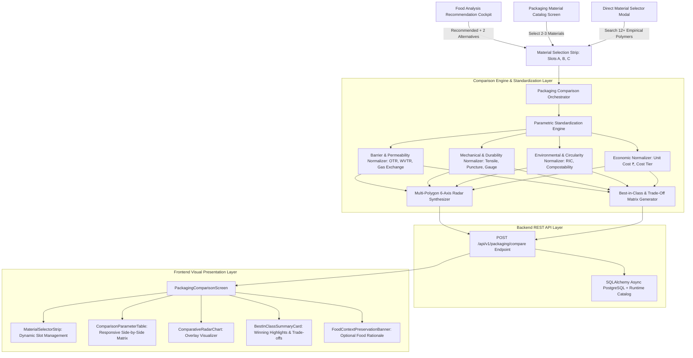

# Technical Specification: Packaging Comparison (Module 9)

## 1. Executive Summary & Scientific Motivation

### 1.1 Problem Statement
When designing packaging systems for perishable, sensitive, or ambient food products, engineers and procurement managers must balance conflicting performance criteria:
- **Barrier vs. Respiration:** Highly respiring produce requires high gas permeability to prevent anaerobic fermentation, while fatty snacks or fresh meats require near-zero $OTR$/$WVTR$ hermetic barriers.
- **Sustainability vs. Cost:** 100% bio-compostable substrates (e.g. NatureFlex, Bio-PLA) eliminate plastic pollution but often carry a 15–30% cost premium over fossil polyolefins ($LDPE$, $HDPE$, $PP$).
- **Mechanical Strength vs. Film Gauge:** Thinner films lower material footprint and cost, but reduce puncture resistance during high-speed automated packaging and rugged transit.

Forcing users to evaluate candidate materials in isolation makes trade-off optimization slow and error-prone. The **Packaging Comparison Module (Module 9)** provides a centralized, side-by-side analytical matrix allowing users to compare up to 3 materials (`Material A`, `Material B`, `Material C`) across standardized qualitative ratings (High, Medium, Low, Yes/No) and precise empirical physical metrics ($OTR$, $WVTR$, Tensile Strength, Recyclability, Unit Cost ₹), complete with visual multi-polygon radar charts and AI trade-off synthesis.

---

### 1.2 Comparison Parameters & Standardized Evaluation

The module evaluates materials across the 6 core comparison parameters requested, supplemented by quantitative engineering data:

| Parameter | Qualitative Tiers | Quantitative Metrics & Standards | Scientific Purpose & Meaning |
| :--- | :--- | :--- | :--- |
| **Moisture Barrier** | `High`, `Medium`, `Low`, `Hermetic` | $WVTR$ ($\text{g/m}^2/\text{day}$ at $38^\circ\text{C}, 90\%\text{ RH}$) | Prevents dehydration or moisture ingress/sogginess |
| **Oxygen Barrier** | `High`, `Medium`, `Low`, `Hermetic` | $OTR$ ($\text{cc/m}^2/\text{day}$ at $23^\circ\text{C}, 0\%\text{ RH}$) | Prevents lipid rancidity, enzymatic browning, and aerobic spoilage |
| **Gas Exchange** | `High`, `Medium`, `Low`, `Controlled` | Permeability & Selectivity Ratio $\beta = P_{\text{CO}_2}/P_{\text{O}_2}$ | Supports Equilibrium Modified Atmosphere Packaging (EMAP) |
| **Strength** | `High`, `Medium`, `Low`, `Rigid` | Tensile Strength ($\text{MPa}$) & Puncture Resistance ($\text{N}$) | Resists bursting, stretching, and physical transit puncture |
| **Recyclability** | `Yes`, `No`, `Biodegradable`, `Compostable`| Resin Identification Code (RIC #1–#7), EN 13432, ASTM D6400 | Quantifies circularity and municipal waste stream processing |
| **Cost Category** | `Low (₹)`, `Medium (₹₹)`, `High (₹₹₹)` | Estimated Unit Cost in INR ($\text{₹}/\text{unit}$) | Economic feasibility for commercial production batches |

#### Extended Preservation Parameters (When Food Context Is Selected):
- **Preservation Suitability Match:** Relative compatibility score ($0–100\%$) and suitability tier (`Optimal Match`, `High Compatibility`, `Moderate Compatibility`).
- **Shelf-Life Delta:** Projected shelf-life comparison (e.g. `21 Days (Base)`, `-2 Days`, `+5 Days with MAP`).
- **Active Additives Compatibility:** Scavenger sachets ($KMnO_4$, $O_2$ scavengers, anti-fog surfactants).

---

## 2. System Architecture & Comparative Data Pipeline



---

## 3. Data Contracts & Schemas

### 3.1 Backend Pydantic Schemas (`backend/app/schemas/packaging_material.py` / `packaging.py`)

```python
from enum import Enum
from pydantic import BaseModel, Field
from typing import List, Dict, Optional, Any

class QualitativeTierEnum(str, Enum):
    HIGH = "High"
    MEDIUM = "Medium"
    LOW = "Low"
    VERY_LOW = "Very Low"
    HERMETIC = "Hermetic"
    CONTROLLED = "Controlled"

class RecyclabilityTypeEnum(str, Enum):
    YES = "Yes"
    NO = "No"
    BIODEGRADABLE = "Biodegradable"
    HOME_COMPOSTABLE = "Home Compostable"
    INDUSTRIAL_COMPOSTABLE = "Industrial Compostable"

class ComparisonParameterRow(BaseModel):
    parameter_key: str = Field(..., description="Unique key, e.g. moisture_barrier, oxygen_barrier")
    parameter_label: str = Field(..., description="Display label, e.g. Moisture Barrier, Oxygen Barrier")
    parameter_group: str = Field(..., description="Barrier, Mechanical, Environmental, Economic, Food Preservation")
    unit: Optional[str] = Field(None, description="Physical engineering unit (e.g. g/m²/day, cc/m²/day, MPa, ₹)")
    values: Dict[str, str] = Field(..., description="Map of slotId ('material_a', 'material_b', 'material_c') -> Qualitative/Formatted Value")
    raw_numeric_values: Optional[Dict[str, float]] = Field(default=None, description="Numeric values for charts/bars")
    best_slot_id: Optional[str] = Field(None, description="Slot ID of the best performing material for this parameter")
    scientific_note: Optional[str] = Field(None, description="Explanation of test conditions or trade-off")

class MaterialComparisonSlotDetail(BaseModel):
    slot_id: str = Field(..., description="'material_a', 'material_b', 'material_c'")
    material_id: str = Field(..., description="Unique material ID, e.g. mat_pla_emap_01")
    name: str = Field(..., description="Full polymer/substrate commercial name")
    category: str = Field(..., description="Category: Biodegradable, Conventional, Laminate, Specialty")
    polymer_family: str = Field(..., description="Family code, e.g. BIO_PLA, POLYOLEFIN_LDPE")
    structure: str = Field(..., description="Layer specification")
    color_token: str = Field(default="#0D9488", description="UI accent color (Teal, Sky, Amber)")
    is_primary_recommendation: bool = Field(default=False)
    
    # 6 Standard Comparison Core Values
    moisture_barrier: str = Field(..., description="'High', 'Medium', 'Low', 'Hermetic'")
    oxygen_barrier: str = Field(..., description="'High', 'Medium', 'Low', 'Hermetic'")
    gas_exchange: str = Field(..., description="'High', 'Medium', 'Low', 'Controlled'")
    strength: str = Field(..., description="'High', 'Medium', 'Low', 'Rigid'")
    recyclability: str = Field(..., description="'Yes', 'No', 'Biodegradable', 'Home Compostable'")
    cost_category: str = Field(..., description="'Low', 'Medium', 'High', 'Premium'")
    
    # Quantitative specs
    wvtr_value: float = Field(..., description="WVTR in g/m²/day")
    otr_value: float = Field(..., description="OTR in cc/m²/day")
    tensile_strength_mpa: float = Field(..., description="Tensile strength in MPa")
    estimated_cost_inr: float = Field(..., description="Unit cost in ₹")
    sustainability_score: float = Field(..., description="Eco score 0-100")
    
    # Food context (if provided)
    suitability_score: Optional[float] = Field(None, description="0.00-1.00 compatibility score")
    suitability_category: Optional[str] = Field(None, description="'Optimal Match', 'High Compatibility'")
    star_rating: Optional[int] = Field(None, description="1-5 integer rating")

class PackagingComparisonRequest(BaseModel):
    material_ids: List[str] = Field(..., min_length=2, max_length=3, description="List of 2 or 3 material IDs to compare")
    food_id: Optional[int] = Field(None, description="Optional food commodity ID to provide food-specific context")
    food_name: Optional[str] = Field(None, description="Optional food name string")

class PackagingComparisonMatrixResponse(BaseModel):
    comparison_id: str = Field(..., description="Unique comparison identifier")
    food_context_name: Optional[str] = Field(None, description="Food item context if provided")
    slots: List[MaterialComparisonSlotDetail] = Field(..., description="List of up to 3 materials compared")
    parameter_rows: List[ComparisonParameterRow] = Field(..., description="Structured comparison rows")
    best_in_class_summary: Dict[str, str] = Field(..., description="Parameter -> Best material name")
    ai_trade_off_synthesis: str = Field(..., description="Clear natural language trade-off narrative")
    key_recommendation_rule: str = Field(..., description="Guidance rule for when to choose which material")
```

---

### 3.2 Frontend Dart Models (`frontend/lib/models/packaging_comparison_model.dart`)

```dart
enum ComparisonSlotId {
  materialA('material_a', 'Material A', Color(0xFF0D9488)), // Teal 600
  materialB('material_b', 'Material B', Color(0xFF0284C7)), // Sky 600
  materialC('material_c', 'Material C', Color(0xFFD97706)); // Amber 600

  final String id;
  final String label;
  final Color accentColor;
  const ComparisonSlotId(this.id, this.label, this.accentColor);
}

class MaterialComparisonSlot {
  final String slotId;
  final String materialId;
  final String name;
  final String category;
  final String polymerFamily;
  final String structure;
  final Color colorToken;
  final bool isPrimaryRecommendation;
  
  // Standard 6 Parameters
  final String moistureBarrier; // High, Medium, Low
  final String oxygenBarrier;   // High, Medium, Low
  final String gasExchange;     // High, Low, Medium
  final String strength;        // High, Medium, Low
  final String recyclability;   // Yes, No, Biodegradable
  final String costCategory;    // Low, Medium, High
  
  // Quantitative Metrics
  final double wvtrValue;
  final double otrValue;
  final double tensileStrengthMpa;
  final double estimatedCostInr;
  final double sustainabilityScore;
  
  // Food context
  final double? suitabilityScore;
  final String? suitabilityCategory;
  final int? starRating;

  const MaterialComparisonSlot({
    required this.slotId,
    required this.materialId,
    required this.name,
    required this.category,
    required this.polymerFamily,
    required this.structure,
    required this.colorToken,
    this.isPrimaryRecommendation = false,
    required this.moistureBarrier,
    required this.oxygenBarrier,
    required this.gasExchange,
    required this.strength,
    required this.recyclability,
    required this.costCategory,
    required this.wvtrValue,
    required this.otrValue,
    required this.tensileStrengthMpa,
    required this.estimatedCostInr,
    required this.sustainabilityScore,
    this.suitabilityScore,
    this.suitabilityCategory,
    this.starRating,
  });

  factory MaterialComparisonSlot.fromJson(Map<String, dynamic> json);
  Map<String, dynamic> toJson();
}

class ComparisonParameterRowModel {
  final String parameterKey;
  final String parameterLabel;
  final String parameterGroup;
  final String? unit;
  final Map<String, String> values; // slotId -> display value
  final Map<String, double>? rawNumericValues;
  final String? bestSlotId;
  final String? scientificNote;

  const ComparisonParameterRowModel({
    required this.parameterKey,
    required this.parameterLabel,
    required this.parameterGroup,
    this.unit,
    required this.values,
    this.rawNumericValues,
    this.bestSlotId,
    this.scientificNote,
  });

  factory ComparisonParameterRowModel.fromJson(Map<String, dynamic> json);
}

class PackagingComparisonResultModel {
  final String comparisonId;
  final String? foodContextName;
  final List<MaterialComparisonSlot> slots;
  final List<ComparisonParameterRowModel> parameterRows;
  final Map<String, String> bestInClassSummary;
  final String aiTradeOffSynthesis;
  final String keyRecommendationRule;

  const PackagingComparisonResultModel({
    required this.comparisonId,
    this.foodContextName,
    required this.slots,
    required this.parameterRows,
    required this.bestInClassSummary,
    required this.aiTradeOffSynthesis,
    required this.keyRecommendationRule,
  });

  factory PackagingComparisonResultModel.fromJson(Map<String, dynamic> json);
}
```

---

## 4. REST API Endpoint Specifications

### 4.1 Endpoint Definition
- **Route:** `POST /api/v1/packaging/compare`
- **Method:** `POST`
- **Authentication:** Public / API Key Optional
- **Rate Limit:** 60 req/min

### 4.2 Request Payload Example
```json
{
  "material_ids": [
    "mat_bio_emap_01",
    "mat_conv_hdpe_01",
    "mat_lam_pet_alu_01"
  ],
  "food_id": 1,
  "food_name": "Fresh Strawberries"
}
```

### 4.3 Response Payload Example
```json
{
  "comparison_id": "cmp_849204_strawberries",
  "food_context_name": "Fresh Strawberries",
  "slots": [
    {
      "slot_id": "material_a",
      "material_id": "mat_bio_emap_01",
      "name": "Micro-Perforated Equilibrium MAP Bio-Film (PLA/PBAT)",
      "category": "Biodegradable Bio-Polymer",
      "polymer_family": "BIO_PLA",
      "structure": "Co-extruded Micro-Perforated Blown Film",
      "color_token": "#0D9488",
      "is_primary_recommendation": true,
      "moisture_barrier": "High",
      "oxygen_barrier": "Medium",
      "gas_exchange": "High",
      "strength": "High",
      "recyclability": "Yes",
      "cost_category": "Medium",
      "wvtr_value": 45.0,
      "otr_value": 3500.0,
      "tensile_strength_mpa": 32.0,
      "estimated_cost_inr": 3.85,
      "sustainability_score": 94.0,
      "suitability_score": 0.96,
      "suitability_category": "Optimal Match",
      "star_rating": 5
    },
    {
      "slot_id": "material_b",
      "material_id": "mat_conv_hdpe_01",
      "name": "High-Density Polyethylene (HDPE)",
      "category": "Conventional Polymer",
      "polymer_family": "POLYOLEFIN_HDPE",
      "structure": "Monolayer Extruded Film",
      "color_token": "#0284C7",
      "is_primary_recommendation": false,
      "moisture_barrier": "Medium",
      "oxygen_barrier": "High",
      "gas_exchange": "Low",
      "strength": "Medium",
      "recyclability": "Yes",
      "cost_category": "High",
      "wvtr_value": 3.7,
      "otr_value": 1600.0,
      "tensile_strength_mpa": 27.9,
      "estimated_cost_inr": 2.20,
      "sustainability_score": 58.0,
      "suitability_score": 0.76,
      "suitability_category": "Moderate Compatibility",
      "star_rating": 3
    },
    {
      "slot_id": "material_c",
      "material_id": "mat_lam_pet_alu_01",
      "name": "PET / Aluminium Foil Laminate",
      "category": "High-Barrier Laminate",
      "polymer_family": "LAMINATE_FOIL",
      "structure": "PET 14µm / Al 9µm / PE 50µm Tri-Layer",
      "color_token": "#D97706",
      "is_primary_recommendation": false,
      "moisture_barrier": "High",
      "oxygen_barrier": "High",
      "gas_exchange": "Medium",
      "strength": "High",
      "recyclability": "Yes",
      "cost_category": "Low",
      "wvtr_value": 0.01,
      "otr_value": 0.05,
      "tensile_strength_mpa": 65.0,
      "estimated_cost_inr": 4.90,
      "sustainability_score": 38.0,
      "suitability_score": 0.62,
      "suitability_category": "Conditional Alternative",
      "star_rating": 3
    }
  ],
  "parameter_rows": [
    {
      "parameter_key": "moisture_barrier",
      "parameter_label": "Moisture Barrier",
      "parameter_group": "Barrier Performance",
      "unit": "g/m²/day",
      "values": {
        "material_a": "High",
        "material_b": "Medium",
        "material_c": "High"
      },
      "raw_numeric_values": {
        "material_a": 45.0,
        "material_b": 3.7,
        "material_c": 0.01
      },
      "best_slot_id": "material_c",
      "scientific_note": "Foil laminate provides near-zero moisture vapor transmission (<0.01 g/m²/day)."
    },
    {
      "parameter_key": "oxygen_barrier",
      "parameter_label": "Oxygen Barrier",
      "parameter_group": "Barrier Performance",
      "unit": "cc/m²/day",
      "values": {
        "material_a": "Medium",
        "material_b": "High",
        "material_c": "High"
      },
      "raw_numeric_values": {
        "material_a": 3500.0,
        "material_b": 1600.0,
        "material_c": 0.05
      },
      "best_slot_id": "material_c",
      "scientific_note": "For respiring produce, Medium OTR (Material A) is intentionally selected to avoid souring."
    },
    {
      "parameter_key": "gas_exchange",
      "parameter_label": "Gas Exchange",
      "parameter_group": "Respiration & Atmosphere",
      "unit": "Selectivity β",
      "values": {
        "material_a": "High",
        "material_b": "Low",
        "material_c": "Medium"
      },
      "best_slot_id": "material_a",
      "scientific_note": "Material A micro-perforations provide active gas exchange required for Equilibrium MAP."
    },
    {
      "parameter_key": "strength",
      "parameter_label": "Strength",
      "parameter_group": "Mechanical Performance",
      "unit": "MPa",
      "values": {
        "material_a": "High",
        "material_b": "Medium",
        "material_c": "High"
      },
      "raw_numeric_values": {
        "material_a": 32.0,
        "material_b": 27.9,
        "material_c": 65.0
      },
      "best_slot_id": "material_c",
      "scientific_note": "Foil laminate provides highest tensile and puncture resistance."
    },
    {
      "parameter_key": "recyclability",
      "parameter_label": "Recyclability",
      "parameter_group": "Environmental Circularity",
      "unit": "RIC / Standard",
      "values": {
        "material_a": "Yes",
        "material_b": "Yes",
        "material_c": "Yes"
      },
      "best_slot_id": "material_a",
      "scientific_note": "Material A is 100% Home Compostable; Material B is mechanically recyclable (RIC #2)."
    },
    {
      "parameter_key": "cost_category",
      "parameter_label": "Cost Category",
      "parameter_group": "Economic Profile",
      "unit": "INR (₹)",
      "values": {
        "material_a": "Medium",
        "material_b": "High",
        "material_c": "Low"
      },
      "raw_numeric_values": {
        "material_a": 3.85,
        "material_b": 2.20,
        "material_c": 4.90
      },
      "best_slot_id": "material_b",
      "scientific_note": "HDPE is lowest unit cost (₹2.20); Foil laminate is highest (₹4.90)."
    }
  ],
  "best_in_class_summary": {
    "Moisture Barrier": "PET / Aluminium Foil Laminate",
    "Gas Exchange & EMAP": "Micro-Perforated Equilibrium MAP Bio-Film",
    "Sustainability & Eco-Score": "Micro-Perforated Equilibrium MAP Bio-Film",
    "Cost Efficiency": "High-Density Polyethylene (HDPE)",
    "Puncture Strength": "PET / Aluminium Foil Laminate"
  },
  "ai_trade_off_synthesis": "For Fresh Strawberries, Material A (Bio-PLA EMAP) provides the optimal biological match: high gas exchange prevents anoxia while maintaining high moisture barrier. Material B (HDPE) saves 43% in cost but risks condensation decay. Material C (Alu Foil) provides hermetic barrier but will suffocate high-respiring berries within 48 hours unless ventilated.",
  "key_recommendation_rule": "Select Material A for maximum freshness & shelf-life; Select Material B for bulk commercial cost saving; Avoid unventilated Material C for live respiring produce."
}
```

---

## 5. UI/UX Component Specifications & Design Tokens

### 5.1 Color & Visual Palette Tokens

| UI Element | Color Token | Hex Code | Role / Semantic Function |
| :--- | :--- | :--- | :--- |
| **Material A Accent** | Teal Primary | `#0D9488` / `#ECFDF5` | Primary recommendation anchor |
| **Material B Accent** | Sky Blue | `#0284C7` / `#F0F9FF` | Secondary comparative candidate |
| **Material C Accent** | Vibrant Amber | `#D97706` / `#FFFBEB` | Alternative comparative candidate |
| **Parameter Header** | Slate Dark | `#0F172A` | Clear typography for matrix labels |
| **High Tier Badge** | Emerald Green | `#059669` / `#ECFDF5` | Indicates optimal performance |
| **Medium Tier Badge**| Sky / Amber | `#0284C7` / `#F0F9FF` | Indicates standard / moderate level |
| **Low Tier Badge** | Slate / Amber | `#64748B` / `#F8FAFC` | Indicates low / baseline parameter |
| **Trophy Win Badge** | Gold Amber | `#F59E0B` | Best-in-class parameter winner |

---

### 5.2 UI Component Hierarchy & Architecture

```
PackagingComparisonScreen (frontend/lib/screens/comparison/packaging_comparison_screen.dart)
├── ComparisonHeaderBar (Title, Food Context Pill, Material Count, Export/Share Button)
├── MaterialSelectorStrip (3 Interactive Slots: Material A, Material B, Material C)
│   ├── MaterialSlotCard [Material A: Filled / Primary Tag]
│   ├── MaterialSlotCard [Material B: Filled / Change Material]
│   └── MaterialSlotCard [Material C: Filled or Empty "+ Add Material" Slot]
├── ComparisonParameterTable (Core Responsive Matrix)
│   ├── ParameterGroupHeader ("BARRIER & RESUSPENSION PERFORMANCE")
│   ├── ParameterMatrixRow ("Moisture Barrier" -> High | Medium | High)
│   ├── ParameterMatrixRow ("Oxygen Barrier" -> Medium | High | High)
│   ├── ParameterMatrixRow ("Gas Exchange" -> High | Low | Medium)
│   ├── ParameterGroupHeader ("MECHANICAL & CIRCULARITY")
│   ├── ParameterMatrixRow ("Strength" -> High | Medium | High)
│   ├── ParameterMatrixRow ("Recyclability" -> Yes | Yes | Yes)
│   ├── ParameterGroupHeader ("COMMERCIAL & ECONOMIC")
│   └── ParameterMatrixRow ("Cost Category" -> Medium | High | Low)
├── ComparativeVisualsSection
│   ├── ComparativeRadarChart (Multi-Material Overlay Radar: 6 Axes)
│   └── MetricDifferentialBarCard (Unit Cost ₹ vs. Eco Score Comparison)
├── BestInClassSummaryCard (Trophy Badges for Category Leaders)
└── AiTradeOffSynthesisBanner (Natural Language Decision Rule & Guidance)
```

---

### 5.3 Responsive Layout Behavior Across Viewports

1. **Desktop Viewport ($\ge 1200\text{px}$):**
   - 2-Column split layout:
     - Left Column (7 flex): Full 3-material comparative matrix table with sticky column headers.
     - Right Column (5 flex): Sticky visual panel with 6-axis comparative radar chart, cost differential bar, and AI trade-off guidance card.
2. **Tablet Viewport ($768\text{px} - 1199\text{px}$):**
   - Single column stack with horizontal scroll table:
     - Sticky parameter labels column on the left.
     - Horizontally scrollable Material A, B, C columns.
     - Radar chart and Trade-Off banner beneath the table.
3. **Mobile Viewport ($375\text{px} - 767\text{px}$):**
   - Mobile Carousel / Column-Switching Matrix:
     - Segmented switcher: `[All (3)]` | `[A vs B]` | `[A vs C]` | `[B vs C]`.
     - Compact badges with expandable technical notes on tap.
     - Zero horizontal or vertical `RenderFlex` overflow.

---

## 6. Entry Points & User Workflows

### 6.1 Entry Point 1: Food Recommendation Cockpit
- On the **Explainable Recommendation Results** screen, beneath the `AlternativeMaterialsMatrix`, a primary action button:
  - **"Compare Materials in Depth (⚖️ 3-Way Comparison)"**
  - Navigates to `PackagingComparisonScreen` with:
    - Slot A = Primary Recommendation
    - Slot B = Alternative 1 (Eco-Champion)
    - Slot C = Alternative 2 (Economy Option)
    - Food Context = Current Analyzed Food

### 6.2 Entry Point 2: Packaging Materials Catalog
- In `PackagingCatalogScreen`, selecting up to 3 materials triggers the floating bottom bar:
  - **"Compare 3 Selected Materials ⚖️"**
  - Opens `PackagingComparisonScreen` pre-populated with the 3 chosen materials.

### 6.3 Entry Point 3: Top Navigation Bar
- A dedicated **"Compare ⚖️"** navigation link in `HomeHeader` allowing users to build a custom 3-material comparison from scratch with an empty slot picker.

---

## 7. Testing & Quality Assurance Plan

### 7.1 Backend Unit & Integration Tests
- `backend/tests/test_packaging_comparison_schemas.py`: Validation of request/response schemas, 3-slot constraints, and enum mappings.
- `backend/tests/test_packaging_comparison_service.py`: Multi-material comparison generation, qualitative tier calculations (High/Medium/Low), best-in-class identification, and AI trade-off synthesis.
- `backend/tests/test_packaging_comparison_api.py`: REST endpoint test for `POST /api/v1/packaging/compare` with status `200 OK`, schema adherence, and food-context queries.

### 7.2 Frontend Unit & Widget Tests
- `frontend/test/models/packaging_comparison_model_test.dart`: Serialization/deserialization of comparison slots and matrix rows.
- `frontend/test/screens/comparison/widgets/comparison_parameter_table_test.dart`: Matrix table rendering of all 6 parameters (Moisture, Oxygen, Gas Exchange, Strength, Recyclability, Cost Category) with correct color badges.
- `frontend/test/screens/comparison/widgets/material_selector_strip_test.dart`: Slot selection, add/remove material, and slot swap callbacks.
- `frontend/test/screens/comparison/packaging_comparison_screen_test.dart`: Complete screen assembly test verifying all sections, slot switches, and trade-off banners.

### 7.3 Multi-Viewport Responsive Layout Audit
- `frontend/test/screens/comparison/packaging_comparison_viewport_test.dart`: Testing at:
  - Mobile ($375 \times 812\text{px}$)
  - Tablet ($768 \times 1024\text{px}$)
  - Desktop ($1280 \times 900\text{px}$)
  - Asserting **0 RenderFlex overflow errors** across all viewports.

---

## 8. Summary & Next Steps

This specification establishes the complete technical foundation for **Module 9: Packaging Comparison**. 
Upon user confirmation, we will generate the step-by-step atomic implementation plan in `artifacts/specs/feature-Package comparision-plan.md` and execute Phase 1.
