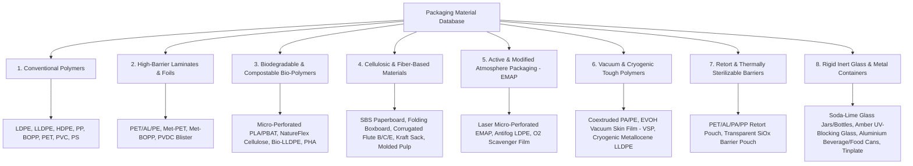
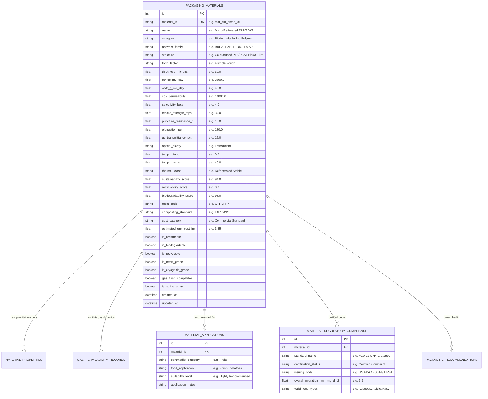
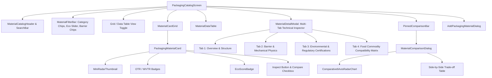

# Technical Specification: Packaging Material Database (Module 6)

## 1. Overview & System Objectives

### 1.1 Purpose
The **Packaging Material Database** is the definitive empirical materials intelligence layer of SmartPack AI. It provides a standardized, peer-reviewed, and searchable repository of conventional, bio-based, active, and rigid food packaging materials. It correlates quantitative physicochemical barrier properties, mechanical durability metrics, optical characteristics, thermal boundaries, regulatory food-contact certifications, recyclability indices, and unit economics.

### 1.2 Core Capabilities
1. **Multi-Domain Material Library (30+ Standardized Materials):**
   - Full coverage across *Conventional Polyolefins, Cellulosic & Fiber Boards, High-Barrier Multi-layer Laminates, Biodegradable & Compostable Bio-Polymers, Active/EMAP Films, Metal Cans/Foils, and Inert Glassware*.
2. **Standardized 12-Property Vector Matrix:**
   - Quantitative profiling across *Moisture Barrier ($WVTR$), Oxygen Barrier ($OTR$), $CO_2$ Permeability/Selectivity, Light/UV Opacity, Tensile/Puncture Strength, Rigidity/Flexibility, Thermal Resistance ($T_{min}/T_{max}$), Food Contact Regulatory Compliance, Recyclability Index, Biodegradability Standards, Cost Category, and Sealing/Gas-Flush Compatibility*.
3. **Multi-Parameter Search & Filtering Engine:**
   - Filter by polymer category, gas barrier requirements (Ultra-High, High, Moderate, Breathable), sustainability tier ($0\text{--}100$), temperature resistance, and economic class.
4. **Side-by-Side Multi-Material Comparison Matrix:**
   - 6-axis interactive radar visualizations and comparative differential matrices to evaluate barrier vs. sustainability vs. cost trade-offs.
5. **Manual Material Entry & Custom Material Persistence:**
   - CRUD API and frontend modal allowing packaging engineers to register, benchmark, and store custom proprietary polymers and laminates in the database.
6. **Dual-Layer Database Architecture with Offline Fallback:**
   - Full PostgreSQL relational schema with seamless in-memory fallback syncing for offline-first resilience.

```
┌─────────────────────────────────────────────────────────────────────────────┐
│                    PACKAGING MATERIAL DATABASE ARCHITECTURE                 │
│                                                                             │
│   ┌─────────────────────────────────────────────────────────────────────┐   │
│   │ 1. Empirical Materials Repository (30+ Polymers, Metals, Fibers)    │   │
│   │   • Flexible Films (LDPE, HDPE, BOPP, PET, EVOH, PA, PVDC)          │   │
│   │   • Bio-Polymers (PLA, PBAT, PHA, NatureFlex, Bio-LLDPE)            │   │
│   │   • Cellulosic Matrices (SBS Paperboard, Kraft Paper, Corrugated)   │   │
│   │   • Rigid/Inert Containers (Aluminium Foil, Glass, Tinplate)        │   │
│   └──────────────────────────────────┬──────────────────────────────────┘   │
│                                      │                                      │
│                                      ▼                                      │
│   ┌─────────────────────────────────────────────────────────────────────┐   │
│   │ 2. Standardized 12-Property Vector Matrix                           │   │
│   │   [WVTR] [OTR] [CO₂ Ratio] [UV Opacity] [Tensile] [Puncture]        │   │
│   │   [T_min / T_max] [Food Contact (FDA/FSSAI)] [Recyclability]        │   │
│   │   [Biodegradability Standard] [Cost Tier] [Gas-Flush Suitability]   │   │
│   └──────────────────────────────────┬──────────────────────────────────┘   │
│                                      │                                      │
│                                      ▼                                      │
│   ┌─────────────────────────────────────────────────────────────────────┐   │
│   │ 3. Service & Presentation Layer                                     │   │
│   │   • REST Query, Filter & CRUD Endpoints (/api/v1/materials)         │   │
│   │   • Material Explorer UI with Multi-Filter Cockpit                  │   │
│   │   • 6-Axis Comparative Radar Chart & Trade-off Differential Matrix  │   │
│   │   • Dynamic Add / Store Custom Material Dialog                      │   │
│   └─────────────────────────────────────────────────────────────────────┘   │
└─────────────────────────────────────────────────────────────────────────────┘
```

---

## 2. Complete Material Taxonomy & Coverage

The database categorizes packaging materials into 8 core structural domains:



### 2.1 Domain Classification Table

| Category ID | Material Domain | Polymer / Substrate Family | Key Target Applications |
| :--- | :--- | :--- | :--- |
| `CAT_POLYOLEFIN` | **Conventional Polymers** | LDPE, HDPE, PP, BOPP, PET | Dry bakery, confectionery, milk jugs, liners, snacks |
| `CAT_LAMINATE` | **High-Barrier Laminates** | PET/AL/PE, Met-PET, Met-BOPP, PVDC | Fried chips, roasted nuts, ground coffee, milk powder |
| `CAT_BIOPOLYMER` | **Biodegradable Bio-Polymers** | PLA, PBAT, PHA, Regenerated Cellulose | Organic fresh produce, salad greens, gourmet bakery |
| `CAT_CELLULOSIC` | **Cellulosic & Fiber Matrices** | Kraft Paper, Paperboard, Corrugated Flute, Pulp | Bulk grains, dry pulses, transit outer cartons, egg trays |
| `CAT_EMAP` | **Active & Breathable EMAP** | Micro-Perforated PLA/PBAT, Antifog PE | High-respiring produce, tomatoes, berries, mushrooms |
| `CAT_VACUUM` | **Vacuum & Cryogenic Polymers** | PA/PE, EVOH VSP, Metallocene LLDPE | Fresh poultry, red meats, bone-in cuts, deep-freeze seafood |
| `CAT_RETORT` | **Retort & Thermal Barriers** | PET/AL/PA/Cast PP, SiOx PET/PP | Shelf-stable ready-to-eat meals, curries, pasteurized sauces |
| `CAT_RIGID_INERT` | **Rigid Glass & Metals** | Soda-Lime Glass, Amber Glass, Aluminium/Tinplate | Pickles, jams, carbonated beverages, canned infant nutrition |

---

## 3. Standardized 12-Property Vector Matrix

Every material entity in the database implements the **12 Standardized Empirical Property Vectors**:

```
┌─────────────────────────────────────────────────────────────────────────────────────────────────┐
│                                 THE 12 MATERIAL PROPERTY VECTORS                                │
├───────────────────────────────┬─────────────────────────────────┬───────────────────────────────┤
│ 1. Moisture Barrier (WVTR)    │ 2. Oxygen Barrier (OTR)         │ 3. CO₂ Permeability & Beta    │
│  • g/m²/day @ 38°C, 90% RH    │  • cc/m²/day @ 23°C, 0% RH      │  • P_CO2 and Beta = P_CO2/P_O2│
├───────────────────────────────┼─────────────────────────────────┼───────────────────────────────┤
│ 4. Light Barrier & Optics     │ 5. Mechanical Strength          │ 6. Flexibility & Form Factor  │
│  • UV Transmittance % & Haze  │  • Tensile (MPa) & Puncture (N) │  • Rigid / Semi-Rigid / Film  │
├───────────────────────────────┼─────────────────────────────────┼───────────────────────────────┤
│ 7. Thermal Resistance         │ 8. Regulatory Food-Contact      │ 9. Recyclability Profile      │
│  • T_min to T_max (°C)        │  • FDA 21 CFR, EU 10/2011, FSSAI│  • RIC #1-#7, Recyclability % │
├───────────────────────────────┼─────────────────────────────────┼───────────────────────────────┤
│ 10. Biodegradability Standard │ 11. Cost Tier & Economics       │ 12. Sealing & Compatibility   │
│  • EN 13432 / ASTM D6400      │  • Budget / Commercial / Premium│  • Heat Seal & N2 Gas Flush   │
└───────────────────────────────┴─────────────────────────────────┴───────────────────────────────┘
```

### 3.1 Vector Definitions & Units

1. **Moisture Vapor Barrier ($WVTR$):**
   - *Unit:* $\text{g}/\text{m}^2/\text{day}$ tested at $38^\circ\text{C}$ and $90\%\text{ RH}$ (ASTM F1249 / ISO 15106).
   - *Tiers:*
     - *Hermetic Barrier ($WVTR < 0.05$):* Aluminium foil laminates, glass, tinplate.
     - *High Barrier ($0.05 \le WVTR < 2.0$):* HDPE, Met-PET, Met-BOPP, Cryogenic LLDPE.
     - *Moderate Barrier ($2.0 \le WVTR < 15.0$):* Standard LDPE, BOPP, PET, PA/PE.
     - *Permeable / Breathable ($WVTR \ge 15.0$):* Micro-perforated bio-films, Kraft paper, Paperboard.
2. **Oxygen Transmission Barrier ($OTR$):**
   - *Unit:* $\text{cc}/\text{m}^2/\text{day}$ (or $\text{mL}/\text{m}^2/\text{day}$) tested at $23^\circ\text{C}$ and $0\%\text{ RH}$ (ASTM D3985 / ISO 15105).
   - *Tiers:*
     - *Zero Permeation ($OTR < 0.05$):* Aluminium foil laminates, glass containers.
     - *Ultra-High Barrier ($0.05 \le OTR \le 1.5$):* EVOH Vacuum Skin, Metallized Bio-PET, PVDC.
     - *High Barrier ($1.5 < OTR \le 35.0$):* PA/PE bags, PET film, Retort pouches.
     - *Moderate Barrier ($35.0 < OTR \le 500.0$):* Unbleached Kraft with PLA liner.
     - *Breathable EMAP ($OTR > 1000.0$):* Micro-perforated PLA/PBAT, Macro-vented PP clamshells.
3. **$CO_2$ Permeability & Selectivity Ratio ($\beta$):**
   - *Unit:* $\text{cc}/\text{m}^2/\text{day}$ at $23^\circ\text{C}$; Selectivity Ratio $\beta = \frac{P_{CO_2}}{P_{O_2}}$.
   - Critical for Modified Atmosphere Packaging ($MAP$) where $\beta \approx 3.0\text{--}6.0$ prevents anaerobic fermentation while maintaining elevated $CO_2$ antimicrobial suppression.
4. **Light Barrier & Optical Clarity:**
   - *UV Transmittance ($200\text{--}400\,\text{nm}$):* Expressed in percentage ($0\%\text{ = Total UV Block}$ to $90\%\text{ = Highly Transparent}$).
   - *Optical Grade:* `CRYSTAL_CLEAR` (Glossy PET, BOPP), `TRANSLUCENT` (HDPE, LDPE), `OPAQUE` (Aluminium, Metallized, Paperboard), `AMBER_TINTED` (UV-protecting amber glass).
5. **Mechanical Strength & Puncture Buffer:**
   - *Tensile Strength ($\text{MPa}$):* Machine direction ($MD$) and transverse direction ($TD$) yield strength (ASTM D882 / ISO 527).
   - *Puncture Resistance ($\text{N}$):* Maximum force sustained before puncture against sharp food geometries like bone fragments or crispy points (ASTM F1306).
   - *Elongation at Break (%):* Extensibility under load.
6. **Flexibility & Rigidity Form Factor:**
   - Classification: `FLEXIBLE_POUCH`, `BLOWN_FILM`, `THERMOFORMED_TRAY`, `RIGID_CLAMSHELL`, `FOLDING_CARTON`, `CORRUGATED_BOX`, `RIGID_BOTTLE_JAR`, `METAL_CAN`.
7. **Thermal Resistance & Boundary Ceilings:**
   - *Minimum Safe Temperature ($T_{min}$ in $^\circ\text{C}$):* Sub-zero embrittlement threshold (e.g. $-40^\circ\text{C}$ for metallocene LLDPE; $-10^\circ\text{C}$ for standard PP).
   - *Maximum Safe Temperature ($T_{max}$ in $^\circ\text{C}$):* Softening/melting point (e.g. $135^\circ\text{C}$ for retort PP; $45^\circ\text{C}$ for PLA).
   - *Thermal Class:* `CRYOGENIC_DEEP_FREEZE`, `REFRIGERATED_STABLE`, `AMBIENT_ONLY`, `MICROWAVEABLE`, `RETORT_AUTOCLAVE`.
8. **Regulatory & Food-Contact Safety:**
   - Standards: FDA 21 CFR 177 (Polymers), EU Commission Regulation No 10/2011 (Plastic materials intended to come into contact with food), FSSAI IS 9845 (Overall Migration Limits $\le 10\,\text{mg}/\text{dm}^2$).
   - Acid resistance, alcohol stability, and lipid chemical inertness.
9. **Recyclability Profile & Circularity:**
   - *Resin Identification Code (RIC):* `RIC_1_PET`, `RIC_2_HDPE`, `RIC_4_LDPE`, `RIC_5_PP`, `PAP_20_22_CORRUGATED`, `GL_70_72_GLASS`, `ALU_41_ALUMINIUM`, `OTHER_7`.
   - *Circularity Score ($0\text{--}100$):* Derived from curbside collection availability, mono-material purity, and mechanical recycling infrastructure.
10. **Biodegradability & Composting Standard:**
    - *Certifications:* `EN_13432` (Industrial Compostable in 90 days), `ASTM_D6400`, `NF_T51_800` (Home Compostable), `BIO_BASED_CARBON_PCT` ($0\text{--}100\%$).
    - *Biodegradability Score ($0\text{--}100$):* Rate of natural decomposition in soil/compost without microplastic residues.
11. **Cost Tier & Economic Viability:**
    - *Economic Tier:* `BUDGET_ECONOMY` ($\le ₹2.00/\text{unit}$), `COMMERCIAL_STANDARD` ($₹2.00\text{--}₹4.50/\text{unit}$), `PREMIUM_BARRIER` ($₹4.50\text{--}₹7.00/\text{unit}$), `SPECIALIZED_ENGINEERED` ($> ₹7.00/\text{unit}$).
    - *Estimated Unit Cost in INR / USD.*
12. **Processing, Sealing & Gas-Flush Compatibility:**
    - Heat seal temperature window ($90^\circ\text{C}\text{--}160^\circ\text{C}$).
    - Hermetic seal integrity under modified atmosphere gas flush ($N_2/CO_2$).

---

## 4. Database Schema & Entity Relational Architecture (ERD)

### 4.1 Relational ERD



---

## 5. Pydantic Schemas & Data Contracts

### 5.1 Query & Filter Parameters Schema
```python
class MaterialFilterParams(BaseModel):
    search: Optional[str] = Field(None, description="Search query across name, structure, polymer family")
    category: Optional[str] = Field(None, description="Material domain category filter")
    polymer_family: Optional[str] = Field(None, description="Polymer family code")
    max_otr: Optional[float] = Field(None, description="Upper bound OTR limit (cc/m²/day)")
    max_wvtr: Optional[float] = Field(None, description="Upper bound WVTR limit (g/m²/day)")
    min_sustainability: Optional[float] = Field(None, ge=0, le=100, description="Minimum sustainability score")
    is_biodegradable: Optional[bool] = Field(None, description="Filter for biodegradable materials")
    is_recyclable: Optional[bool] = Field(None, description="Filter for curbside recyclable materials")
    is_cryogenic: Optional[bool] = Field(None, description="Filter for deep-freeze materials")
    is_retort: Optional[bool] = Field(None, description="Filter for autoclave/retort materials")
    cost_tier: Optional[str] = Field(None, description="Budget, Commercial, Premium, Specialized")
    sort_by: Optional[str] = Field("sustainability_score", description="Sort field (sustainability_score, otr, wvtr, cost, tensile)")
    sort_order: Optional[str] = Field("desc", description="asc or desc")
    limit: int = Field(50, ge=1, le=100)
    offset: int = Field(0, ge=0)
```

### 5.2 Material Detailed Response Schema
```python
class MaterialPropertyRadarSchema(BaseModel):
    barrier_score: float = Field(..., description="Normalized 0-100 barrier protection score")
    mechanical_score: float = Field(..., description="Normalized 0-100 tensile and puncture strength score")
    sustainability_score: float = Field(..., description="0-100 environmental sustainability score")
    thermal_score: float = Field(..., description="0-100 temperature resilience range score")
    cost_efficiency_score: float = Field(..., description="0-100 economic procurement score")
    optical_score: float = Field(..., description="0-100 clarity or light barrier score")

class PackagingMaterialDetailResponse(BaseModel):
    id: int
    material_id: str
    name: str
    category: str
    polymer_family: str
    structure: str
    form_factor: str
    thickness_microns: float
    barrier_profile: Dict[str, Any] # OTR, WVTR, CO2, Selectivity Beta
    optical_profile: Dict[str, Any] # UV Transmittance, Clarity, Gloss
    mechanical_profile: Dict[str, Any] # Tensile, Puncture, Elongation
    thermal_profile: Dict[str, Any] # T_min, T_max, Thermal Class
    environmental_profile: Dict[str, Any] # Sustainability, Recyclability, Biodegradability, Resin Code
    economic_profile: Dict[str, Any] # Cost Tier, Unit Cost INR, Market Scalability
    functional_flags: Dict[str, bool] # is_breathable, is_biodegradable, is_recyclable, is_retort, is_cryogenic, gas_flush
    recommended_applications: List[str]
    regulatory_certifications: List[str]
    radar_scores: MaterialPropertyRadarSchema
    notes: str
```

### 5.3 Custom Material Creation Schema (`POST /materials`)
```python
class CreatePackagingMaterialInput(BaseModel):
    name: str = Field(..., min_length=2, description="Material commercial / technical name")
    category: str = Field(..., description="Category domain (Biodegradable Bio-Polymer, Conventional Polymer, etc.)")
    polymer_family: str = Field(..., description="Polymer family class identifier")
    structure: str = Field(..., description="Layer structure specification (e.g. Coextruded PE/EVOH/PE)")
    form_factor: str = Field(default="Flexible Pouch", description="Form factor (Pouch, Film, Clamshell, Box, Jar)")
    thickness_microns: float = Field(..., gt=0, description="Nominal thickness in microns")
    otr_cc_m2_day: float = Field(..., ge=0, description="Oxygen Transmission Rate at 23°C, 0% RH")
    wvtr_g_m2_day: float = Field(..., ge=0, description="Water Vapor Transmission Rate at 38°C, 90% RH")
    co2_permeability: Optional[float] = Field(default=None, description="CO2 Permeability in cc/m²/day")
    tensile_strength_mpa: float = Field(..., ge=0, description="Tensile strength in MPa")
    puncture_resistance_n: float = Field(..., ge=0, description="Puncture resistance in N")
    elongation_pct: Optional[float] = Field(default=100.0, description="Elongation at break %")
    uv_transmittance_pct: Optional[float] = Field(default=10.0, description="UV transmittance %")
    optical_clarity: Optional[str] = Field(default="Translucent", description="Crystal Clear, Translucent, Opaque")
    temp_min_c: float = Field(default=-10.0, description="Minimum operating temperature in °C")
    temp_max_c: float = Field(default=70.0, description="Maximum operating temperature in °C")
    sustainability_score: float = Field(..., ge=0, le=100, description="Sustainability Eco-Score (0-100)")
    recyclability_score: Optional[float] = Field(default=0.0, ge=0, le=100, description="Recyclability index (0-100)")
    biodegradability_score: Optional[float] = Field(default=0.0, ge=0, le=100, description="Biodegradability score (0-100)")
    resin_code: Optional[str] = Field(default="OTHER_7", description="Resin code (RIC_1_PET, PAP_20, etc.)")
    composting_standard: Optional[str] = Field(default=None, description="EN 13432, ASTM D6400, etc.")
    estimated_unit_cost_inr: float = Field(..., gt=0, description="Standard unit cost in INR")
    is_breathable: bool = Field(default=False)
    is_biodegradable: bool = Field(default=False)
    is_recyclable: bool = Field(default=False)
    is_retort_grade: bool = Field(default=False)
    is_cryogenic_grade: bool = Field(default=False)
    gas_flush_compatible: bool = Field(default=True)
    recommended_applications: List[str] = Field(default_factory=list)
    notes: Optional[str] = Field(default="", description="Technical documentation and processing notes")
```

---

## 6. REST API Endpoints

| HTTP Method | Route Path | Description | Query / Body Payload | Response |
| :--- | :--- | :--- | :--- | :--- |
| `GET` | `/api/v1/materials` | Multi-filter query material catalog with sorting & pagination | `MaterialFilterParams` | `List[PackagingMaterialDetailResponse]` |
| `GET` | `/api/v1/materials/{id}` | Retrieve comprehensive technical profile for specific material | Path parameter `id` (int or string `mat_id`) | `PackagingMaterialDetailResponse` |
| `POST` | `/api/v1/materials` | Create and store new custom packaging material in database | `CreatePackagingMaterialInput` | `PackagingMaterialDetailResponse` |
| `PUT` | `/api/v1/materials/{id}` | Update existing material technical specifications | `CreatePackagingMaterialInput` | `PackagingMaterialDetailResponse` |
| `DELETE` | `/api/v1/materials/{id}` | Deactivate / soft-delete material record | Path parameter `id` | `{"status": "deleted", "id": id}` |
| `POST` | `/api/v1/materials/compare` | Compare 2 to 4 materials side-by-side with radar vectors | `{"material_ids": ["mat_1", "mat_2"]}` | `MaterialComparisonMatrixResponse` |
| `GET` | `/api/v1/materials/categories` | Grouped taxonomy breakdown with counts and barrier distributions | None | `MaterialCategoriesSummaryResponse` |
| `GET` | `/api/v1/materials/barrier-matrix` | Quantitative barrier scatter data for chart plotting | `{"x_axis": "otr", "y_axis": "wvtr"}` | `BarrierScatterPlotResponse` |

---

## 7. Frontend UI / UX Architecture

### 7.1 Master Material Catalog Screen (`PackagingCatalogScreen`)

The material explorer is designed as an interactive, data-dense engineering cockpit:

```
┌──────────────────────────────────────────────────────────────────────────────────────────────────┐
│ 🌿 SMARTPACK AI  •  PACKAGING MATERIAL EXPLORER & TECHNICAL DATABASE                             │
├──────────────────────────────────────────────────────────────────────────────────────────────────┤
│  [ 🔍 Search 30+ Polymers, Foils, Paperboards, Bio-Films... ]    [ ➕ Add Custom Material ]       │
├──────────────────────────────────────────────────────────────────────────────────────────────────┤
│  FILTERS:                                                                                        │
│  [ All Domains (30) ] [ 🌿 Bio-Polymers ] [ 🛡️ High-Barrier ] [ 📦 Paperboard ] [ ❄️ Cryogenic ]  │
│  Sustainability: [===●====] ≥ 70 | OTR: [≤ 10 cc] | Cost: [All] | Mode: [ ⊞ Grid / ☰ Table ]    │
├──────────────────────────────────────────────────────────────────────────────────────────────────┤
│  ┌─────────────────────────┐  ┌─────────────────────────┐  ┌─────────────────────────┐           │
│  │ 🌿 NatureFlex Bio-Film  │  │ 🛡️ High-Barrier EVOH VSP│  │ 📦 Unbleached Kraft PLA │           │
│  │ Bio-Based Compostable   │  │ Coextruded PE/EVOH/PE   │  │ Renewable Paper Matrix  │           │
│  │ OTR: 2800 • WVTR: 35.0  │  │ OTR: 0.4 • WVTR: 1.2    │  │ OTR: 45.0 • WVTR: 4.8   │           │
│  │ Eco: 98/100 • ₹4.50     │  │ Eco: 52/100 • ₹5.80     │  │ Eco: 95/100 • ₹3.50     │           │
│  │ [ 🔍 View Full Specs ]  │  │ [ 🔍 View Full Specs ]  │  │ [ 🔍 View Full Specs ]  │           │
│  │ [ ⚖️ Compare ]          │  │ [ ⚖️ Compare ]          │  │ [ ⚖️ Compare ]          │           │
│  └─────────────────────────┘  └─────────────────────────┘  └─────────────────────────┘           │
│                                                                                                  │
│  ┌────────────────────────────────────────────────────────────────────────────────────────────┐  │
│  │ ⚖️ COMPARISON PINNED BAR (2 Selected: NatureFlex Bio-Film vs High-Barrier EVOH VSP)        │  │
│  │ [ 📊 Launch Side-by-Side 6-Axis Comparison Radar & Barrier Matrix ]     [ ❌ Clear All ]   │  │
│  └────────────────────────────────────────────────────────────────────────────────────────────┘  │
└──────────────────────────────────────────────────────────────────────────────────────────────────┘
```

### 7.2 Modular Frontend Component Hierarchy



---

## 8. Verification & Test Plan

### 8.1 Backend Automated Pytest Suite
1. **Catalog Query & Filter Suite (`test_packaging_materials_api.py`):**
   - Test full catalog retrieval with standard 25+ default materials.
   - Test category filtering (`category="Biodegradable Bio-Polymer"` returns only bio-polymers).
   - Test barrier boundary filters (`max_otr=1.5` returns EVOH, Met-PET, Met-BOPP, Al-Foil).
   - Test sustainability score sorting (descending).
2. **Material CRUD Operations Suite (`test_material_crud.py`):**
   - `POST /api/v1/materials`: Create new material (`Custom Multi-Layer Nanoclay Film`) and verify 201 Created.
   - Verify newly created material appears in subsequent filter queries.
   - `PUT /api/v1/materials/{id}`: Update tensile strength and unit cost.
   - `DELETE /api/v1/materials/{id}`: Deactivate and verify exclusion from standard active listing.
3. **Multi-Material Comparison Engine Suite (`test_material_comparison.py`):**
   - Compare 3 materials (`NatureFlex`, `EVOH VSP`, `Recycled Kraft`).
   - Validate 6-axis radar score normalization ($[0.0, 100.0]$ for all vectors).
   - Validate trade-off differential summaries.

### 8.2 Frontend Automated Flutter Test Suite
1. **Model & Service Serialization Tests (`packaging_material_model_test.dart`):**
   - Validate JSON parsing of detailed 12-vector property records.
   - Test offline fallback caching and `ApiService.createMaterial()` error resilience.
2. **Widget Unit Tests (`material_card_test.dart`, `material_detail_modal_test.dart`):**
   - Test `PackagingMaterialCard` rendering barrier chips, eco pills, and unit costs.
   - Test `MaterialDetailModal` tabs (Physics, Regulatory, Applications).
   - Test `AddPackagingMaterialDialog` validation and submission.
3. **Multi-Viewport Responsive Layout Audit (`packaging_catalog_viewport_test.dart`):**
   - Verify 0 `RenderFlex` overflow across Mobile ($375\times812$), Tablet ($768\times1024$), and Desktop ($1280\times900$) viewports.

---

## 9. Deliverables & Acceptance Criteria

- [ ] Complete PostgreSQL database migration with 30+ empirical materials seeded.
- [ ] Comprehensive REST endpoints for querying, filtering, comparing, and creating packaging materials.
- [ ] Responsive Flutter `PackagingCatalogScreen` with search, filter chips, grid/table view, detail modal, and comparison cockpit.
- [ ] `AddPackagingMaterialDialog` allowing users to register new custom packaging materials into the database.
- [ ] 100% test coverage with zero regressions across backend and frontend test suites.
