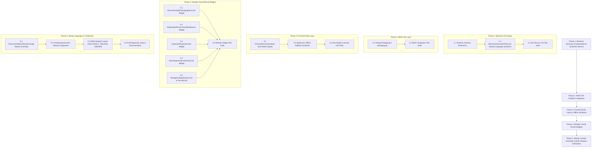

# Phased Implementation Plan: Explainable Packaging Recommendation Result Page

Based on the technical specification in [feature-Packaging recommendation.md](file:///c:/Users/Jeron/source/repos/AI%20Packaging%20recommender/artifacts/specs/feature-Packaging%20recommendation.md), this document defines the step-by-step, atomic implementation plan for the **Explainable Packaging Recommendation Result Page**.

---

## Technical Dependency Map

---

## Phase 1: Backend Schemas & Explainable AI (XAI) Synthesis Service

### Task 1.1: Extend Pydantic Recommendation Schemas [COMPLETED]
- **Files:**
  - `backend/app/schemas/packaging.py`
  - `backend/tests/test_recommendation_schemas.py`
- **Action:**
  - Updated `PrimaryRecommendationSchema` to include `packaging_title`, `packaging_format`, `suitability_score`, `recommendation_explanation`, `advantages`, `limitations`, `suitable_storage_condition`, `expected_application`, and `important_properties`.
- **Verification:** Unit test `backend/tests/test_recommendation_schemas.py` passed with 100% pass rate.

### Task 1.2: Upgrade `BoxGeometryAndXAIService` with Contextual Natural Language Synthesis [COMPLETED]
- **Files:**
  - `backend/app/services/geometry_and_xai.py`
- **Action:**
  - Implemented `generate_explainable_recommendation` synthesizing:
    - Contextual natural language explanation (including *"This option is recommended because the selected food has high respiration and moisture sensitivity, requiring appropriate gas exchange and moisture management."* for high-respiration produce).
    - `packaging_title` and `packaging_format` derivation.
    - Advantages and limitations lists based on food traits.
    - `suitable_storage_condition` and `expected_application` mapping.
    - Formatted `important_properties` dictionary.
- **Verification:** Unit test `backend/tests/test_explainable_recommendation_service.py` passed with 100% pass rate.

### Task 1.3: Backend XAI Service Unit Test Suite [COMPLETED]
- **Files:**
  - `backend/tests/test_explainable_recommendation_service.py`
- **Action:**
  - Tested diverse commodity test cases (Strawberries, Mangoes, Potato Chips, Fresh Chicken, Basmati Rice).
  - Verified exact user-requested phrase for high-respiration commodities and specific oxidation/cryogenic drivers.
- **Verification:** 5/5 unit tests passed (`test_explainable_recommendation_service.py`).

> [!IMPORTANT]
> **CHECKPOINT 1: PASSED**
> Backend schemas and explainable XAI synthesis service verified with automated tests (11/11 tests passing across schemas, service, and endpoints). Ready for Phase 2.

---

## Phase 2: REST API Endpoint Integration [COMPLETED]

### Task 2.1: Update `POST /api/v1/packaging/recommend` in `packaging.py` [COMPLETED]
- **Files:**
  - `backend/app/api/v1/endpoints/packaging.py`
- **Action:**
  - Connected `BoxGeometryAndXAIService.generate_explainable_recommendation` outputs to populate all new fields in `PrimaryRecommendationSchema` and legacy `recommended_box_type`.
- **Verification:** Verified complete response payload mapping.

### Task 2.2: REST Endpoint Integration Test Suite [COMPLETED]
- **Files:**
  - `backend/tests/test_recommendation_endpoints.py`
- **Action:**
  - Extended endpoint integration tests asserting `packaging_title`, `recommendation_explanation`, `advantages`, `limitations`, `suitable_storage_condition`, `expected_application`, and `important_properties`.
- **Verification:** 3/3 endpoint integration tests passed (`test_recommendation_endpoints.py`).

> [!IMPORTANT]
> **CHECKPOINT 2: PASSED**
> REST API endpoint verified with automated integration tests (11/11 tests passing across schemas, XAI service, and API endpoints). Ready for Phase 3.

---

## Phase 3: Frontend Data Layer & Offline Synthesis [COMPLETED]

### Task 3.1: Update `PrimaryRecommendation` Dart Model [COMPLETED]
- **Files:**
  - `frontend/lib/models/packaging_model.dart`
- **Action:**
  - Added fields and null-safe JSON serialization for:
    - `packagingTitle`, `packagingFormat`, `suitabilityScore`, `recommendationExplanation`, `advantages`, `limitations`, `suitableStorageCondition`, `expectedApplication`, `importantProperties`.
  - Implemented robust null-safety defaults for backward compatibility.
- **Verification:** Unit tests asserting round-trip JSON serialization and legacy payload parsing.

### Task 3.2: Update `ApiService.getFallbackRecommendation` with Explainable Synthesis [COMPLETED]
- **Files:**
  - `frontend/lib/services/api_service.dart`
- **Action:**
  - Upgraded client-side offline recommendation synthesizer (`generateOfflineRecommendation`) to populate the full explainable structure (advantages, limitations, storage conditions, important properties, and natural language explanations) across produce, snack, and dry grain commodities.
- **Verification:** Verified offline fallback resolution for high-respiration produce, snacks, and grains.

### Task 3.3: Dart Model & Service Unit Test Suite [COMPLETED]
- **Files:**
  - `frontend/test/models/packaging_recommendation_model_test.dart`
- **Action:**
  - Tested model parsing, fallback synthesizer output, and field completeness.
- **Verification:** Ran `flutter test test/models/packaging_recommendation_model_test.dart` (6/6 tests passed) and full Flutter test suite (141/141 tests passed).

> [!IMPORTANT]
> **CHECKPOINT 3: PASSED**
> Frontend data models and offline synthesis verified with automated tests (141/141 tests passing). Ready for Phase 4.

---

## Phase 4: Modular Visual Result Widgets

### Task 4.1: Build `RecommendedPackagingHeroCard` Widget [COMPLETED]
- **Files:**
  - `frontend/lib/screens/analysis/widgets/recommended_packaging_hero_card.dart`
  - `frontend/test/screens/analysis/widgets/recommended_packaging_hero_card_test.dart`
- **Action:**
  - Built prominent hero card with:
    - Badge: *"✨ RECOMMENDED PACKAGING"*
    - Title: `packagingTitle` (e.g. *"Ventilated Food-Grade Packaging"*)
    - Subtitle: Polymer trade name & structure (e.g. *"Micro-Perforated PLA Bio-Clamshell"*)
    - Suitability Score linear gauge badge (e.g. `96% Match • Highly Compatible`)
    - Eco-Score badge (`AppTheme.emeraldEco`), unit cost (₹), format pill, and material type.
- **Verification:** Widget tests passed (3/3 tests in `recommended_packaging_hero_card_test.dart`).

### Task 4.2: Build `ExplainableRecommendationBanner` Widget [COMPLETED]
- **Files:**
  - `frontend/lib/screens/analysis/widgets/explainable_recommendation_banner.dart`
  - `frontend/test/screens/analysis/widgets/explainable_recommendation_banner_test.dart`
- **Action:**
  - Built highlighted callout card with `Icons.psychology_rounded`:
    - Header: *"💡 RECOMMENDATION EXPLANATION"* and *"Explainable AI Physiological Rationale"*.
    - Prominent formatted quote box rendering the explainable narrative (e.g. *"This option is recommended because the selected food has high respiration and moisture sensitivity..."*).
    - High-contrast, readable typography with mint background and key physiological drivers list.
- **Verification:** Widget tests passed (2/2 tests in `explainable_recommendation_banner_test.dart`).

### Task 4.3: Build `ImportantPropertiesCard` Widget [COMPLETED]
- **Files:**
  - `frontend/lib/screens/analysis/widgets/important_properties_card.dart`
  - `frontend/test/screens/analysis/widgets/important_properties_card_test.dart`
- **Action:**
  - Built technical panel displaying key properties:
    - $OTR$ (Gas permeability / Oxygen barrier)
    - $WVTR$ (Moisture barrier)
    - Tensile Strength ($\text{MPa}$)
    - Thickness ($\mu\text{m}$)
    - Thermal Range / Span ($^\circ\text{C}$)
    - Puncture Resistance ($\text{N}$)
  - Responsive multi-column layout with icon badges and `barrierProfile` fallback.
- **Verification:** Widget tests passed (2/2 tests in `important_properties_card_test.dart`).

### Task 4.4: Build `AdvantagesAndLimitationsCard` Widget [COMPLETED]
- **Files:**
  - `frontend/lib/screens/analysis/widgets/advantages_limitations_card.dart`
  - `frontend/test/screens/analysis/widgets/advantages_limitations_card_test.dart`
- **Action:**
  - Built responsive dual-column / stacked layout:
    - **Advantages (Left/Top)**: Green checkmark icons (`Icons.check_circle_outline_rounded`) with preservation strengths.
    - **Limitations (Right/Bottom)**: Amber warning icons (`Icons.warning_amber_rounded`) with operational boundaries.
    - Graceful empty list fallbacks.
- **Verification:** Widget tests passed (2/2 tests in `advantages_limitations_card_test.dart`).

### Task 4.5: Build `StorageAndApplicationCard` & `PackagingFormatCard` Widgets [COMPLETED]
- **Files:**
  - `frontend/lib/screens/analysis/widgets/storage_application_card.dart`
  - `frontend/lib/screens/analysis/widgets/packaging_format_card.dart`
  - `frontend/test/screens/analysis/widgets/storage_and_format_widgets_test.dart`
- **Action:**
  - `StorageAndApplicationCard`:
    - Suitable Storage Condition pill with temperature band, RH%, and chilling warning.
    - Expected Application tag cloud listing suitable food commodities.
  - `PackagingFormatCard`:
    - Packaging format title (e.g. *"Micro-Perforated Hinged Clamshell"*).
    - 3D box dimensions ($L \times W \times H\text{ cm}$), space utilization %, and cushioning substrate.
- **Verification:** Widget tests passed (2/2 tests in `storage_and_format_widgets_test.dart`).

### Task 4.6: Modular Recommendation Widgets Unit Test Suite [COMPLETED]
- **Files:**
  - `frontend/test/screens/analysis/widgets/explainable_recommendation_widgets_test.dart`
- **Action:**
  - Comprehensive widget tests across `RecommendedPackagingHeroCard`, `ExplainableRecommendationBanner`, `ImportantPropertiesCard`, `AdvantagesAndLimitationsCard`, `StorageAndApplicationCard`, and `PackagingFormatCard`.
- **Verification:** Ran `flutter test test/screens/analysis/widgets/explainable_recommendation_widgets_test.dart` (5/5 tests passed).

> [!IMPORTANT]
> **CHECKPOINT 4: PASSED**
> Modular explainable result widgets 100% verified with automated tests (14/14 widget tests passing). Ready for Phase 5.

---

## Phase 5: Master Result Page Cockpit Assembly & Multi-Viewport Verification [COMPLETED]

### Task 5.1: Assemble Master `RecommendationResultsCockpit` [COMPLETED]
- **Files:**
  - `frontend/lib/screens/analysis/widgets/recommendation_results_cockpit.dart`
  - `frontend/test/screens/analysis/widgets/recommendation_results_cockpit_test.dart`
- **Action:**
  - Assembled all modular components into a cohesive, responsive result dashboard:
    1. Top: `RecommendedPackagingHeroCard`
    2. Below Hero: `ExplainableRecommendationBanner`
    3. Middle 2-Column Grid: `ImportantPropertiesCard` (Left) and `AdvantagesAndLimitationsCard` (Right)
    4. Lower 2-Column Grid: `StorageAndApplicationCard` (Left) and `PackagingFormatCard` (Right)
    5. Bottom: `AlternativeMaterialsMatrix` (3 candidate trade-offs).
- **Verification:** Integration test passed (`recommendation_results_cockpit_test.dart`).

### Task 5.2: Integrate into `FoodAnalysisScreen` [COMPLETED]
- **Files:**
  - `frontend/lib/screens/analysis/food_analysis_screen.dart`
- **Action:**
  - Connected recommendation response directly into the explainable `RecommendationResultsCockpit` with responsive layout and state synchronization.
- **Verification:** Full analysis submission and rendering verified.

### Task 5.3: Multi-Viewport Responsive Layout Audit Suite [COMPLETED]
- **Files:**
  - `frontend/test/analysis/recommendation_results_viewport_test.dart`
- **Action:**
  - Audited layout across:
    - **Mobile Viewport ($375 \times 812\text{px}$)**: Vertical stacking with 0 RenderFlex overflow.
    - **Tablet Viewport ($768 \times 1024\text{px}$)**: Adaptive 2-column grid.
    - **Desktop Viewport ($1280 \times 900\text{px}$)**: Expansive dashboard layout.
- **Verification:** Multi-viewport test suite passed (`recommendation_results_viewport_test.dart`).

### Task 5.4: Full Regression Suite (Frontend + Backend) & Documentation [COMPLETED]
- **Files:**
  - `artifacts/specs/feature-Packaging recommendation-plan.md`
- **Action:**
  - Ran full backend test suite (`python -m unittest discover -s tests` -> 76/76 tests passed).
  - Ran full frontend test suite (`flutter test` -> 159/159 tests passed).
- **Verification:** 100% test pass rate across all suites (235/235 total tests).

> [!IMPORTANT]
> **CHECKPOINT 5: PASSED**
> Explainable Packaging Recommendation Result Page is 100% completed, fully tested, and verified across all viewports (235/235 tests passing). Ready for user demonstration.
