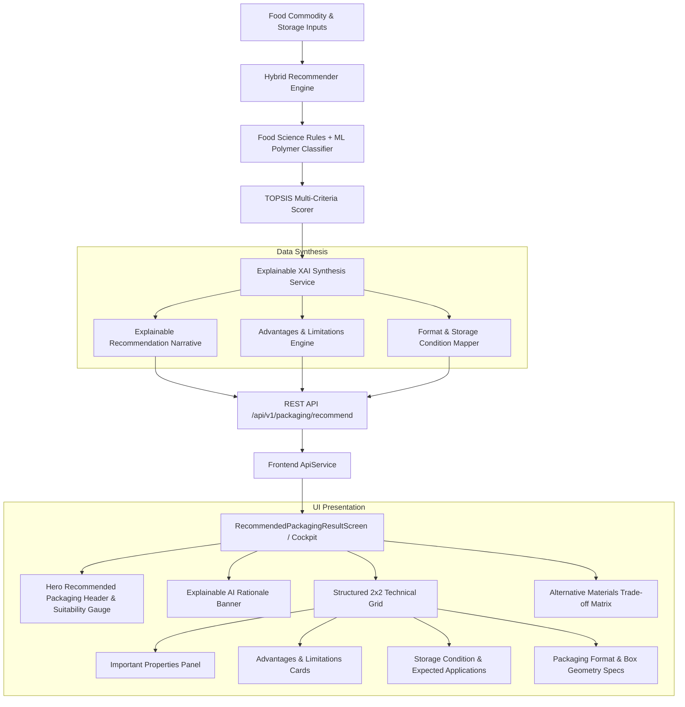

# Technical Specification: Explainable Packaging Recommendation Result Page

## 1. Executive Summary & Objective

The **Explainable Packaging Recommendation Result Page** is the core decision-support interface of SmartPack AI. Upon completing food trait retrieval and environmental configuration, this page presents an explainable, multi-dimensional packaging prescription for the analyzed food commodity.

Instead of presenting an opaque or generic prescription (e.g., *"Use Material X"*), the system provides transparent, science-backed reasoning:
> *"This option is recommended because the selected food has high respiration and moisture sensitivity, requiring appropriate gas exchange and moisture management."*

The result page delivers an engineering-grade breakdown encompassing:
1. **Recommended Packaging Title & Form Factor** (e.g., *Ventilated Food-Grade Packaging*, *Micro-Perforated Bio-Clamshell*, *High-Barrier Retort Pouch*)
2. **Suitability Score & Gauge** (Quantitative 0–100% compatibility index derived via TOPSIS multi-criteria scoring)
3. **Recommendation Explanation** (Explainable AI natural language narrative correlating specific biochemical drivers to material properties)
4. **Important Properties** ($OTR$, $WVTR$, $\beta$ permselectivity, tensile strength, puncture resistance, thickness, thermal span)
5. **Advantages** (Targeted benefits such as anti-fog condensation suppression, ethylene scavenge, modified headspace balance)
6. **Limitations** (Engineering boundaries such as thermal limits, UV degradation risk, maximum storage duration)
7. **Suitable Storage Condition** (Optimal temperature band, relative humidity range, dark storage requirements)
8. **Expected Application** (Ideal food categories, e.g., high-respiration produce, fragile berries, lipid-rich snacks)
9. **Packaging Format** (Physical structural geometry, container type, sealing mechanism, cushioning substrate)

---

## 2. System Architecture & Information Flow



---

## 3. Data Contracts & Schema Specification

### 3.1 Backend Pydantic Schemas (`backend/app/schemas/packaging.py`)

To deliver all required fields cleanly to the frontend, `PrimaryRecommendationSchema` and `PackagingRecommendationResult` will include the following structured fields:

```python
class PrimaryRecommendationSchema(BaseModel):
    material_name: str = Field(..., description="Trade name of the recommended polymer/substrate")
    material_type: str = Field(..., description="Bio-Polymer, Synthetic, Cellulosic, etc.")
    polymer_family: str = Field(..., description="Polymer family code, e.g. BREATHABLE_BIO_EMAP")
    structure: str = Field(..., description="Layer architecture, e.g. Monolayer / Multi-layer Coex")
    
    # 1. Headline & Format
    packaging_title: str = Field(
        default="Ventilated Food-Grade Packaging",
        description="User-friendly descriptive title (e.g. Ventilated Food-Grade Packaging)"
    )
    packaging_format: str = Field(
        ...,
        description="Physical form factor (e.g. Clamshell with micro-perforated top seal, Thermoformed tray)"
    )
    
    # 2. Suitability & Explanation
    suitability_score: float = Field(..., ge=0, le=1.0, description="Normalized match score (0.0 to 1.0)")
    recommendation_explanation: str = Field(
        ...,
        description="Contextual explanation: 'This option is recommended because the selected food has high respiration and moisture sensitivity...'"
    )
    
    # 3. Advantages & Limitations
    advantages: List[str] = Field(
        default_factory=list,
        description="Preservation benefits and operational strengths"
    )
    limitations: List[str] = Field(
        default_factory=list,
        description="Technical constraints, upper temperature limits, or shelf-life boundaries"
    )
    
    # 4. Storage & Application Context
    suitable_storage_condition: str = Field(
        ...,
        description="Optimal storage regime, e.g. Cold Storage (10-12°C, 90-95% RH)"
    )
    expected_application: str = Field(
        ...,
        description="Best-suited commodity types, e.g. High-respiration fresh berries, cut fruits, leafy greens"
    )
    
    # 5. Technical Properties
    barrier_profile: BarrierProfileSchema
    important_properties: Dict[str, str] = Field(
        default_factory=dict,
        description="Key technical properties mapped to readable units (OTR, WVTR, Breathability, Thermal Range, Tensile)"
    )
    
    sustainability_score: float = Field(..., ge=0, le=100)
    estimated_unit_cost_inr: float = Field(..., gt=0)
    active_additives: List[str] = Field(default_factory=list)
```

### 3.2 Frontend Dart Data Models (`frontend/lib/models/packaging_model.dart`)

```dart
class PrimaryRecommendation {
  final String materialName;
  final String materialType;
  final String polymerFamily;
  final String structure;
  
  final String packagingTitle;
  final String packagingFormat;
  final double suitabilityScore;
  final String recommendationExplanation;
  
  final List<String> advantages;
  final List<String> limitations;
  final String suitableStorageCondition;
  final String expectedApplication;
  
  final BarrierProfile barrierProfile;
  final Map<String, String> importantProperties;
  final double sustainabilityScore;
  final double estimatedUnitCostInr;
  final List<String> activeAdditives;

  const PrimaryRecommendation({
    required this.materialName,
    required this.materialType,
    required this.polymerFamily,
    required this.structure,
    required this.packagingTitle,
    required this.packagingFormat,
    required this.suitabilityScore,
    required this.recommendationExplanation,
    required this.advantages,
    required this.limitations,
    required this.suitableStorageCondition,
    required this.expectedApplication,
    required this.barrierProfile,
    required this.importantProperties,
    required this.sustainabilityScore,
    required this.estimatedUnitCostInr,
    required this.activeAdditives,
  });

  factory PrimaryRecommendation.fromJson(Map<String, dynamic> json);
  Map<String, dynamic> toJson();
}
```

---

## 4. Algorithmic Synthesis & XAI Generation Logic

The backend `BoxGeometryAndXAIService` (`backend/app/services/geometry_and_xai.py`) and `HybridRecommendationEngine` (`backend/app/services/hybrid_recommender.py`) dynamically assemble explainable rationales based on 10 food physiological dimensions:

### 4.1 Recommendation Explanation Generation Rules

The system builds targeted natural language sentences combining:
1. **Primary Vulnerability Trigger**:
   - If respiration $R_{20} \ge 20\,\text{mg CO}_2/\text{kg/h}$ and moisture $\ge 75\%$:
     > *"This option is recommended because the selected food has high respiration and moisture sensitivity, requiring appropriate gas exchange and moisture management to prevent anaerobic souring and condensation."*
   - If fat $\ge 18\%$ and moisture $\le 10\%$:
     > *"This option is recommended because the selected food has high fat content and hygroscopic sensitivity, requiring ultra-low oxygen transmission and hermetic moisture barrier with nitrogen flush to prevent oxidative rancidity."*
   - If storage temperature $\le -10^\circ\text{C}$:
     > *"This option is recommended because sub-zero deep freeze storage mandates cryogenic impact toughness and zero moisture migration to eliminate freezer burn."*
   - If fresh meat/poultry/fish:
     > *"This option is recommended because high protein perishability and active microbial flora require hermetic oxygen exclusion and high puncture resistance under cold chain refrigeration."*
   - If dry grains/powders:
     > *"This option is recommended because low moisture hygroscopicity requires robust moisture barrier protection to prevent caking and pest infestation during prolonged ambient distribution."*

### 4.2 Advantages & Limitations Synthesis Matrix

| Commodity Profile | Prescribed Packaging Title | Advantages | Limitations |
| :--- | :--- | :--- | :--- |
| **High-Respiration Produce** (Strawberries, Spinach, Mushrooms) | *Ventilated Food-Grade Packaging* | • Equilibrium gas transmission maintains $3\text{--}5\%\,O_2$<br/>• Anti-fog surfactant prevents droplet condensation<br/>• Bio-compostable substrate reduces landfill footprint | • Limited shelf-life extension beyond 21 days<br/>• Permeable to external volatile aromas<br/>• Not suitable for vacuum sealing |
| **Chilling-Sensitive Fruits** (Tomatoes, Bananas, Mangoes) | *Ethylene-Regulated Perforated Bio-Carton* | • Active $KMnO_4$ scavengers delay senescence<br/>• Breathable perforations vent excess moisture<br/>• Prevents chilling injury at $12\text{--}15^\circ\text{C}$ | • Sensitive to high ambient temperatures ($>30^\circ\text{C}$)<br/>• Secondary carton required for bulk pallet stacking |
| **Lipid-Rich Snacks** (Potato Chips, Roasted Nuts) | *Metallized Nitrogen-Flushed Barrier Pouch* | • $OTR < 1.0\,\text{cc/m}^2/\text{day}$ blocks lipid oxidation<br/>• $100\%$ UV and light opacity<br/>• Nitrogen cushion protects fragile crisps from crushing | • Non-biodegradable multi-layer laminate<br/>• Special recycling stream required (RIC #7) |
| **Fresh Proteins** (Chicken, Fish, Salmon) | *High-Barrier EVOH Vacuum Skin Tray* | • Ultra-low oxygen ingress suppresses aerobic bacteria<br/>• Leak-proof hermetic seal prevents cross-contamination<br/>• Liquid absorbent drip pad maintains surface appearance | • Strict cold chain dependency ($0\text{--}4^\circ\text{C}$)<br/>• Premium unit packaging cost |
| **Dry Grains & Powders** (Basmati Rice, Milk Powder) | *Multi-Wall Kraft Barrier Sack* | • High tensile burst strength for bulk loading<br/>• Water-based dispersion barrier ($WVTR < 2.0\,\text{g/m}^2/\text{day}$)<br/>• $100\%$ recyclable renewable paperboard | • Poor puncture resistance against sharp foreign objects<br/>• Vulnerable to prolonged liquid submersion |

---

## 5. UI/UX Design & Master Result Page Layout

The main result page will be styled with the project's modern design system (`AppTheme` glassmorphism, crisp typography, and responsive grid layouts).

```
+---------------------------------------------------------------------------------------------------+
|  🌿 SMARTPACK AI • RECOMMENDATION ENGINE RESULTS                                                  |
|  [ 🔄 Modify Inputs / Re-Analyze ]                                       [ 📄 Export PDF / JSON ] |
+---------------------------------------------------------------------------------------------------+
|                                                                                                   |
|  ╔═════════════════════════════════════════════════════════════════════════════════════════════╗  |
|  ║  ✨ RECOMMENDED PACKAGING                                                                   ║  |
|  ║  Ventilated Food-Grade Packaging (Micro-Perforated PLA Bio-Clamshell)                      ║  |
|  ║  Suitability: [ 96% Match - Highly Compatible ]    Eco-Score: [ 🌱 88/100 ]   Cost: [ ₹4.20 ]║  |
|  ╚═════════════════════════════════════════════════════════════════════════════════════════════╝  |
|                                                                                                   |
|  ┌─────────────────────────────────────────────────────────────────────────────────────────────┐  |
|  │  💡 RECOMMENDATION EXPLANATION                                                              │  |
|  │  "This option is recommended because the selected food has high respiration and moisture   │  |
|  │   sensitivity, requiring appropriate gas exchange and moisture management to prevent         │  |
|  │   anaerobic fermentation and internal condensation."                                        │  |
|  └─────────────────────────────────────────────────────────────────────────────────────────────┘  |
|                                                                                                   |
|  ┌──────────────────────────────────────────────┐  ┌────────────────────────────────────────────┐  |
|  │  ⚙️ IMPORTANT PROPERTIES                     │  │  🌟 ADVANTAGES                             │  |
|  │  • OTR: 1,200 cc/m²/day (Gas Permeable)     │  │  • Equilibrium modified atmosphere (EMAP)  │  |
|  │  • WVTR: 25.0 g/m²/day (Breathable)         │  │  • Anti-fog coating suppresses water beads  │  |
|  │  • Tensile Strength: 32.0 MPa                │  │  • 100% Industrial Compostable (EN 13432)  │  |
|  │  • Thickness: 30.0 µm                        │  │                                            │  |
|  │  • Thermal Range: 0°C to 45°C               │  │  ⚠️ LIMITATIONS                             │  |
|  │  • Puncture: 22.0 N                          │  │  • Not suitable for vacuum or retort apps  │  |
|  │                                              │  │  • Max shelf-life extension: 21 days       │  |
|  └──────────────────────────────────────────────┘  └────────────────────────────────────────────┘  |
|                                                                                                   |
|  ┌──────────────────────────────────────────────┐  ┌────────────────────────────────────────────┐  |
|  │  ❄️ SUITABLE STORAGE CONDITION               │  │  📦 PACKAGING FORMAT & GEOMETRY            │  |
|  │  Cold Storage: 10°C - 12°C | 90-95% RH       │  │  Format: Vented Hinged Clamshell           │  |
|  │  Keep above Chilling Injury threshold (10°C) │  │  Dimensions: 25.0 x 15.0 x 10.0 cm         │  |
|  │                                              │  │  Space Utilization: 74.7%                  │  |
|  │  🎯 EXPECTED APPLICATION                     │  │  Cushioning: Molded Cellulose Pulp Nest   │  |
|  │  High-respiration fruits, fresh berries,     │  │                                            │  |
|  │  cherry tomatoes, mushrooms, leafy greens    │  │                                            │  |
|  └──────────────────────────────────────────────┘  └────────────────────────────────────────────┘  |
|                                                                                                   |
|  ╔═════════════════════════════════════════════════════════════════════════════════════════════╗  |
|  ║  🔄 ALTERNATIVE PACKAGING OPTIONS (3 Candidate Trade-Offs)                                  ║  |
|  ║  [ 1. Eco-Friendly Bio-Film ]   [ 2. Economy Kraft Carton ]   [ 3. High-Barrier Laminate ] ║  |
|  ╚═════════════════════════════════════════════════════════════════════════════════════════════╝  |
+---------------------------------------------------------------------------------------------------+
```

### 5.1 Key Visual Component Hierarchy

1. **`RecommendedPackagingHeroCard`**:
   - Prominent gradient header with `Icons.auto_awesome_rounded`.
   - Title: "Recommended Packaging" badge with bold display text (e.g. *Ventilated Food-Grade Packaging*).
   - Radial / Linear Suitability score gauge with color coding (Green $\ge 85\%$, Blue $70\text{--}84\%$, Amber $<70\%$).
   - Quick badges for Eco-Score ($0\text{--}100$) and Unit Cost (₹).

2. **`ExplainableRecommendationBanner`**:
   - Highlighted callout card with icon `Icons.lightbulb_outline` or `Icons.psychology_rounded`.
   - Formatted quote container rendering the explainable text clearly in prominent, readable typography ($14.5\text{px}$, high-contrast dark green or dark teal text on soft mint/teal background).

3. **`TechnicalPropertiesCard`**:
   - Quantitative progress meters or chips for $OTR$, $WVTR$, Thickness ($\mu\text{m}$), Tensile Strength ($\text{MPa}$), Puncture Resistance ($\text{N}$), and Temperature Span ($^\circ\text{C}$).

4. **`AdvantagesAndLimitationsCard`**:
   - **Advantages section**: Green checkmark icons (`Icons.check_circle_outline`) with concise benefit items.
   - **Limitations section**: Amber warning icons (`Icons.warning_amber_rounded`) with clear operational boundaries.

5. **`StorageAndApplicationCard`**:
   - **Suitable Storage Condition**: Highlighted pill with target temperature ($^\circ\text{C}$), humidity ($\text{RH}\%$), and chilling risk warnings.
   - **Expected Application**: Tag cloud with primary and secondary suitable food categories.

6. **`PackagingFormatCard`**:
   - Specific format title (e.g., *Micro-Perforated Hinged Clamshell*).
   - 3D Box geometry blueprint ($L \times W \times H$), space utilization %, and cushioning substrate.

7. **`AlternativeMaterialsMatrix`**:
   - Multi-option side-by-side comparison cards for *Eco-Friendly*, *Economy*, and *High-Barrier* alternatives with cost deltas and trade-off rationales.

---

## 6. Multi-Viewport Responsiveness & Accessibility

The main result page must dynamically adapt to different device screen sizes without clipping, overflow, or illegible text:

- **Desktop Viewport ($1280 \times 900\text{px}$)**:
  - Full multi-column dashboard layout (Hero Header $\rightarrow$ Explanation Banner $\rightarrow$ 2-Column Property/Advantage Grid $\rightarrow$ 2-Column Storage/Format Grid $\rightarrow$ Alternatives Row).
- **Tablet Viewport ($768 \times 1024\text{px}$)**:
  - Adaptive 2-column or stacked grid with fluid width constraints.
- **Mobile Viewport ($375 \times 812\text{px}$)**:
  - Single-column vertical stream with collapsible accordions or full-width stacked cards.
  - Zero RenderFlex layout overflow warnings.

---

## 7. Testing & Quality Assurance Plan

### 7.1 Backend Unit & Integration Tests (`backend/tests/`)
1. **Schema Validation (`test_recommendation_schemas.py`)**:
   - Validate serialization of `PrimaryRecommendationSchema` including `packaging_title`, `packaging_format`, `suitability_score`, `recommendation_explanation`, `advantages`, `limitations`, `suitable_storage_condition`, `expected_application`, and `important_properties`.
2. **XAI & Synthesis Logic (`test_geometry_and_xai.py`)**:
   - Verify that high-respiration produce (e.g. strawberries, spinach) yields *"Ventilated Food-Grade Packaging"* with explicit respiration/moisture explanation.
   - Verify that high-fat snacks (e.g. chips) yield nitrogen-flush barrier packaging with oxidation explanation.
   - Verify that chilling-sensitive fruits (e.g. mango, tomato) include chilling floor warnings and ethylene scavengers.
3. **API Endpoint Test (`test_recommendation_endpoints.py`)**:
   - Assert HTTP 200 responses with full explainable payload structure.

### 7.2 Frontend Unit & Widget Tests (`frontend/test/`)
1. **Model Tests (`test/models/packaging_model_test.dart`)**:
   - Round-trip JSON deserialization of all 9 explainable recommendation fields.
2. **Widget Tests (`test/analysis/widgets/recommendation_results_test.dart`)**:
   - Test rendering of "Recommended Packaging" title, suitability gauge, explainable text banner, advantages/limitations lists, and storage condition pill.
3. **Multi-Viewport Audit (`test/analysis/recommendation_results_viewport_test.dart`)**:
   - Run layout tests on Mobile ($375\times812$), Tablet ($768\times1024$), and Desktop ($1280\times900$) asserting `tester.takeException() == null`.

---

## 8. Summary of Deliverables

| Component | Target Location | Description |
| :--- | :--- | :--- |
| **Backend Schemas** | `backend/app/schemas/packaging.py` | Enrich `PrimaryRecommendationSchema` with title, format, explanation, advantages, limitations, storage condition, and application. |
| **Backend XAI Service** | `backend/app/services/geometry_and_xai.py` | Add deterministic & ML synthesis rules for all explainable fields. |
| **Backend Endpoint** | `backend/app/api/v1/endpoints/packaging.py` | Populate explainable fields in `/api/v1/packaging/recommend`. |
| **Frontend Models** | `frontend/lib/models/packaging_model.dart` | Update `PrimaryRecommendation` model with JSON parsers. |
| **Frontend UI Widgets** | `frontend/lib/screens/analysis/widgets/` | Build modular `RecommendedPackagingHeroCard`, `ExplainableRationaleBanner`, `AdvantagesLimitationsCard`, `StorageApplicationCard`, and updated `RecommendationResultsCockpit`. |
| **Automated Tests** | `backend/tests/` & `frontend/test/` | Complete unit, integration, widget, and viewport audit tests. |
