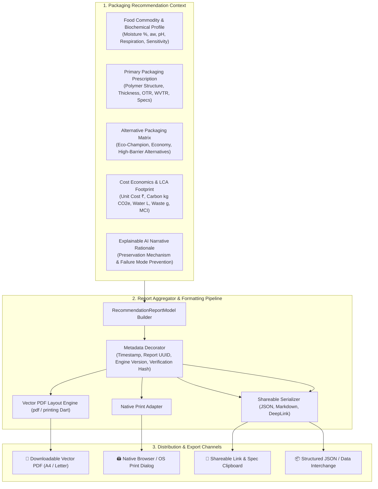

# Technical Specification: Recommendation Report & Multi-Format Export Engine (Module 12)

## 1. Executive Summary & Engineering Motivation

### 1.1 Problem Statement
In professional food manufacturing, packaging procurement, regulatory compliance, and quality assurance workflows, packaging decisions cannot remain trapped within an ephemeral web interface. Packaging engineers, brand managers, compliance officers, and procurement specialists require **formal, standardized, auditable, and shareable packaging specification reports**.

Key enterprise requirements for this reporting workflow include:
1. **Auditable Decision Traceability:** Traceable records linking the input food degradation profile ($a_w$, pH, respiration, moisture) to the prescribed barrier properties ($\text{OTR}, \text{WVTR}$) and the explainable AI rationale.
2. **Multi-Format Exportability:** Capability to generate client-side and server-side **vector-crisp PDF documents**, trigger **OS/browser native print workflows**, and provide **instant digital share links / JSON / Markdown data export**.
3. **Regulatory & Provenance Verification:** Formal watermarking with timestamp, unique Report UUID / Verification Hash, algorithm version (e.g., `SmartPack AI Engine v2.4-hybrid`), and empirical LCI dataset citations (Sphera/GaBi, PlasticsEurope, Ecoinvent).
4. **Offline & Air-Gapped Operation:** The reporting engine must support full offline vector PDF synthesis and print rendering directly within the Flutter client layer without requiring external cloud rendering dependencies.

The **Recommendation Report Module (Module 12: `12. Recommendation Report`)** defines the data architecture, PDF document layout schema, vector rendering pipeline, print orchestration, and export services.

---

### 1.2 System Architecture & Report Generation Workflow



---

## 2. Report Content Specification

The generated recommendation report encapsulates **12 structured sections** ensuring end-to-end technical completeness:

```
+==================================================================================================+
|  SMARTPACK AI — PRECISION FOOD PACKAGING PRESCRIPTION REPORT                                     |
|  Report ID: SPK-2026-9B7C12F         Date/Time: 2026-09-26 21:35 UTC        Engine: v2.4-Hybrid  |
+==================================================================================================+
| 1. COMMODITY & OPERATIONAL CONTEXT                                                               |
|    • Commodity: Roasted Organic Coffee Beans        • Fill Quantity: 500 g / pack                |
|    • Target Shelf-Life: 180 Days                    • Storage: Ambient Chilled (18°C, 55% RH)    |
|                                                                                                  |
| 2. BIOCHEMICAL DEGRADATION CHARACTERISTICS                                                       |
|    • Moisture: 2.5% | aw: 0.32 | pH: 5.1 | Fat: 14.5% | Respiration: Low | Oxygen Sensitive: HIGH  |
|                                                                                                  |
| 3. PRIMARY RECOMMENDED PACKAGING PRESCRIPTION                                                    |
|    • Material: High-Barrier EVOH Metallized Film     • Polymer Family: MULTILAYER_BARRIER_COEX   |
|    • Structure: PET 12µ / EVOH 15µ / LLDPE 50µ       • Format: Stand-up Doypack (Bottom Gusset)  |
|    • OTR: < 1.5 cc/m²/day                           • WVTR: < 0.8 g/m²/day                       |
|    • Tensile Strength: 45.0 MPa                     • Puncture Resistance: 28.0 N                |
|                                                                                                  |
| 4. EXPLAINABLE AI (XAI) SCIENTIFIC RATIONALE                                                     |
|    • Matched ultra-low OTR (<1.5) to prevent lipid oxidation of volatile coffee aromatics.        |
|    • Water vapor barrier (<0.8 WVTR) suppresses moisture re-absorption above critical aw 0.50.   |
|                                                                                                  |
| 5. MULTI-MATERIAL COMPARATIVE BENCHMARK                                                          |
|    [Alternative 1: Eco-Champion]  NatureFlex™ NK Bio-Cellulose   (100% Home Compostable, +12% Cost) |
|    [Alternative 2: Economy]       Monomaterial BOPP Barrier Film (High Recyclability, -18% Cost) |
|    [Alternative 3: Preservation]  PET/Al-Foil/PE 3-Ply Laminate  (Zero OTR/WVTR, Non-Recyclable) |
|                                                                                                  |
| 6. SUSTAINABILITY & LCA IMPACT                                                                   |
|    • Recyclability: High (RIC 5 Monomaterial)       • Carbon Footprint: 14.2 g CO2e / pack       |
|    • Circularity Index (MCI): 0.82 / 1.0            • Landfill Diversion Potential: 88%          |
|                                                                                                  |
| 7. CONVERTER COST ECONOMICS BASELINE                                                             |
|    • Unit Packaging Cost: ₹4.25 / pack              • Gross Material Mass: 12.8 g / pack         |
|    • Estimated 10k Batch Cost: ₹42,500 INR          • Scrap Allowance: 4.5%                      |
|                                                                                                  |
| 8. PROVENANCE, STANDARDS & VERIFICATION                                                          |
|    • Standards: ASTM F1927 (OTR), ASTM F1249 (WVTR), ISO 14040/44 (LCA), EN 13432 (Compostability) |
|    • Citation: Sphera GaBi Life Cycle Inventory (2023) • Verification Hash: 9f8a3c2e1b4d0e7a     |
+==================================================================================================+
```

---

## 3. Detailed Data Schemas

### 3.1 Backend Pydantic Schemas (`backend/app/schemas/recommendation_report.py`)

```python
from datetime import datetime
from typing import List, Dict, Optional, Any
from pydantic import BaseModel, Field

class ReportFoodContext(BaseModel):
    name: str = Field(..., description="Food commodity name")
    category: str = Field(..., description="Food category (e.g., Produce, Bakery, Beverages)")
    scientific_name: Optional[str] = Field(None, description="Botanical or scientific name")
    fill_quantity: str = Field(..., description="Product fill weight or volume (e.g., 500g, 1kg)")
    batch_size_units: int = Field(default=10000, description="Target production batch size")
    storage_condition: str = Field(..., description="Recommended storage condition")
    storage_temp_c: Optional[float] = Field(None, description="Storage temperature in Celsius")
    storage_duration_days: int = Field(..., description="Target shelf-life duration in days")
    transport_mode: Optional[str] = Field("Ambient Standard", description="Logistics transport mode")

class ReportFoodProperties(BaseModel):
    moisture_pct: Optional[float] = Field(None, description="Moisture percentage")
    water_activity_aw: Optional[float] = Field(None, description="Water activity aw (0.0 - 1.0)")
    ph_level: Optional[float] = Field(None, description="pH level (0.0 - 14.0)")
    fat_pct: Optional[float] = Field(None, description="Fat percentage")
    respiration_class: Optional[str] = Field(None, description="Respiration rate category")
    oxygen_sensitivity: str = Field(default="Moderate", description="Oxygen sensitivity level")
    moisture_sensitivity: str = Field(default="Moderate", description="Moisture sensitivity level")
    ethylene_sensitivity: Optional[str] = Field(None, description="Ethylene sensitivity")
    chilling_injury_threshold_c: Optional[float] = Field(None, description="Chilling injury temperature")

class ReportPrimaryPrescription(BaseModel):
    material_name: str = Field(..., description="Commercial packaging material name")
    polymer_family: str = Field(..., description="Polymer classification")
    structure: str = Field(..., description="Lamination / monolayer film structure")
    package_format: str = Field(..., description="Package format type (e.g. Stand-up Doypack)")
    dimensions: str = Field(..., description="Length x Width x Gusset dimensions in cm")
    thickness_microns: float = Field(..., description="Total barrier gauge in microns")
    otr: str = Field(..., description="Oxygen Transmission Rate with units")
    wvtr: str = Field(..., description="Water Vapor Transmission Rate with units")
    tensile_strength_mpa: float = Field(..., description="Tensile strength in MPa")
    puncture_resistance_n: float = Field(..., description="Puncture resistance in Newtons")
    suitability_score: float = Field(..., description="Overall compatibility score (0.0 - 1.0)")
    advantages: List[str] = Field(default_factory=list, description="Key operational advantages")
    limitations: List[str] = Field(default_factory=list, description="Operational boundaries")

class ReportAlternativePackaging(BaseModel):
    tier_name: str = Field(..., description="Tier name (Eco-Champion, Economy, High-Barrier)")
    material_name: str = Field(..., description="Alternative material substrate")
    key_tradeoff: str = Field(..., description="Primary comparative trade-off")
    cost_delta_pct: float = Field(..., description="Cost delta vs primary prescription (%)")
    eco_delta_pct: float = Field(..., description="Eco score delta vs primary prescription (%)")
    shelf_life_delta: str = Field(..., description="Shelf life impact description")

class ReportLcaSummary(BaseModel):
    recyclability_tier: str = Field(..., description="Recyclability classification")
    resin_identification_code: str = Field(..., description="RIC Code")
    biodegradability_standard: Optional[str] = Field(None, description="Composting standard")
    reusability_cycles: int = Field(default=1, description="Cycle durability count")
    carbon_footprint_g_per_unit: float = Field(..., description="Carbon footprint in grams CO2e")
    carbon_footprint_batch_kg: float = Field(..., description="Total batch carbon footprint in kg")
    pcr_percentage: float = Field(default=0.0, description="Post-Consumer Recycled content (%)")
    water_footprint_l_per_unit: float = Field(..., description="Freshwater footprint in Liters")
    unit_waste_grams: float = Field(..., description="Solid waste mass in grams")
    landfill_diversion_pct: float = Field(..., description="Landfill diversion potential (%)")
    circularity_index_mci: float = Field(..., description="Ellen MacArthur Circularity Index (0.0 - 1.0)")

class ReportCostSummary(BaseModel):
    estimated_cost_per_unit_inr: float = Field(..., description="Unit cost in INR")
    estimated_batch_cost_inr: float = Field(..., description="Total batch cost in INR")
    gross_material_mass_grams: float = Field(..., description="Gross film weight per pouch")
    currency: str = Field(default="INR", description="Currency symbol")

class RecommendationReportModel(BaseModel):
    report_id: str = Field(..., description="Unique report identifier (e.g. SPK-2026-9B7C12F)")
    generated_at: datetime = Field(default_factory=datetime.utcnow, description="Generation timestamp UTC")
    engine_version: str = Field(default="SmartPack AI Engine v2.4-Hybrid", description="Engine version")
    verification_hash: str = Field(..., description="SHA-256 integrity verification hash")
    food_context: ReportFoodContext
    food_properties: ReportFoodProperties
    primary_prescription: ReportPrimaryPrescription
    explainable_rationale: str
    key_drivers: List[str] = Field(default_factory=list)
    alternatives: List[ReportAlternativePackaging] = Field(default_factory=list)
    lca_summary: ReportLcaSummary
    cost_summary: ReportCostSummary
    standards_and_citations: List[str] = Field(default_factory=list)
```

---

### 3.2 Frontend Dart Models (`frontend/lib/models/recommendation_report_model.dart`)

```dart
class RecommendationReportModel {
  final String reportId;
  final DateTime generatedAt;
  final String engineVersion;
  final String verificationHash;
  final ReportFoodContext foodContext;
  final ReportFoodProperties foodProperties;
  final ReportPrimaryPrescription primaryPrescription;
  final String explainableRationale;
  final List<String> keyDrivers;
  final List<ReportAlternativePackaging> alternatives;
  final ReportLcaSummary lcaSummary;
  final ReportCostSummary costSummary;
  final List<String> standardsAndCitations;

  RecommendationReportModel({
    required this.reportId,
    required this.generatedAt,
    required this.engineVersion,
    required this.verificationHash,
    required this.foodContext,
    required this.foodProperties,
    required this.primaryPrescription,
    required this.explainableRationale,
    required this.keyDrivers,
    required this.alternatives,
    required this.lcaSummary,
    required this.costSummary,
    required this.standardsAndCitations,
  });

  factory RecommendationReportModel.fromRecommendationResult({
    required PackagingRecommendationResult result,
    required PackagingInput input,
    SustainabilityProfile? sustainabilityProfile,
    CostEstimationResponse? costResponse,
  }) {
    // Client-side synthesis aggregating live recommendation state
  }

  Map<String, dynamic> toJson();
  factory RecommendationReportModel.fromJson(Map<String, dynamic> json);
  String toMarkdownString();
}
```

---

## 4. Multi-Format Export Architecture

### 4.1 Export Channel 1: High-Fidelity Vector PDF Document (`.pdf`)
- **Rendering Technology:** Dart `pdf` and `printing` libraries (Vector canvas rendering, zero bitmap degradation).
- **Page Geometry:** Standard ISO **A4** ($210 \times 297\,\text{mm}$) and North American **Letter** ($8.5 \times 11\,\text{in}$) with dynamic pagination.
- **Visual Typography & Palette:**
  - Header: Emerald Gradient (`#064E3B` to `#0D9488`) with SmartPack AI branding.
  - Sub-headers: Charcoal Slate (`#0F172A`) and Cool Grey (`#64748B`).
  - Metric Tables: Alternating zebra rows with rounded border containers.
  - Security Watermark: Verification Hash and QR Code leading to verification deep-link.
- **Embedded Visual Assets:**
  - 3-Pillars Sustainability Badges (Recyclability, Biodegradability, Reusability).
  - 2x2 Technical Barrier Grid.
  - Alternatives Comparison Table.

### 4.2 Export Channel 2: Native Print Engine
- **Workflow:** Direct hook into `Printing.layoutPdf()` which triggers:
  - On **Web:** Native Browser Print dialog with `@media print` CSS layout optimization.
  - On **Desktop (Windows/macOS/Linux):** Operating System Print Spooler with paper tray selection.
  - On **Mobile (Android/iOS):** AirPrint / Android Print Service integration.

### 4.3 Export Channel 3: Shareable Spec & Clipboard Export
- **Clipboard Formats:**
  1. **Shareable Deep-Link URL:** Encoding serialized recommendation parameters for instant re-hydration.
  2. **Technical Markdown Spec Sheet (`.md`):** Clean, formatted Markdown table ready to paste into GitHub, Jira, Notion, or Slack.
  3. **Structured JSON Data Interchange (`.json`):** Machine-readable payload for converter ERP integration.

---

## 5. UI / UX Design & Component Hierarchy

```
+--------------------------------------------------------------------------------------------------+
|  [ < Back to Results ]                 RECOMMENDATION REPORT                       [ 🖨️ Print ] |
+--------------------------------------------------------------------------------------------------+
|                                                                                                  |
|   +------------------------------------------------------------------------------------------+   |
|   |  SMARTPACK AI — PACKAGING SPECIFICATION & LCA AUDIT REPORT                               |   |
|   |  Report ID: SPK-2026-9B7C12F  •  Date: Sep 26, 2026 21:35 UTC  •  Engine: v2.4-Hybrid    |   |
|   +------------------------------------------------------------------------------------------+   |
|                                                                                                  |
|   [ 1. Commodity Context ]                   [ 2. Food Degradation Kinetics ]                    |
|   • Product: Organic Coffee (500g)           • Moisture: 2.5%    • aw: 0.32    • pH: 5.1         |
|   • Shelf-Life: 180 Days (Ambient)           • Respiration: Low  • O2 Sensitivity: High          |
|                                                                                                  |
|   +------------------------------------------------------------------------------------------+   |
|   |  3. PRIMARY PRESCRIBED PACKAGING: High-Barrier EVOH Metallized Coex (77 µm Doypack)      |   |
|   |  • OTR: < 1.5 cc/m²/day  • WVTR: < 0.8 g/m²/day  • Tensile: 45.0 MPa  • Puncture: 28.0 N |   |
|   +------------------------------------------------------------------------------------------+   |
|                                                                                                  |
|   [ 4. Explainable AI Rationale & Failure Mode Prevention ]                                      |
|   "Matched ultra-low OTR (<1.5) to prevent lipid oxidation of volatile coffee aromatics..."      |
|                                                                                                  |
|   [ 5. 3-Way Alternative Benchmark ]                                                             |
|   +--------------------------+------------------------------+--------------------------------+   |
|   | Eco-Champion Alternative | NatureFlex™ Bio-Cellulose    | 100% Home Compostable (+12% ₹) |   |
|   | Economy Baseline Option  | Monomaterial BOPP Film       | High Recyclability (-18% ₹)    |   |
|   | High-Barrier Retort      | PET / Al-Foil / PE Laminate  | Absolute Zero Barrier (No Rec) |   |
|   +--------------------------+------------------------------+--------------------------------+   |
|                                                                                                  |
|   [ 6. Sustainability Profile ]              [ 7. Converter Cost Baseline ]                      |
|   • ♻ Recyclability: High (RIC 5)             • Unit Cost: ₹4.25 INR / pack                      |
|   • 🌱 Biodegradability: Industrial Compost   • 10k Batch Cost: ₹42,500 INR                      |
|   • Carbon Footprint: 14.2 g CO2e / pack     • Gross Film Weight: 12.8 g / pack                 |
|                                                                                                  |
|   +------------------------------------------------------------------------------------------+   |
|   |  [ 📄 Download Vector PDF ]   [ 🖨️ Print Report ]   [ 🔗 Copy Share Link ]   [ 📋 JSON ]   |   |
|   +------------------------------------------------------------------------------------------+   |
+--------------------------------------------------------------------------------------------------+
```

---

## 6. REST API Endpoints (`/api/v1/reports`)

| HTTP Method | Route | Description | Request Payload | Response Model |
| :--- | :--- | :--- | :--- | :--- |
| `POST` | `/api/v1/reports/generate` | Synthesize complete structured report payload | `PackagingInput` + `recommendation_id` | `RecommendationReportModel` |
| `GET` | `/api/v1/reports/{report_id}` | Retrieve previously generated report by UUID | Path param `report_id` | `RecommendationReportModel` |
| `POST` | `/api/v1/reports/pdf` | Generate server-side binary PDF document | `RecommendationReportModel` | `application/pdf` binary stream |
| `POST` | `/api/v1/reports/markdown` | Generate exportable Markdown spec document | `RecommendationReportModel` | `{"markdown": "..."}` |

---

## 7. Quality Assurance & Multi-Viewport Verification Strategy

1. **Unit & Mathematical Verification:**
   - Verify report aggregation preserves 100% numerical parity with live recommendation calculations (costs, carbon numbers, barrier specs).
   - Test JSON & Markdown serializers for complete schema compliance.
2. **PDF Vector Output Verification:**
   - Assert PDF document builds without font rendering errors, text clipping, or unhandled image assets.
   - Verify pagination bounds (ensuring 1-page compact summary or 2-page detailed technical specification).
3. **Multi-Viewport & Responsive Layout Audits:**
   - Verify report preview screen across **Mobile** ($375 \times 812$), **Tablet** ($768 \times 1024$), and **Desktop** ($1440 \times 900$) viewports with 0 `RenderFlex` overflow errors.
4. **Offline Resilience:**
   - Verify report generation, PDF compilation, printing, and Markdown copying operate cleanly when disconnected from backend network.

---

## 8. Implementation Roadmap & Milestones

- **Phase 1: Backend Report Schemas & REST Endpoints** (`backend/app/schemas/recommendation_report.py`, `backend/app/api/v1/endpoints/reports.py`).
- **Phase 2: Frontend Data Models & Aggregation Engine** (`frontend/lib/models/recommendation_report_model.dart`, `frontend/lib/services/report_generator_service.dart`).
- **Phase 3: Vector PDF Generation Engine & Document Layout** (`frontend/lib/services/pdf_report_builder.dart`).
- **Phase 4: Interactive Report Viewer & Action Toolbar** (`frontend/lib/screens/reports/recommendation_report_screen.dart`).
- **Phase 5: Navigation Deep-Linking & Action Bar Integration** (Wire `[ 📄 Export Report ]` button in `RecommendationResultsCockpit`, `HistoryScreen`, and `HomePage`).
- **Phase 6: Multi-Viewport Audits, PDF Verification & Full Regression**.
