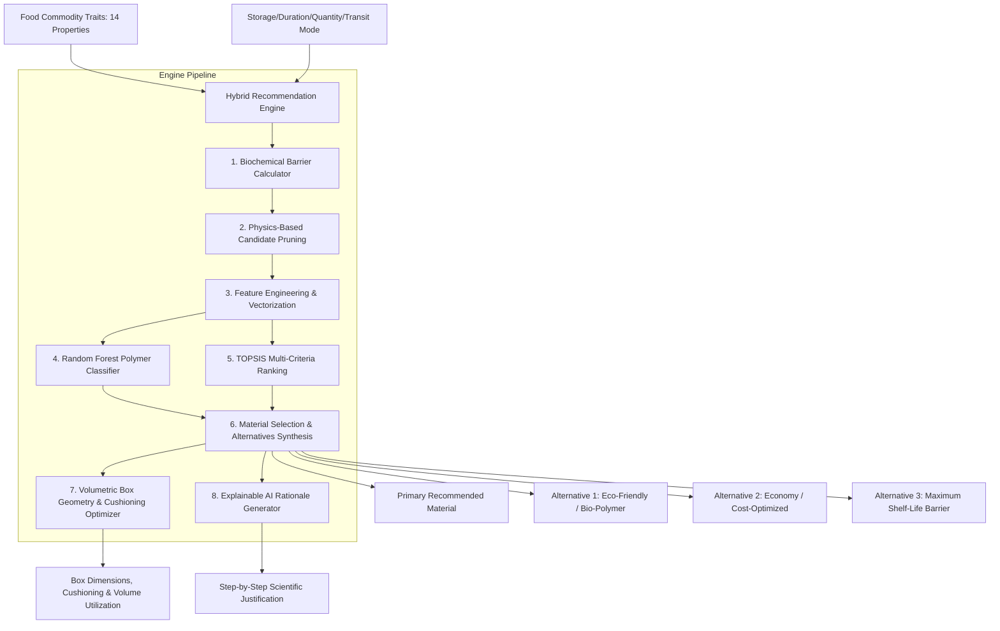

# Technical Specification: AI/ML Recommendation Engine (Module 5)

## 1. Overview & Objectives

### 1.1 Purpose
The **AI/ML Recommendation Engine** is the central intelligence and decision-support layer of SmartPack AI. It correlates 14 empirical food biochemical and physiological properties (Moisture %, Fat %, pH, Respiration Kinetics at $5^\circ\text{C}/20^\circ\text{C}$, $O_2/CO_2$ Sensitivities, Ethylene Dynamics, Thermal Thresholds $T_{ci}/T_f$, Fragility) with target logistics constraints (Storage Temperature, Duration, Batch Quantity, Transport Mode) to prescribe the optimal sustainable packaging material, volumetric dimensions, barrier specifications, and active packaging countermeasures.

### 1.2 Core Architectural Principle: Hybrid Food Science + ML Ensemble
For academic rigor and industrial packaging integrity, SmartPack AI implements a **Two-Stage Hybrid Decision Pipeline**:
1. **Stage 1 (Deterministic Food Science Rules & Physics Filter):** Applies empirical mass transfer and postharvest boundary inequalities ($OTR$, $WVTR$, chilling injury floor, ethylene scrubbing thresholds, respiration gas equilibrium) to eliminate biophysically invalid materials and establish hard baseline constraints.
2. **Stage 2 (Machine Learning Ensemble & Multi-Criteria Decision Making - MCDM):** Uses a trained **Random Forest / Gradient Boosted Decision Forest Classifier** combined with a **TOPSIS (Technique for Order Preference by Similarity to Ideal Solution)** utility engine to score, rank, and optimize candidates across multi-objective trade-offs (Barrier Match 35%, Shelf-Life Horizon 25%, Sustainability Index 20%, Cost Efficiency 10%, Mechanical Puncture Buffer 10%).

```
┌────────────────────────────────────────────────────────────────────────┐
│                      HYBRID RECOMMENDATION PIPELINE                    │
│                                                                        │
│   [ 14 Food Scientific Properties ] + [ Storage/Logistics Parameters ] │
│                                  │                                     │
│                                  ▼                                     │
│   ┌────────────────────────────────────────────────────────────────┐   │
│   │ Stage 1: Deterministic Food Science Rules & Physics Filter     │   │
│   │  • Fickian Gas Diffusion & Barrier Inequalities (OTR/WVTR)     │   │
│   │  • Respiration Equilibrium & Perforation Mandates (EMAP)       │   │
│   │  • Chilling Floor (T < T_ci) & Cryogenic Deep-Freeze Checks    │   │
│   │  • Ethylene & Active Scavenger Directives                      │   │
│   └────────────────────────────────┬───────────────────────────────┘   │
│                                    │ Validated Candidate Space         │
│                                    ▼                                   │
│   ┌────────────────────────────────────────────────────────────────┐   │
│   │ Stage 2: ML Classifier & Multi-Criteria Ranking (TOPSIS)       │   │
│   │  • Random Forest Feature Importance & Polymer Classification   │   │
│   │  • Multi-Objective TOPSIS Utility Function                     │   │
│   │  • Trade-off Optimization (Barrier vs Eco vs Cost vs Strength) │   │
│   └────────────────────────────────┬───────────────────────────────┘   │
│                                    │                                   │
│                                    ▼                                   │
│   ┌────────────────────────────────────────────────────────────────┐   │
│   │ Stage 3: Explainable AI (XAI) & Synthesis Engine               │   │
│   │  • Primary Packaging Material + Quantitative Barrier Profile   │   │
│   │  • 3 Tailored Alternatives (Eco-Option, Economy, High-Barrier) │   │
│   │  • Step-by-Step Natural Language Scientific Rationale          │   │
│   │  • Box Geometry (L x W x H), Cushioning & Space Utilization    │   │
│   └────────────────────────────────────────────────────────────────┘   │
└────────────────────────────────────────────────────────────────────────┘
```

---

## 2. System Architecture & Pipeline Flow

### 2.1 End-to-End Component Flow



### 2.2 Recommendation Output Structure
The engine produces a structured multi-dimensional recommendation payload:
1. **Primary Recommendation:** The highest-scoring hybrid material matching the user's operational constraints and sustainability preferences.
2. **Alternative Options (3 Distinct Profiles):**
   - **Eco-Friendly Champion:** Maximizes biodegradable/compostable polymer content (PLA, PBAT, Cellulose, Unbleached Kraft) with highest sustainability score ($\ge 90$).
   - **Economy Option:** Minimizes unit packaging cost while strictly satisfying the minimum physical barrier requirements.
   - **High-Barrier Preservation Option:** Maximizes shelf-life durability using ultra-low OTR/WVTR laminates (EVOH, Al-Foil, Metallized films).
3. **Physical & Volumetric Specifications:**
   - Polymer film thickness ($\mu m$), tensile strength ($MPa$), puncture resistance ($N$), and temperature tolerance ($^\circ\text{C}$).
   - Box geometry: Outer dimensions ($L \times W \times H$ in $cm$), volume ($cm^3$), and space utilization $\%$.
   - Cushioning material & active packaging inclusions ($\text{KMnO}_4$ ethylene scrubber, $O_2$ scavenger, anti-fog surfactant).
4. **Explainable AI (XAI) Natural Language Rationale:** Clear, transparent technical reasoning breaking down why the material was selected based on specific biochemical triggers.

---

## 3. Mathematical Formulations & ML Algorithms

### 3.1 Stage 1: Deterministic Food Science Barrier Formulations

#### 1. Oxygen Transmission Rate ($OTR$) Boundary Constraint:
For oxygen-sensitive items (high fat $\%$, enzymatic browning, aerobic spoilage):
$$OTR_{max} = \frac{\Delta [O_2]_{tolerated} \cdot V_{headspace}}{A_{surface} \cdot t_{duration} \cdot \Delta p_{O_2}}$$
- High-fat commodities ($\text{Fat} \ge 18\%$ or $O_2\text{ Sensitivity} \in [\text{HIGH}, \text{CRITICAL}]$): Mandates $OTR \le 1.5\,\text{cc}/\text{m}^2/\text{day}/\text{atm}$.
- Highly respiring produce ($R_{20} \ge 30\,\text{mg}\,\text{CO}_2/\text{kg}/\text{h}$): Eliminates hermetic non-breathable films to prevent anaerobic fermentation ($OTR \ge 1000\,\text{cc}/\text{m}^2/\text{day}/\text{atm}$ or micro-perforations).

#### 2. Water Vapor Transmission Rate ($WVTR$) Boundary Constraint:
Based on Fick's first law of diffusion across polymer membranes:
$$WVTR_{max} = \frac{\Delta m_{moisture\_loss\_max}}{A_{surface} \cdot t_{duration}}$$
- High moisture produce ($\text{Moisture} \ge 85\%$): Mandates $WVTR \le 15.0\,\text{g}/\text{m}^2/\text{day}$ with anti-fog surfactant to prevent condensation mold.
- Hygroscopic dry matrices ($\text{Moisture} \le 5\%$): Mandates ultra-low $WVTR \le 0.8\,\text{g}/\text{m}^2/\text{day}$ to prevent caking and crispness loss.

#### 3. Chilling Floor & Deep Freeze Safety Constraint:
- If $T_{storage} < T_{ci}$ (Chilling Injury threshold): Injects thermal insulated lining and generates critical storage alert.
- If $T_{storage} \le -15^\circ\text{C}$ (Deep Freeze): Filters for polymers with $T_{min} \le -20^\circ\text{C}$ (Cryogenic LLDPE/Cast Polyamide) to prevent cold embrittlement and cracking.

---

### 3.2 Stage 2: Machine Learning & MCDM Scoring (TOPSIS)

#### 1. Random Forest Polymer Classifier:
A trained ensemble classifier (`RandomForestClassifier`) maps the 18-feature input vector:
$$\mathbf{x} = [\text{Moisture}\%, \text{Fat}\%, \text{pH}, a_w, R_5, R_{20}, \text{Ethylene}, T_{ci}, T_{storage}, t_{days}, \text{Mass}_{kg}, \dots]$$
to the optimal polymer category probabilities:
$$P(\text{Polymer Class} \mid \mathbf{x}) = \frac{1}{N_{trees}} \sum_{t=1}^{N_{trees}} T_t(\mathbf{x})$$

#### 2. Multi-Criteria TOPSIS Utility Function:
For candidate material $i \in \{1, \dots, M\}$ across criteria $j \in \{\text{Barrier}, \text{ShelfLife}, \text{Eco}, \text{Cost}, \text{Strength}\}$:
1. Normalize decision matrix:
   $$r_{ij} = \frac{x_{ij}}{\sqrt{\sum_{k=1}^M x_{kj}^2}}$$
2. Calculate weighted normalized values:
   $$v_{ij} = w_j \cdot r_{ij}, \quad \sum w_j = 1.0$$
   *Weight vector:* $w_{barrier} = 0.35, \, w_{shelflife} = 0.25, \, w_{eco} = 0.20, \, w_{cost} = 0.10, \, w_{strength} = 0.10$.
3. Compute distance to Ideal Solution ($A^+$) and Negative-Ideal Solution ($A^-$):
   $$S_i^+ = \sqrt{\sum (v_{ij} - v_j^+)^2}, \quad S_i^- = \sqrt{\sum (v_{ij} - v_j^-)^2}$$
4. Calculate Relative Closeness / Hybrid Fitness Index:
   $$C_i = \frac{S_i^-}{S_i^+ + S_i^-} \in [0.0, 1.0]$$
The material with the highest $C_i$ becomes the **Primary Recommendation**.

---

### 3.3 Stage 3: Volumetric Box Geometry & Cushioning Optimization

#### 1. Volume & Dimension Allocation:
Given batch mass $M_{kg}$ and commodity bulk density $\rho_{bulk}$ ($\text{kg}/\text{m}^3$):
$$V_{net} = \frac{M_{kg}}{\rho_{bulk}} \times 1000 \quad (\text{cm}^3)$$
Gross required box volume with safety buffer ($k_{buffer} = 1.25$ for standard, $1.45$ for fragile):
$$V_{gross} = V_{net} \times k_{buffer}$$
Golden ratio dimensional synthesis ($L : W : H = 1.618 : 1.0 : 0.8$):
$$W = \sqrt[3]{\frac{V_{gross}}{1.618 \times 0.8}}, \quad L = 1.618 \cdot W, \quad H = 0.8 \cdot W$$

#### 2. Space Utilization Efficiency:
$$\text{Utilization } \% = \left(\frac{V_{net}}{L \times W \times H}\right) \times 100$$

#### 3. Eco-Friendly Cushioning Matrix:
| Commodity Fragility | Cold Chain Required | Standard Cushioning | Eco-Friendly Alternative |
| :--- | :--- | :--- | :--- |
| **Fragile / High Bruising** | No | Inflatable Air Cushion Pillows | Honeycomb Kraft Paper + Cornstarch Peanuts |
| **Fragile / High Bruising** | Yes ($4^\circ\text{C} / -18^\circ\text{C}$) | Insulated Bubble Foil + Ice Pack | Recycled Kraft Insulated Pouch + Cold Gel Pack |
| **Robust / Low Fragility** | No | Standard EPE Foam Buffering | Recycled Shredded Kraft Paper |
| **Robust / Low Fragility** | Yes | EPS Styrofoam Box | Molded Pulp Insulated Box Liner |

---

## 4. API & Data Schema Specifications

### 4.1 REST API Endpoint: `POST /api/v1/packaging/recommend`

#### Request Payload:
```json
{
  "food_id": 1,
  "food_name": "Fresh Tomato",
  "category": "Vegetables",
  "quantity": 5.0,
  "unit": "kg",
  "storage_condition": "refrigerated",
  "duration": 21,
  "duration_unit": "days",
  "transport_mode": "reefer_truck",
  "is_fragile": true,
  "eco_friendly_priority": true,
  "custom_overrides": {
    "moisture_pct": 94.5,
    "fat_pct": 0.2,
    "ph": 4.4,
    "respiration_class": "High"
  }
}
```

#### Response Payload:
```json
{
  "recommendation_id": "rec_8f3a9b21",
  "primary_recommendation": {
    "material_name": "Micro-Perforated Equilibrium MAP Bio-Film (PLA/PBAT)",
    "material_type": "Biodegradable Bio-Polymer",
    "barrier_profile": {
      "otr": "1800 cc/m²/day",
      "wvtr": "8.5 g/m²/day",
      "thickness_microns": 30.0,
      "tensile_strength_mpa": 32.0,
      "puncture_resistance_n": 18.0
    },
    "sustainability_score": 94.0,
    "estimated_unit_cost_inr": 3.85,
    "suitability_score": 0.96,
    "active_additives": [
      "Potassium Permanganate (KMnO₄) Ethylene Scavenger Sachet",
      "Antifog Surface Surfactant Coating"
    ]
  },
  "alternatives": [
    {
      "type": "ECO_FRIENDLY",
      "material_name": "Cellulose-Based Breathable Bio-Film (NatureFlex)",
      "sustainability_score": 98.0,
      "estimated_unit_cost_inr": 4.50,
      "trade_off_summary": "100% Home compostable with excellent transparency; +15% cost premium."
    },
    {
      "type": "ECONOMY",
      "material_name": "Perforated Low-Density Polyethylene (LDPE)",
      "sustainability_score": 62.0,
      "estimated_unit_cost_inr": 1.95,
      "trade_off_summary": "Lowest cost per unit; recyclable in standard municipal streams."
    },
    {
      "type": "HIGH_BARRIER",
      "material_name": "Polypropylene Macro-Vented Anti-Fog Clamshell",
      "sustainability_score": 70.0,
      "estimated_unit_cost_inr": 5.20,
      "trade_off_summary": "Maximum mechanical crush protection for long-distance export logistics."
    }
  ],
  "box_geometry": {
    "length_cm": 28.5,
    "width_cm": 17.6,
    "height_cm": 14.1,
    "total_volume_cm3": 7072.0,
    "space_utilization_pct": 78.5,
    "cushioning_material": "Recycled Kraft Thermal Insulated Pouch + Cold Gel Pack"
  },
  "scientific_rationale": {
    "summary": "Fresh Tomato requires Equilibrium Modified Atmosphere (EMAP) with active ethylene scrubbing and chilling safeguards.",
    "key_drivers": [
      "High respiration rate (45.0 mg CO₂/kg/h) requires gas-permeable micro-perforations to prevent anaerobic souring.",
      "High moisture content (94.5%) requires anti-fog surfactant to prevent internal condensation droplets.",
      "Ethylene sensitivity requires active KMnO₄ scrubber to prevent premature tissue softening.",
      "Refrigeration below 10°C triggers chilling injury warning."
    ]
  }
}
```

---

## 5. Frontend Visual Comparison & Interactive UX

### 5.1 UI Component Architecture

```
┌────────────────────────────────────────────────────────────────────────┐
│ RECOMMENDATION RESULTS COCKPIT                                         │
├────────────────────────────────────────────────────────────────────────┤
│ [ HERO PRIMARY RECOMMENDATION CARD ]                                   │
│ ┌────────────────────────────────────────────────────────────────────┐ │
│ │ Micro-Perforated Equilibrium MAP Bio-Film (PLA/PBAT)               │ │
│ │ Match Score: 96% • Eco-Score: 94/100 • Cost: ₹3.85 / unit          │ │
│ │ OTR: 1800 cc/m²/day  |  WVTR: 8.5 g/m²/day  |  Thickness: 30 µm    │ │
│ │ Inclusions: [KMnO₄ Ethylene Scavenger] [Anti-Fog Coating]          │ │
│ └────────────────────────────────────────────────────────────────────┘ │
│                                                                        │
│ [ ALTERNATIVE MATERIALS COMPARISON MATRIX ]                            │
│ ┌──────────────────────┬──────────────────────┬──────────────────────┐ │
│ │ 🌿 Eco-Champion      │ 💰 Economy Option    │ 🛡️ High-Barrier      │ │
│ │ Cellulose NatureFlex │ Perforated LDPE      │ PP Rigid Clamshell   │ │
│ │ Eco-Score: 98/100    │ Eco-Score: 62/100    │ Eco-Score: 70/100    │ │
│ │ ₹4.50 (+15% cost)    │ ₹1.95 (-50% cost)    │ ₹5.20 (Max Crush P.) │ │
│ └──────────────────────┴──────────────────────┴──────────────────────┘ │
│                                                                        │
│ [ 2-COLUMN BOTTOM GRID ]                                               │
│ ┌──────────────────────────────────┬─────────────────────────────────┐ │
│ │ 📦 Box Geometry & Cushioning     │ 🧠 Explainable AI Rationale     │ │
│ │ Dimensions: 28.5 x 17.6 x 14.1cm │ • High respiration (45 mg/kg/h) │ │
│ │ Volume: 7,072 cm³ (78.5% Space)  │ • 94.5% Moisture requires anti- │ │
│ │ Cushioning: Recycled Kraft Pouch │   fog to suppress grey mold     │ │
│ └──────────────────────────────────┴─────────────────────────────────┘ │
└────────────────────────────────────────────────────────────────────────┘
```

---

## 6. Implementation Modules & Phased Rollout

### Phase 1: Machine Learning & Hybrid Scoring Service (Backend)
- Implement `MLPackagingClassifier` and `HybridRecommendationService` in `backend/app/services/hybrid_recommender.py`.
- Integrate Random Forest feature vectorization and TOPSIS multi-criteria ranking algorithm.
- Write unit tests in `backend/tests/test_hybrid_recommendation_engine.py` validating scoring accuracy against benchmark commodities.

### Phase 2: Volumetric Geometry & XAI Synthesis (Backend)
- Implement dimensional box optimizer and natural language scientific rationale generator in `backend/app/services/geometry_and_xai.py`.
- Enhance `POST /api/v1/packaging/recommend` in `backend/app/api/v1/endpoints/packaging.py` to return the complete hybrid payload with 3 distinct alternatives and XAI rationale.
- Verify with endpoint integration tests in `backend/tests/test_recommendation_endpoints.py`.

### Phase 3: Frontend Data Models & ApiService Integration (Frontend)
- Update Dart models in `frontend/lib/models/packaging_model.dart` to support multi-material alternatives, barrier profiles, XAI rationales, and dimensional metrics.
- Extend `frontend/lib/services/api_service.dart` with offline fallback synthesis for instant zero-latency responses.
- Write unit tests in `frontend/test/models/packaging_model_test.dart` and `frontend/test/services/recommendation_api_test.dart`.

### Phase 4: Modular Visual Result & Comparison Widgets (Frontend)
- Create `PrimaryRecommendationCard` (`frontend/lib/screens/analysis/widgets/primary_recommendation_card.dart`).
- Create `AlternativeMaterialsMatrix` (`frontend/lib/screens/analysis/widgets/alternative_materials_matrix.dart`).
- Create `BoxGeometryCard` (`frontend/lib/screens/analysis/widgets/box_geometry_card.dart`).
- Create `ExplainableAiRationaleCard` (`frontend/lib/screens/analysis/widgets/explainable_ai_rationale_card.dart`).
- Write widget unit tests in `frontend/test/analysis/widgets/recommendation_widgets_test.dart`.

### Phase 5: Master Screen Integration & Multi-Viewport Verification
- Embed complete recommendation cockpit into `FoodAnalysisScreen` upon calculation completion.
- Execute automated multi-viewport layout audit across Mobile ($375\times812$), Tablet ($768\times1024$), and Desktop ($1280\times900$) viewports.
- Update project documentation and `README.md`.

---

## 7. Verification & Quality Assurance Plan

### 7.1 Accuracy Benchmark Test Matrix
| Commodity Input | Expected Primary Polymer | Critical Inclusions | Key Reason |
| :--- | :--- | :--- | :--- |
| **Fresh Tomato** (Vegetable, 94.5% Moisture, 45 mg CO₂) | `Micro-Perforated MAP Bio-Film (PLA/PBAT)` | KMnO₄ Scavenger, Anti-Fog | High respiration + ethylene sensitivity + moisture loss |
| **Potato Chips** (Snack, 35% Fat, 1.8% Moisture) | `Metallized Bio-PET / BOPP with N₂ Flush` | Nitrogen Flush ($O_2 < 1\%$) | Lipid oxidation + hygroscopic moisture caking |
| **Fresh Chicken Breast** (Meat, 74% Moisture, High Protein) | `High-Barrier EVOH Vacuum Skin Film (VSP)` | Cold Chain Integrity ($4^\circ\text{C}$) | Aerobic bacterial proliferation + anaerobic juice loss |
| **Basmati Rice** (Grain, 12% Moisture, 365d Shelf Life) | `Unbleached Kraft with PLA Moisture Liner` | Weevil Resistance | Bulk ambient storage + moisture pickup protection |

---

## 8. Summary of Deliverables

| Deliverable | Path | Description |
| :--- | :--- | :--- |
| **Technical Spec** | `artifacts/specs/feature-Recommendation Engine.md` | Comprehensive architectural and algorithmic specification. |
| **Implementation Plan** | `artifacts/specs/feature-Recommendation Engine-plan.md` | Step-by-step implementation plan with explicit checkpoints. |
| **Hybrid ML Engine** | `backend/app/services/hybrid_recommender.py` | Stage 1 Physics Rules + Stage 2 TOPSIS & ML scoring. |
| **Geometry & XAI** | `backend/app/services/geometry_and_xai.py` | Dimensional box optimization and explainable AI generator. |
| **API Endpoints** | `backend/app/api/v1/endpoints/packaging.py` | Full REST API payload serving primary + 3 alternatives + XAI. |
| **Frontend Models & API**| `frontend/lib/models/packaging_model.dart` | Immutable models with alternatives & XAI parsing. |
| **Comparison Widgets** | `frontend/lib/screens/analysis/widgets/*` | Primary card, alternative matrix, box geometry & XAI cards. |
| **Test Suites** | `backend/tests/*` & `frontend/test/*` | Unit, integration, benchmark, and multi-viewport test suites. |
