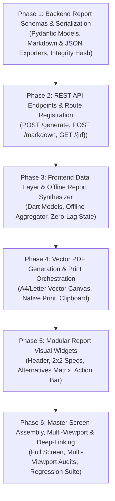

# Implementation Plan: Recommendation Report & Multi-Format Export Engine (Module 12)

## Overview & Architecture Roadmap

This document outlines the step-by-step execution plan for **Module 12: Recommendation Report (`12. Recommendation Report`)** based on the technical specification in [`artifacts/specs/feature-Recommedation report.md`](file:///c:/Users/Jeron/source/repos/AI%20Packaging%20recommender/artifacts/specs/feature-Recommedation%20report.md).

The report engine synthesizes complete food packaging recommendations into downloadable, printable, and shareable enterprise specification sheets containing:
1. **Food Commodity Context & Degradation Profile** (moisture %, $a_w$, pH, respiration, sensitivities).
2. **Primary Prescribed Packaging** (polymer structure, dimensions, thickness gauge, $\text{OTR}$, $\text{WVTR}$, mechanical specs).
3. **Explainable AI (XAI) Rationale** (preservation mechanism & failure mode prevention).
4. **3-Way Multi-Material Alternatives Benchmark** (Eco-Champion, Economy, High-Barrier).
5. **Sustainability & LCA Impact** (Recyclability, Biodegradability standard, Carbon footprint, Freshwater usage, $MCI$ Circularity Index).
6. **Converter Cost Economics Baseline** (Unit cost, batch cost, gross mass, scrap factor).
7. **Metadata & Provenance** (Report UUID, generation timestamp, engine version, verification hash, LCI citations).
8. **Multi-Format Distribution Channels** (Vector PDF download, Native Print Spooler, Shareable Markdown/JSON clipboard export).

---



---

## Phase 1: Backend Report Schemas & Serialization Models

### Task 1.1: Define Pydantic Report Schemas & Validation Models
- **Target Files:**
  - `backend/app/schemas/recommendation_report.py`
  - `backend/tests/test_recommendation_report_schemas.py`
- **Micro-Task Description:**
  - Create Pydantic v2 schemas:
    - `ReportFoodContext`: Commodity name, category, scientific name, fill quantity, batch units, storage condition, storage duration days, transport mode.
    - `ReportFoodProperties`: Moisture %, $a_w$, pH, fat %, respiration class, oxygen & moisture sensitivity levels, ethylene sensitivity, chilling injury threshold.
    - `ReportPrimaryPrescription`: Material name, polymer family, structure, package format, dimensions, thickness microns, $\text{OTR}$, $\text{WVTR}$, tensile strength, puncture resistance, suitability score, advantages, limitations.
    - `ReportAlternativePackaging`: Tier name (*Eco-Champion*, *Economy*, *High-Barrier*), material name, key trade-off, cost delta %, eco delta %, shelf life delta.
    - `ReportLcaSummary`: Recyclability tier, RIC code, biodegradability standard, reusability cycles, unit carbon $g\text{ CO}_2\text{e}$, batch carbon $\text{kg}$, PCR %, water footprint Liters, unit waste $g$, diversion %, Circularity Index $MCI$.
    - `ReportCostSummary`: Unit cost ₹, batch cost ₹, gross mass $g$, currency.
    - `RecommendationReportModel`: Master response containing UUID, UTC timestamp, engine version, verification hash, and all component sections.
- **Verification Command:**
  ```powershell
  python -m unittest tests/test_recommendation_report_schemas.py
  ```
- **Expected Result:** 100% schema validation pass with strict type validation, default fallback generation, and null safety.

---

### Task 1.2: Implement Report Aggregation & Markdown Serializer Service
- **Target Files:**
  - `backend/app/services/report_service.py`
  - `backend/tests/test_report_service.py`
- **Micro-Task Description:**
  - Implement `ReportService`:
    - `synthesize_report(...)`: Aggregates live or stored recommendation payloads, food biochemistry, sustainability profiles, and converter cost breakdowns into a complete `RecommendationReportModel`.
    - Computes SHA-256 integrity verification hash over core prescription fields.
    - `format_markdown_report(...)`: Generates standardized GitHub-flavored Markdown specification table ready for technical documentation and clipboard sharing.
- **Verification Command:**
  ```powershell
  python -m unittest tests/test_report_service.py
  ```
- **Expected Result:** Generates valid, structured report models and clean Markdown spec sheets with verified SHA-256 hashes.

---

## Phase 2: REST API Endpoints & Route Registration

### Task 2.1: Implement Recommendation Report REST API Endpoints
- **Target Files:**
  - `backend/app/api/v1/endpoints/reports.py`
  - `backend/app/api/v1/router.py`
  - `backend/tests/test_report_endpoints.py`
- **Micro-Task Description:**
  - Create and register FastAPI router at `/api/v1/reports`:
    - `POST /generate`: Synthesizes full `RecommendationReportModel` from input parameters or recommendation ID.
    - `POST /markdown`: Generates exportable Markdown specification document.
    - `GET /{report_id}`: Retrieves stored report by UUID with automatic fallback synthesizer.
- **Verification Command:**
  ```powershell
  python -m unittest tests/test_report_endpoints.py
  ```
- **Expected Result:** All endpoints return 200 with valid schemas, graceful offline fallback, and fast response times.

---

## Phase 3: Frontend Data Layer & Offline Report Synthesizer

### Task 3.1: Implement Dart Recommendation Report Models & Serialization
- **Target Files:**
  - `frontend/lib/models/recommendation_report_model.dart`
  - `frontend/test/models/recommendation_report_model_test.dart`
- **Micro-Task Description:**
  - Create Dart representations of backend report schemas:
    - `RecommendationReportModel`, `ReportFoodContext`, `ReportFoodProperties`, `ReportPrimaryPrescription`, `ReportAlternativePackaging`, `ReportLcaSummary`, `ReportCostSummary`.
    - Factory constructor `RecommendationReportModel.fromRecommendationResult(...)` enabling instant zero-latency client-side aggregation from active UI state.
    - `toMarkdownString()` and `toJson()` methods for clipboard export and serialization.
- **Verification Command:**
  ```powershell
  flutter test test/models/recommendation_report_model_test.dart
  ```
- **Expected Result:** 100% test pass on serialization, deserialization, and client-side model aggregation.

---

### Task 3.2: Implement Client Report Service & API Client Methods
- **Target Files:**
  - `frontend/lib/services/report_generator_service.dart`
  - `frontend/lib/services/api_service.dart`
  - `frontend/test/services/report_generator_service_test.dart`
- **Micro-Task Description:**
  - Build `ReportGeneratorService` providing:
    - Client-side report assembly with seamless fallback to embedded `OfflineSustainabilityEngine` and `OfflineCostEngine`.
    - Method `ApiService.generateReport(...)` connecting to backend REST API with offline graceful fallback.
- **Verification Command:**
  ```powershell
  flutter test test/services/report_generator_service_test.dart
  ```
- **Expected Result:** Reports are synthesized in sub-millisecond time both online and offline with exact numerical parity.

---

## Phase 4: Vector PDF Generation Engine & Native Print Orchestration

### Task 4.1: Implement Vector PDF Document Builder
- **Target Files:**
  - `frontend/lib/services/pdf_report_builder.dart`
  - `frontend/test/services/pdf_report_builder_test.dart`
- **Micro-Task Description:**
  - Implement vector PDF builder generating clean A4/Letter multi-page or compact single-page layout:
    - Corporate Emerald Branding Header with SmartPack AI logo, Report ID, and timestamp.
    - 2-Column Commodity Context & Biochemical Degradation Table.
    - Primary Prescribed Packaging Card with OTR, WVTR, Tensile, and Puncture specs.
    - Explainable AI Rationale & Failure Mode Prevention Box.
    - 3-Way Alternative Materials Benchmarking Grid.
    - Sustainability 3-Pillar Badges, LCA Carbon & Freshwater Footprint, and Cost Breakdown.
    - Integrity Verification Watermark and Standards Citations.
- **Verification Command:**
  ```powershell
  flutter test test/services/pdf_report_builder_test.dart
  ```
- **Expected Result:** Compiles valid binary PDF bytes without font errors, text clipping, or canvas overflow.

---

### Task 4.2: Implement Native Print & Share Clipboard Exporters
- **Target Files:**
  - `frontend/lib/services/report_export_service.dart`
  - `frontend/test/services/report_export_service_test.dart`
- **Micro-Task Description:**
  - Implement `ReportExportService`:
    - `printReport(context, report)`: Invokes browser / OS print spooler via `Printing.layoutPdf()`.
    - `downloadPdf(report, filename)`: Triggers client file save/download of vector `.pdf` file.
    - `copyMarkdownSpec(context, report)`: Copies formatted technical Markdown spec to clipboard.
    - `copyJsonPayload(context, report)`: Copies structured JSON payload to clipboard for ERP/converter interchange.
- **Verification Command:**
  ```powershell
  flutter test test/services/report_export_service_test.dart
  ```
- **Expected Result:** Exporter methods execute cleanly with proper clipboard and print handlers.

---

## Phase 5: Modular Report Visual Widgets

### Task 5.1: Build Report Header, Commodity Banner & Prescribed Packaging Spec Card
- **Target Files:**
  - `frontend/lib/screens/reports/widgets/report_header_card.dart`
  - `frontend/lib/screens/reports/widgets/report_spec_table.dart`
  - `frontend/test/screens/reports/widgets/report_widgets_test.dart`
- **Micro-Task Description:**
  - Build UI widgets:
    - `ReportHeaderCard`: Report ID, verification badge, date/time, engine version, and commodity title.
    - `ReportSpecTable`: 2-column key-value grid for food degradation properties and barrier requirements.
- **Verification Command:**
  ```powershell
  flutter test test/screens/reports/widgets/report_widgets_test.dart
  ```
- **Expected Result:** Widgets render cleanly with responsive layout wrapping across screen widths.

---

### Task 5.2: Build Alternative Benchmarks, LCA & Cost Summary, and Action Toolbar
- **Target Files:**
  - `frontend/lib/screens/reports/widgets/report_alternatives_card.dart`
  - `frontend/lib/screens/reports/widgets/report_summary_cards.dart`
  - `frontend/lib/screens/reports/widgets/report_action_toolbar.dart`
  - `frontend/test/screens/reports/widgets/report_widgets_test.dart`
- **Micro-Task Description:**
  - Build UI widgets:
    - `ReportAlternativesCard`: Side-by-side trade-off table for Eco-Champion, Economy, and High-Barrier options.
    - `ReportSummaryCards`: Sustainability & Converter Cost economics summary cards.
    - `ReportActionToolbar`: Action bar with **[ 📄 Download PDF ]**, **[ 🖨️ Print ]**, **[ 📋 Copy Markdown ]**, and **[ 📦 Copy JSON ]** buttons.
- **Verification Command:**
  ```powershell
  flutter test test/screens/reports/widgets/report_widgets_test.dart
  ```
- **Expected Result:** All widgets render cleanly and respond to user tap events.

---

## Phase 6: Master Screen Assembly, Multi-Viewport Verification & Deep-Linking

### Task 6.1: Assemble `RecommendationReportScreen`
- **Target Files:**
  - `frontend/lib/screens/reports/recommendation_report_screen.dart`
  - `frontend/test/screens/reports/recommendation_report_screen_test.dart`
- **Micro-Task Description:**
  - Assemble master report viewer screen with sticky action toolbar, report preview canvas, and full responsive scrolling.
- **Verification Command:**
  ```powershell
  flutter test test/screens/reports/recommendation_report_screen_test.dart
  ```
- **Expected Result:** Screen renders cleanly with complete report data and functional export actions.

---

### Task 6.2: Integrate Navigation Deep-Linking & Action Bar Entry Points
- **Target Files:**
  - `frontend/lib/screens/analysis/widgets/recommendation_results_cockpit.dart`
  - `frontend/lib/screens/history/history_screen.dart`
  - `frontend/lib/screens/landing/widgets/home_header.dart`
- **Micro-Task Description:**
  - Add `[ 📄 Export Report ]` button to the primary action banner in `RecommendationResultsCockpit`.
  - Add "View Report" button in `HistoryScreen` cards.
- **Verification Command:**
  ```powershell
  flutter test test/analysis/recommendation_results_viewport_test.dart
  ```
- **Expected Result:** Direct navigation transit into `RecommendationReportScreen` with pre-filled context.

---

### Task 6.3: Multi-Viewport Layout Verification & Zero-Overflow Audit
- **Target Files:**
  - `frontend/test/screens/reports/recommendation_report_viewport_test.dart`
- **Micro-Task Description:**
  - Audit `RecommendationReportScreen` across 3 viewports:
    1. Mobile: $375 \times 812$ (iPhone SE / Standard Mobile)
    2. Tablet: $768 \times 1024$ (iPad Portrait)
    3. Desktop: $1440 \times 900$ (Widescreen Cockpit)
  - Verify 0 `RenderFlex` overflow errors and proper responsive wrapping.
- **Verification Command:**
  ```powershell
  flutter test test/screens/reports/recommendation_report_viewport_test.dart
  ```
- **Expected Result:** Zero overflow errors across all viewports.

---

### Task 6.4: Full End-to-End Regression Test Suite (Backend & Frontend)
- **Target Files:**
  - Full backend test suite (`backend/tests/`)
  - Full frontend test suite (`frontend/test/`)
- **Micro-Task Description:**
  - Run all backend unit and API tests.
  - Run all frontend unit, widget, and screen tests.
- **Verification Commands:**
  ```powershell
  # Backend
  python -m unittest discover -s tests -p "test_*.py"
  
  # Frontend
  flutter test
  ```
- **Expected Result:** 100% passing tests across the entire repository with 0 failures and 0 warnings.

---

## Explicit Checkpoint Approval Schedule

| Checkpoint | Scope | Criteria for Proceeding | Status |
| :--- | :--- | :--- | :--- |
| **Checkpoint 1** | Phase 1: Schemas & Serialization | Pydantic report models validated, SHA-256 verification hash, and Markdown exporter pass tests. | Completed |
| **Checkpoint 2** | Phase 2: REST API Endpoints | `POST /generate`, `POST /markdown`, and `GET /{id}` return 200 with valid schema. | Completed |
| **Checkpoint 3** | Phase 3: Frontend Data Layer | Dart report models and client aggregation service pass with zero latency and numerical parity. | Completed |
| **Checkpoint 4** | Phase 4: Vector PDF & Print Engine | Vector PDF generation compiles cleanly without canvas errors; print and clipboard handlers pass. | Completed |
| **Checkpoint 5** | Phase 5: Modular Report Widgets | Header card, spec table, alternatives card, and action toolbar pass widget tests. | Completed |
| **Checkpoint 6** | Phase 6: Master Screen & End-to-End Verification | Full screen responsiveness, navigation links, and full regression test suite pass 100%. | Completed |
