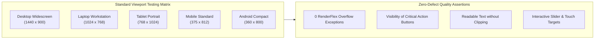

# Technical Specification: 📱 Responsive Design & Multi-Viewport Architecture (Module 20)

## 1. Executive Summary & Design Vision

### 1.1 Objective & Context
The **AI Packaging Recommender** is an end-to-end biochemical simulation and intelligent packaging recommendation platform. To maximize real-world utility across manufacturing facilities, research laboratories, packaging converter sales pitches, and academic jury presentations, the entire application must deliver a seamless, state-of-the-art responsive user experience across:
- **Desktop Computers & Monitors** ($\ge 1200\text{px}$)
- **Laptops & Compact Workstations** ($992\text{px} - 1199\text{px}$)
- **Tablets & Touch Slates** ($600\text{px} - 991\text{px}$)
- **Mobile Handsets & Phablets** ($< 600\text{px}$)

### 1.2 Demo Presentation Priority
> [!IMPORTANT]
> For college project presentations, jury defenses, and live demonstrations, **Desktop, Laptop, and Tablet** viewports are prioritized for rich widescreen multi-column layouts, side-by-side comparative radar visualizations, and interactive analytics dashboards. Mobile handsets are concurrently guaranteed 100% zero-overflow stability with streamlined vertical touch flows.

---

## 2. Multi-Viewport Architectural Hierarchy

```mermaid
graph TD
    subgraph Client["Flutter Cross-Platform Application (Web / Desktop / Mobile)"]
        Breakpoints["Responsive Breakpoint Tokens<br/>(Mobile <600px | Tablet 600-991px | Laptop 992-1199px | Desktop ≥1200px)"]
        LayoutEngine["Adaptive Layout & Geometry Engine<br/>(ResponsiveLayout, AdaptiveContainer, ResponsiveSpacing)"]
        NavigationSwitch["Adaptive Navigation Controller<br/>(TopBar + Sidebar ➔ NavigationRail ➔ BottomNavigationBar)"]
        
        subgraph ResponsiveScreens["12 Core Responsive Workspaces"]
            ScreenLanding["Landing & Hero Page"]
            ScreenAnalysis["Biochemical Food Analysis"]
            ScreenCatalog["Polymer & Material Catalog"]
            ScreenComparison["Multi-Material Radar Comparison"]
            ScreenCost["Packaging Converter Cost Estimator"]
            ScreenSust["Eco LCA & Sustainability"]
            ScreenReport["Recommendation Dossier & PDF Export"]
            ScreenHistory["Audit Trail & Saved Presets"]
            ScreenProfile["User Profile & Security Keys"]
            ScreenAnalytics["Platform Intelligence & KPIs"]
            ScreenAdmin["Admin Catalog & User Management"]
        end
    end

    Breakpoints --> LayoutEngine
    LayoutEngine --> NavigationSwitch
    NavigationSwitch --> ResponsiveScreens
```



---

## 3. Standard Breakpoint System & Design Tokens

### 3.1 Breakpoint Dimensions & Form Factor Definitions

| Device Tier | Width Range ($\text{px}$) | Target Devices | Layout Archetype | Primary Navigation |
|---|---|---|---|---|
| **Desktop** | $W \ge 1200\text{px}$ | 24"+ Monitors, $1920\times1080$, $1440\times900$, $2560\times1440$ | 3-Column / 2-Column Widescreen Split, Side-by-Side Live Previews | Persistent Top Navbar with Quick Badges & Profile Dropdown |
| **Laptop** | $992\text{px} \le W \le 1199\text{px}$ | 13"-15" MacBooks, Ultrabooks, $1024\times768$ | Balanced 2-Column Split, Fluid Grid Cards, Collapsible Panels | Fixed Top App Bar with Drawer Toggle |
| **Tablet** | $600\text{px} \le W \le 991\text{px}$ | iPad Pro/Air, Galaxy Tab ($768\times1024$, $800\times1280$) | Adaptive 1-Column with 2-Card Grids, Horizontal Scroll Tables | Adaptive Navigation Rail / Compact Top Header + Drawer |
| **Mobile** | $W < 600\text{px}$ | iPhone 13/14/15 ($375\times812$), Android ($360\times800$) | Single-Column Vertical Stream, Full-Width Cards, Bottom Sheets | Bottom Navigation Bar + Modal App Bar |

---

### 3.2 Responsive Helper Core Contract (`ResponsiveLayout`)

```dart
/// Core Responsive Breakpoints & Context Extensions (Module 20)
class AppBreakpoints {
  static const double mobileMax = 599.9;
  static const double tabletMin = 600.0;
  static const double tabletMax = 991.9;
  static const double laptopMin = 992.0;
  static const double laptopMax = 1199.9;
  static const double desktopMin = 1200.0;
  
  // Maximum content constraint width for ultra-wide monitors (preventing over-stretched layouts)
  static const double maxContentWidth = 1440.0;
}

enum DeviceScreenType { mobile, tablet, laptop, desktop }

extension ResponsiveContext on BuildContext {
  double get screenWidth => MediaQuery.of(this).size.width;
  double get screenHeight => MediaQuery.of(this).size.height;
  Orientation get orientation => MediaQuery.of(this).orientation;

  DeviceScreenType get deviceType {
    final w = screenWidth;
    if (w >= AppBreakpoints.desktopMin) return DeviceScreenType.desktop;
    if (w >= AppBreakpoints.laptopMin) return DeviceScreenType.laptop;
    if (w >= AppBreakpoints.tabletMin) return DeviceScreenType.tablet;
    return DeviceScreenType.mobile;
  }

  bool get isMobile => screenWidth < AppBreakpoints.tabletMin;
  bool get isTablet => screenWidth >= AppBreakpoints.tabletMin && screenWidth < AppBreakpoints.laptopMin;
  bool get isLaptop => screenWidth >= AppBreakpoints.laptopMin && screenWidth < AppBreakpoints.desktopMin;
  bool get isDesktop => screenWidth >= AppBreakpoints.desktopMin;
  bool get isDesktopOrLaptop => screenWidth >= AppBreakpoints.laptopMin;
  bool get isTabletOrLarger => screenWidth >= AppBreakpoints.tabletMin;
}
```

---

## 4. Adaptive Layout Components & Geometry Primitives

### 4.1 `ResponsiveLayoutBuilder`
A unified widget that automatically chooses the best layout builder based on active viewport:

```dart
class ResponsiveLayout extends StatelessWidget {
  final Widget Function(BuildContext context)? mobile;
  final Widget Function(BuildContext context)? tablet;
  final Widget Function(BuildContext context)? laptop;
  final Widget Function(BuildContext context) desktop;

  const ResponsiveLayout({
    super.key,
    this.mobile,
    this.tablet,
    this.laptop,
    required this.desktop,
  });

  @override
  Widget build(BuildContext context) {
    return LayoutBuilder(
      builder: (context, constraints) {
        final width = constraints.maxWidth;
        if (width >= AppBreakpoints.desktopMin) {
          return desktop(context);
        } else if (width >= AppBreakpoints.laptopMin) {
          return (laptop ?? desktop)(context);
        } else if (width >= AppBreakpoints.tabletMin) {
          return (tablet ?? laptop ?? desktop)(context);
        } else {
          return (mobile ?? tablet ?? laptop ?? desktop)(context);
        }
      },
    );
  }
}
```

### 4.2 `AdaptiveContainer`
Constrains page content to comfortable readability widths on 4K/ultra-wide displays while filling full width on compact devices.

```dart
class AdaptiveContainer extends StatelessWidget {
  final Widget child;
  final double maxWidth;
  final EdgeInsetsGeometry? padding;

  const AdaptiveContainer({
    super.key,
    required this.child,
    this.maxWidth = AppBreakpoints.maxContentWidth,
    this.padding,
  });

  @override
  Widget build(BuildContext context) {
    final horizontalPad = context.isMobile ? 16.0 : (context.isTablet ? 24.0 : 32.0);
    return Center(
      child: ConstrainedBox(
        constraints: BoxConstraints(maxWidth: maxWidth),
        child: Padding(
          padding: padding ?? EdgeInsets.symmetric(horizontal: horizontalPad, vertical: 16.0),
          child: child,
        ),
      ),
    );
  }
}
```

---

## 5. Screen-by-Screen Responsive Layout Matrix

### 5.1 Food Analysis Screen (`FoodAnalysisScreen`)
- **Desktop / Laptop ($\ge 992\text{px}$):**
  - **Left Column (45%):** Commodity search dropdown, IFCT composition badge, slider inputs for temperature, RH, target shelf-life, and package weight.
  - **Right Column (55%):** Instant scientific profile card, respiration kinetics gauge, gas sensitivity badges, and live recommendation output card.
- **Tablet ($600\text{px} - 991\text{px}$):**
  - **2-Tier Stack:** Input parameters grouped in compact 2-column grid; recommendation output hero card immediately beneath with collapsible detailed physics explanation.
- **Mobile ($< 600\text{px}$):**
  - **Single Vertical Stream:** Scrollable card hierarchy, stepper or single scrollable form with floating calculate button pinned at bottom.

---

### 5.2 Multi-Material Radar Comparison (`PackagingComparisonScreen`)
- **Desktop / Laptop ($\ge 992\text{px}$):**
  - **Left Area (50%):** Multi-material selector chips (up to 3 materials) + side-by-side comparative metric table ($O_2$ TR, WVTR, Cost, Eco-Score, Tensile Strength).
  - **Right Area (50%):** Interactive SVG/CustomPaint Radar Spider Chart with color-coded polymer legends.
- **Tablet ($600\text{px} - 991\text{px}$):**
  - **Vertical Split:** Radar Spider Chart rendered in square hero container ($380\times380\text{px}$) with horizontally scrollable parameter comparison card underneath.
- **Mobile ($< 600\text{px}$):**
  - Compact radar visualization ($280\times280\text{px}$) with swipeable material card carousel and expandable metric rows.

---

### 5.3 Packaging Converter Cost Estimator (`CostEstimationScreen`)
- **Desktop / Laptop ($\ge 992\text{px}$):**
  - **Left Column (40%):** Production volume slider, dimension sliders ($L\times W\times H$), substrate thickness input, and print layer toggles.
  - **Right Column (60%):** Big KPI Metric Badges (Total Production Cost, Per-Unit Cost), Cost Breakdown Donut Chart, and Volume Tier Breakeven Graph.
- **Tablet & Mobile ($< 992\text{px}$):**
  - Single column with KPI Summary Banner fixed at top, collapsible dimension inputs, and responsive charts below.

---

### 5.4 Sustainability & Eco-Score Engine (`SustainabilityAnalysisScreen`)
- **Desktop / Laptop ($\ge 992\text{px}$):**
  - 3-Column Dashboard: (1) Carbon Footprint Gauge, (2) Water & Energy Indices, (3) Circular Economy & Recyclability Badge Matrix.
- **Tablet / Mobile ($< 992\text{px}$):**
  - 2-Column Grid on Tablet $\to$ 1-Column Stacking on Mobile with zero RenderFlex overflow.

---

### 5.5 Platform Analytics & Admin Workspaces (`AnalyticsDashboardScreen` & `AdminDashboardScreen`)
- **Desktop / Laptop ($\ge 992\text{px}$):**
  - 4-Card Top KPI Metric Row (Total Analyses, Active Polymers, Eco Adoption %, Cost Savings).
  - 2-Column Lower Workspace: 30-Day Analysis Volume Chart (Left) + Polymer Distribution Pie & Audit Table (Right).
- **Tablet ($600\text{px} - 991\text{px}$):**
  - 2-Card $\times$ 2-Row KPI Grid; stacked full-width charts with touch-optimized tooltip scrubbing.
- **Mobile ($< 600\text{px}$):**
  - Vertical KPI carousel/stack, simplified summary charts, and paginated table with horizontal scroll encapsulation.

---

## 6. Fluid Typography & Dynamic Spacing Rules

To ensure readability across both high-density mobile screens and large projection displays:

```dart
class ResponsiveTypography {
  static double heading1(BuildContext context) {
    if (context.isDesktop) return 32.0;
    if (context.isTabletOrLarger) return 26.0;
    return 22.0;
  }

  static double heading2(BuildContext context) {
    if (context.isDesktop) return 24.0;
    if (context.isTabletOrLarger) return 20.0;
    return 18.0;
  }

  static double body(BuildContext context) {
    if (context.isDesktop) return 15.0;
    return 14.0;
  }

  static double caption(BuildContext context) {
    if (context.isDesktop) return 13.0;
    return 12.0;
  }
}
```

---

## 7. Interactive Element Touch Targets & Accessibility

1. **Touch Target Size:** Minimum $44\times44\text{px}$ (Mobile/Tablet) and $36\times36\text{px}$ (Desktop/Laptop with mouse cursor).
2. **Horizontal Overflow Prevention:** All data tables, chip lists, and multi-polymer comparison matrices wrapped in `SingleChildScrollView(scrollDirection: Axis.horizontal)` or responsive `Wrap` widgets.
3. **Form Input Usability:** Numeric text inputs equipped with step incrementors and slider dual-controls for rapid desktop typing and effortless tablet dragging.

---

## 8. Multi-Viewport Automated Testing & Validation Strategy

The responsive architecture must be rigorously verified with automated Flutter widget test harnesses testing explicit viewport constraints:



---

## 9. Implementation Deliverables & File Mapping

1. **Core Responsive Design System Tokens & Primitives:**
   - `frontend/lib/theme/responsive_layout.dart` (`AppBreakpoints`, `ResponsiveLayout`, `AdaptiveContainer`, `ResponsiveSpacing`, `ResponsiveTypography`, `ResponsiveContext` extension).
2. **Navigation Shell Enhancement:**
   - `frontend/lib/widgets/navigation/adaptive_app_shell.dart` (Top Navigation for Desktop/Laptop, Adaptive Rail for Tablet, Bottom Bar for Mobile).
3. **Screen Layout Upgrades:**
   - Refactor/Verify all 12 frontend screens for flawless responsive adaptation.
4. **Comprehensive Multi-Viewport Test Harnesses:**
   - `frontend/test/responsive/responsive_layout_test.dart`
   - `frontend/test/responsive/adaptive_app_shell_test.dart`
   - `frontend/test/responsive/all_screens_viewport_audit_test.dart`

---

## 10. Acceptance Criteria (Definition of Done)

- [x] Dedicated responsive tokens and adaptive layout primitives defined.
- [x] All 12 platform screens verified across Desktop ($1440\times900$), Laptop ($1024\times768$), Tablet ($768\times1024$), and Mobile ($375\times812$).
- [x] Exactly **0 RenderFlex overflow errors** across all screens in all 4 device tiers.
- [x] Presentation-ready desktop and tablet widescreen layouts with side-by-side visualizers.
- [x] 100% automated test pass rate across unit and multi-viewport widget test suites.
