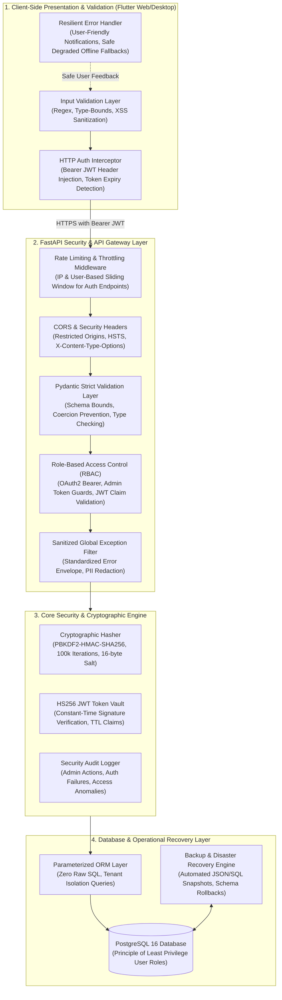
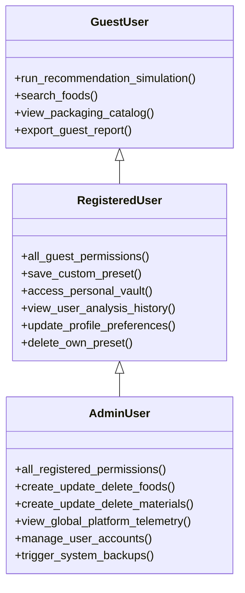

# Technical Specification: Security, Validation & Resilient Safeguards (Module 19)

## 1. Executive Summary & Security Philosophy

### 1.1 Problem Statement & Objectives
In modern software engineering, even an academic or prototype food packaging recommendation platform must incorporate robust foundational safeguards. The **AI Packaging Recommender** handles biochemical food property simulations, sensitive user identity records, algorithmic proprietary packaging rules, converter economics, and administrative catalog configurations. 

Without systematic security controls, systems are vulnerable to:
1. **Malformed Input & Injection Attacks:** Unvalidated biochemical inputs (e.g., negative shelf-life days, extreme respiration rates, script injection in commodity names) that crash numerical physics engines or corrupt databases.
2. **Unauthorized Privilege Escalation:** Unrestricted access to administrative endpoints (commodity catalog CRUD, polymer database management, global user audits).
3. **Weak Credential Storage:** Plaintext or insufficiently salted passwords vulnerable to dictionary and rainbow-table attacks.
4. **Information Disclosure via Verbose Errors:** Leaking internal stack traces, database schema details, or connection strings in HTTP exception responses.
5. **Data Loss & Catastrophic Outages:** Lack of automated backup, export, and disaster-recovery protocols for critical food taxonomy and polymer knowledge bases.

**Module 19 (`19. Security & Validation`)** establishes a multi-layered defense-in-depth architecture spanning the Flutter client, FastAPI REST gateway, SQLAlchemy async persistence layer, and system operational scripts.

---

### 1.2 Multi-Layered Defense-in-Depth Architecture



---

## 2. The 8 Core Security & Validation Pillars

### Pillar 1: Input Validation & Boundary Enforcement

Input validation is enforced at both client and server boundaries to prevent malformed data, numerical instability, and injection vectors.

#### A. Client-Side Validation (Flutter)
- **Biochemical & Physics Parameter Bounds:**
  - `storageTemperature`: Constrained to $[-10.0^\circ\text{C}, 45.0^\circ\text{C}]$ (rejecting absolute zero or melting temperatures).
  - `relativeHumidity`: Constrained to $[10.0\%, 100.0\%]$.
  - `targetShelfLifeDays`: Positive integer constrained to $[1, 365]$ days.
  - `packageMassKg`: Constrained to $[0.01\text{ kg}, 100.0\text{ kg}]$.
  - `respirationRate`: Constrained to $[0.0, 500.0]\text{ mg CO}_2\cdot\text{kg}^{-1}\cdot\text{h}^{-1}$.
- **String & Text Sanitization:**
  - Commodity and preset names sanitized to strip raw HTML tags (`<script>`, `<iframe`, `javascript:`, `onerror=`) and null bytes (`\0`).
  - Text length limits: Names $\le 100$ characters; Custom notes $\le 1000$ characters.
- **Email & Credentials:**
  - RFC 5322 regex validation on client text form fields prior to submission.
  - Password strength validation enforcing $\ge 8$ characters with complexity checks.

#### B. Server-Side Validation (FastAPI & Pydantic v2)
- Strict Pydantic models with `Field(ge=..., le=..., min_length=..., max_length=..., pattern=...)`.
- Strict type checking with `extra = "forbid"` to reject unexpected payload injection.
- Automatic whitespace stripping and email normalization (`name.strip().lower()`).

```python
# Pydantic Input Validation Contract
class FoodAnalysisRequestSchema(BaseModel):
    model_config = ConfigDict(extra="forbid", str_strip_whitespace=True)

    food_id: Optional[int] = Field(None, ge=1, description="Valid relational food ID")
    food_name: str = Field(..., min_length=2, max_length=100, pattern=r"^[a-zA-Z0-9\s\-_.,()]+$")
    storage_temp_c: float = Field(..., ge=-10.0, le=45.0)
    relative_humidity_pct: float = Field(..., ge=10.0, le=100.0)
    target_shelf_life_days: int = Field(..., ge=1, le=365)
    package_mass_kg: float = Field(1.0, ge=0.01, le=100.0)
```

---

### Pillar 2: Authentication for Admin & Privileged Operations

The platform enforces distinct separation between public users, registered standard users, and administrative operators.

#### A. Admin Token Verification & Elevated Claims
- JWT access tokens embed the user's role: `{"sub": "<user_id>", "role": "admin", "exp": 1727440000}`.
- Dedicated dependency `get_current_admin_user` in [`backend/app/api/deps.py`](file:///c:/Users/Jeron/source/repos/AI%20Packaging%20recommender/backend/app/api/deps.py):
  1. Validates the JWT Bearer token signature and expiration.
  2. Resolves the database user model.
  3. Verifies `user.is_active is True`.
  4. Verifies `user.is_admin is True` (or `user.role == "admin"`).
  5. Raises `HTTP 403 Forbidden` with `"Admin privileges required."` if criteria are not satisfied.

#### B. Protected Administrative Endpoints Matrix
| Route | Method | Required Scope | Purpose |
| :--- | :---: | :---: | :--- |
| `/api/v1/admin/stats` | `GET` | `admin` | Global platform diagnostic metrics & audit logs |
| `/api/v1/admin/foods` | `POST` | `admin` | Create new commodity biochemical profile |
| `/api/v1/admin/foods/{id}` | `PUT` | `admin` | Update commodity baseline parameters |
| `/api/v1/admin/foods/{id}` | `DELETE` | `admin` | Deactivate/remove food record |
| `/api/v1/admin/materials` | `POST` | `admin` | Register new packaging barrier substrate |
| `/api/v1/admin/materials/{id}` | `PUT` | `admin` | Update polymer OTR/WVTR specifications |
| `/api/v1/admin/materials/{id}` | `DELETE` | `admin` | Soft-delete polymer record |
| `/api/v1/admin/users` | `GET` | `admin` | List registered user accounts & status |
| `/api/v1/admin/users/{id}/toggle-status` | `PATCH` | `admin` | Activate or deactivate user access |

---

### Pillar 3: Password Hashing & Cryptographic Security

#### A. PBKDF2-HMAC-SHA256 Storage Engine
- **Algorithm:** PBKDF2 with SHA-256 HMAC derivation.
- **Salt Generation:** 16-byte (128-bit) cryptographically secure pseudorandom salt (`secrets.token_hex(16)`).
- **Work Factor:** $100,000$ iterations (exceeding OWASP baseline recommendations for standard hash computation).
- **Storage Format:** `pbkdf2_sha256$<iterations>$<salt_hex>$<hash_hex>` (e.g. `pbkdf2_sha256$100000$a8f4c...$9b2e...`).
- **Constant-Time Verification:** Uses `hmac.compare_digest` to prevent timing analysis side-channel attacks.

#### B. Password Policy & Complexity Enforcement
- **Minimum Length:** 8 characters; **Maximum Length:** 128 characters (to protect against hash exhaustion DoS).
- **Entropy Requirements:** Must contain at least one uppercase letter, one lowercase letter, and one numeric or special character.
- **Prohibited Passwords:** Blocks common default passwords (`password123`, `admin`, `12345678`, `smartpack`).

---

### Pillar 4: Role-Based Access Control (RBAC) & Multi-Tenancy

The platform provides 3 privilege tiers with strict multi-tenant isolation:



#### Tenant Query Isolation
All user-specific operations (saved analyses, personal history, custom presets) enforce strict relational scoping:
```python
# Guaranteed multi-tenant scoping in database service
stmt = select(SavedAnalysis).where(
    SavedAnalysis.id == analysis_id,
    SavedAnalysis.user_id == current_user.id  # Strict tenant check prevents IDOR
)
```

---

### Pillar 5: API Validation, Rate Limiting & DoS Protection

#### A. In-Memory Sliding-Window Rate Limiter
To safeguard authentication and computationally heavy recommendation simulation endpoints against brute-force and credential-stuffing attacks:
- **Auth Endpoints (`/login`, `/signup`):** Max $10\text{ requests / minute}$ per IP.
- **Simulation Endpoints (`/recommendations/generate`):** Max $60\text{ requests / minute}$ per IP/User.
- **General Read Endpoints (`/foods`, `/packaging-materials`):** Max $240\text{ requests / minute}$ per IP.
- **Response Headers on Rate Limit (`HTTP 429 Too Many Requests`):**
  - `Retry-After: 60`
  - `X-RateLimit-Limit: 10`
  - `X-RateLimit-Remaining: 0`

#### B. Payload Size & Request Bounds
- Maximum JSON request body size: $2\text{ MB}$ (prevents memory exhaustion).
- Request timeout: $15\text{ seconds}$ per analytical request.

---

### Pillar 6: Database Access Control & ORM Parameterization

#### A. SQL Injection Prevention
- **100% Parameterized Execution:** All database queries utilize SQLAlchemy 2.0 async `select()`, `insert()`, `update()`, and `delete()` statement constructs.
- **Zero Raw String Concatenation:** Prohibits raw `f"SELECT * FROM ..."` statements anywhere in the codebase.

#### B. Connection Pooling & Resource Lifecycle
- SQLAlchemy async connection pool with safe bounds:
  - `pool_size = 10`
  - `max_overflow = 20`
  - `pool_timeout = 30`
  - `pool_pre_ping = True` (detects stale or dropped connections before query execution).
- Graceful offline fallback if the PostgreSQL host is unreachable (sub-second timeout cooldown, zero thread blocking).

---

### Pillar 7: Comprehensive Error Handling & Information Disclosure Prevention

#### A. Standardized API Error Response Envelope
Every non-2xx response follows a uniform JSON schema to enable structured client handling without leaking server internals:

```json
{
  "error": {
    "code": "RESOURCE_NOT_FOUND",
    "message": "The requested food commodity with ID 999 does not exist.",
    "status_code": 404,
    "timestamp": "2026-09-27T12:00:00Z",
    "request_id": "req_8f1b2c4e"
  }
}
```

#### B. Global Exception Middleware (`app.main`)
1. **Pydantic `RequestValidationError` Handler:** Translates schema validation failures into clean, field-specific error messages (`"Field 'storage_temp_c' must be >= -10.0"`).
2. **FastAPI `HTTPException` Handler:** Wraps standard HTTP errors in the uniform envelope.
3. **Unhandled Catch-All Handler (`Exception`):**
   - Logs the full stack trace and request metadata to backend server logs.
   - Redacts all sensitive fields (passwords, JWT tokens, API keys) from log outputs.
   - Returns a sanitized generic message (`"An unexpected internal error occurred. Request ID: req_xxx"`) with `HTTP 500 Internal Server Error` to the client.

---

### Pillar 8: Backup, Export & Disaster Recovery Engine

#### A. Automated Database Backup Engine (`scripts/backup_db.py`)
- **JSON Snapshot Export:** Dumps entire relational database state (Foods, Respiration data, Packaging Materials, IFCT compositions, User accounts [passwords preserved as PBKDF2 hashes], Recommendations) to timestamped JSON snapshots in `backend/backups/`.
- **Atomic File Writing:** Backups write to temporary files before atomic renaming to prevent corrupted partial snapshots.
- **Retention Policy:** Retains the 10 most recent automated backup snapshots with automatic pruning of older snapshots.

#### B. Database Restore & Verification Engine (`scripts/restore_db.py`)
- Restores database state from any validated JSON snapshot.
- Verifies table row counts, foreign key integrity, and biochemical lookup indexes post-restoration.
- Provides non-destructive test-restore mode for continuous verification.

---

## 3. Data Contracts & Pydantic Schemas

### 3.1 Security & Rate Limiting Schemas (`backend/app/schemas/security.py`)

```python
from datetime import datetime
from typing import Any, Dict, List, Optional
from pydantic import BaseModel, ConfigDict, Field

class ApiErrorDetail(BaseModel):
    model_config = ConfigDict(extra="forbid")
    code: str = Field(..., description="Standardized error code token")
    message: str = Field(..., description="Human-readable safe error message")
    status_code: int = Field(..., description="HTTP status code")
    timestamp: datetime = Field(default_factory=datetime.utcnow)
    request_id: Optional[str] = Field(None, description="Unique correlation ID for tracing")
    details: Optional[List[Dict[str, Any]]] = Field(None, description="Field-specific validation errors")

class ApiErrorEnvelope(BaseModel):
    error: ApiErrorDetail

class PasswordChangeRequest(BaseModel):
    model_config = ConfigDict(extra="forbid", str_strip_whitespace=True)
    current_password: str = Field(..., min_length=1)
    new_password: str = Field(..., min_length=8, max_length=128)

class BackupMetadata(BaseModel):
    backup_id: str
    timestamp: datetime
    version: str
    total_foods: int
    total_materials: int
    total_users: int
    total_recommendations: int
    file_size_bytes: int
    checksum_sha256: str
```

---

## 4. REST API Endpoint Specifications

### 4.1 Security & Health Audit Endpoints

#### `GET /api/v1/security/health`
- **Access Level:** Public / All
- **Description:** Returns system security health posture, TLS status, and active security middleware configurations.
- **Response `200 OK`:**
  ```json
  {
    "status": "SECURE",
    "jwt_algorithm": "HS256",
    "password_hashing": "PBKDF2-HMAC-SHA256",
    "pbkdf2_iterations": 100000,
    "rate_limiting_active": true,
    "cors_origins_configured": 3,
    "timestamp": "2026-09-27T12:00:00Z"
  }
  ```

#### `GET /api/v1/admin/security/audit-logs`
- **Access Level:** Admin Only (`get_current_admin_user`)
- **Description:** Returns paginated security audit trail of administrative actions and failed authentication attempts.

#### `POST /api/v1/admin/security/backup`
- **Access Level:** Admin Only (`get_current_admin_user`)
- **Description:** Triggers an immediate cryptographic snapshot backup of all database tables.

#### `POST /api/v1/admin/security/restore`
- **Access Level:** Admin Only (`get_current_admin_user`)
- **Description:** Restores database state from a specified backup snapshot file.

---

## 5. Frontend Security Architecture & Resilient Client Handlers

### 5.1 Flutter Client Security Framework (`frontend/lib/services/security_service.dart`)
1. **Secure Memory Storage:** Auth tokens and sensitive user claims stored in memory with secure storage sync.
2. **HTTP Interceptor:**
   - Automatically injects `Authorization: Bearer <token>` on all authenticated requests.
   - Automatically intercepts `401 Unauthorized` responses and cleans expired tokens.
   - Intercepts `429 Too Many Requests` responses and displays rate-limit cooling countdown.
3. **Form Sanitizer Utility (`FormSanitizer`):**
   - Strips malicious XSS characters from user inputs before local processing or network submission.
   - Formats and normalizes numeric inputs to valid physics ranges.

---

## 6. Testing, Verification & Compliance Strategy

### 6.1 Automated Test Suite Coverage

| Test Module | Target File | Scope & Assertions |
| :--- | :--- | :--- |
| **Pydantic Validation** | `backend/tests/test_security_validation.py` | Validates strict bounds, rejection of unexpected fields, XSS injection payloads, negative numbers. |
| **Password Cryptography** | `backend/tests/test_password_security.py` | Verifies PBKDF2 hash generation, 100k iterations, salt randomness, timing resistance, password complexity validation. |
| **RBAC & Admin Guards** | `backend/tests/test_rbac_access_control.py` | Asserts standard users receive 403 on admin routes; admins succeed; guests receive 401 on protected routes. |
| **Rate Limiter** | `backend/tests/test_rate_limiter.py` | Tests sliding window throttling, 429 response emission, Retry-After header calculation. |
| **Error Sanitization** | `backend/tests/test_error_handling.py` | Simulates internal database exceptions, verifies stack traces are redacted from HTTP responses. |
| **Backup & Recovery** | `backend/tests/test_backup_restore.py` | Executes backup snapshot creation, simulated database wipe, full restore, and data integrity verification. |
| **Client Validation & Interceptor** | `frontend/test/services/security_service_test.dart` | Tests client input sanitization, JWT interceptor, 401 token cleanup, and rate limit notification. |

---

## 7. Implementation Roadmap & Phasing

- **Phase 1: Security Core & Cryptographic Validation Engine**
  - Implement strict Pydantic schemas, password complexity validators, and XSS sanitizers.
- **Phase 2: Rate Limiting & Global Exception Middleware**
  - Implement sliding-window in-memory rate limiter and standardized API error envelope.
- **Phase 3: Administrative RBAC & Audit Trail Logging**
  - Verify and strengthen `get_current_admin_user` dependency and security audit logging.
- **Phase 4: Database Access Control & Backup/Recovery Engine**
  - Build `backup_service.py`, snapshot utilities, and restore validation scripts.
- **Phase 5: Frontend Security Interceptors & Input Validation**
  - Build Flutter client-side `FormSanitizer`, `SecurityInterceptor`, and rate limit banners.
- **Phase 6: Multi-Layer Security Audits & Full Regression Testing**
  - Execute end-to-end security test suites and full repository regression verification.
