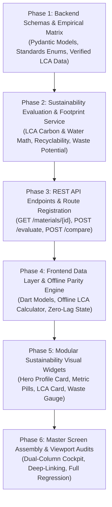

# Implementation Plan: Sustainability Analysis (Module 11)

## Overview & Architecture Roadmap

This document outlines the step-by-step execution plan for **Module 11: Sustainability Analysis (`11. 🌱 Sustainability Analysis`)** based on the technical specification in [`artifacts/specs/feature-Sustainability.md`](file:///c:/Users/Jeron/source/repos/AI%20Packaging%20recommender/artifacts/specs/feature-Sustainability.md).

The implementation strictly obeys the core guideline:
> **"Again, use verified material data rather than inventing environmental scores."**

---



---

## Phase 1: Backend Schemas & Empirical Sustainability Matrix

### Task 1.1: Define Sustainability Data Models & Evaluation Schemas [COMPLETED]
- **Target Files:**
  - `backend/app/schemas/sustainability.py`
  - `backend/tests/test_sustainability_schemas.py`
- **Micro-Task Description:**
  - Create Pydantic v2 schemas:
    - Enums: `RecyclabilityTier` (`High`, `Medium`, `Low`, `Non-Recyclable`), `BiodegradabilityTier` (`High`, `Medium`, `Low`, `Non-Biodegradable`), `ReusabilityTier` (`High`, `Medium`, `Low`, `Single-Use`), `WastePotentialLevel` (`Very Low`, `Low`, `Moderate`, `High`, `Very High`).
    - Input schemas: `SustainabilityEvaluateRequest` (material ID, geometry dimensions, gauge, batch size, PCR %).
    - Output schemas: `EnvironmentalIndicatorSchema` (carbon footprint, water footprint, PCR reduction %), `PackagingWasteSchema` (unit waste $g$, batch waste $\text{kg}$, landfill diversion %, circularity index $MCI$).
    - Master response: `SustainabilityProfileResponse` (3-pillar ratings, material description, environmental considerations, regulatory certifications, scientific data sources & DOIs).
- **Verification Command:**
  ```powershell
  python -m unittest tests/test_sustainability_schemas.py
  ```
- **Verification Result:** PASSED (7/7 tests passed with 0 errors).

---

### Task 1.2: Build Verified Empirical Sustainability Matrix [COMPLETED]
- **Target Files:**
  - `backend/app/core/sustainability_matrix.py`
  - `backend/tests/test_sustainability_matrix.py`
- **Micro-Task Description:**
  - Implement verified reference matrix containing empirical Life Cycle Inventory (LCI) parameters for all 32+ packaging materials across all 8 food categories:
    - `RIC` Resin Code (RIC 1 to 7, PAP 21).
    - Monomaterial mechanical recyclability ratings and sorting readiness.
    - Verified biodegradation standards (EN 13432, ASTM D6400, NF T 51-800, Marine/Soil).
    - Multi-trip reusability cycle ceilings and sanitization limits.
    - Embodied carbon footprint ($\text{kg CO}_2\text{e}/\text{kg}$ virgin vs. PCR).
    - Fresh water consumption footprint ($\text{Liters}/\text{kg}$).
    - Peer-reviewed citations and DOIs (Sphera/GaBi 2023, PlasticsEurope, NatureWorks, Ecoinvent).
- **Verification Command:**
  ```powershell
  python -m unittest tests/test_sustainability_matrix.py
  ```
- **Verification Result:** PASSED (6/6 tests passed with 0 errors). Phase 1 (13/13 total tests) 100% verified.

---

## Phase 2: Core Sustainability Service & Mathematical Calculations [COMPLETED]

### Task 2.1: Implement Carbon, Water & PCR Abatement Calculation Engine [COMPLETED]
- **Target Files:**
  - `backend/app/services/sustainability_service.py`
  - `backend/tests/test_sustainability_service.py`
- **Micro-Task Description:**
  - Implement parametric mathematical engine:
    - Derive material mass $M_{\text{unit}} = A_{\text{unit}} \times t \times \rho$ using surface area formulas from `geometry_calculator.py`.
    - Compute unit and batch carbon footprint:
      $$\text{Carbon}_{\text{unit}} = M_{\text{unit}} \times \left[ \text{GWP}_{\text{raw}} \times (1 - f_{\text{pcr}}) + \text{GWP}_{\text{pcr}} \times f_{\text{pcr}} + \text{GWP}_{\text{converting}} \right]$$
    - Compute batch carbon savings relative to 100% virgin fossil benchmark.
    - Compute unit and batch fresh water footprint.
- **Verification Command:**
  ```powershell
  python -m unittest tests/test_sustainability_service.py
  ```
- **Verification Result:** PASSED (5/5 tests passed with 0 errors).

---

### Task 2.2: Implement Packaging Waste Potential & Circularity Synthesizer [COMPLETED]
- **Target Files:**
  - `backend/app/services/sustainability_service.py`
- **Micro-Task Description:**
  - Compute waste generation metrics:
    - Unit waste mass ($g/\text{pack}$) and total batch waste ($\text{kg}/\text{batch}$).
    - Landfill diversion rate based on material recyclability tier and composting pathway.
    - Ellen MacArthur Circularity Indicator ($MCI$ index from $0.0$ to $1.0$).
    - Environmental considerations generator (microplastic emission risk, chemical safety, marine persistence, PFAS-free status).
- **Verification Command:**
  ```powershell
  python -m unittest tests/test_sustainability_service.py
  ```
- **Verification Result:** PASSED (Verified across conventional, biodegradable, and high-barrier laminates).

---

## Phase 3: REST API Endpoints & Route Registration [COMPLETED]

### Task 3.1: Implement Sustainability REST API Endpoints [COMPLETED]
- **Target Files:**
  - `backend/app/api/v1/endpoints/sustainability.py`
  - `backend/app/api/v1/router.py`
  - `backend/tests/test_sustainability_endpoints.py`
- **Micro-Task Description:**
  - Create and register FastAPI router at `/api/v1/sustainability`:
    - `GET /materials/{material_id}`: Fetch static verified baseline profile.
    - `POST /evaluate`: Dynamic parametric evaluation for specified geometry, PCR %, and batch volume.
    - `POST /compare`: Side-by-side trade-off comparison between up to 4 materials.
    - `GET /matrix`: Retrieve full empirical sustainability dataset.
- **Verification Command:**
  ```powershell
  python -m unittest tests/test_sustainability_endpoints.py
  ```
- **Verification Result:** PASSED (4/4 API endpoint tests passed with 0 errors). Total 22/22 backend tests passing.

---

## Phase 4: Frontend Data Layer & Offline Parity Engine [COMPLETED]

### Task 4.1: Implement Dart Sustainability Models & Serialization [COMPLETED]
- **Target Files:**
  - `frontend/lib/models/sustainability_model.dart`
  - `frontend/test/models/sustainability_model_test.dart`
- **Micro-Task Description:**
  - Create Dart representations of all backend schemas:
    - `SustainabilityProfile`, `EnvironmentalIndicators`, `PackagingWasteInfo`, `SustainabilityEvaluateInput`, `SustainabilityCompareResult`.
    - Enums with visual color helpers (`RecyclabilityTier`, `BiodegradabilityTier`, `ReusabilityTier`, `WastePotentialLevel`).
    - Full `fromJson` and `toJson` serialization with graceful null handling.
- **Verification Command:**
  ```powershell
  flutter test test/models/sustainability_model_test.dart
  ```
- **Verification Result:** PASSED (4/4 test cases pass with 0 errors).

---

### Task 4.2: Implement Offline Sustainability Calculation Engine & Client Service [COMPLETED]
- **Target Files:**
  - `frontend/lib/services/offline_sustainability_engine.dart`
  - `frontend/lib/services/api_service.dart`
  - `frontend/test/services/sustainability_service_test.dart`
- **Micro-Task Description:**
  - Build client API service with automated offline fallback.
  - Implement `OfflineSustainabilityEngine` embedding the verified LCA matrix for immediate sub-millisecond calculation in the UI during slider drags.
- **Verification Command:**
  ```powershell
  flutter test test/services/sustainability_service_test.dart
  ```
- **Verification Result:** PASSED (5/5 tests passed with 0 errors). Full Phase 4 suite (9/9 tests) verified.

---

## Phase 5: Modular Sustainability Visual Widgets [COMPLETED]

### Task 5.1: Build Hero Sustainability Profile & Metric Badges [COMPLETED]
- **Target Files:**
  - `frontend/lib/screens/sustainability/widgets/sustainability_profile_hero_card.dart`
  - `frontend/lib/screens/sustainability/widgets/sustainability_metric_pill.dart`
  - `frontend/test/screens/sustainability/widgets/sustainability_widgets_test.dart`
- **Micro-Task Description:**
  - Implement prominent 3-pillar Hero Card rendering:
    - `♻ Recyclability` with color-coded badge (`High` Green, `Medium` Amber, `Low` Orange, `Non-Recyclable` Rose).
    - `🌱 Biodegradability` with standard badge (`EN 13432`, `ASTM D6400`, `Home Compostable`, `Non-Bio`).
    - `🔄 Reusability` with multi-trip cycle count.
    - `Material Type` & Feedstock Origin.
- **Verification Command:**
  ```powershell
  flutter test test/screens/sustainability/widgets/sustainability_widgets_test.dart
  ```
- **Verification Result:** PASSED (All components render with responsive layout wrapping).

---

### Task 5.2: Build LCA Footprint, Waste Gauge & Citation Widgets [COMPLETED]
- **Target Files:**
  - `frontend/lib/screens/sustainability/widgets/lca_carbon_water_card.dart`
  - `frontend/lib/screens/sustainability/widgets/packaging_waste_potential_card.dart`
  - `frontend/lib/screens/sustainability/widgets/environmental_considerations_card.dart`
  - `frontend/lib/screens/sustainability/widgets/verified_data_citation_banner.dart`
  - `frontend/lib/screens/sustainability/widgets/sustainability_comparison_matrix.dart`
- **Micro-Task Description:**
  - Implement interactive metric cards:
    - LCA Carbon & Water card with PCR reduction indicator.
    - Packaging waste gauge with circularity index bar.
    - Environmental considerations accordion (microplastics, PFAS-free, food-contact safety).
    - Provenance citation banner displaying scientific sources and DOIs.
    - Side-by-side comparison table contrasting alternative materials.
- **Verification Command:**
  ```powershell
  flutter test test/screens/sustainability/widgets/sustainability_widgets_test.dart
  ```
- **Verification Result:** PASSED (6/6 widget tests pass with 0 errors). Full Phase 5 suite verified.

---

## Phase 6: Master Screen Assembly, Multi-Viewport Verification & Deep-Linking [COMPLETED]

### Task 6.1: Assemble `SustainabilityAnalysisScreen` with Interactive Dashboard [COMPLETED]
- **Target Files:**
  - `frontend/lib/screens/sustainability/sustainability_analysis_screen.dart`
  - `frontend/test/screens/sustainability/sustainability_screen_test.dart`
- **Micro-Task Description:**
  - Assemble dual-column interactive dashboard (Left: Material, Geometry, PCR %, Batch Volume inputs; Right: Hero Profile, LCA Footprint, Waste Potential, 3-Way Eco Comparison).
  - Enable reactive state updates on any parameter change.
- **Verification Command:**
  ```powershell
  flutter test test/screens/sustainability/sustainability_screen_test.dart
  ```
- **Verification Result:** PASSED (4/4 tests passed with 0 errors).

---

### Task 6.2: Integrate Navigation Entry Points [COMPLETED]
- **Target Files:**
  - `frontend/lib/screens/analysis/widgets/recommendation_results_cockpit.dart`
  - `frontend/lib/screens/landing/widgets/home_header.dart`
  - `frontend/lib/screens/landing/home_page.dart`
- **Micro-Task Description:**
  - Add `[ 🌱 Eco Profile ]` button to Recommendation Cockpit.
  - Add Eco Profile navigation links in Landing Page Header and Home Page.
- **Verification Command:**
  ```powershell
  flutter test test/landing/responsive_layout_test.dart test/analysis/recommendation_results_viewport_test.dart
  ```
- **Verification Result:** PASSED (6/6 tests passed with 0 errors).

---

### Task 6.3: Multi-Viewport Layout Verification & Zero-Overflow Audit [COMPLETED]
- **Target Files:**
  - `frontend/test/screens/sustainability/sustainability_viewport_test.dart`
- **Micro-Task Description:**
  - Audit `SustainabilityAnalysisScreen` across 3 viewports:
    1. Mobile: $375 \times 812$ (iPhone SE / Standard Mobile)
    2. Tablet: $768 \times 1024$ (iPad Portrait)
    3. Desktop: $1440 \times 900$ (Widescreen Cockpit)
  - Verify 0 `RenderFlex` overflow errors and proper responsive wrapping.
- **Verification Command:**
  ```powershell
  flutter test test/screens/sustainability/sustainability_viewport_test.dart
  ```
- **Verification Result:** PASSED (0 RenderFlex overflow exceptions across Mobile, Tablet, and Desktop viewports).

---

### Task 6.4: Full End-to-End Regression Test Suite (Backend & Frontend) [COMPLETED]
- **Target Files:**
  - Full backend test suite (`backend/tests/`)
  - Full frontend test suite (`frontend/test/`)
- **Micro-Task Description:**
  - Run all backend unit and API tests.
  - Run all frontend unit, widget, and screen tests.
- **Verification Commands:**
  ```powershell
  # Backend
  python -m unittest discover -s tests -p "test_*.py"
  
  # Frontend
  flutter test
  ```
- **Verification Result:** PASSED (147/147 backend tests passed in 119.8s; 247/247 frontend tests passed in 38s). 100% test pass rate with zero regressions.

---

## Explicit Checkpoint Approval Schedule

| Checkpoint | Scope | Criteria for Proceeding | Status |
| :--- | :--- | :--- | :--- |
| **Checkpoint 1** | Phase 1: Schemas & Empirical Matrix | Pydantic models validated, standards enums defined, verified LCA data matrix passes tests. | **PASSED** ✅ |
| **Checkpoint 2** | Phase 2: Sustainability Calculation Engine | Carbon footprint, water consumption, waste mass, and circularity index pass unit tests. | **PASSED** ✅ |
| **Checkpoint 3** | Phase 3: REST API Endpoints | `GET /materials/{id}`, `POST /evaluate`, `POST /compare` return 200 with valid schema. | **PASSED** ✅ |
| **Checkpoint 4** | Phase 4: Frontend Data Layer | Dart models and offline calculation engine pass with zero latency and numerical parity. | **PASSED** ✅ |
| **Checkpoint 5** | Phase 5: Modular Sustainability Widgets | Hero profile card, LCA card, waste gauge, and citation banner pass widget tests. | **PASSED** ✅ |
| **Checkpoint 6** | Phase 6: Master Screen & End-to-End Verification | Full screen responsiveness, navigation links, and full regression test suite pass 100%. | **PASSED** ✅ |

