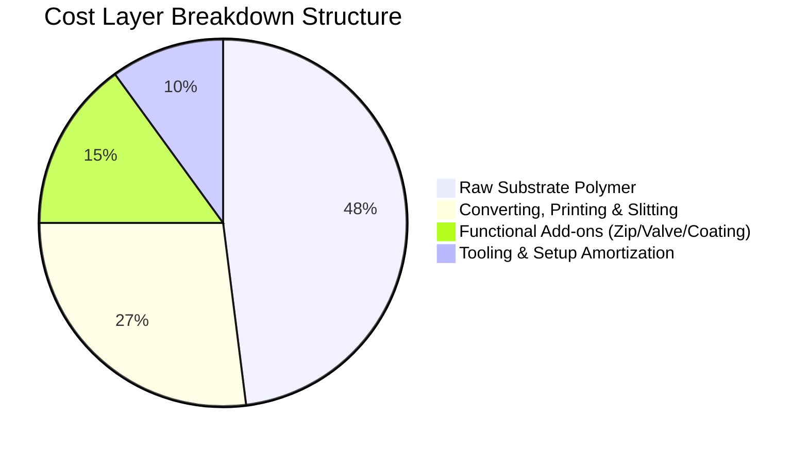
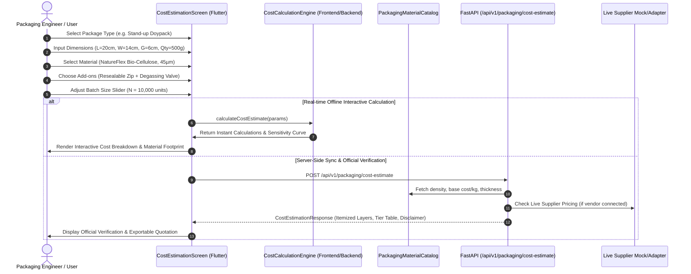

# Technical Specification: Cost Estimation (Module 10)

## 1. Executive Summary & Engineering Motivation

### 1.1 Problem Statement
When food manufacturers, agricultural processors, and packaging engineers transition from theoretical material selection to commercial production, **cost feasibility and material footprint estimation** represent the most critical go/no-go decision criteria.

1. **Geometry-Dependent Material Footprint:** Packaging material volume is not simply weight or volume of food; it depends on package geometry (surface area, seam margins, bottom/side gussets, draw depths for thermoforming) and film gauge (microns/thickness).
2. **Multi-Factor Cost Structure:** True packaging cost is composed of:
   - Raw substrate polymer/foil/paper material cost (by kg or $\text{m}^2$).
   - Converting and manufacturing costs (blown/cast extrusion, solventless lamination, rotogravure/flexographic printing, pouch forming).
   - Functional add-on features (resealable zippers, degassing valves, easy-open tear notches, anti-fog coatings, MAP gas-flushing hermetic seals).
   - Economies of scale and batch size volume discounts (Minimum Order Quantities / MOQ tiers).
3. **Estimation vs. Live Pricing Transparency:** Because resin prices and converter conversion fees fluctuate with global commodity indexes (ICIS, Platts) and supply chain dynamics, packaging calculations must be **explicitly labeled as "Estimated Baseline"** unless tied to live supplier RFQ (Request for Quote) feeds.

The **Cost Estimation Module (Module 10)** provides an intelligent, parametric engineering calculator that ingests packaging type, geometry dimensions, substrate material properties, functional add-ons, and production quantity, yielding rigorous material requirement totals ($\text{m}^2$, $\text{kg}$, scrap allowance) and itemized cost breakdowns ($\text{₹}/\text{unit}$, total $\text{₹}$, volume tier discount curve).

---

### 1.2 Core Input & Output Parameters

```mermaid
graph LR
    subgraph Inputs
        I1[Quantity / Pack Fill Weight]
        I2[Packaging Type / Form Factor]
        I3[Material Substrate & Gauge]
        I4[Package Size: L x W x H/G]
        I5[Number of Packages / Batch Size]
        I6[Functional Add-ons & Finishes]
    end

    subgraph Cost Engine
        E1[Geometric Surface Area Calculator]
        E2[Mass & Density Calculator]
        E3[Scrap Allowance & Waste Factor]
        E4[Converting & Manufacturing Matrix]
        E5[Volume Scaling Tier Engine]
    end

    subgraph Outputs
        O1["Estimated Material Requirement (m², kg)"]
        O2["Estimated Packaging Cost (₹ Subtotal)"]
        O3["Cost Per Unit (₹/unit)"]
        O4["Total Estimated Cost (₹)"]
        O5["Cost Breakdown (Substrate, Converting, Add-ons)"]
        O6["Volume Tier Sensitivity Curve"]
        O7["Mandatory 'Estimated' Baseline Badge"]
    end

    Inputs --> Cost Engine --> Outputs
```

| Input Dimension | Description & Supported Options | Units / Constraints |
| :--- | :--- | :--- |
| **Quantity (Fill Capacity)** | Target food net weight or volume per pack | `50g`, `100g`, `250g`, `500g`, `1000g / 1kg`, `5kg`, or Custom |
| **Packaging Type** | Form factor geometry determining surface area formula | `Pillow Pouch`, `Stand-up Doypack (Bottom Gusset)`, `3-Side Seal Pouch`, `4-Side Quad Seal Pouch`, `Thermoformed Tray / Clamshell`, `Vacuum / Retort Pouch`, `Folding Carton Box` |
| **Material Substrate** | Polymer, bio-film, paper, or multi-layer laminate | Reference to Catalog (LDPE, HDPE, BOPP, PET, NatureFlex Cellulose, Bio-PLA, Al-Foil Laminate, EVOH Co-ex, Kraft Paper/PE) |
| **Film Gauge / Thickness** | Thickness of film or rigid sheet | $15\,\mu\text{m}$ to $350\,\mu\text{m}$ (Default derived from material) |
| **Package Size** | Length ($L$), Width ($W$), Depth/Gusset ($H$ or $G$) | $\text{cm}$ or $\text{mm}$ |
| **Number of Packages** | Total production run / batch size | $100$ to $1,000,000+$ units |
| **Add-on Features** | Optional functional components & treatments | `Resealable Press-to-Close Zip`, `One-way Degassing Valve`, `Tear Notch`, `Anti-Fog Coating`, `Micro-perforations`, `Gas Flush Hermetic Seal` |

---

## 2. Mathematical Formulations & Geometric Calculations

### 2.1 Geometric Surface Area ($A_{\text{unit}}$) by Packaging Form Factor

Let $L = \text{Length (m)}$, $W = \text{Width (m)}$, $H = \text{Height/Depth (m)}$, $G = \text{Gusset Width (m)}$, and $S = \text{Seam Margin (default } 0.01\text{ m / } 10\text{ mm)}$.

#### 1. Pillow Pouch (Form-Fill-Seal / 2-side seam):
$$A_{\text{pillow}} = 2 \times (L + 2S) \times (W + S)$$

#### 2. Stand-up Doypack (with Bottom Gusset $G$):
$$A_{\text{doypack}} = \left[ 2 \times (L + S) \times (W + S) \right] + \left[ (W + S) \times (G + S) \times 1.15 \right]$$
*(where $1.15$ accounts for the rounded bottom insert trim cut).*

#### 3. 3-Side Seal Pouch:
$$A_{\text{3side}} = 2 \times (L + S) \times (W + 2S)$$

#### 4. 4-Side Quad Seal Pouch (with Side Gussets $G$):
$$A_{\text{quad}} = 2 \times (L + 2S) \times \left( W + 2G + 2S \right)$$

#### 5. Thermoformed Tray / Rigid Clamshell (with draw depth $H$ and flange margin $F = 0.015\text{ m}$):
$$A_{\text{tray}} = \left[ (L \times W) + 2(L \times H) + 2(W \times H) \right] \times (1 + \text{drawSlackFactor})$$
*(where $\text{drawSlackFactor} = 0.12$ for corner thinning and flange lip).*

#### 6. Vacuum / Retort Flat Pouch:
$$A_{\text{vacuum}} = 2 \times (L + 2S) \times (W + 2S)$$

#### 7. Folding Carton Box (Outer Carton):
$$A_{\text{carton}} = 2 \times \left( (L \times W) + (L \times H) + (W \times H) \right) \times 1.22$$
*(where $1.22$ accounts for glue flaps, tuck flaps, and dust wings).*

---

### 2.2 Material Mass, Density, and Scrap Calculation

Let $\rho$ be the substrate polymer/composite density in $\text{g/cm}^3$ (or $\text{kg/m}^3$), $t$ be the total gauge thickness in $\text{m}$ ($t_{\mu\text{m}} \times 10^{-6}$), and $\alpha_{\text{scrap}}$ be the production trim scrap allowance ($5\% \le \alpha_{\text{scrap}} \le 8\%$, default $0.06$).

#### Single Unit Film Mass ($M_{\text{unit}}$):
$$M_{\text{unit}} (\text{kg}) = A_{\text{unit}} (\text{m}^2) \times t (\text{m}) \times \rho (\text{kg/m}^3)$$

*Polymer Densities Table ($\rho$):*
- LDPE / LLDPE: $920\,\text{kg/m}^3$ ($0.92\,\text{g/cm}^3$)
- HDPE: $955\,\text{kg/m}^3$ ($0.955\,\text{g/cm}^3$)
- BOPP / PP: $905\,\text{kg/m}^3$ ($0.905\,\text{g/cm}^3$)
- PET / Polyester: $1380\,\text{kg/m}^3$ ($1.38\,\text{g/cm}^3$)
- Bio-PLA (Polylactic Acid): $1250\,\text{kg/m}^3$ ($1.25\,\text{g/cm}^3$)
- NatureFlex (Regenerated Cellulose): $1450\,\text{kg/m}^3$ ($1.45\,\text{g/cm}^3$)
- Aluminum Foil ($9\,\mu\text{m}$ barrier layer): $2700\,\text{kg/m}^3$ ($2.70\,\text{g/cm}^3$)
- Kraft Paper (Solid Bleached Sulfate): $750\,\text{kg/m}^3$ ($0.75\,\text{g/cm}^3$)

#### Total Batch Material Requirements:
$$\text{Net Area Required } A_{\text{net}} = N \times A_{\text{unit}} \quad (\text{m}^2)$$
$$\text{Gross Area (with Scrap) } A_{\text{gross}} = A_{\text{net}} \times (1 + \alpha_{\text{scrap}}) \quad (\text{m}^2)$$
$$\text{Gross Material Weight } M_{\text{gross}} = N \times M_{\text{unit}} \times (1 + \alpha_{\text{scrap}}) \quad (\text{kg})$$

---

### 2.3 Unit Cost & Total Cost Component Breakdown

The packaging cost per unit ($C_{\text{unit}}$) is computed via 4 discrete cost layers:

$$C_{\text{unit}} = \left( C_{\text{substrate}} + C_{\text{converting}} + C_{\text{addons}} + \frac{C_{\text{toolingSetup}}}{N} \right) \times (1 - \delta_{\text{volume}})$$



#### 1. Substrate Cost ($C_{\text{substrate}}$):
$$C_{\text{substrate}} = M_{\text{unit}} \times (1 + \alpha_{\text{scrap}}) \times \text{BasePricePerKg}_{\text{material}}$$
*(or $A_{\text{unit}} \times \text{BasePricePerSqm}$ if substrate is quoted by area).*

#### 2. Converting, Printing & Fabrication Cost ($C_{\text{converting}}$):
- Lamination fee: ₹$0.45/\text{m}^2$
- Printing fee (Up to 8-color Rotogravure/Flexo): ₹$0.75/\text{m}^2$
- Slitting & Pouch Making conversion: ₹$0.35/\text{unit}$
$$C_{\text{converting}} = \left( A_{\text{unit}} \times (P_{\text{print}} + P_{\text{lam}}) \right) + P_{\text{pouchMaker}}$$

#### 3. Functional Add-on Costs ($C_{\text{addons}}$):
$$\sum C_{\text{addon}} = \begin{cases}
\text{Resealable Zipper:} & +₹0.40/\text{unit} \\
\text{One-Way Degassing Valve:} & +₹0.85/\text{unit} \\
\text{Anti-Fog Surfactant Coating:} & +₹0.20/\text{unit} \\
\text{Laser Scoring / Easy-Tear Notch:} & +₹0.08/\text{unit} \\
\text{MAP Gas Flush Seal Integrity:} & +₹0.15/\text{unit} \\
\text{Micro-Perforation (Laser/Needle):} & +₹0.18/\text{unit}
\end{cases}$$

#### 4. Tooling & Cylinder Setup Amortization ($C_{\text{toolingSetup}}$):
- Printing cylinders / tooling dies: Fixed one-time charge ₹$12,000$ (spread over $N$ units).

#### 5. Economies of Scale & Volume Tier Discounts ($\delta_{\text{volume}}$):
| Tier | Order Volume Range ($N$) | Volume Discount ($\delta_{\text{volume}}$) | Operational Rationale |
| :--- | :--- | :--- | :--- |
| **Tier 1: Prototype / Pilot** | $100 \le N < 5,000$ | $0.0\%$ ($0\%$) | High setup-to-run ratio, short reel waste |
| **Tier 2: Small Commercial** | $5,000 \le N < 25,000$ | $8.0\%$ ($8\%$) | Standard master roll utilization |
| **Tier 3: Medium Commercial**| $25,000 \le N < 100,000$ | $16.0\%$ ($16\%$) | Continuous extrusion runs, reduced scrap |
| **Tier 4: Enterprise Scale** | $N \ge 100,000$ | $24.0\%$ ($24\%$) | Direct resin railcar bulk pricing |

---

## 3. System Architecture & Component Interactions



---

## 4. Backend Data Contracts & Schemas

### 4.1 Pydantic Schemas (`backend/app/schemas/cost_estimation.py`)

```python
from enum import Enum
from typing import List, Optional, Dict
from pydantic import BaseModel, Field

class PackagingFormFactorEnum(str, Enum):
    PILLOW_POUCH = "Pillow Pouch"
    STAND_UP_DOYPACK = "Stand-up Doypack"
    THREE_SIDE_SEAL = "3-Side Seal Pouch"
    FOUR_SIDE_QUAD_SEAL = "4-Side Quad Seal"
    THERMOFORMED_TRAY = "Thermoformed Tray / Clamshell"
    VACUUM_RETORT_POUCH = "Vacuum / Retort Pouch"
    FOLDING_CARTON = "Folding Carton Box"

class FunctionalAddOnEnum(str, Enum):
    RESEALABLE_ZIPPER = "Resealable Zipper"
    DEGASSING_VALVE = "One-Way Degassing Valve"
    TEAR_NOTCH = "Laser Tear Notch"
    ANTI_FOG_COATING = "Anti-Fog Coating"
    MICRO_PERFORATIONS = "Laser Micro-Perforations"
    MAP_GAS_FLUSH = "MAP Gas Flush Seal"

class PricingSourceEnum(str, Enum):
    ESTIMATED_MODEL = "Estimated Baseline Model"
    LIVE_SUPPLIER_QUOTE = "Live Supplier Direct RFQ"

class PackageDimensionsInput(BaseModel):
    length_cm: float = Field(..., gt=0, description="Length in centimeters")
    width_cm: float = Field(..., gt=0, description="Width in centimeters")
    depth_or_gusset_cm: Optional[float] = Field(0.0, ge=0, description="Depth, Height, or Gusset in cm")
    thickness_microns: Optional[float] = Field(None, gt=0, description="Film/sheet thickness in microns")

class CostEstimationRequest(BaseModel):
    material_id: Optional[str] = Field(None, description="Identifier of material from catalog, e.g. MAT_001")
    material_name: str = Field(..., description="Name of material, e.g. Bio-PLA or LDPE")
    packaging_type: PackagingFormFactorEnum = Field(..., description="Packaging form factor")
    dimensions: PackageDimensionsInput = Field(..., description="Package physical dimensions")
    product_fill_quantity: Optional[str] = Field("500g", description="Net food weight/volume per pack")
    number_of_packages: int = Field(..., gt=0, description="Batch order volume N")
    selected_addons: Optional[List[FunctionalAddOnEnum]] = Field(default_factory=list, description="Add-ons selected")
    custom_material_cost_per_kg: Optional[float] = Field(None, ge=0, description="Override base price INR/kg")
    custom_scrap_rate_percent: Optional[float] = Field(6.0, ge=0, le=30, description="Trim scrap allowance percentage")
    include_tooling_amortization: Optional[bool] = Field(True, description="Amortize fixed setup cylinder tooling fee")

class MaterialRequirementDetail(BaseModel):
    surface_area_per_unit_sqm: float = Field(..., description="Surface area for one unit in m²")
    weight_per_unit_grams: float = Field(..., description="Mass for one unit in grams")
    gross_area_required_sqm: float = Field(..., description="Total batch area including scrap in m²")
    gross_weight_required_kg: float = Field(..., description="Total batch material mass in kg")
    scrap_allowance_percent: float = Field(..., description="Trim scrap percentage applied")
    scrap_material_weight_kg: float = Field(..., description="Estimated scrap material in kg")

class CostLayerItem(BaseModel):
    category: str = Field(..., description="Substrate, Converting, Add-on, or Tooling")
    item_name: str = Field(..., description="Specific item description")
    cost_per_unit_inr: float = Field(..., description="Unit cost contribution in INR")
    total_cost_inr: float = Field(..., description="Total batch cost in INR")
    percentage_of_total: float = Field(..., description="Percentage contribution to total cost")

class VolumeTierSensitivityPoint(BaseModel):
    tier_label: str = Field(..., description="e.g. 1k Units, 10k Units, 100k Units")
    order_volume: int = Field(..., description="Unit count")
    cost_per_unit_inr: float = Field(..., description="Estimated unit cost at this volume")
    total_cost_inr: float = Field(..., description="Total order cost at this volume")
    discount_percent: float = Field(..., description="Volume discount percentage")

class CostEstimationResponse(BaseModel):
    material_id: Optional[str]
    material_name: str
    packaging_type: PackagingFormFactorEnum
    number_of_packages: int
    product_fill_quantity: str
    
    # Material Footprint Output
    material_requirement: MaterialRequirementDetail
    
    # Financial Cost Outputs
    cost_per_unit_inr: float = Field(..., description="Final estimated cost per unit in INR")
    total_estimated_cost_inr: float = Field(..., description="Total estimated batch cost in INR")
    
    # Itemized Breakdown
    cost_breakdown: List[CostLayerItem]
    substrate_cost_subtotal_inr: float
    converting_cost_subtotal_inr: float
    addons_cost_subtotal_inr: float
    tooling_cost_subtotal_inr: float
    volume_discount_amount_inr: float
    volume_discount_percent: float
    
    # Volume Sensitivity Curve
    volume_tier_sensitivity: List[VolumeTierSensitivityPoint]
    
    # Mandatory Transparency & Disclaimer Metadata
    pricing_mode: PricingSourceEnum = Field(default=PricingSourceEnum.ESTIMATED_MODEL)
    is_estimated: bool = Field(default=True, description="Always true unless live supplier verified")
    disclaimer_notice: str = Field(
        default="ESTIMATED BASELINE: Values are computed using standard industry conversion ratios, empirical polymer densities, and standard finishing margins. Actual commercial prices may vary ±10-15% based on live polymer index fluctuations and converter tooling specifications."
    )
    supplier_quote_reference_id: Optional[str] = None
    currency_code: str = Field(default="INR", description="Currency ISO code")
```

---

## 5. Backend Service Implementation Architecture

### 5.1 Service Location & Class Definition
- **File:** `backend/app/services/cost_estimation_service.py`
- **Class:** `CostEstimationService`

### 5.2 Core Service Methods:
1. `calculate_unit_surface_area(packaging_type, length_cm, width_cm, depth_cm) -> float`:
   Applies geometric formulations for pillow, doypack, 3-side seal, quad-seal, thermoformed tray, vacuum bag, and folding carton.
2. `get_polymer_density(material_name_or_id) -> float`:
   Queries material catalog or falls back to standard polymer physics densities.
3. `calculate_cost_estimate(request: CostEstimationRequest) -> CostEstimationResponse`:
   Orchestrates geometric surface area, mass, converting matrices, add-on aggregations, volume scaling, and tier curve generation.

---

## 6. Frontend UI/UX Architecture

### 6.1 Screen & Widget Layout (`CostEstimationScreen`)

```
+-----------------------------------------------------------------------------------+
|  [Header] 💰 Packaging Cost & Material Estimator                                  |
|  [!] ESTIMATED BASELINE COST (Subject to Live Supplier Quotes) [Info Icon]        |
+-----------------------------------------------------------------------------------+
|  LEFT PANEL: Input Parameters               | RIGHT PANEL: Estimated Cost Cockpit |
|                                             |                                     |
|  1. Packaging Type & Fill Capacity          |  +-------------------------------+  |
|     [Pillow] [Doypack*] [3-Side] [Tray]     |  | Total Estimated Cost: ₹68,400 |  |
|     Fill: [ 500 g v ]                       |  | Cost Per Unit:        ₹6.84   |  |
|                                             |  +-------------------------------+  |
|  2. Geometry Dimensions (cm)                |                                     |
|     Length: [ 20.0 ]  Width: [ 14.0 ]       |  Material Requirements:             |
|     Gusset/Depth: [ 6.0 ]                   |  - Unit Area: 0.064 m² (640 cm²)    |
|                                             |  - Unit Weight: 4.15 g (45 µm)      |
|  3. Material Substrate                      |  - Total Batch Film: 44.0 kg        |
|     [ NatureFlex Cellulose 45µm v ]         |  - Scrap Margin (6%): 2.64 kg       |
|     Base Cost: ₹420 / kg                    |                                     |
|                                             |  Cost Breakdown (Donut Chart):      |
|  4. Functional Add-ons                      |  [==== Substrate 48% ======]        |
|     [x] Resealable Zipper (+₹0.40)          |  [=== Converting 28% ======]        |
|     [x] Degassing Valve   (+₹0.85)          |  [== Add-ons 18% ==========]        |
|     [ ] Anti-Fog Coating  (+₹0.20)          |  [= Tooling Setup 6% ======]        |
|                                             |                                     |
|  5. Batch Order Size (N)                    |  Volume Pricing Curve:              |
|     Slider: [========o=====] 10,000 Units   |  1k: ₹9.20 | 10k: ₹6.84 | 100k: ₹5.15|
|     Tier: Tier 2 (-8% Volume Discount)      |                                     |
|                                             |  [ Request Supplier RFQ / Export ]  |
+-----------------------------------------------------------------------------------+
```

### 6.2 Widget Components in `frontend/lib/screens/cost_estimation/widgets/`:
1. `PackagingTypeSelectorGrid`: Visual grid with intuitive geometry icons (Pouch, Doypack, Clamshell, Box).
2. `PackageDimensionInputs`: Numeric steppers and millimeter/centimeter input fields with dimension guideline tooltips.
3. `MaterialSelectorDropdown`: Quick-search dropdown integrated with the 12+ empirical polymer catalog and thickness gauge override.
4. `AddOnFeatureChecklist`: Multi-select card list with explicit unit cost tags (+₹0.40/unit, etc.).
5. `BatchVolumeSlider`: Responsive logarithmic/linear slider from 100 to 500,000 units with active tier indicator badges.
6. `CostSummaryHeroCard`: Large typography displaying **Total Estimated Cost (₹)** and **Cost Per Unit (₹)** with prominent `"ESTIMATED"` badge.
7. `MaterialFootprintCard`: Cards showing Unit Surface Area, Gross Film Area ($\text{m}^2$), Total Batch Mass ($\text{kg}$), and Trim Scrap ($\text{kg}$).
8. `CostBreakdownChart`: Segmented progress bar / fl_chart donut chart detailing Substrate vs Converting vs Add-ons vs Tooling.
9. `VolumeSensitivityChart`: Interactive bar/line chart highlighting unit cost reduction across 1k, 5k, 10k, 25k, 50k, 100k volume milestones.
10. `SupplierQuoteDisclaimerBanner`: Amber-hued persistent disclaimer banner with RFQ inquiry modal launcher.

---

## 7. REST API Endpoints & Routes

### 7.1 `POST /api/v1/packaging/cost-estimate`
- **Description:** Ingests packaging geometry, material specifications, add-on features, and batch quantity to calculate material footprint and itemized cost breakdown.
- **Request Body:** `CostEstimationRequest`
- **Response Body:** `CostEstimationResponse`
- **Status Codes:**
  - `200 OK`: Successful calculation.
  - `400 Bad Request`: Invalid dimensions ($L \le 0$, $W \le 0$) or negative batch volume.
  - `422 Unprocessable Entity`: Schema validation errors.

### 7.2 `GET /api/v1/packaging/cost-parameters`
- **Description:** Returns the system reference table for default polymer densities, standard dimension presets by pack weight (50g, 250g, 500g, 1kg), standard add-on feature prices, and volume discount tiers.
- **Response Body:**
```json
{
  "standard_form_factors": ["Pillow Pouch", "Stand-up Doypack", "3-Side Seal Pouch", "4-Side Quad Seal", "Thermoformed Tray / Clamshell", "Vacuum / Retort Pouch", "Folding Carton Box"],
  "polymer_densities_g_cm3": {
    "LDPE": 0.92,
    "HDPE": 0.955,
    "BOPP": 0.905,
    "PET": 1.38,
    "Bio-PLA": 1.25,
    "NatureFlex": 1.45,
    "Al-Foil": 2.70,
    "Kraft Paper": 0.75
  },
  "addons_pricing_inr": {
    "Resealable Zipper": 0.40,
    "One-Way Degassing Valve": 0.85,
    "Laser Tear Notch": 0.08,
    "Anti-Fog Coating": 0.20,
    "Laser Micro-Perforations": 0.18,
    "MAP Gas Flush Seal": 0.15
  },
  "volume_discount_tiers": [
    {"min_qty": 100, "max_qty": 4999, "discount_pct": 0.0, "tier_name": "Pilot / Prototype"},
    {"min_qty": 5000, "max_qty": 24999, "discount_pct": 8.0, "tier_name": "Small Commercial"},
    {"min_qty": 25000, "max_qty": 99999, "discount_pct": 16.0, "tier_name": "Medium Commercial"},
    {"min_qty": 100000, "max_qty": null, "discount_pct": 24.0, "tier_name": "Enterprise Scale"}
  ]
}
```

---

## 8. Integration Points with Existing Features

1. **Food Recommendation Cockpit Integration (`Module 6 & 8`):**
   - In `RecommendationResultsCockpit`, each recommended material card receives an action button: `[ Calculate Production Cost ]`.
   - Clicking deep-links into `CostEstimationScreen` pre-populating food net weight (e.g. 500g), recommended material (e.g. Bio-PLA 30µm), and standard package size.
2. **Packaging Comparison Matrix Integration (`Module 9`):**
   - In `PackagingComparisonScreen`, the "Cost Category" row includes an interactive link: `[ Estimate Batch Cost for Material A / B / C ]`.
3. **Materials Catalog Integration (`Module 7`):**
   - In `MaterialDetailModal`, a direct button `[ Launch Cost Calculator ]` passes the material ID and density.

---

## 9. Verification & Testing Strategy

### 9.1 Backend Test Matrix (`backend/tests/`)
1. `test_geometry_surface_area_formulas()`:
   - Tests all 7 form factors against hand-calculated analytical benchmarks.
   - Verifies seam allowances, gusset adjustments, and thermoforming draw margins.
2. `test_material_mass_and_scrap_calculations()`:
   - Verifies density $\times$ volume conversion ($M = A \times t \times \rho$).
   - Verifies $6\%$ scrap allowance correctly inflates gross mass requirement.
3. `test_cost_layer_subtotals_and_tier_discounts()`:
   - Verifies unit cost and total cost across Tier 1, Tier 2, Tier 3, and Tier 4.
   - Verifies add-ons sum correctly without double-counting.
   - Verifies tooling amortization scales down with larger batch sizes ($C_{\text{tooling}} / N$).
4. `test_cost_estimation_endpoint_api()`:
   - Validates `POST /api/v1/packaging/cost-estimate` returns 200 OK with correct Pydantic structure.
   - Tests validation errors for invalid geometry ($L \le 0, W \le 0, N \le 0$).
5. `test_cost_parameters_endpoint_api()`:
   - Validates `GET /api/v1/packaging/cost-parameters` returns full reference metadata.

### 9.2 Frontend Test Matrix (`frontend/test/`)
1. `test_cost_estimation_model_serialization()`:
   - Tests `CostEstimationRequest` and `CostEstimationResponse` `toJson()` and `fromJson()`.
2. `test_offline_cost_calculation_engine()`:
   - Verifies frontend offline synthesis math matches backend calculations to $\pm0.01\text{ ₹}$ precision.
3. `test_cost_estimation_screen_rendering()`:
   - Verifies input widgets, dimension steppers, add-on checkboxes, and volume slider render without errors.
   - Verifies zero `RenderFlex` overflow across desktop ($1440\text{px}$) and mobile ($390\text{px}$).
4. `test_cost_estimation_interactive_updates()`:
   - Verifies moving the batch slider immediately updates Total Cost and Cost Per Unit.
   - Verifies toggling add-on checkboxes updates the breakdown chart in real-time.
5. `test_disclaimer_notice_visibility()`:
   - Verifies that the *"ESTIMATED BASELINE"* label and disclaimer are visibly rendered in the UI.

---

## 10. Acceptance Criteria Checklist

- [ ] **Geometry Calculations:** Accurate surface area math for Pillow, Doypack, 3-Side, Quad-Seal, Clamshell/Tray, Vacuum Bag, and Folding Carton.
- [ ] **Material Footprint:** Outputs Unit Surface Area ($\text{m}^2$), Unit Mass ($\text{g}$), Gross Batch Area ($\text{m}^2$), Gross Batch Mass ($\text{kg}$), and Scrap Allowance ($\text{kg}$).
- [ ] **Itemized Cost Layers:** Clear breakdown of Substrate Raw Material, Converting & Printing, Functional Add-ons, and Tooling Amortization.
- [ ] **Financial Totals:** Outputs exact **Cost Per Unit ($\text{₹}/\text{unit}$)** and **Total Estimated Cost ($\text{₹}$)**.
- [ ] **Volume Scaling Curve:** Dynamic sensitivity points for 1k, 5k, 10k, 25k, 50k, 100k units with tier discount badges.
- [ ] **Mandatory Estimated Labeling:** Prominent disclaimer and `"ESTIMATED"` badge displayed on all views and reports.
- [ ] **Offline & API Parity:** Works both via `POST /api/v1/packaging/cost-estimate` and local client-side offline calculation engine.
- [ ] **UI/UX Visual Excellence:** Sleek dark-mode glassmorphic cards, intuitive dimension input guides, animated donut chart breakdown, and volume slider.
- [ ] **100% Test Coverage:** All backend and frontend unit, widget, and integration tests pass with 0 errors.
