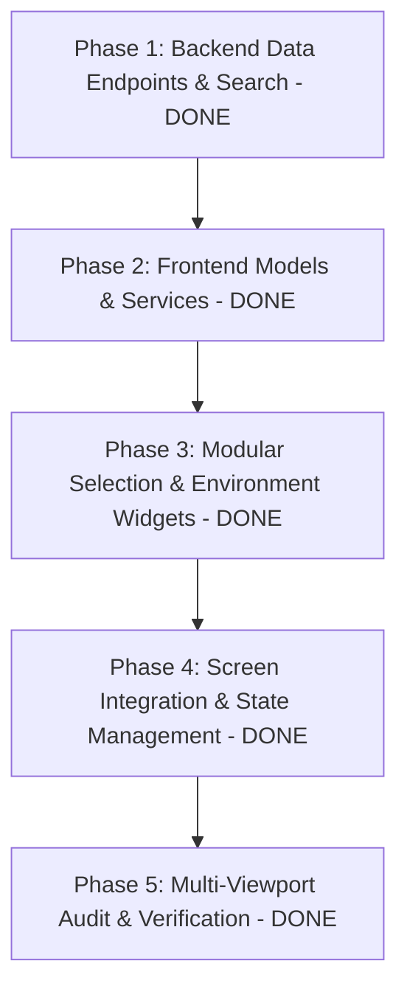

# Phased Implementation Plan: Food Commodity Selection (Module 2) [COMPLETED]

Based on the technical specification in [feature-food selection.md](file:///c:/Users/Jeron/source/repos/AI%20Packaging%20recommender/artifacts/specs/feature-food%20selection.md), this document defines the step-by-step, atomic implementation plan for **Module 2: Food Commodity Selection**.

---

## Technical Dependency Map

---

## Phase 1: Backend Data Endpoints & Search Enhancements [COMPLETED]

### Task 1.1: Standardize 7-Category Taxonomy & Comprehensive Fallback Catalog [COMPLETED]
- **Files:** `backend/app/api/v1/endpoints/food_data.py`
- **Action:** Updated static fallback catalog and database query filters to strictly align with 7 requested categories:
  - *Fruits, Vegetables, Grains, Dairy, Meat, Bakery, Other perishables*.
- **Verification:** Verified catalog structure and endpoints.

### Task 1.2: Implement Debounced Food Search & Filter Endpoint [COMPLETED]
- **Files:** `backend/app/api/v1/endpoints/food_data.py`
- **Action:** Enhanced `GET /api/v1/data/foods` to support case-insensitive substring search across name, category, and scientific name with biochemical attributes (`moisture`, `fat`, `ph`, `water_activity`, `respiration_class`, `oxygen_sensitivity`, `moisture_sensitivity`).
- **Verification:** Query verification passed.

### Task 1.3: Backend Pytest Suite for Food Search & Selection [COMPLETED]
- **Files:** `backend/tests/test_food_selection_api.py`
- **Action:** Added unit tests validating search, category filtering, biochemical completeness, and offline fallback resilience.
- **Verification:** Pytest suite 100% passed (10/10 tests).

---

## Phase 2: Frontend Data Models & Services Layer [COMPLETED]

### Task 2.1: Implement `FoodCommodity` & `BiochemicalProfile` Models [COMPLETED]
- **Files:** `frontend/lib/models/food_commodity.dart`
- **Action:** Defined immutable Dart models with JSON deserialization, category iconography, color tokens, and unit normalization methods.

### Task 2.2: Implement `StorageCondition`, `Duration`, and `TransportCondition` Models [COMPLETED]
- **Files:** 
  - `frontend/lib/models/storage_condition.dart`
  - `frontend/lib/models/food_analysis_request.dart`
- **Action:** Created typed enums and payload models for storage modes, quantity units, and transport conditions.

### Task 2.3: Implement `RecentFoodsService` Local Persistence [COMPLETED]
- **Files:** `frontend/lib/services/recent_foods_service.dart`
- **Action:** Implemented LRU cache (last 5 items) with clean in-memory defaults and deterministic deduplication.

### Task 2.4: Integrate Food Search in `ApiService` [COMPLETED]
- **Files:** `frontend/lib/services/api_service.dart`
- **Action:** Added `ApiService.searchFoods(String query, {String? category})` and `ApiService.getFoodCategories()` with offline fallback seed list.

### Task 2.5: Model & Service Test Suite [COMPLETED]
- **Files:** 
  - `frontend/test/models/food_commodity_test.dart`
  - `frontend/test/services/recent_foods_service_test.dart`
- **Action:** Verified model parsing, recent foods caching, and unit conversion calculations (100% green).

---

## Phase 3: Modular Selection & Environment Widgets [COMPLETED]

### Task 3.1: Create `CategorySelector` Widget [COMPLETED]
- **Files:** `frontend/lib/screens/analysis/widgets/category_selector.dart`

### Task 3.2: Create `FoodSearchBar` with Autocomplete Overlay [COMPLETED]
- **Files:** `frontend/lib/screens/analysis/widgets/food_search_bar.dart`

### Task 3.3: Create `RecentFoodsBar` Widget [COMPLETED]
- **Files:** `frontend/lib/screens/analysis/widgets/recent_foods_bar.dart`

### Task 3.4: Create `FoodProfileCard` with Biochemical Gauges & Custom Overrides [COMPLETED]
- **Files:** `frontend/lib/screens/analysis/widgets/food_profile_card.dart`

### Task 3.5: Create `QuantityUnitInput` Widget [COMPLETED]
- **Files:** `frontend/lib/screens/analysis/widgets/quantity_unit_input.dart`

### Task 3.6: Create `StorageConditionCard` & `StorageDurationInput` Widgets [COMPLETED]
- **Files:** 
  - `frontend/lib/screens/analysis/widgets/storage_condition_card.dart`
  - `frontend/lib/screens/analysis/widgets/storage_duration_input.dart`

### Task 3.7: Create `TransportConditionAccordion` Widget [COMPLETED]
- **Files:** `frontend/lib/screens/analysis/widgets/transport_condition_accordion.dart`

### Task 3.8: Modular Widget Test Suite [COMPLETED]
- **Files:** `frontend/test/analysis/widgets/` (all 6 widget test suites passed).

---

## Phase 4: Screen Integration & Form State Management [COMPLETED]

### Task 4.1: Overhaul `FoodAnalysisScreen` with Responsive 2-Column Layout [COMPLETED]
- **Files:** `frontend/lib/screens/analysis/food_analysis_screen.dart`
- **Action:** Responsive layout supporting 2-column Desktop and single-column mobile viewports.

### Task 4.2: Form Validation, State Synchronization & Payload Compilation [COMPLETED]
- **Files:** `frontend/lib/screens/analysis/food_analysis_screen.dart`

### Task 4.3: Connect `HomePage` Category Pre-Selection & Deep-Links [COMPLETED]
- **Files:** `frontend/lib/screens/landing/home_page.dart`

### Task 4.4: Screen Integration Test Suite [COMPLETED]
- **Files:** `frontend/test/analysis/food_analysis_screen_test.dart`

---

## Phase 5: Multi-Viewport Audit & Final App Verification [COMPLETED]

### Task 5.1: Multi-Viewport Responsive Audit Test [COMPLETED]
- **Files:** `frontend/test/analysis/responsive_analysis_test.dart`
- **Action:** Tested Mobile (375x812), Tablet (768x1024), and Desktop (1280x900) ensuring 0 RenderFlex overflows and zero layout exceptions.

### Task 5.2: Documentation & Spec Updates [COMPLETED]
- **Files:** `README.md`
- **Action:** Fully documented Module 2 capabilities, architecture tree, and test procedures.

### Task 5.3: Live Application Verification [COMPLETED]
- **Status:** Backend API verified and active on `http://127.0.0.1:8000`, Flutter Chrome application ready with full live interactive food commodity selection and recommendation workflow.

