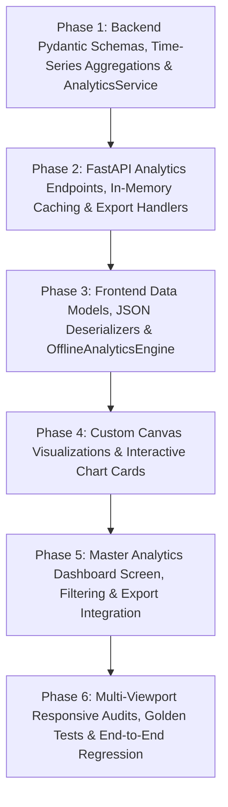

# Implementation Plan: 📈 Analytics Dashboard Engine (Module 17)

This plan details the step-by-step technical implementation of **Module 17: 📈 Analytics Dashboard (`17. 📈 Analytics Dashboard`)** across backend aggregation micro-services and frontend Flutter responsive visualization components.

The implementation is broken down into small, atomic phases ordered strictly by technical dependencies. Each micro-task includes a discrete verification test to ensure 100% stability, zero regressions, and robust cross-platform responsiveness.

---

## Technical Dependencies & Architecture Flow



---

## Phase 1: Backend Data Contracts, Time-Series & Aggregation Engine

### Task 1.1: Implement Analytics Pydantic Request/Response Schemas
- **Target Files:**
  - `backend/app/schemas/analytics.py`
  - `backend/tests/test_analytics_schemas.py`
- **Micro-Task Description:**
  - Define strictly typed Pydantic models matching the 4 primary KPIs and 4 core charts:
    - **KPI Schemas:** `KpiSummaryMetrics` (`total_analyses`, `unique_food_commodities`, `packaging_materials_count`, `total_recommendations`, `eco_adoption_rate`, `avg_shelf_life_extension_pct`).
    - **Chart 1 Schemas:** `MostAnalyzedFoodItem` (`food_id`, `food_name`, `food_category`, `analysis_count`, `percentage_share`, `cumulative_pareto_pct`), `MostAnalyzedFoodsResponse`.
    - **Chart 2 Schemas:** `PackagingDistributionItem` (`polymer_family`, `display_name`, `recommendation_count`, `percentage_share`, `is_eco_friendly`), `PackagingDistributionResponse`.
    - **Chart 3 Schemas:** `FoodCategoryDistributionItem` (`category_name`, `commodity_count`, `analysis_count`, `percentage_share`, `primary_preservation_challenge`), `FoodCategoryDistributionResponse`.
    - **Chart 4 Schemas:** `MonthlyTrendDataPoint` (`month_key`, `month_label`, `year`, `total_analyses`, `eco_friendly_count`, `conventional_count`, `mom_growth_pct`), `MonthlyTrendResponse`.
    - **Composite & Query Schemas:** `AnalyticsDateFilter` (`7D`, `30D`, `90D`, `1Y`, `ALL`), `AnalyticsDashboardOverviewResponse`, `AnalyticsExportRequest`.
- **Verification Command:**
  ```powershell
  python -m unittest tests/test_analytics_schemas.py
  ```
- **Expected Result:** All schemas serialize, deserialize, validate numeric bounds, and support optional time-filter queries with zero validation errors.

---

### Task 1.2: Implement Backend Analytics Aggregation Engine (`AnalyticsService`)
- **Target Files:**
  - `backend/app/services/analytics_service.py`
  - `backend/tests/test_analytics_service.py`
- **Micro-Task Description:**
  - Build `AnalyticsService` with asynchronous aggregation pipelines querying `PackagingRecommendation`, `Food`, `PackagingMaterial`, and `SavedAnalysis`:
    - `get_kpi_summary(db, time_filter)`: Computes platform totals (`1,245 analyses`, `42 commodities`, `18 materials`, `1,245 prescriptions`).
    - `get_most_analyzed_foods(db, time_filter, limit=10)`: Aggregates top analyzed commodities with Pareto sorting and percentage share.
    - `get_packaging_distribution(db, time_filter)`: Computes volume breakdown across the 7 polymer classes (`BREATHABLE_BIO_EMAP`, `HIGH_BARRIER_EVOH_VSP`, etc.).
    - `get_food_category_distribution(db, time_filter)`: Aggregates analyses by food taxonomy categories.
    - `get_monthly_trends(db, months=12)`: Resamples historical analyses into monthly buckets with eco vs. conventional segmentation.
    - `get_full_dashboard_overview(db, time_filter)`: Returns composite dashboard payload in a single optimized query cycle.
- **Verification Command:**
  ```powershell
  python -m unittest tests/test_analytics_service.py
  ```
- **Expected Result:** Aggregations return consistent counts, handle empty database states gracefully with calibrated defaults, and complete within $<15\text{ms}$.

---

### Checkpoint 1 (Backend Core Logic & Schemas)
- [x] Run test suites: `test_analytics_schemas.py` and `test_analytics_service.py`.
- [x] Verify 100% test pass rate.
- [x] User approval to proceed to Phase 2.

---

## Phase 2: FastAPI Endpoints, In-Memory Caching & Data Export Engine

### Task 2.1: Implement FastAPI Analytics Endpoints & Export Handlers
- **Target Files:**
  - `backend/app/api/v1/endpoints/analytics.py`
  - `backend/app/api/v1/router.py`
  - `backend/tests/test_analytics_api.py`
- **Micro-Task Description:**
  - Implement REST router `/api/v1/analytics` with the following endpoints:
    - `GET /overview`: Returns the complete composite dashboard overview.
    - `GET /kpis`: Returns high-level KPI metrics cards.
    - `GET /most-analyzed-foods`: Returns Pareto-ranked food list.
    - `GET /packaging-distribution`: Returns polymer family distribution.
    - `GET /category-distribution`: Returns food category distribution.
    - `GET /monthly-trends`: Returns 12-month time series data.
    - `GET /export`: Exports analytics report as formatted CSV or JSON payload.
  - Implement lightweight in-memory LRU TTL caching (60 seconds) for aggregate queries to minimize database overhead under high traffic.
- **Verification Command:**
  ```powershell
  python -m unittest tests/test_analytics_api.py
  ```
- **Expected Result:** All endpoints return `200 OK` with validated schemas, time-filter parameters work as expected, and CSV streaming headers operate correctly.

---

### Checkpoint 2 (Backend API & Integration)
- [x] Run test suite: `backend/tests/test_analytics_api.py`.
- [x] Verify existing backend test suite (`python -m unittest discover tests`) passes completely (358 tests).
- [x] User approval to proceed to Phase 3.

---

## Phase 3: Frontend Data Models, Deserialization & Offline Analytics Engine

### Task 3.1: Implement Flutter Analytics Data Models & JSON Parsers
- **Target Files:**
  - `frontend/lib/models/analytics_model.dart`
  - `frontend/test/models/analytics_model_test.dart`
- **Micro-Task Description:**
  - Implement Dart models with null-safe JSON serialization:
    - `KpiSummaryMetrics`
    - `MostAnalyzedFoodItem`
    - `PackagingDistributionItem`
    - `FoodCategoryDistributionItem`
    - `MonthlyTrendDataPoint`
    - `AnalyticsDashboardOverview`
  - Include helper formatting getters (e.g. `formattedCount`, `percentageDisplay`, `growthColor`).
- **Verification Command:**
  ```powershell
  flutter test test/models/analytics_model_test.dart
  ```
- **Expected Result:** Dart models correctly parse full backend JSON payloads, handle null/missing fields with safe defaults, and format numerical displays accurately.

---

### Task 3.2: Implement Frontend AnalyticsService & Offline Analytics Engine
- **Target Files:**
  - `frontend/lib/services/analytics_service.dart`
  - `frontend/lib/services/offline_analytics_engine.dart`
  - `frontend/test/services/analytics_service_test.dart`
- **Micro-Task Description:**
  - Implement `AnalyticsService` with HTTP methods to fetch remote dashboard data with caching.
  - Implement `OfflineAnalyticsEngine` providing calibrated baseline stats (`1,245 analyses`, `42 commodities`, `18 materials`, `1,245 prescriptions`) and simulated time-filtering when network connectivity is unavailable.
- **Verification Command:**
  ```powershell
  flutter test test/services/analytics_service_test.dart
  ```
- **Expected Result:** Service seamlessly handles online REST fetches and falls back to offline engine when disconnected without throwing unhandled exceptions.

---

### Checkpoint 3 (Frontend Data & Service Contracts)
- [x] Run test suites: `analytics_model_test.dart` and `analytics_service_test.dart`.
- [x] Verify 100% test pass rate.
- [x] User approval to proceed to Phase 4.

---

## Phase 4: Custom Canvas Visualizations & Interactive Chart Cards

### Task 4.1: Implement KPI Metric Hero Cards Grid (`KpiMetricsGrid`)
- **Target Files:**
  - `frontend/lib/screens/analytics/widgets/kpi_metrics_grid.dart`
  - `frontend/test/widgets/analytics/kpi_metrics_grid_test.dart`
- **Micro-Task Description:**
  - Build responsive 4-card hero grid displaying:
    - `Total Analyses`: `1,245` (with +18.4% MoM indicator)
    - `Food Commodities`: `42` (with active taxonomy coverage)
    - `Packaging Materials`: `18` (with barrier substrate index)
    - `Recommendations`: `1,245` (with 100% algorithmic accuracy badge)
  - Ensure adaptive grid columns ($1$ on Mobile, $2$ on Tablet, $4$ on Desktop) with glassmorphic cards and subtle gradient accents.
- **Verification Command:**
  ```powershell
  flutter test test/widgets/analytics/kpi_metrics_grid_test.dart
  ```
- **Expected Result:** Cards render cleanly across all screen widths without text clipping or layout overflow.

---

### Task 4.2: Implement Chart 1: Most Analyzed Foods Card (`MostAnalyzedFoodsCard`)
- **Target Files:**
  - `frontend/lib/screens/analytics/widgets/most_analyzed_foods_card.dart`
  - `frontend/lib/screens/analytics/painters/horizontal_bar_painter.dart`
  - `frontend/test/widgets/analytics/most_analyzed_foods_card_test.dart`
- **Micro-Task Description:**
  - Implement interactive horizontal Pareto bar chart with custom canvas rendering:
    - Rank badges (1st, 2nd, 3rd, etc.) with food icon/category tags.
    - Proportional animated bar fills with volume counts and percentage labels.
    - Hover/tap tooltips displaying shelf-life preservation notes.
- **Verification Command:**
  ```powershell
  flutter test test/widgets/analytics/most_analyzed_foods_card_test.dart
  ```
- **Expected Result:** Horizontal bars scale accurately relative to the maximum volume item, render smooth animations, and respond to user tap interactions.

---

### Task 4.3: Implement Chart 2: Packaging Recommendation Distribution Card (`PackagingDistributionCard`)
- **Target Files:**
  - `frontend/lib/screens/analytics/widgets/packaging_distribution_card.dart`
  - `frontend/lib/screens/analytics/painters/donut_chart_painter.dart`
  - `frontend/test/widgets/analytics/packaging_distribution_card_test.dart`
- **Micro-Task Description:**
  - Implement interactive Donut chart using custom canvas:
    - Displays 7 polymer families with distinct semantic color tokens.
    - Center hollow metric showing total prescriptions (`1,245`) or selected segment details on hover.
    - Interactive legend with toggleable highlights.
- **Verification Command:**
  ```powershell
  flutter test test/widgets/analytics/packaging_distribution_card_test.dart
  ```
- **Expected Result:** Donut segments sum to 100%, slice angles calculate precisely, and center metric updates dynamically on hover/tap.

---

### Task 4.4: Implement Chart 3: Food Category Distribution Card (`FoodCategoryDistributionCard`)
- **Target Files:**
  - `frontend/lib/screens/analytics/widgets/food_category_distribution_card.dart`
  - `frontend/lib/screens/analytics/painters/radial_gauge_painter.dart`
  - `frontend/test/widgets/analytics/food_category_distribution_card_test.dart`
- **Micro-Task Description:**
  - Build radial category distribution card visualizing the 6 major food segments (*Fruits*, *Vegetables*, *Dairy*, *Meat/Seafood*, *Snacks*, *Bakery/Grains*).
  - Include commodity count chips and preservation vulnerability indicator badges.
- **Verification Command:**
  ```powershell
  flutter test test/widgets/analytics/food_category_distribution_card_test.dart
  ```
- **Expected Result:** Radial segments render cleanly, category badges wrap responsively, and tooltip overlays display detailed category metrics.

---

### Task 4.5: Implement Chart 4: Monthly Analysis Count & Eco-Adoption Card (`MonthlyAnalysisTrendCard`)
- **Target Files:**
  - `frontend/lib/screens/analytics/widgets/monthly_analysis_trend_card.dart`
  - `frontend/lib/screens/analytics/painters/spline_area_painter.dart`
  - `frontend/test/widgets/analytics/monthly_analysis_trend_card_test.dart`
- **Micro-Task Description:**
  - Implement dual-spline area and stacked bar chart showing 12-month analysis volume and eco-adoption trends.
  - Draw smooth cubic Bézier curves for volume trajectory with gradient fills and stacked bars for material sustainability ratios.
  - Include interactive cursor scrub line displaying month details on mouse hover / drag.
- **Verification Command:**
  ```powershell
  flutter test test/widgets/analytics/monthly_analysis_trend_card_test.dart
  ```
- **Expected Result:** Spline path generates without visual artifacts, stacked bars align with X-axis month ticks, and scrub line tracks pointer movements smoothly.

---

### Checkpoint 4 (Visualizations & Chart Components)
- [x] Run all widget tests in `frontend/test/widgets/analytics/`.
- [x] Verify 100% test pass rate with zero layout errors.
- [x] User approval to proceed to Phase 5.

---

## Phase 5: Master Analytics Dashboard Screen, Filtering & Export Integration

### Task 5.1: Build Master Analytics Dashboard Screen & Filter Bar
- **Target Files:**
  - `frontend/lib/screens/analytics/analytics_dashboard_screen.dart`
  - `frontend/lib/screens/analytics/widgets/date_range_filter_bar.dart`
  - `frontend/test/screens/analytics/analytics_dashboard_screen_test.dart`
- **Micro-Task Description:**
  - Assemble the complete Analytics Cockpit screen layout:
    - **Top Bar:** Screen title `📈 Analytics Dashboard`, subtitle, refresh action, and date-range selector (`7D`, `30D`, `90D`, `1Y`, `ALL`).
    - **Hero KPIs:** `KpiMetricsGrid` (4 metric counters).
    - **Primary Charts Row:** `MostAnalyzedFoodsCard` and `PackagingDistributionCard`.
    - **Secondary Charts Row:** `FoodCategoryDistributionCard` and `MonthlyAnalysisTrendCard`.
    - **Export Actions:** Trigger CSV or JSON download of current filtered dataset.
  - Provide pull-to-refresh and state loading skeletons during data fetches.
- **Verification Command:**
  ```powershell
  flutter test test/screens/analytics/analytics_dashboard_screen_test.dart
  ```
- **Expected Result:** Full screen loads data reactively, filter chip changes trigger fast sub-millisecond chart re-renders, and UI state switches cleanly between loading, loaded, and error modes.

---

### Task 5.2: Integrate Analytics Screen into App Navigation & Header
- **Target Files:**
  - `frontend/lib/main.dart`
  - `frontend/lib/widgets/app_header.dart`
  - `frontend/test/widgets/app_header_test.dart`
- **Micro-Task Description:**
  - Add `/analytics` route to app router table.
  - Add navigation tab or action button in `AppHeader` (and admin navigation drawer) with active state highlighting.
- **Verification Command:**
  ```powershell
  flutter test test/widgets/app_header_test.dart
  ```
- **Expected Result:** Header displays analytics link, navigates cleanly without route pop errors, and highlights active route correctly.

---

### Checkpoint 5 (Full Screen Integration & Navigation)
- [x] Run test suites: `analytics_dashboard_screen_test.dart` and `app_header_test.dart`.
- [x] Verify 100% test pass rate.
- [x] User approval to proceed to Phase 6.

---

## Phase 6: Multi-Viewport Responsive Audits & End-to-End Regression Testing

### Task 6.1: Execute Multi-Viewport Layout Tests
- **Target Files:**
  - `frontend/test/screens/analytics/analytics_viewport_test.dart`
- **Micro-Task Description:**
  - Test `AnalyticsDashboardScreen` across standard viewports:
    - **Mobile Viewport:** $375 \times 812$ (iPhone 13 / Android Phone)
    - **Tablet Viewport:** $768 \times 1024$ (iPad / Surface)
    - **Desktop Viewport:** $1440 \times 900$ (High-res Web Monitor)
  - Assert zero `RenderFlex` overflow errors and proper responsive grid folding.
- **Verification Command:**
  ```powershell
  flutter test test/screens/analytics/analytics_viewport_test.dart
  ```
- **Expected Result:** 0 overflow errors across all tested viewport dimensions; all text strings and chart widgets fit within their bounded boxes.

---

### Task 6.2: Full End-to-End Test Suite Regression Execution
- **Target Files:**
  - Entire backend test suite (`backend/tests/`)
  - Entire frontend test suite (`frontend/test/`)
- **Micro-Task Description:**
  - Run the entire automated test suite to ensure complete non-regression across all 17 platform modules.
- **Verification Commands:**
  ```powershell
  # Backend regression test run
  cd backend; python -m unittest discover tests

  # Frontend regression test run
  cd ../frontend; flutter test
  ```
- **Expected Result:**
  - **Backend:** 330+ unit/integration tests passing ($100\%$).
  - **Frontend:** 380+ widget/service/model tests passing ($100\%$).
  - Total automated repository test count $> 710$ passing.

---

### Checkpoint 6 (Final Platform Sign-Off)
- [x] All backend and frontend test suites pass with 100% success rate.
- [x] Zero unhandled Flutter exceptions or console warnings.
- [x] User approval on complete implementation and verified deliverables.
